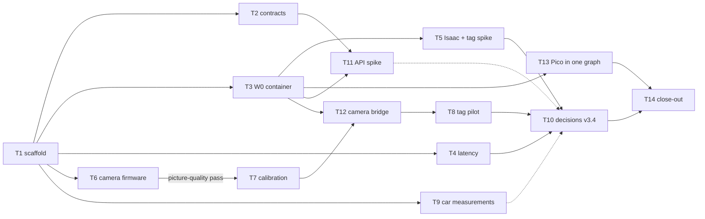

# M1 — Foundations and open decisions

Written 2026-10-05 for the BeaconMind course project (EN.665.715; sole participant **Xiaohui Chen**;
final deadline **2026-12-13**; ordered, undated). This file follows `plan/README.md` exactly: its
session protocol (§1), conventions (L1–L11), contracts (C0–C12), safety rules (S1–S12) and task
template (§4.3). **If this file contradicts `plan/README.md`, the README wins; if the README
contradicts `AGENT-DESIGN.md` v3.3, AGENT-DESIGN wins** — stop and report the conflict (README §1.4
item 8).

**Revised 2026-10-24** (README S11 and S13; `course-project/research/2026-10-24-car-firmware-lessons-and-pid.md`):
M1.T9's hand-turn encoder count (step 4) and its push-the-car roll-out are superseded by powered runs
(M3.T3, M3.T24, M3.T8), and M1.T13 now runs on the firmware the Pico carries (Assignment 7 Build J2 or J1,
or the project image after M3.T14). The changed passages say "Revised 2026-10-24".

**Revised 2026-10-29** (`research/2026-10-29-urdf-firmware-camera-status.md`): the image the docs name since 2026-10-25 is Build K2 (`buildK2_bd46b95f`), not J2. J2 is the one-flash fallback; J1 is the fallback the 2026-10-24 entry named for J2. The chip was not re-checked on 2026-10-29. M1.T13 uses that image and still does not reflash. M1.T6 stays in-progress. M1.T7 stays todo. M1.T9 stays blocked; its lens rows stay partial. New tasks: M1.T16 (current-car mass and power-bank box) and M1.T17 (capture size before calibration).

---

## 0. How to read this file (for the executor)

- Start every session with README §1.2 (read `course-project/CONTEXT.md`, then the README, then the
  task). Then read **§0.3 below** (shell shorthands) and **your task, in full**.
- Every step names the machine. "Mac" = `/Users/xiaohuichen/Projects/EN.665.715`. "Spark host" =
  `/home/xiaohui_chen/Projects/EN.665.715` on `spark-2a60`. "Spark container beaconmind-ros" = the
  container M1.T3 builds. "Xiaohui (bench)" = a physical action only Xiaohui may do (S1): write the
  instruction with its **What / Why / Measure / Pass**, then wait for their report.
- Every fact this file could not verify is a **verification step** with a branch for each outcome.
  Never skip a verification step because "it is probably fine".
- Every value marked **DV** or **proposed default** may only be changed through M1.T10 with Xiaohui's
  approval (README §1.4 item 6).
- **Never invent output.** If a command cannot be run, write "not executed — run on the Spark with
  `<command>`" in the evidence file, the status table and `CONTEXT.md` (README §1.3).

### 0.1 Facts verified while this file was written (2026-10-05, 23:30–23:50 CDT, read-only)

These were checked by Claude Opus 5.5 with read-only commands. Re-check any of them that a task
depends on (the task's Prerequisites table says how), because the machine may have changed.

| Fact | How it was checked | Result |
| --- | --- | --- |
| Host C compiler on the Spark | `cc --version; make --version` (Spark host) | `cc (Ubuntu 11.5.0-1ubuntu1~24.04.1) 11.5.0`, `GNU Make 4.3`, `/usr/bin/cmake` present. Resolves README §9.1 "host C compiler" (M1.T1 re-checks) |
| ESP32 / Pico flashing tools on the Spark host | `command -v esptool esptool.py arduino-cli idf.py picotool` | all **absent** |
| Docker images on the Spark | `docker images` | present: `ollama-ros2:latest` (the `rosa-ros2` image), `pico-microros-builder:latest`, `microros/micro-ros-agent:humble`, `python:3.12-bookworm`, `ubuntu:24.04`, `vllm-node-qwen35:latest`. **No `ros:humble-*` image** is pulled yet |
| Containers | `docker ps -a` | `rosa-ros2` and `vllm-rosa` **Exited (137)** ~42 h earlier; no `pico-micro-ros-agent`; no `beaconmind-ros` |
| `vllm-rosa` arguments | `docker inspect vllm-rosa --format '{{json .Args}}'` | `--max-model-len 131072 --max-num-seqs 4 --max-num-batched-tokens 4096 --gpu-memory-utilization 0.60 --kv-cache-dtype fp8 --enable-auto-tool-choice --tool-call-parser qwen3_coder --reasoning-parser qwen3 --enable-prefix-caching --port 8000 --host 127.0.0.1` |
| Docker Compose version | `docker compose version` | `v5.0.2` (supports `env_file` with `required: false`) |
| Spark user | `id -u; id -g; id -nG` | uid 1000, gid 1000; groups include `dialout plugdev docker adm` |
| Spark host Python packages (system `python3` 3.12.3) | `python3 -m pip list`, `python3 -c "import cv2…"` | `openai 2.21.0`, `anthropic 0.79.0`, `jsonschema 4.26.0`, `scipy 1.17.0`, `matplotlib 3.10.8`, `pyserial 3.5`, `pytest 7.4.4`, `numpy 2.3.5`, `cv2 4.13.0` **with `cv2.aruco`**. Not installed: `gtsam`, `evo`, `statsmodels` |
| Venvs | `ls ~/.venvs` | only `cad-viewer`; `python3 -m venv` works (`ensurepip` importable) |
| `tmux` | `tmux -V` | `tmux 3.4` |
| Isaac Sim build | `cat ~/IsaacSim/_build/linux-aarch64/release/VERSION` | `5.1.0-rc.19+main.0.aa503a9b.local` |
| Isaac asset root | `grep` of `exts/*/config/extension.toml` | default `https://omniverse-content-production.s3-us-west-2.amazonaws.com/Assets/Isaac/5.1` |
| AprilTag material on the asset server | `curl -I` from the Mac | HTTP 200 for `Isaac/Materials/AprilTag/AprilTag.mdl` and `Isaac/Materials/AprilTag/Textures/tag36h11.png` under **both** `…/Assets/Isaac/5.1/` and `…/Assets/Isaac/6.0/`. No file named `*apriltag*` exists inside the local build or `~/.cache/ov` (3.4 GB): the material is fetched from the asset server at run time. **Rendering and decoding are not verified** (M1.T5) |
| Isaac Sim 6.0 | research note `research/…/topic5-benchmark-and-sim.md` line 93 | GA announced 2026-06-08; release tag `v6.0.1` exists on GitHub. **Not installed on the Spark**; aarch64 build untested |
| `gtsam` wheels | PyPI JSON `https://pypi.org/pypi/gtsam/json` (from the Mac) | `4.3.0` has aarch64 wheels for cp311, **cp312** (`manylinux_2_27/2_28`), cp313, cp314; **none for cp310** → GTSAM cannot run in the Humble container; it runs in the Spark host venv (AGENT-DESIGN "B1 (GTSAM)"). Install not yet tried (M1.T1) |
| `evo`, `openai`, `anthropic`, `jsonschema` | PyPI JSON | latest `evo 1.37.1`, `openai 3.24.0`, `anthropic 1.11.0`, `jsonschema 4.26.0`; each `requires_python >=3.10`. Install on 3.10 aarch64 not yet tried (M1.T3) |
| Pico diagnostic firmware | `ls -la …/assignment5/diagnostics/pintest/build/*.uf2` | `pintest.uf2` (62,976 B, 2026-10-01 16:18) and the tilt image `pico2w_led.uf2` (808,448 B, 2026-10-01 14:36) both exist on the Spark mirror |
| USB devices | `ls /dev/ttyACM* /dev/ttyUSB*` | none (no Pico, no camera plugged in) |
| **Spark mirror is partial** | `ls` on the Spark | `~/Projects/EN.665.715/course-project/` lacks `research/`, `AGENT-DESIGN.md`, `plan/`; `assignments/assignment4/` holds only `module4-pico2w` (no `system-prompt/`). The Module 4 smoke tests ran from `~/a4-smoke/`. **Every task that needs a file on the Spark syncs it first** (M1.T1 writes the sync script) |
| Reference numbers and firmware strings (review, 2026-10-06, Mac, read-only) | ran the M1.T2 example recipes against `l2_geometry.py`; read `pintest.c`, `spark-flash.sh`, `smoke_test.py` | the Example 1 and 3 recipes reproduce `fewshot-numbers.json` exactly; pintest replies `OK all low` and `counters edges: GP16=… GP17=… GP18=… GP19=…` and prints a `PINTEST mode=…` banner every 2 s; `spark-flash.sh` takes `UF2=` and prints `flashed: Pico is running again on <port>`; `smoke_test.py` CLI is `<print-output.txt> <out.jsonl> [K] [thinking 0\|1] [scenario prefix]`, records carry `seconds`, `check.all_pass`, `turns[].usage`, scenarios `S1_duplicate_new`, `S2_refuse_request`, `S3_third_id_rejected`, `S4_refuse_in_explore`. Encoders are powered from the Pico 3V3 rail (`wiring-plan.md`), so they count on USB power alone |
| Claude API facts used in M1.T11 | Claude Code `claude-api` skill (cached 2026-09-25) | model ID `claude-opus-5-5`; $4 / $20 per million input / output tokens, cache reads $0.20; thinking cannot be disabled (effort is the control, default `medium`); forced `tool_choice` `any`/`tool` returns HTTP 400; thinking blocks must be passed back unchanged within a tool loop; `client.models.list()` lists models. **M1.T11 re-checks all of these against the live documentation before spending** |

### 0.2 Prerequisites from other milestones

M1 needs only **M0 (done, README §2)**. No task in M1 waits on M2–M6.

### 0.3 Shell shorthands used in this file (type them out in full; shell state does not persist)

| Shorthand | Meaning |
| --- | --- |
| `REPO_MAC` | `/Users/xiaohuichen/Projects/EN.665.715` |
| `REPO_SPARK` | `/home/xiaohui_chen/Projects/EN.665.715` (on the Spark, also `$HOME/Projects/EN.665.715`) |
| `SPARK` | `ssh -o ConnectTimeout=15 -o BatchMode=yes xiaohui_chen@spark-2a60` |
| "run on the Spark host" | write the commands to a script in your scratch directory, then `SPARK 'bash -s' < script.sh`; for anything longer than 10 minutes or interactive, run it inside `tmux` session `bm` on the Spark (`tmux new -A -s bm`) |
| "run in beaconmind-ros" | on the Spark host: `docker exec beaconmind-ros bash -lc 'source /opt/ros/humble/setup.bash && <command>'` (interactive: `docker exec -it beaconmind-ros bash -l`). After M1.T3 has built the workspace, also `source /workspace/course-project/ros2_ws/install/setup.bash` |
| "start in the background in beaconmind-ros" (for `ros2 launch`, publishers and anything else that runs until stopped) | `docker exec -d beaconmind-ros bash -lc 'source /opt/ros/humble/setup.bash && source /workspace/course-project/ros2_ws/install/setup.bash && exec <command> > /workspace/course-project/data/<name>.log 2>&1'`. Check it started: `docker exec beaconmind-ros pgrep -af '<unique word of the command>'`. Stop it: `docker exec beaconmind-ros pkill -INT -f '<unique word>'` (run `pkill` directly, **not** inside `bash -lc`, so it cannot match its own shell). Read its log from the Spark host at `~/Projects/EN.665.715/course-project/data/<name>.log` |
| "run detached on the Spark host" (anything longer than 10 minutes) | write the commands into a script, then `tmux new-session -d -s <name> "bash <script> > <log> 2>&1"`; poll with `tmux has-session -t <name> 2>/dev/null && echo running \|\| echo finished` and `tail -5 <log>` every 5–10 minutes. Never attach interactively from a non-interactive ssh |
| Commands that wait for Xiaohui | never use a script that waits for a key press. Run one non-interactive command per physical action: tell Xiaohui what to do, **wait for their reply in the chat**, then run the next command |
| `EV` | the task's evidence folder: Mac `/Users/xiaohuichen/Projects/EN.665.715/course-project/evidence/M1/<task-id>/`; Spark host `~/Projects/EN.665.715/course-project/evidence/M1/<task-id>/`; inside beaconmind-ros `/workspace/course-project/evidence/M1/<task-id>/`. Create it with `mkdir -p` on the machine that writes into it |
| Task-status checks ("status table", or `grep -E "^\| M1.T<k> "` in a Prerequisites row) | once `course-project/tools/task_status.py` exists (M1.T1 step 6; source in README L12), use `python3 course-project/tools/task_status.py <ID> [<ID> …]` (Mac) instead: it prints `<ID> <status>` from the status-table row only. Before it exists, read the status column of §1.1 by eye |
| `\|` inside a table cell | a Markdown escape for the pipe character. When you copy a command out of a table, **drop the backslash** (for example `pgrep -af "kit/kit\|python.sh"` is typed with a plain pipe between `kit/kit` and `python.sh`) |

---

## 1. Milestone summary

**Goal.** Lay every foundation the simulated result (M2) and the real car (M3) stand on, and settle
the design choices that are still open, so that later milestones build on measured facts instead of
guesses.

**Entry criteria.** M0 done (README §2). Nothing else.

**Exit criteria** (README §3.1, expanded; the milestone is done when every item holds and its
evidence is saved):

1. **One ROS 2 graph proven:** the `beaconmind-ros` Humble container exists; inside it, an
   `apriltag_ros` node, an Isaac Sim bridge topic and the Pico's micro-ROS node are all visible in
   one graph (M1.T3, M1.T13).
2. **Camera ready** (exit criterion, not the state on 2026-10-29): the ESP32-CAM stands upright on a rigid bracket, runs project JPEG firmware,
   and has passed the M1.T6 step 14 forward-view picture-quality check (`verdict: pass`) before
   calibration. It is bridged to ROS 2 with timestamps, is calibrated (`configs/camera.json`), and
   has a measured tag noise model (`configs/detector_noise.json`) (M1.T6, M1.T7, M1.T12, M1.T8).
   On 2026-10-29 none of M1.T7, M1.T8, or M1.T12 is done. `camera.json` does not exist.
3. **Car measured:** `configs/car.json` holds measured wheel diameters, track width, overhangs,
   sweep radius, lens and IMU mounts and mass (M1.T9). **Revised 2026-10-24:** encoder counts per wheel
   revolution are no longer an M1 exit item. Nobody turns or rolls the wheels by hand (README S13), so
   M3.T3 measures them with powered stand runs and M3.T24 checks them on the floor against the IMU.
4. **LLM latency re-measured without queueing:** p50/p95 per decision for Qwen3.5-35B-A3B thinking
   on and off, and the closed-loop model setting chosen against the 60 s p95 gate (M1.T4).
5. **Isaac version chosen** (OD7), and an AprilTag rendered by Isaac is decoded by the detector
   (M1.T5).
6. **Contracts as code:** JSON Schemas C0–C11, `configs/dv.json`, and `beaconmind.geometry` with
   tests passing on the Mac, the Spark host (3.12) and the container (3.10) (M1.T1, M1.T2).
7. **Frontier APIs proven:** one tool call per provider family, budget guard proven, spend ≤ $5
   (M1.T11).
8. **Open decisions settled:** OD1–OD5, OD7, OD8, OD11, OD12, OD14, the API budget and data
   governance approved by Xiaohui and recorded in `AGENT-DESIGN.md` **v3.4**, which also documents
   the Module 4 MCP servers (M1.T10).
9. **`CONTEXT.md` refreshed** and the milestone integration smoke test passed (M1.T14).

**What M1 unlocks** (README §3.3):

| M1 task | Unlocks |
| --- | --- |
| M1.T2 | M2.T1, M2.T2 (and through them the whole core library, worlds and kinsim) |
| M1.T3 | M2.T4 and the Isaac track; M3.T2, M3.T9, M3.T11, M3.T13 |
| M1.T5 | M2.T15 (Isaac arena; tag method) |
| M1.T7, M1.T9, M1.T16 | M2.T4 (URDF), M2.T16 (Isaac car); M1.T9 also M3.T4, M3.T8, M3.T10. M1.T16 is the mass, two-scale split and bank box (2026-10-29); M2.T4 waits on those rows |
| M1.T17 | M1.T7 (capture size must be chosen before calibration starts) |
| M1.T8 | M2.T6 (sim perception and noise injection), M2.T11 (non-placeholder logs), M3.T16 |
| M1.T11 (or the OD18 waiver) | M2.T7 (harness); M1.T11 itself for M2.T18 (frontier providers), M4.T2, M3.T18 |
| M1.T6 | M3.T7 (latency with the camera streaming) |
| M1.T12, M1.T13 | M3.T9, M3.T16 (camera bridge); M3.T2 and later (Pico in the project graph) |
| M1.T4 | M2.T7 closed-loop setting, M4.T2, M6.T2 (OD8) |
| M1.T10 | M4.T3 (OD1), M5.T3 (Experiments section), M6.T2 (OD14), and through them M4.T1 |
(Consolidated in README §3.3, 2026-10-06.)

### 1.1 Status table

| Task | Title | Status | Effort | Evidence | Last updated | Notes |
| --- | --- | --- | --- | --- | --- | --- |
| M1.T1 | Project scaffolding (layout, package skeleton, `.gitignore`, sync scripts, pytest, venvs) | done | S | `evidence/M1/M1.T1/` | 2026-10-06 | |
| M1.T2 | Contracts as code: `dv.json`, geometry port, JSON Schemas C0–C11 | done | M | `evidence/M1/M1.T2/` | 2026-10-06 | Part A done. 3.10 passed 2026-10-07 |
| M1.T3 | W0: build `beaconmind-ros` (Humble); packages; Isaac bridge topic + `apriltag_ros` in one graph | done | M | `evidence/M1/M1.T3/` | 2026-10-06 | Pico part is M1.T13; tag frame `tag36h11:3` |
| M1.T4 | LLM latency re-measured without queueing; closed-loop model setting (OD8) | done | S | `evidence/M1/M1.T4/` | 2026-10-06 | pinned by Xiaohui 2026-10-06: Qwen3.8-Flash-Next thinking on |
| M1.T5 | Isaac Sim version decision (OD7) + AprilTag render/decode spike + kit-lifetime check | done | M | `evidence/M1/M1.T5/` | 2026-10-07 | OD7 approved 2026-10-07: Isaac Sim 5.1.0-rc.19 |
| M1.T6 | Camera: stand upright, flashing toolchain, project JPEG firmware, HTTP capture proven | in-progress | M | `evidence/M1/M1.T6/` | 2026-10-29 | **2026-10-29:** floor pictures that passed were bm_cam-0.1 on 2026-10-07, UXGA, hmirror 0, USB out, 192.168.4.24. That address is gone. The image in the docs now is bm_cam-0.2 at 192.168.5.49, VGA boot, saved hmirror 1 (2026-10-25). Still open: level reading, h/d photo, named step-13 files (`overnight-gaps.md`). Desk UXGA timing misses ≥ 3 frames/s |
| M1.T7 | Camera calibration (checkerboard), HFOV/VFOV, camera-to-base extrinsics | todo | S | `evidence/M1/M1.T7/` | 2026-10-29 | Not done. **2026-10-29:** Module 8's vision demo and bm_cam-0.2 are not this task. No `camera.json`, checkerboard, distortion, or RMS. Do not start until M1.T17 names the capture size. The 1600×1200 sentences below stay until that choice |
| M1.T8 | Tag pilot: range/bearing error vs distance and angle; `configs/detector_noise.json` | todo | M | `evidence/M1/M1.T8/` | 2026-10-05 | Xiaohui at the bench |
| M1.T9 | Car measurements [encoder counts moved to M3.T3, S13]; `configs/car.json` | blocked | S | `evidence/M1/M1.T9/` | 2026-10-29 | Blocked on Xiaohui (README §1.4 items 1, 8). `car.json` written from his 2026-10-10 readings (Module 6 lab) and valid (`bm.car/1` OK); `tools/car_measurements_template.csv` written. Not done: one reading per quantity (not 3), no roll-out (direct 67 mm diameter in `wheel_diameter_m`), encoder counts postponed (Pico), `car-top/side` and `imu-orientation` photos and `imu_axes` missing; for Xiaohui to accept or redo: single readings, the direct diameter, the encoder postponement, `chassis_*` = main body not whole car (deviation 7), corners/sweep radius assume the ESP32-CAM and plate strip centred (deviation 8) (`README.md`). **Revised 2026-10-24:** the encoder postponement and the missing roll-out are no longer for Xiaohui to accept or redo. No wheel is turned or rolled by hand (README S13), so step 4 and the roll-out are superseded. Counts per turn and signs come from M3.T3 (powered stand runs, filmed tyre flag) and M3.T24 (floor check against the IMU), and the driven scale from M3.T8. The direct diameter stays. **2026-10-29:** lens rows stay partial (one reading each: x 0.12 m, y 0.0 m, z 0.075 m above the floor). The power-bank mass and box are M1.T16, not this task. Status stays blocked |
| M1.T10 | Settle the open decisions with Xiaohui; AGENT-DESIGN v3.4 incl. MCP servers | todo | S | `evidence/M1/M1.T10/` | 2026-10-05 | |
| M1.T11 | Frontier API spike: keys, one tool call per provider, budget guard (≤ $5) | in-progress | S | `evidence/M1/M1.T11/` | 2026-10-07 | Quality K=1, $5 cap lifted for that run. Budget guard never demonstrated; other acceptance files missing (`overnight-gaps.md`). Opus K=5 vs Qwen thinking-on stamp 20261006-212041: n=20, p50 18.8 s, p95 21.8 s, max 22.2 s, n_all_pass 20/20, mean tool calls 5.75, n_errors 0 (`opus20-comparison.md`). Not done. |
| M1.T12 | Camera ROS 2 bridge `bm_camera_bridge` + rectify + `apriltag_ros` launch | todo | S | `evidence/M1/M1.T12/` | 2026-10-05 | Appended task (W2 bridge) |
| M1.T13 | One-graph proof with the live Pico node (W0 close) | todo | S | `evidence/M1/M1.T13/` | 2026-10-29 | Not done. **Revised 2026-10-29:** runs on the image the docs name, Build K2 (`buildK2_bd46b95f`, node `/pico_fusion`), and never reflashes. One-flash fallback is J2 (`buildJ2_b4298742`); J1 (`buildJ1_9849874a`) is the fallback the 2026-10-24 entry named for J2. The chip was not re-checked on 2026-10-29: confirm it before the session. `/bm_pico` only after M3.T14. Stop `m7-micro-ros-agent` and `m7-gazebo` first (UDP 8888). No Pico reboot after the agent starts unless the node is still absent at 30 s (S11) |
| M1.T14 | M1 close-out: `CONTEXT.md` refresh + milestone integration smoke test | todo | S | `evidence/M1/M1.T14/` | 2026-10-05 | Appended task |
| M1.T15 | Two local closed-loop candidates after Qwen 3.5 was rejected | in-progress | M | `evidence/M1/M1.T15/` | 2026-10-06 | Qwen3.8-Flash-Next pinned; Bonsai research-only; OD8 pin recorded 2026-10-06 |
| M1.T16 | Current-car mass, two-scale split, and power-bank box | in-progress | S | `evidence/M1/M1.T16/` | 2026-10-29 | New scope after the 2026-10-10 weighing. Blocks M2.T4's mass update. Does not duplicate M1.T9. 2026-10-29: mass 660 g, split 58 / 602 g, bank box, rear cable 148 mm, ride height unchanged (`measurements.md`, `confirm.md`). 2026-10-29 23:45 CDT: front camera cable 40 mm past the old 138 mm point (178 mm); Xiaohui chose to keep both cables and enlarge the footprint. M2.T4 applied the mass, split, bank and footprint rows to `car.json` and the URDF the same night. Open: bank alone (not detached; Xiaohui declined), and the cables' sideways position and width (the sweep radius assumes them). Whether M1.T16 can close without the bank-alone row is Xiaohui's call |
| M1.T17 | Settle the camera capture size before calibration | todo | S | `evidence/M1/M1.T17/` | 2026-10-29 | Decision task, not a second calibration. M1.T7 does not start until this choice is dated. UXGA q10 versus VGA q12 is not chosen |

### 1.2 Task list with dependencies

| ID | Title | Depends on (must be `done`) | Effort | Machine(s) |
| --- | --- | --- | --- | --- |
| M1.T1 | Scaffolding | — | S | Mac, Spark host |
| M1.T2 | Contracts as code | M1.T1 | M | Mac (then Spark host + container for the 3.12/3.10 runs once M1.T3 exists) |
| M1.T3 | W0 container + packages + Isaac topic + `apriltag_ros` | M1.T1 | M | Spark host, Spark container beaconmind-ros |
| M1.T4 | LLM latency | M1.T1 | S | Spark host, Spark container vllm-rosa |
| M1.T5 | Isaac version + AprilTag spike | M1.T3 | M | Spark host (Isaac), Spark container beaconmind-ros |
| M1.T6 | Camera mount + firmware | M1.T1 | M | Xiaohui (bench), Spark host, ESP32-CAM |
| M1.T7 | Calibration + extrinsics | M1.T6 (step 14 picture-quality `verdict: pass`); M1.T17 (dated capture size) | S | Xiaohui (bench), Spark host |
| M1.T12 | Camera ROS bridge + perception launch | M1.T3, M1.T7 | S | Spark container beaconmind-ros |
| M1.T8 | Tag pilot + noise model | M1.T12 (hence T3, T6, T7) | M | Xiaohui (bench), Spark container beaconmind-ros, Spark host |
| M1.T9 | Car measurements | M1.T1 (M1.T2 for schema validation; M1.T7 for lens values if available) | S | Xiaohui (bench), Spark host (Revised 2026-10-24: no Pico, because step 4 is superseded) |
| M1.T11 | Frontier API spike | M1.T2, M1.T3 | S | Spark container beaconmind-ros |
| M1.T13 | One graph with the live Pico | M1.T3 | S | Xiaohui (bench), Spark host, Spark container beaconmind-ros, Pico |
| M1.T10 | Decisions + AGENT-DESIGN v3.4 | M1.T4, M1.T5, M1.T8 (uses M1.T9, M1.T11 results if done; otherwise records them as pending) | S | Mac |
| M1.T14 | Close-out | all of M1.T1–T13 | S | Mac, Spark host, Spark container beaconmind-ros |
| M1.T15 | Local closed-loop candidates | M1.T1 | M | Spark host |
| M1.T16 | Current-car mass, two-scale split, bank box | M1.T1 | S | Xiaohui (bench), Mac |
| M1.T17 | Capture-size decision | M1.T6 far enough that HTTP capture works (task need not be `done`) | S | Xiaohui (floor spot), Spark host |

### 1.3 Suggested execution order (parallel groups)

The camera chain is on the critical path (README §3.4) and needs Xiaohui at the bench, so start it
early. Tasks in the same group can run in any order or in parallel sessions.

1. **Group A (first, no hardware):** M1.T1.
2. **Group B (after T1; any order):** M1.T2 · M1.T3 · M1.T4 · **M1.T6 (start the camera chain now)** ·
   M1.T9.
3. **Group C (after their prerequisites):** M1.T5 (after T3) · M1.T7 (after T6 step 14
   picture-quality `verdict: pass`) · M1.T11 (after T2 + T3) · M1.T13 (after T3).
4. **Group D:** M1.T12 (after T3 + T7) → M1.T8 (after T12).
5. **Group E:** M1.T10 (after T4, T5, T8; ideally also T9, T11).
6. **Group F (last):** M1.T14.

Bench sessions can be batched to save Xiaohui's time: M1.T6 steps 1–4 (mount) and M1.T9 (car
measurements) can happen in one sitting, because both need the car on the floor with the battery
off.



---

## 2. Tasks

The tasks appear in the suggested execution order of §1.3, not in ID order (M1.T12 comes before
M1.T8 because the pilot needs the bridge). IDs never change (README §3.2).

### M1.T1 — Project scaffolding: layout, package skeleton, `.gitignore`, sync scripts, pytest, venvs

**Why.** Every later task writes into one layout (README L1) and runs one test command (L4) on three
Pythons (L3). This task creates the empty skeleton, the two venvs, the Mac↔Spark sync scripts (L6)
and the `.gitignore` lines that keep data, keys and Wi-Fi credentials out of git (L1, L9). It also
answers two README §9.1 questions: whether `gtsam` 4.3.0 installs into a cp312 aarch64 venv, and
whether the Spark host has a C compiler.

**Prerequisites.**

| Prerequisite | Kind | Check command (machine) | Expected result |
| --- | --- | --- | --- |
| M0 done | task | `grep -n "M0 — course fit (DONE" course-project/plan/README.md` (Mac) | one line |
| Spark reachable | service | `ssh -o ConnectTimeout=15 -o BatchMode=yes xiaohui_chen@spark-2a60 'hostname'` (Mac) | `spark-2a60` |
| Python on the Mac | tool | `python3 --version` (Mac) | `Python 3.13.x` (3.13.7 on 2026-10-05) |
| Python and venv on the Spark | tool | `SPARK 'python3 --version && python3 -c "import ensurepip" && echo venv-ok'` | `Python 3.12.3` and `venv-ok` |
| Nothing already scaffolded | state | `ls course-project/beaconmind 2>&1` (Mac) | `No such file or directory` (if it exists, read it and continue only with the missing pieces) |

**Inputs.** `plan/README.md` §5 L1–L4, L6, L9–L11 (in full); root `.gitignore` (in full); AGENTS.md
§3 (".gitkeep" rule) and §7.4 gotcha 4 (no rsync).

**Steps.**

1. **Mac — create the folder skeleton** (README L1). From `REPO_MAC`:
   ```bash
   cd /Users/xiaohuichen/Projects/EN.665.715/course-project
   mkdir -p beaconmind/src/beaconmind/{schemas,envs,harness/providers,baselines,metrics} beaconmind/tests/fixtures \
     ros2_ws/src firmware/pico/beaconmind_fw/logic firmware/pico/tests firmware/esp32cam sim/isaac docker \
     configs/arenas tools evidence/M1 preregistration presentation
   for d in ros2_ws/src firmware/pico/beaconmind_fw/logic firmware/pico/tests firmware/esp32cam sim/isaac \
            docker configs/arenas preregistration presentation; do touch "$d/.gitkeep"; done
   ```
   Do **not** create `course-project/data/` on the Mac (it lives on the Spark; L8). Do not create any
   folder named `log/` (L1).
2. **Mac — write `beaconmind/pyproject.toml`** with exactly these sections (versions are lower bounds
   now; step 9 pins them):
   ```toml
   [build-system]
   requires = ["setuptools>=64"]
   build-backend = "setuptools.build_meta"

   [project]
   name = "beaconmind"
   version = "0.1.0"
   description = "BeaconMind: an LLM owns landmark SLAM (EN.665.715 course project, Xiaohui Chen)"
   requires-python = ">=3.10"
   dependencies = []

   [project.optional-dependencies]
   dev = ["pytest>=7.4", "jsonschema>=4.17"]
   providers = ["openai>=2.0", "anthropic>=0.79"]
   b1 = ["gtsam==4.3.0"]
   metrics = ["numpy>=1.26", "scipy>=1.11", "statsmodels>=0.14", "evo>=1.30", "matplotlib>=3.8"]

   [tool.setuptools.packages.find]
   where = ["src"]

   [tool.setuptools.package-data]
   beaconmind = ["schemas/*.json"]

   [tool.pytest.ini_options]
   testpaths = ["tests"]
   addopts = "-m 'not llm and not isaac and not hardware and not gtsam'"
   markers = [
     "llm: needs the vLLM server or a frontier API (run on the Spark)",
     "isaac: needs Isaac Sim (run on the Spark host)",
     "hardware: needs the car, the Pico or the camera",
     "gtsam: needs gtsam (Spark host venv only)",
   ]
   ```
   Put the AI-disclosure line (L11) as a TOML comment on line 1.
3. **Mac — write the package files.**
   - `beaconmind/src/beaconmind/__init__.py`: module docstring (one paragraph on what the package is,
     then the L11 disclosure line); `__version__ = "0.1.0"`; and
     ```python
     from pathlib import Path
     import os

     def course_root() -> Path:
         """course-project/ folder: $BM_COURSE_ROOT if set, else the first parent of this file that
         contains configs/ and plan/ (works for the Mac checkout, the Spark mirror and /workspace)."""
     ```
     Implement `course_root()` with that rule; raise `FileNotFoundError` with a clear message if no
     such parent exists and the variable is unset.
   - Empty `__init__.py` (docstring + disclosure only) in `schemas/`, `envs/`, `harness/`,
     `harness/providers/`, `baselines/`, `metrics/`.
   - `beaconmind/tests/conftest.py`: fixtures `course_root` (returns `beaconmind.course_root()`) and
     `repo_root` (its parent).
4. **Mac — write `beaconmind/tests/test_scaffold.py`** with the five tests listed under **Tests**.
5. **Mac — append to the root `.gitignore`** (README L1 lists the first five lines; the last two are
   appended by this task because step 9's editable install and pytest create them):
   ```
   # Course project (plan/README.md L1, L9): Spark-only data, secrets, build and render outputs
   course-project/data/
   course-project/**/wifi_config.h
   course-project/**/secrets*.env
   course-project/firmware/**/build/
   course-project/sim/isaac/_out/
   course-project/**/*.egg-info/
   course-project/**/.pytest_cache/
   ```
6. **Mac — write the three tool scripts** (bash, `set -euo pipefail`, L11 disclosure comment at the
   top, `chmod +x`):
   - `course-project/tools/sync_to_spark.sh`: the README L6 Mac→Spark command, run from
     `REPO_MAC`, with two extra excludes, `--exclude '*.egg-info' --exclude .pytest_cache` (the Mac's
     editable-install metadata must not overwrite the Spark venv's; a safe superset of L6), followed by
     `echo "synced course-project to spark-2a60"`. Accept optional extra repo-relative paths as
     arguments and add them to the `tar` list (so a task can sync, for example,
     `assignments/assignment4/system-prompt/tools`). Before syncing it prints a reminder line:
     `remember: pull Spark-side evidence first (pull_evidence.sh), or it is kept but never updated`.
   - `course-project/tools/pull_evidence.sh M<n> M<n>.T<k>`: exactly the README L6 Spark→Mac command
     for `course-project/evidence/<M>/<task>`; exit 2 with a usage line if an argument is missing.
   - `course-project/tools/env_check.sh` (runs **on the Spark host**): prints, each under a `== name`
     header: `date`; `python3 --version`; `~/.venvs/beaconmind/bin/python --version` (or "no venv");
     `cc --version | head -1`; `docker compose version`; `docker ps -a --format '{{.Names}} {{.Status}}'`;
     `curl -sf http://127.0.0.1:8000/v1/models` (or "vLLM not serving"); `ls /dev/ttyACM* /dev/ttyUSB*`
     (or "no serial devices"); `ip -4 addr show | grep 192.168.5.1` (or "192.168.5.1 not present").
   - `course-project/tools/task_status.py` (Python, stdlib only): **exactly** the source in README
     convention L12 (the plan-wide task-status helper every milestone uses; if M5.T8 already created it,
     compare it with L12 using `diff` and keep it if identical). Check (Mac):
     `python3 course-project/tools/task_status.py M1.T1 M9.T1; echo "exit $?"` → `M1.T1 in-progress`
     (or the current status), `M9.T1 NO-FILE`, `exit 2`. Save the output to `EV/task-status-check.txt`.
7. **Mac — create the Mac venv and run the tests:**
   ```bash
   cd /Users/xiaohuichen/Projects/EN.665.715
   python3 -m venv course-project/.venv
   course-project/.venv/bin/pip install -e "course-project/beaconmind[dev]"
   mkdir -p course-project/evidence/M1/M1.T1
   (cd course-project/beaconmind && ../.venv/bin/python -m pytest -q) 2>&1 | tee course-project/evidence/M1/M1.T1/pytest-mac.txt
   (python3 --version; course-project/.venv/bin/pip freeze) > course-project/evidence/M1/M1.T1/env-mac.txt
   ```
   Expected last line of `pytest-mac.txt`: `5 passed in …`. If not, fix the code (two attempts), then
   stop and ask (§1.4 item 4).
8. **Mac → Spark — sync:** `bash course-project/tools/sync_to_spark.sh`. Then **Spark host**:
   `mkdir -p ~/Projects/EN.665.715/course-project/data/{obslogs,runs,worlds,bags,frames,renders,latency,print,pilot,api_spike} ~/Projects/EN.665.715/course-project/evidence/M1/M1.T1`.
9. **Spark host — create the venv and install every host extra** (L3; use `$HOME`, not `~`, inside
   quotes):
   ```bash
   python3 -m venv ~/.venvs/beaconmind
   ~/.venvs/beaconmind/bin/pip install --upgrade pip
   ~/.venvs/beaconmind/bin/pip install -e "$HOME/Projects/EN.665.715/course-project/beaconmind[dev,b1,metrics]" 2>&1 | tail -20
   ~/.venvs/beaconmind/bin/python -c "import gtsam, evo, numpy, scipy, statsmodels, matplotlib, jsonschema, pytest; print('gtsam', gtsam.__version__ if hasattr(gtsam,'__version__') else 'imported')"
   ~/.venvs/beaconmind/bin/pip freeze > ~/Projects/EN.665.715/course-project/evidence/M1/M1.T1/pip-freeze-spark.txt
   ```
   **Verification (README §9.1: gtsam cp312 aarch64).**
   - If the install and the import succeed → continue at step 10.
   - If `pip` reports "No matching distribution found for gtsam==4.3.0" → stop and ask (§1.4 item 3).
     Report the exact pip output. (PyPI listed a cp312 aarch64 wheel on 2026-10-05, so this would be a
     contradiction.)
   - If only `evo` or `statsmodels` fails → record the error, remove that package from the `metrics`
     extra *in your notes only* (do not edit the extra), and stop and ask.
10. **Spark host — run the tests and the C-compiler check:**
    ```bash
    E=~/Projects/EN.665.715/course-project/evidence/M1/M1.T1
    (cd ~/Projects/EN.665.715/course-project/beaconmind && ~/.venvs/beaconmind/bin/python -m pytest -q) 2>&1 | tee $E/pytest-spark.txt
    cc --version | head -1; make --version | head -1
    bash ~/Projects/EN.665.715/course-project/tools/env_check.sh 2>&1 | tee $E/env-spark.txt
    ```
    **Verification (README §9.1: host C compiler).** If `cc` prints a version → record "host compiler
    present; firmware logic tests run on the Spark host" in `CONTEXT.md`. If `cc: command not found`
    → record that the firmware logic tests must run inside `pico-microros-builder` (README L4) and
    tell Xiaohui; no stop needed.
11. **Mac — pin the versions.** Replace the lower bounds in `pyproject.toml` with `==` pins taken
    from `pip-freeze-spark.txt` for `pytest`, `jsonschema`, `gtsam`, `numpy`, `scipy`, `statsmodels`,
    `evo`, `matplotlib`. Leave `providers` as lower bounds (M1.T3 pins them from the container). Re-run
    step 7's `pip install -e` and the tests on the Mac. If a pinned version does not install on the
    Mac's 3.13 (only `dev` is installed there, so only `pytest`/`jsonschema` matter), keep the Spark pin
    and record the Mac's version in the evidence; do not loosen the pin silently — tell Xiaohui.
12. **Mac — check the `.gitignore` lines** (from `REPO_MAC`):
    ```bash
    { git check-ignore -v course-project/data/x course-project/firmware/esp32cam/bm_cam/wifi_config.h \
      course-project/x/secrets.env course-project/firmware/pico/beaconmind_fw/build/x \
      course-project/sim/isaac/_out/x course-project/beaconmind/src/beaconmind.egg-info/x
      git status --short course-project | head -40; } 2>&1 | tee course-project/evidence/M1/M1.T1/gitignore-check.txt
    ```
    Expected: six lines of the form `.gitignore:<line>:<pattern>	<path>`, one per path. A path with no
    line means its rule is missing: fix `.gitignore` and rerun.
13. **Pull evidence** created on the Spark: `bash course-project/tools/pull_evidence.sh M1 M1.T1`.
14. Update the status table and `CONTEXT.md` (README §1.2 step 9). Say in `CONTEXT.md` that the
    Spark mirror is now synced with `course-project/tools/sync_to_spark.sh`.

**Deliverables.**
- Root `.gitignore` (7 lines appended).
- `course-project/beaconmind/pyproject.toml`; `course-project/beaconmind/src/beaconmind/__init__.py`;
  `…/schemas/__init__.py`, `…/envs/__init__.py`, `…/harness/__init__.py`,
  `…/harness/providers/__init__.py`, `…/baselines/__init__.py`, `…/metrics/__init__.py`.
- `course-project/beaconmind/tests/conftest.py`, `course-project/beaconmind/tests/test_scaffold.py`.
- `course-project/tools/sync_to_spark.sh`, `pull_evidence.sh`, `env_check.sh`, `task_status.py` (README L12).
- The `.gitkeep` files of step 1.
- Mac venv `course-project/.venv` (git-ignored); Spark venv `~/.venvs/beaconmind`; Spark folder
  `course-project/data/…` (git-ignored).

**Tests.**
- Unit tests, `course-project/beaconmind/tests/test_scaffold.py`:
  - `test_package_version` — `beaconmind.__version__ == "0.1.0"`.
  - `test_python_is_supported` — `sys.version_info >= (3, 10)`.
  - `test_markers_registered(pytestconfig)` — the names parsed from `pytestconfig.getini("markers")`
    include `llm`, `isaac`, `hardware`, `gtsam`.
  - `test_layout_folders_exist(course_root)` — each of `beaconmind/src/beaconmind`, `ros2_ws/src`,
    `firmware/pico/beaconmind_fw/logic`, `firmware/pico/tests`, `firmware/esp32cam`, `sim/isaac`,
    `docker`, `configs/arenas`, `tools`, `evidence`, `preregistration`, `presentation` exists under
    `course_root`.
  - `test_no_folder_named_log(course_root)` — `os.walk(course_root)` (prune `.venv`, `data`,
    `node_modules` and `ros2_ws` from the walk) finds no directory named `log` (colcon's own
    `ros2_ws/log/` is allowed; `data/` is git-ignored and can be large).
  - Command (Mac): `cd course-project/beaconmind && ../.venv/bin/python -m pytest -q` → expected last
    line `5 passed in …`.
  - Command (Spark host): `cd ~/Projects/EN.665.715/course-project/beaconmind &&
    ~/.venvs/beaconmind/bin/python -m pytest -q` → `5 passed in …`.
- Smoke tests: `bash course-project/tools/env_check.sh` on the Spark host prints every `== ` header
  with no `command not found`; `git check-ignore -v` (step 12) prints one matching rule per path.

**Acceptance criteria.**
- [ ] `pytest-mac.txt` and `pytest-spark.txt` both end with `5 passed`.
- [ ] `pip-freeze-spark.txt` lists `gtsam==4.3.0`, `evo==…`, `statsmodels==…`.
- [ ] `pyproject.toml` pins `dev`, `b1` and `metrics` with `==`.
- [ ] `gitignore-check.txt` shows a rule for each of the 6 test paths; `git status` shows no file under
      `course-project/data/` and no `.egg-info`.
- [ ] `env-spark.txt` shows the `cc` line (or the documented fallback).
- [ ] `CONTEXT.md` has a dated entry naming the venvs and the sync script.

**Evidence to save** (`course-project/evidence/M1/M1.T1/`): `pytest-mac.txt`, `pytest-spark.txt`
(real output), `pip-freeze-spark.txt`, `env-spark.txt` (output of `env_check.sh`), `env-mac.txt`
(`python3 --version; course-project/.venv/bin/pip freeze`), `gitignore-check.txt` (step 12 output).

**Pitfalls and known gotchas.**
- Never `rsync` to the Spark: it hangs under Tailscale SSH's check mode (AGENTS.md §7.4 gotcha 4).
  Use `sync_to_spark.sh`.
- `COPYFILE_DISABLE=1` must be set on the Mac side of `tar`, or `._*` files appear on the Spark.
- `~` inside double quotes is not expanded by pip; use `$HOME` (README L3).
- The global `.gitignore` already ignores `build/`, `install/`, `log/`: a data folder named `log/`
  would vanish from git silently (README L1).
- Files written on the Spark (the freeze file) are overwritten by the next Mac→Spark sync unless they
  are pulled first (README L6). Pull before the next sync.
- Host `pytest` is 7.4.4 (system); the venv installs its own. Always call the venv's Python.

**Stop-and-ask conditions.** `gtsam==4.3.0` does not install in the cp312 venv; the Spark mirror holds
a `course-project/beaconmind/` that differs from the Mac's (someone edited on the Spark) — do not
overwrite it, ask.

**Estimated effort.** S.

**AI-disclosure note.** Every new Python file ends its module docstring with
`AI-assisted: <your model> via <your tool>, <YYYY-MM-DD>: <what you wrote>.`; every shell script and
`pyproject.toml` carries the same line as a `#` comment at the top (L11). The `.gitignore` block gets
the comment line shown in step 5.

---

### M1.T2 — Contracts as code: `configs/dv.json`, `beaconmind.geometry` (port of `l2_geometry.py`), JSON Schemas C0–C11

**Why.** README §6 defines every data format once; this task turns those definitions into JSON
Schemas that code and tests can check (README §6 heading: "The machine-readable form of each contract
is the JSON Schema file named in its heading, which M1.T2 writes"). It also moves every design value
into `configs/dv.json` (C0, L7) and ports the reference geometry
(`assignments/assignment4/system-prompt/tools/l2_geometry.py`) into the project package so that
M2.T1's tools (C4) read DVs from one file. AGENT-DESIGN "Design values" and D5 are the sources.

The task has **two parts, one session each**. Part A: vendored reference + `dv.json` + geometry port +
tests. Part B: schemas + validator CLI + config schemas + tests. Write "Part A done" in the Notes
column after Part A; set `done` only after Part B.

**Prerequisites.**

| Prerequisite | Kind | Check command (machine) | Expected result |
| --- | --- | --- | --- |
| M1.T1 done | task | `grep -E "^\| M1.T1 " course-project/plan/M1-foundations.md` (Mac) | status `done` |
| Mac venv works | tool | `cd course-project/beaconmind && ../.venv/bin/python -m pytest -q` (Mac) | `5 passed` |
| Reference geometry unchanged since v3.3 | file | `shasum -a 256 assignments/assignment4/system-prompt/tools/l2_geometry.py assignments/assignment4/system-prompt/tools/fewshot_scenario.py assignments/assignment4/system-prompt/evidence/fewshot-numbers.json` (Mac) | `eb19b5d9…6e60243f`, `44f72308…6583d86`, `3f830176…1c3258` (checked 2026-10-06; the first equals `discussions/module4/vendor/SOURCES.sha256`'s entry). A different hash → the reference changed after v3.3: stop and ask |
| (Part B, for the 3.10 run) M1.T3 done | task | `grep -E "^\| M1.T3 " course-project/plan/M1-foundations.md` | `done`; if not, run the 3.10 test later in M1.T14 and say so |

**Inputs.** README §6 C0–C11 (in full) and L2, L3, L7; AGENT-DESIGN D3, D5, D7, D8 (in full);
`assignments/assignment4/system-prompt/tools/l2_geometry.py` (all 237 lines);
`assignments/assignment4/system-prompt/evidence/fewshot-numbers.json` (keys `example1` and, if
present, `example3`); `assignments/assignment4/system-prompt/tools/smoke_test.py` lines 53–105 (the
`TOOLS` definitions and `rnd`/`err`).

**Steps — Part A.**

1. **Mac — vendor the reference** (so the tests run on the Spark and in the container, where
   `assignments/assignment4/system-prompt/` is not mirrored; §0.1):
   ```bash
   cd /Users/xiaohuichen/Projects/EN.665.715
   mkdir -p course-project/beaconmind/tests/fixtures/reference
   cp assignments/assignment4/system-prompt/tools/l2_geometry.py course-project/beaconmind/tests/fixtures/reference/
   cp assignments/assignment4/system-prompt/evidence/fewshot-numbers.json course-project/beaconmind/tests/fixtures/reference/
   (cd course-project/beaconmind/tests/fixtures/reference && shasum -a 256 l2_geometry.py fewshot-numbers.json > SOURCES.sha256)
   ```
   Add a `README.txt` there (3 lines): what the files are, where they were copied from, the date. Do
   not edit the copied files.
2. **Mac — write `course-project/configs/dv.json`** (schema `bm.dv/1`): an object
   `{"schema": "bm.dv/1", "values": {<key>: {"value", "unit", "status", "source", "evidence", "updated"}}}`
   with **every key of README C0, in the C0 order, with exactly the C0 values**, `status: "DV"`,
   `evidence: null`, `updated: "<today>"`. Units, checked **in this order** (first match wins):
   `gate_widen_range_per_m` → `"m/m"`; `gate_widen_bearing_per_m` → `"deg/m"`;
   `gate_widen_bearing_per_turn_deg` → `"deg/turn"`; any other key ending `_per_m` → `"m/m"`; then
   by suffix `_mps` → `"m/s"`, `_dps` → `"deg/s"`, `_ms` → `"ms"`, `_m` → `"m"`, `_deg` → `"deg"`,
   `_s` → `"s"`, `_v` → `"V"`; every other key (counts, fractions, `reject_quality_below`) → `"1"`.
   Then **add these keys, which `l2_geometry.py` hard-codes and C0 does
   not list** (values unchanged, so this is not a design change; `source: "l2_geometry.py (ported in
   M1.T2)"`):

   | Key | Value | Unit | Where in `l2_geometry.py` |
   | --- | --- | --- | --- |
   | `gate_travel_cap_m` | 3.0 | m | `gate_detection`: `t = min(max(travel_since_fix_m, 0.0), 3.0)` |
   | `sigma_range_a_m` | 0.05 | m | `SIGMA_RANGE_M = lambda r: 0.05 + 0.05 * r` |
   | `sigma_range_b_per_m` | 0.05 | 1 | same lambda (metres of sigma per metre of range) |
   | `sigma_bearing_deg` | 2.0 | deg | `SIGMA_BEARING_DEG` |
   | `near_blocked_deg` | 30.0 | deg | `predict_observation` |
   | `sector_width_deg` | 30.0 | deg | `exploration_summary` (12 sectors, ±30° beacon window) |
   | `sector_wall_clearance_m` | 0.60 | m | `exploration_summary`: `(wall - 0.60) / 0.25` |
   | `sector_leg_step_m` | 0.25 | m | same expression |
   | `sector_max_leg_moves` | 3 | 1 | same expression (`min(3, …)`) |
   | `leg_lookahead_m` | 0.75 | m | `LEG_LOOKAHEAD_M` |
   | `scan_point_ignore_m` | 0.10 | m | `exploration_summary`: `> 0.10` |
   | `interior_weight` | 0.5 | 1 | `score = nov + 0.5 * interior` |

   `SECTOR_BLOCK_DIST_M` and `SECTOR_BLOCK_HALF_DEG` are defined but unused in `l2_geometry.py`; do
   not add them. If you find any other literal threshold while porting, add it the same way and list
   it in the evidence file `dv-added-keys.txt`.
3. **Mac — write `course-project/beaconmind/src/beaconmind/dv.py`** (stdlib only):
   ```python
   def load_dv(path: "str | os.PathLike | None" = None) -> dict:
       """Return {key: value} from configs/dv.json (default: course_root()/configs/dv.json).
       Raises KeyError naming the key if a caller later asks for a missing one (use dv_get)."""
   def dv_get(dv: dict, key: str) -> float: ...
   def dv_sha12(path=None) -> str:
       """First 12 hex chars of SHA-256 of the canonical JSON (sort_keys=True, separators=(',', ':'))."""
   ```
   `load_dv` caches by absolute path (a module-level dict) so repeated calls are cheap.
4. **Mac — write `course-project/beaconmind/src/beaconmind/geometry.py`**: a port of
   `l2_geometry.py` with **the same function names, signatures and return dicts**, plus one optional
   keyword `dv: dict | None = None` on every function that uses a threshold
   (`predict_observation`, `gate_detection`, `fix_pose`, `exploration_summary`, and the private
   `_sigma`). Inside, `dv = dv or load_dv()` and every former constant becomes `dv_get(dv, "<key>")`.
   Functions: `wrap_deg`, `compose_odometry`, `map_point`, `predict_observation`, `distance`,
   `gate_detection`, `_resection`, `_sigma`, `fix_pose`, `update_beacon`, `exploration_summary`.
   - Copying the reference body is allowed (README L11: repository code written for Xiaohui). Keep the
     reference's disclosure text and add
     `Derived from: assignments/assignment4/system-prompt/tools/l2_geometry.py (copied 2026-…; constants moved to configs/dv.json).`
   - The gate widening must use the C0 keys: range `min(gate_range_m + gate_widen_range_per_m * t,
     gate_cap_range_m)`, bearing `min(gate_bearing_deg + gate_widen_bearing_per_m * t +
     gate_widen_bearing_per_turn_deg * max(turns, 0), gate_cap_bearing_deg)`, with
     `t = min(max(travel_since_fix_m, 0), gate_travel_cap_m)`; `revisit` uses `revisit_travel_m`;
     `fix_pose` uses `prior_gate_m`, `prior_gate_deg`, `position_fix_gate_m`, `heading_safe_deg`,
     `well_cond_sigma_xy_m`, `well_cond_sigma_theta_deg`, `reloc_min_beacons`, `reloc_residual_m`,
     `reloc_sigma_xy_m`, `reloc_sigma_theta_deg`; `exploration_summary` uses `new_place_m` and the
     added sector keys.
   - No `import numpy`. No `print`. Python 3.10 syntax only (README L3).
5. **Mac — write `course-project/beaconmind/tests/test_geometry.py`** (cases under **Tests**) and
   run the Mac tests.

**Steps — Part B.**

6. **Mac — write the schemas** in `course-project/beaconmind/src/beaconmind/schemas/`, JSON Schema
   draft 2020-12 (`"$schema": "https://json-schema.org/draft/2020-12/schema"`), each with an
   **absolute** `"$id": "https://schemas.beaconmind.invalid/bm.<name>-<major>.schema.json"`, `"title":
   "bm.<name>/<major>"`, and `"additionalProperties": false` on every object whose fields the contract
   lists exhaustively. Why absolute: a bare `$id` such as `bm.step/1` is a *relative* URI, so a `$ref`
   to `bm.observation/1` inside it resolves to `bm.step/bm.observation/1` and fails. The `.invalid`
   domain can never resolve, and nothing is fetched over the network: `validate` (step 7) puts every
   schema into a local registry. Cross-schema references use the full `$id` (for example
   `"$ref": "https://schemas.beaconmind.invalid/bm.observation-1.schema.json"`). The `"schema"`
   **data** field inside documents stays `bm.<name>/<major>` (README L2). File names (README L2):

   | File | Contract | Must encode |
   | --- | --- | --- |
   | `bm.dv-1.schema.json` | C0 | `schema` const `bm.dv/1`; `values` map of `{value: number, unit: string, status: enum DV/measured, source: string, evidence: string or null, updated: date string}` |
   | `bm.move-1.schema.json` | C2 MoveCommand | all 9 fields of the C2 example, all required: `schema` (const `bm.move/1`), `cmd_seq`, `obs_id`, `action`, `distance_m`, `angle_deg`, `v_max_mps`, `w_max_dps`, `timeout_s`; `action` enum of the 5 moves; numeric bounds `distance_m` 0–0.25, `angle_deg` −30–30, `timeout_s` > 0 and ≤ 5 |
   | `bm.move_result-1.schema.json` | C2 MoveResult | all 12 fields; `result` enum `done stalled bumped timeout link_lost refused not_called`; `reason` string or null |
   | `bm.observation-1.schema.json` | C3 OBSERVATION | exactly the D5 fields and nesting; `source` enum `sim kinsim real`; `mode` enum `closed_loop replay`; `status` enum `ok error`; `odometry` object or null with `quality` enum `ok slip_suspected`; `detections[].id` integer or null; `quality` 0–1 |
   | `bm.step-1.schema.json` | C3 step message | `mission` pattern `^(EXPLORE|RETURN_TO_START|REPORT|STOP|GO_TO_BEACON B[0-9]+b?)$`; `operator_request` string or null; `OBSERVATION` `$ref` to the observation schema; `PREVIOUS_REPORT` object or null |
   | `bm.report-1.schema.json` | C6 / D8 | every D8 field and enum (README C6 list); beacon label pattern `^(B[0-9]+b?|U[0-9]+)$` |
   | `bm.world-1.schema.json` | C7 | the C7 example's fields; `tags[].family` const `tag36h11`; `tags[].id` 0–29; `roof_tags` items 100–109; `condition` enum `unique duplicated hidden`; `source` enum `sim real`; `measured` object or null. (The geometric constraints are code in `beaconmind.worlds.check`, M2.T2, not schema) |
   | `bm.obslog-1.schema.json` | C9.1 | `oneOf` header / step / footer keyed by `type`, fields as C9.1 |
   | `bm.runlog-1.schema.json` | C9.2 | `oneOf` step / episode_footer, fields as C9.2 (the `step_message` and `report` objects may be `true`/any; `report_corrected` may be null) |
   | `bm.run-1.schema.json` | C9.2 `run.json` | arm enum `L2 B0 B1 B2 L1 L3 N V`; model key; provider entry; `prompt_sha12`, `tool_schema_sha12`, `dv_sha12` (pattern `^[0-9a-f]{12}$`); seeds array; `K` ≥ 1; `budget_usd` ≥ 0; times; host. **No field may be named like a key value** (no `api_key`) |
   | `bm.providers-1.schema.json` | C11 | top level `{schema: const "bm.providers/1", models: {<key>: entry}}`. Entry **required**: `provider` enum `vllm openai_responses anthropic_messages`; `model` string; `api_key_env` string or null; `price_usd_per_mtok` with `input`, `cached_input` (number or null), `output`; `price_checked` date string or null; `options` object. Entry **optional**: `base_url` string, `thinking` boolean, `sampling` object, `max_turns_per_step` integer ≥ 1, `request_timeout_s` number > 0. `additionalProperties: false` on the entry (so a field named `api_key` fails) |
   | `bm.car-1.schema.json` | M1.T9 output | `schema` const `bm.car/1`; `values` map in the same per-value object form as `bm.dv-1` plus `uncertainty` (number or null); `measured` object `{by, date, instruments, notes}` |
   | `bm.camera-1.schema.json` | M1.T7 output | `image_width`, `image_height` (int), `frame_size` (string), `jpeg_quality` (int), `distortion_model` const `plumb_bob`, `camera_matrix` (9 numbers), `distortion` (5 numbers), `rms_px`, `hfov_deg`, `vfov_deg`, `n_images`, `extrinsics` `{parent: "base_link", child: "camera_optical_frame", x_m, y_m, z_m, roll_deg, pitch_deg, yaw_deg, uncertainty_m, uncertainty_deg}`, `firmware` `{name, version, vflip, hmirror}`, `capture_url`, `calibrated` (date) |
   | `bm.detector_noise-1.schema.json` | M1.T8 output | `range_bias_m` `{a, b}`, `range_sigma_m` `{a, b}`, `bearing_bias_deg` (number), `bearing_sigma_deg` `{a, b}`, `min_range_m`, `max_range_m`, `max_incidence_deg`, `p_detect` (array of `{range_m, incidence_deg, p}`), `obs_frames`, `obs_min_frames`, `tag_black_size_m`, `source` `{log, date, n_frames, n_placements}` |

7. **Mac — write `course-project/beaconmind/src/beaconmind/schemas/__init__.py`**:
   ```python
   SCHEMA_NAMES = ("dv", "move", "move_result", "observation", "step", "report", "world",
                   "obslog", "runlog", "run", "providers", "car", "camera", "detector_noise")
   def load_schema(name: str, major: int = 1) -> dict: ...     # reads bm.<name>-<major>.schema.json
   def validate(name: str, obj, major: int = 1) -> list:
       """Return a list of error strings ('' path: message); [] if valid. Imports jsonschema lazily and
       raises ImportError('pip install jsonschema (extra dev)') if it is missing. Resolves the
       observation $ref inside bm.step-1 through a local registry built from SCHEMA_NAMES, keyed
       by each schema's absolute $id (no network retrieval)."""
   ```
   and `schemas/__main__.py`: `python -m beaconmind.schemas <name> <file>`; for `.jsonl` it validates
   every line (for `obslog`/`runlog`), prints `OK <file> (<n> objects)` or one line per error, and
   exits 1 on any error.
8. **Mac — write the fixtures** under `course-project/beaconmind/tests/fixtures/contracts/`:
   `move.json` and `move_result.json` (the C2 examples, verbatim), `observation.json` (the D5
   example), `step.json` (`{"mission": "EXPLORE", "operator_request": null, "OBSERVATION": <that
   observation>, "PREVIOUS_REPORT": null}`), `report_example1.json` (the D8 Example 1 JSON, verbatim
   from AGENT-DESIGN D8), `world.json` (the C7 example with `"tags"` extended to 10 tags so it is a
   realistic world; keep `T00` as given), `providers.json` (see step 9).
9. **Mac — write `course-project/configs/providers.json`** from README C11, making the
   `qwen35-a3b-instruct` entry concrete: same as `qwen35-a3b-think` but `"thinking": false` and
   sampling `{"temperature": 0.7, "top_p": 0.8, "top_k": 20, "presence_penalty": 1.5}`. Keep the
   frontier prices and `price_checked: "2026-09-27"` exactly as in C11 (M1.T11 re-checks them). Copy it
   to `tests/fixtures/contracts/providers.json`.
10. **Mac — write `course-project/beaconmind/tests/test_schemas.py`** (cases under **Tests**); run the
    Mac tests.
11. **Save the Mac evidence, sync and run on the Spark host.** Mac (from `REPO_MAC`):
    ```bash
    E=course-project/evidence/M1/M1.T2; mkdir -p $E
    (cd course-project/beaconmind && ../.venv/bin/python -m pytest -q) 2>&1 | tee $E/pytest-mac.txt
    (cd course-project/beaconmind && ../.venv/bin/python -m pytest -v -k "geometry or example or reference") 2>&1 | tee $E/pytest-geometry-verbose.txt
    (cd course-project/beaconmind && for f in "dv ../configs/dv.json" "providers ../configs/providers.json" \
       "move tests/fixtures/contracts/move.json" "move_result tests/fixtures/contracts/move_result.json" \
       "observation tests/fixtures/contracts/observation.json" "step tests/fixtures/contracts/step.json" \
       "report tests/fixtures/contracts/report_example1.json" "world tests/fixtures/contracts/world.json" \
       "providers tests/fixtures/contracts/providers.json"; do ../.venv/bin/python -m beaconmind.schemas $f; done) 2>&1 | tee $E/schema-cli.txt
    bash course-project/tools/sync_to_spark.sh
    ```
    Spark host: `mkdir -p ~/Projects/EN.665.715/course-project/evidence/M1/M1.T2 && (cd
    ~/Projects/EN.665.715/course-project/beaconmind && ~/.venvs/beaconmind/bin/python -m pytest -q) 2>&1 |
    tee ~/Projects/EN.665.715/course-project/evidence/M1/M1.T2/pytest-spark.txt`. If M1.T3 is done, also
    run the README L4 3.10 command in `beaconmind-ros` and save it as `pytest-py310.txt`. Then, on the
    Mac, `bash course-project/tools/pull_evidence.sh M1 M1.T2`.

**Deliverables.**
- `course-project/configs/dv.json`, `course-project/configs/providers.json`.
- `course-project/beaconmind/src/beaconmind/dv.py`, `geometry.py`, `schemas/__init__.py`,
  `schemas/__main__.py`, and the 14 `schemas/bm.*-1.schema.json` files.
- `course-project/beaconmind/tests/fixtures/reference/{l2_geometry.py,fewshot-numbers.json,SOURCES.sha256,README.txt}`.
- `course-project/beaconmind/tests/fixtures/contracts/*.json` (7 files).
- `course-project/beaconmind/tests/test_dv.py`, `test_geometry.py`, `test_schemas.py`.

**Tests.**
- `tests/test_dv.py`:
  - `test_dv_has_every_c0_key` — a hard-coded tuple of the C0 keys (copy them from README C0) is a
    subset of `load_dv()`.
  - `test_dv_c0_values_unchanged` — for 6 spot keys (`gate_range_m` 0.30, `gate_bearing_deg` 15.0,
    `revisit_travel_m` 1.5, `v_max_mps` 0.15, `done_range_m` 0.55, `watchdog_ms` 500) the value
    equals the C0 value.
  - `test_dv_units_match_suffix` — re-implements step 2's ordered unit rule in the test (a small
    function with the same first-match order) and asserts that every key's `unit` equals it; in
    particular `gate_widen_range_per_m` is `m/m` (not `m`) and `pack_min_v` is `V`.
  - `test_dv_sha12_is_stable` — two calls return the same 12-hex string; changing a value in a temp
    copy changes it.
  - `test_dv_get_missing_key_raises` — `KeyError` whose message names the key.
- `tests/test_geometry.py` (imports the vendored reference with
  `importlib.util.spec_from_file_location` from `fixtures/reference/l2_geometry.py`):
  - `test_vendored_reference_hash` — SHA-256 of the two vendored files equals `SOURCES.sha256`.
  - `test_wrap_deg_edges` — `wrap_deg(180) == 180`, `wrap_deg(-180) == 180`, `wrap_deg(540) == 180`,
    `abs(wrap_deg(-175 - 178) - 7.0) < 1e-9`.
  - `test_compose_odometry_heading_90` — pose (0, 0, 90°) + forward 0.25 → (≈0, 0.25, 90°) within
    1e-12.
  - `test_matches_reference_random` — with `random.Random(20261005)`, 200 random poses/detections/
    candidate maps; for each of `compose_odometry`, `map_point`, `predict_observation` (with and
    without `blocked_heading_deg`), `gate_detection` (random `travel_since_fix_m` 0–4,
    `turns_since_fix` 0–40, `odometer_m`), `fix_pose` (2–4 matches), `update_beacon`,
    `exploration_summary` — every numeric output equals the reference within 1e-9 and every boolean
    equals it exactly.
  - `test_example1_numbers` — the inputs that `fewshot-numbers.json` does not store are the two map
    entries; copy them into the test as constants, citing
    `assignments/assignment4/system-prompt/tools/fewshot_scenario.py` `MAP`:
    `B1 = {"x_m": 1.27, "y_m": 0.63, "state": "confirmed", "odo_last_seen_m": 1.25}`,
    `B5 = {"x_m": 0.42, "y_m": 1.22, "state": "confirmed", "odo_last_seen_m": 1.00}`. With
    `e = fewshot-numbers.json["example1"]` and `d0, d1 = e["detections"]`:
    `prior = compose_odometry(e["prev_pose"], **e["odometry"])`;
    `g0 = gate_detection(prior, d0, {"B1": B1}, e["travel_since_fix_m"],
    e["odometer_m"])["candidates"][0]` and `g1` the same with `d1` and `{"B5": B5}`;
    `fx = fix_pose(prior, [{"det": d0, "point": B1}, {"det": d1, "point": B5}])["full"]`; `pose` =
    `fx`'s x, y, theta. Round exactly as `fewshot_scenario.py` does, then compare with `==`:
    `prior` and `pose` → x, y to 2 dp, theta to 1 dp; each gate dict → float keys containing
    `bearing` to 1 dp, other floats to 2 dp, booleans unchanged (`e["gate_B1"]`, `e["gate_B5"]`);
    `fix_full` → float keys containing `deg` to 1 dp, other floats to 3 dp, booleans and
    `n_beacons` unchanged (`e["fix_full"]`).
  - `test_example3_numbers` — `e = fewshot-numbers.json["example3"]` (keys checked 2026-10-06:
    `world, seed, truth_pose, prev_pose, odometry, odometer_m, travel_since_fix_m, turns_since_fix,
    steps_left, detections, prior, gate_B6, gate_id2_vs_B2, fix_position, pose, B2b_point, …, history,
    output_json`). The B6 and B2 map entries are the ones in `json.loads(e["output_json"])["map"]`
    (confirmed beacons are frozen, so they equal the previous report's entries; verified 2026-10-06:
    B6 `x_m 1.24, y_m 0.2`, B2 `x_m -1.02, y_m 0.77`, both `odo_last_seen_m 0.5`). `d0` = the
    detection with `id` 6, `d1` = the one with `id` 2. Compute `prior` from `prev_pose` + `odometry`;
    `gate_B6 = gate_detection(prior, d0, {"B6": B6}, travel, odometer, turns)["candidates"][0]`,
    `gate_id2_vs_B2` likewise with `d1` and `{"B2": B2}` (travel, odometer, turns from `e`);
    `fix_position = fix_pose(prior, [{"det": d0, "point": B6}])["position"]`; `pose` from it;
    `B2b_point = map_point(pose, d1["range_m"], d1["bearing_deg"])`. Round as in example 1
    (`fix_position` like `fix_full`; `B2b_point` to 2 dp) and compare with `==`, booleans exactly.
  - `test_gate_widening_caps` — `travel_since_fix_m=10, turns_since_fix=100` → `gate_range_m == 0.60`,
    `gate_bearing_deg == 30.0`.
  - `test_dv_override_changes_gate` — pose (0, 0, 0°), candidate `{"C": {"x_m": 1.0, "y_m": 0.0}}`,
    detection `{"range_m": 1.20, "bearing_deg": 0.0}` (d_range 0.20 m), `travel_since_fix_m=0`,
    `turns_since_fix=0`: with the default `dv` → `in_gate` true (0.20 ≤ 0.30); with a copy of the dv
    dict whose `gate_range_m` is 0.10 → `in_gate` false.
- `tests/test_schemas.py`:
  - `test_every_schema_is_valid_2020_12` — `Draft202012Validator.check_schema` on all 14.
  - `test_c2_examples_validate` / `test_c3_observation_validates` / `test_step_validates` /
    `test_d8_example1_validates` / `test_c7_world_validates` / `test_dv_json_validates` /
    `test_providers_json_validates` — each fixture (and `configs/dv.json`, `configs/providers.json`)
    gives `validate(...) == []`.
  - `test_bad_move_result_enum_fails` — `result: "ok"` gives ≥ 1 error.
  - `test_observation_missing_field_fails` — deleting `counters` gives ≥ 1 error.
  - `test_report_bad_label_fails` — beacon label `"B1c"` gives ≥ 1 error.
  - `test_run_header_rejects_api_key_field` — a run header with an extra `api_key` field fails.
  - `test_cli_reports_ok(tmp_path)` — `subprocess.run([sys.executable, "-m", "beaconmind.schemas",
    "move", <fixture>])` returns 0 and prints `OK`.
- Commands: Mac `cd course-project/beaconmind && ../.venv/bin/python -m pytest -q`; Spark host and
  container commands from README L4. Expected: `N passed` with N = 5 (scaffold) + 5 + 8 + 13 = 31. Write the
  real numbers in the evidence.

**Acceptance criteria.**
- [ ] `pytest-mac.txt` and `pytest-spark.txt` show 0 failed (and `pytest-py310.txt`, or the M1.T14 note
      that it is pending until M1.T3).
- [ ] `test_matches_reference_random` and `test_example1_numbers` pass (named in the `-v` output saved as
      `pytest-geometry-verbose.txt`).
- [ ] `dv-added-keys.txt` lists every key added beyond C0, with its `l2_geometry.py` source line.
- [ ] `python -m beaconmind.schemas dv course-project/configs/dv.json` prints `OK`.
- [ ] `grep -c "import numpy" course-project/beaconmind/src/beaconmind/geometry.py` prints `0`.

**Evidence to save** (`course-project/evidence/M1/M1.T2/`): `pytest-mac.txt`,
`pytest-geometry-verbose.txt` (`-v -k geometry`), `pytest-spark.txt`, `pytest-py310.txt` (if run),
`dv-added-keys.txt`, `schema-cli.txt` (the CLI run on `dv.json`, `providers.json` and the 7 fixtures).

**Pitfalls and known gotchas.**
- The README C0 table abbreviates several keys on one row; write each key separately.
- `l2_geometry.fix_pose` takes `matches=[{det: {range_m, bearing_deg}, point: {x_m, y_m}}]` (resolved
  values), not D5's `{det: int, beacon: label}`. The port keeps the reference signature; M2.T1's
  `dispatch` resolves indices and labels (README C4).
- `exploration_summary` rounds `turns` with Python's `round` (banker's rounding at .5); keep it
  identical to the reference, or the random test fails at ±180°.
- Do not "fix" the reference while porting. If you think it has a bug, write it in the evidence and
  ask (README §1.4 item 6).
- The recipes in `test_example1_numbers` and `test_example3_numbers` were run against the reference
  on 2026-10-06 (gate, fix and position dicts compared equal after rounding); if the port fails them,
  the port is wrong, not the recipe.
- jsonschema 4.18+ resolves `$ref` through `referencing.Registry`; older versions use `RefResolver`.
  Check `jsonschema.__version__` in each environment and write `validate` for the installed API
  (the Spark host system has 4.26.0; the container's version is printed in M1.T3).

**Stop-and-ask conditions.** A vendored file's hash differs from the repository copy at the time of
copying; `test_example1_numbers` fails after two honest fix attempts (the port or the reference has
drifted); a contract in README §6 cannot be expressed without changing a field.

**Estimated effort.** M (Part A ≈ 1 session, Part B ≈ 1 session).

**AI-disclosure note.** `geometry.py` keeps the reference's disclosure and adds the `Derived from:` line
and a new `AI-assisted:` line for the port. Every other new file: the L11 line. Schema files cannot hold
comments: put `"$comment": "AI-assisted: <model> via <tool>, <date>: wrote this schema from plan/README.md C<k>."`
at the top level of each schema.

---
### M1.T3 — W0: build the `beaconmind-ros` Humble container; verify packages; Isaac bridge topic and `apriltag_ros` in one graph

**Why.** AGENT-DESIGN "Other open project decisions → W0 — ROS 2 distro" chose **a dedicated Humble
project container**, because both proven live links are Humble: the Isaac bridge reaches `rosa-ros2`
UDP-only (FastDDS 2.6.12), and the Pico's `micro-ros-agent:humble` node was seen in Humble; host Jazzy
received neither (AGENTS.md §7.4; `discussions/module2/HANDOFF.md` §0). APPROACH §10 W0 asks to prove
one graph before building on it. This task builds the container (README L5, C12), verifies the
packages README §9.1 lists as unverified (`apriltag_ros`, `image_proc`, `apriltag_msgs`, the tag TF
frame name, the FastDDS version, `openai`/`anthropic`/`evo` on 3.10 aarch64), and proves an Isaac
bridge topic and an `apriltag_ros` node in one graph. The live Pico node is added in M1.T13 (it needs
Xiaohui at the bench).

**Prerequisites.**

| Prerequisite | Kind | Check command (machine) | Expected result |
| --- | --- | --- | --- |
| M1.T1 done | task | `grep -E "^\| M1.T1 " course-project/plan/M1-foundations.md` (Mac) | `done` |
| Docker and Compose | tool | `SPARK 'docker compose version'` | `Docker Compose version v5.0.2` or newer (≥ 2.24 needed for optional `env_file`) |
| uid/gid 1000 | state | `SPARK 'id -u; id -g'` | `1000` and `1000` |
| No container named `beaconmind-ros` | state | `SPARK 'docker ps -a --format "{{.Names}}" \| grep -x beaconmind-ros \|\| echo none'` | `none` (if it exists, read its compose file and continue from step 6) |
| Module 2 Isaac launcher present on the Spark | file | `SPARK 'ls ~/Projects/EN.665.715/discussions/module2/sim/launch_sim_server.sh ~/Projects/EN.665.715/discussions/module2/sim/fastdds_udp.xml ~/IsaacSim/_build/linux-aarch64/release/python.sh'` | three paths listed |
| No Isaac kit running | state | `SPARK 'pgrep -af "kit/kit\|python.sh" \|\| echo "kit clear"'` | `kit clear` |
| Disk space | state | `SPARK 'df -h /home \| tail -1'` | ≥ 50 GB free |

**Inputs.** README §5 L3–L5, §6 C1 ("ROS frame ids") and C12 (in full); AGENT-DESIGN "Other open
project decisions"; `discussions/module2/HANDOFF.md` §0 and §5 item 6; `discussions/module2/sim/launch_sim_server.sh`
(all); `discussions/module2/sim/fastdds_udp.xml` (all); APPROACH §10 W0 and §11 item 5.

**Steps.**

1. **Explain the session to Xiaohui** (README §1.2 step 5): Spark only, no hardware, no money; ~3 h;
   it downloads a ROS 2 Humble base image (~1 GB) and apt packages.
2. **Spark host — verification: the base image and the apt packages exist for arm64.**
   ```bash
   docker pull ros:humble-ros-base
   docker image inspect ros:humble-ros-base --format '{{.Architecture}} {{.Os}}'
   docker run --rm ros:humble-ros-base bash -c 'apt-get update -qq >/dev/null && apt-cache policy \
     ros-humble-apriltag-ros ros-humble-apriltag-msgs ros-humble-image-proc ros-humble-image-transport \
     ros-humble-compressed-image-transport ros-humble-cv-bridge ros-humble-camera-calibration-parsers \
     ros-humble-tf2-ros ros-humble-tf2-tools ros-humble-robot-state-publisher ros-humble-xacro \
     ros-humble-rmw-fastrtps-cpp ros-humble-fastrtps python3-opencv python3-colcon-common-extensions \
     | grep -E "^[a-z]|Candidate"'
   ```
   Save the output as `EV/apt-policy.txt`.
   - Image architecture `arm64 linux` and every package shows a `Candidate:` other than `(none)` →
     continue at step 3.
   - `ros-humble-apriltag-ros` (or `-apriltag-msgs`) shows `Candidate: (none)` → **stop and ask
     (OD11)**. Recommended default: build the container without it and write a custom `cv2.aruco`
     detector node in M1.T12 (README OD11 alternative). Alternative: build `apriltag_ros` from source
     in the workspace (christianrauch/apriltag_ros, `humble` branch) — check its licence and keep it
     as a library, not copied code (L11).
   - Any other package missing → stop and ask (§1.4 item 3), listing the package and the output.
   - **Humble vs Jazzy branch.** Stay on Humble (the AGENT-DESIGN decision) unless step 2, step 9 or
     M1.T13 fails in a way that has no Humble workaround. Only then stop and ask Xiaohui to choose
     between: (a) a Humble workaround (for example building a package from source); (b) moving the
     whole project graph to a Jazzy container (`ros:jazzy-ros-base`, Python 3.12 — GTSAM would then
     also run in the container), which costs: rebuilding the Pico's micro-ROS library for Jazzy, a
     `micro-ros-agent:jazzy` image (existence unverified), and proving the Isaac bridge against
     FastDDS 2.14 (host Jazzy 2.14.6 received **nothing** from Isaac even UDP-only, HANDOFF §0). The
     recommendation is (a).
3. **Mac — write `course-project/docker/fastdds_udp.xml`.** Copy
   `discussions/module2/sim/fastdds_udp.xml` (repository code, allowed by L11) and add an XML comment
   at the top: what it does (disables shared memory; one UDPv4 transport), where it was copied from,
   and the L11 line. The container uses UDP-only so that every peer (Isaac's FastDDS 2.6.10, the
   micro-ROS agent container, `rosa-ros2`) talks to it over UDP; shared memory across these version
   and IPC-namespace boundaries is what failed in Module 2.
4. **Mac — write `course-project/docker/Dockerfile`:**
   ```dockerfile
   # <L11 disclosure line>
   # BeaconMind project graph: ROS 2 Humble (Ubuntu 22.04, Python 3.10). plan/README.md L5, C12.
   FROM ros:humble-ros-base
   ENV DEBIAN_FRONTEND=noninteractive
   RUN apt-get update && apt-get install -y --no-install-recommends \
         ros-humble-apriltag-ros ros-humble-apriltag-msgs ros-humble-image-proc ros-humble-image-transport \
         ros-humble-compressed-image-transport ros-humble-cv-bridge ros-humble-camera-calibration-parsers \
         ros-humble-tf2-ros ros-humble-tf2-tools ros-humble-robot-state-publisher ros-humble-xacro \
         ros-humble-rmw-fastrtps-cpp python3-pip python3-opencv python3-numpy \
         python3-colcon-common-extensions tmux curl iproute2 \
       && rm -rf /var/lib/apt/lists/*
   RUN python3 -m pip install --no-cache-dir --upgrade pip \
       && python3 -m pip install --no-cache-dir "pytest>=7.4" "jsonschema>=4.17" "openai>=2.0" "anthropic>=0.79"
   RUN echo "source /opt/ros/humble/setup.bash" >> /etc/bash.bashrc
   # Package console scripts (pyproject [project.scripts]) are not installed, because the package is on
   # PYTHONPATH (step 5). Give each operator command a one-line wrapper instead (README C5 item 5, L3):
   RUN printf '#!/bin/sh\nexec python3 -m beaconmind.validator clear-latch "$@"\n' > /usr/local/bin/bm-clear-latch \
       && chmod 755 /usr/local/bin/bm-clear-latch
   WORKDIR /workspace/course-project
   ```
   (Drop any package that step 2 showed missing, per the branch you were told to take.) The
   `bm-clear-latch` wrapper fails with `No module named beaconmind.validator` until M2.T1 exists; that is
   expected (cross-plan consistency review, 2026-10-06: M3.T13 and M6 call `bm-clear-latch` inside this
   container, and M2.T1 also offers `python3 -m beaconmind.validator clear-latch --operator <name>`). If a
   later task adds another `[project.scripts]` entry that must run in the container, add a wrapper here the
   same way and rebuild.
5. **Mac — write `course-project/docker/docker-compose.yml`:**
   ```yaml
   # <L11 disclosure line>
   # Project ROS 2 graph (plan/README.md L5). Never `docker compose down` rosa-ros2 or vllm-rosa from here.
   name: beaconmind        # explicit project name: the folder name "docker" is too generic to be safe
   services:
     ros:
       build: {context: ., dockerfile: Dockerfile}
       image: beaconmind-ros:humble
       container_name: beaconmind-ros
       network_mode: host
       user: "1000:1000"
       env_file:
         - path: /home/xiaohui_chen/.config/beaconmind/secrets.env
           required: false
       environment:
         ROS_DOMAIN_ID: "0"
         RMW_IMPLEMENTATION: rmw_fastrtps_cpp
         FASTRTPS_DEFAULT_PROFILES_FILE: /workspace/course-project/docker/fastdds_udp.xml
         PYTHONPATH: /workspace/course-project/beaconmind/src
         BM_COURSE_ROOT: /workspace/course-project
         PYTHONDONTWRITEBYTECODE: "1"
         HOME: /tmp/bmhome
         ROS_LOG_DIR: /tmp/bmhome/ros_log
       volumes:
         - ../..:/workspace
       command: ["bash", "-lc", "mkdir -p /tmp/bmhome && exec sleep infinity"]
       restart: "no"
   ```
   **Why `PYTHONPATH` and not `pip install -e` inside the container** (a deliberate reading of README
   L3's container line): the container runs as uid 1000 without write access to site-packages, and a
   root-run editable install would write a root-owned `src/beaconmind.egg-info/` into the bind-mounted
   tree, which then breaks the Spark host venv's editable install. Putting `src/` on `PYTHONPATH` gives
   the same import behaviour. The dependencies (`pytest`, `jsonschema`, `openai`, `anthropic`) are
   installed in the image (step 4). Record this in the evidence and tell Xiaohui.
6. **Mac → Spark:** `bash course-project/tools/sync_to_spark.sh`.
7. **Spark host — build and start:**
   ```bash
   cd ~/Projects/EN.665.715/course-project/docker
   docker compose build 2>&1 | tail -30
   docker compose up -d
   docker ps --filter name=beaconmind-ros --format '{{.Names}} {{.Status}}'
   ```
8. **Spark container beaconmind-ros — verification of versions and packages** (save as
   `EV/container-versions.txt`):
   ```bash
   docker exec beaconmind-ros bash -lc 'source /opt/ros/humble/setup.bash; python3 --version; \
     ros2 pkg list | grep -E "^(apriltag_ros|apriltag_msgs|image_proc|cv_bridge|robot_state_publisher|xacro)$"; \
     ros2 pkg executables apriltag_ros; ros2 pkg executables image_proc; \
     dpkg -s ros-humble-fastrtps | grep -E "^Version"; \
     python3 -m pip list 2>/dev/null | grep -i -E "^(openai|anthropic|jsonschema|pytest|numpy) "; \
     python3 -c "import cv2; print(\"cv2\", cv2.__version__, hasattr(cv2, \"aruco\"))"; \
     python3 -c "import beaconmind; print(beaconmind.__version__, beaconmind.course_root())"'
   ```
   - Python is `3.10.x`; six packages listed; `openai`, `anthropic`, `jsonschema`, `pytest` listed with
     versions → continue. Write the four versions into `pyproject.toml`'s `providers`/`dev` comments as
     "container pins" and pin `providers` with `==` to the container's versions (L3).
   - FastDDS version: record it (README §9.1 asks). Expected near `2.6.x` (Module 2's `rosa-ros2`
     had 2.6.12). Any version is acceptable here; step 10 tests reception.
   - `evo`: **verification (README §9.1: evo on 3.10 aarch64).** Run `docker exec beaconmind-ros
     python3 -m pip install --user --dry-run evo 2>&1 | tail -5`. Record the result only; evo runs on
     the Spark host venv (L5), so a failure here is a note, not a blocker.
9. **Spark container beaconmind-ros — Python tests on 3.10:** the README L4 3.10 command. Save as
   `EV/pytest-py310.txt`. Expected `0 failed`. If M1.T2 is done, this is also its 3.10 evidence.
10. **Isaac bridge topic into the container** (the proven Module 2 path; HANDOFF §0):
    - Spark host:
      ```bash
      cd ~/Projects/EN.665.715/discussions/module2 && mkdir -p video
      ROBOT=ros HOLD=300 bash sim/launch_sim_server.sh
      # poll until ready (the kit prints "READY: sim server"), at most 6 minutes:
      for i in $(seq 1 36); do grep -q "READY: sim server" video/sim_server.log && break; sleep 10; done; tail -3 video/sim_server.log
      ls /dev/shm | grep -c fastrtps_port
      ```
      The last line must print `0` (UDP-only litmus, HANDOFF §0).
    - Immediately (the kit has died ~80 s to a few minutes after READY before; HANDOFF §5 item 6) run
      in the container:
      ```bash
      docker exec beaconmind-ros bash -lc 'source /opt/ros/humble/setup.bash; \
        timeout 20 ros2 topic hz /chassis/odom; timeout 15 ros2 topic echo /chassis/odom --once | head -20'
      ```
    - Pass: an `average rate:` line with a non-zero rate, and one `nav_msgs/Odometry` message. Save as
      `EV/isaac-odom-in-container.txt`.
    - If `hz` prints nothing: check that the kit is still alive (`pgrep -af kit/kit`). If it died, start
      it again and run the probe sooner. If it is alive and still nothing arrives after two attempts,
      stop and ask (§1.4 item 4), with `ros2 topic list` output from the container and the `/dev/shm`
      count.
    - Afterwards stop the kit **by pid** (HANDOFF §5 item 6): `pgrep -f "kit/kit"` then `kill <pid>`;
      wait 60 s; `kill -9 <pid>` if still alive. Never `pkill -f` a pattern that is on your own ssh
      command line.
11. **`apriltag_ros` on a synthetic image, in the same graph.**
    - Mac: write `course-project/tools/make_tags.py` (runs on the Spark host system `python3`, which
      has `cv2` 4.13 with `aruco`):
      `make_tags.py --ids 0 1 2 3 --black-mm 160 --dpi 300 --out <dir> [--canvas-px W H --tag-px N]`.
      For each ID it draws the tag36h11 marker with `cv2.aruco.getPredefinedDictionary(
      cv2.aruco.DICT_APRILTAG_36h11)` and `cv2.aruco.generateImageMarker(dict, id, side_px)`
      (OpenCV library calls, not copied code), adds a white border of 1/8 of the black side on every
      side (so 160 mm black → 200 mm total, D3), and writes `tag36h11_<id>_black160mm_300dpi.png` at
      `8 * round(black_mm / 25.4 * dpi / 8)` pixels per black side (a multiple of the 8 tag cells, so every cell has the same integer width; 160 mm at 300 dpi → 1888 px = 159.8 mm, and M1.T8 measures the print anyway). It also writes a text file
      listing the expected printed sizes. With `--canvas-px W H --tag-px N`, it instead pastes each
      tag (black side `N` px, plus its 1-cell white border) centred on a mid-grey (128) canvas of W × H
      px and writes `tag36h11_<id>_canvas<W>x<H>_tag<N>px.png` (for example
      `tag36h11_3_canvas800x600_tag160px.png`).
    - Mac: write `course-project/tools/publish_test_image.py` — an rclpy node `bm_test_image` that reads
      a PNG and publishes it at 5 Hz as `sensor_msgs/Image` (`bgr8`, frame `camera_optical_frame`) on
      `/camera/image_rect`, and a `CameraInfo` on `/camera/camera_info` built from `--fx --fy --cx --cy
      --width --height` with zero distortion. Header stamps from the node clock. Exit after `--seconds`.
    - Mac: create the ROS package `course-project/ros2_ws/src/beaconmind_bringup` (`ament_python`;
      `package.xml` with `exec_depend` on `apriltag_ros`, `image_proc`, `launch_ros`; `setup.py` installs
      `launch/*.launch.py` and `config/*.yaml` into `share/beaconmind_bringup`; remove the template's
      `test_flake8.py`, `test_pep257.py`, `test_copyright.py`, because `ament_lint` is not in the image).
      Add `config/apriltag.yaml`:
      ```yaml
      # <L11 line>  Parameter names: verify with `ros2 param list /apriltag` (step 11, below).
      apriltag:
        ros__parameters:
          image_transport: raw
          family: 36h11
          size: 0.16          # black-square edge in metres (D3); M1.T8 verifies the convention
          max_hamming: 0
          detector:
            threads: 2
      ```
      and `launch/apriltag_smoke.launch.py` that starts `apriltag_ros`'s node (executable name from
      step 8's `ros2 pkg executables apriltag_ros`), name `apriltag`, params `config/apriltag.yaml`,
      remappings `image_rect → /camera/image_rect`, `camera_info → /camera/camera_info`,
      `detections → /apriltag/detections` (C12).
    - Sync; Spark host: `python3 ~/Projects/EN.665.715/course-project/tools/make_tags.py --ids 3 --canvas-px 800 600 --tag-px 160 --out ~/Projects/EN.665.715/course-project/data/frames/synthetic`.
    - Spark container beaconmind-ros. Build (foreground), then start the two long-running processes
      in the background (§0.3 "start in the background"), then read the graph:
      ```bash
      # 1. build (run in beaconmind-ros):
      cd /workspace/course-project/ros2_ws && colcon build --symlink-install 2>&1 | tail -5
      # 2. background, log data/apriltag_smoke.log:
      ros2 launch beaconmind_bringup apriltag_smoke.launch.py
      # 3. background, log data/test_image.log:
      python3 /workspace/course-project/tools/publish_test_image.py \
        /workspace/course-project/data/frames/synthetic/tag36h11_3_canvas800x600_tag160px.png \
        --fx 693 --fy 693 --cx 400 --cy 300 --width 800 --height 600 --seconds 120
      # 4. foreground, each with a timeout (run in beaconmind-ros, workspace sourced):
      timeout 15 ros2 topic echo /apriltag/detections --once
      ros2 param list /apriltag; ros2 node list
      timeout 10 ros2 topic echo /tf --once
      ```
      Save step 4's outputs as `EV/apriltag-detection.txt` and `EV/apriltag-params.txt`. Stop both
      background processes afterwards (`pkill -INT -f apriltag_smoke`, `pkill -INT -f publish_test_image`,
      run directly with `docker exec beaconmind-ros …`).
      (`fx 693` ≈ an 800-px-wide image with a 60° HFOV, the D3 DV: 400 / tan 30°.)
    - **Verification (README §9.1 and C1: tag TF frame name).** Pass: a detection with `id: 3` and
      family `36h11`; the `/tf` message shows a child frame for the tag. Write the **exact** child frame
      string (for example `tag36h11:3`) into `EV/apriltag-tf-frame.txt` **and** into README C1's "ROS
      frame ids" bullet (README C1 says "M1.T3 checks it and records the real name here"; this is the
      one README edit this task is allowed). If the parameter names printed by `ros2 param list
      /apriltag` differ from `config/apriltag.yaml`, fix the YAML to the printed names and rerun.
    - **One graph.** Order matters because the kit can die soon after READY: (1) start the apriltag
      launch and the test-image publisher in the background (as above, `--seconds 600`); (2) start
      the Isaac kit exactly as in step 10 and poll for `READY`; (3) **at once** run in the container
      `ros2 node list; ros2 topic list; timeout 15 ros2 topic hz /chassis/odom` and save the output as
      `EV/one-graph.txt`. Pass: one `ros2 node list` shows both the Isaac bridge's node(s) and
      `/apriltag`, and `ros2 topic list` shows `/chassis/odom` and `/apriltag/detections`. Then stop the
      kit by pid and the two background processes.
12. **Leave the container running** (`restart: "no"`, so it stops at reboot). Record in `CONTEXT.md`:
    container name, image tag, how to start it (`cd course-project/docker && docker compose up -d`),
    the FastDDS version, the container's Python package versions, the tag TF frame name, and that the
    Pico node part of W0 is pending M1.T13.

**Deliverables.**
- `course-project/docker/Dockerfile`, `docker-compose.yml`, `fastdds_udp.xml`.
- `course-project/tools/make_tags.py`, `course-project/tools/publish_test_image.py`.
- `course-project/ros2_ws/src/beaconmind_bringup/` (`package.xml`, `setup.py`, `setup.cfg`,
  `resource/beaconmind_bringup`, `beaconmind_bringup/__init__.py`, `config/apriltag.yaml`,
  `launch/apriltag_smoke.launch.py`).
- `course-project/beaconmind/pyproject.toml` (providers pinned).
- `course-project/plan/README.md` C1 (the verified tag frame name only).
- Image `beaconmind-ros:humble` and container `beaconmind-ros` on the Spark.

**Tests.**
- Unit tests: `make_tags.py` needs `cv2`, which the Mac venv lacks, so it is tested by a self-test
  flag instead of pytest: `python3 tools/make_tags.py
  --selftest` (Spark host) generates IDs 0–3 into a temp dir, detects each image with
  `cv2.aruco.ArucoDetector(dict).detectMarkers` and asserts that each returns exactly its own ID, and
  that each PNG's black square is 1888 px wide (± 1 px). Expected output:
  `selftest ok: 4/4 ids decoded, black side 1888 px`.
- ROS package test: `colcon build --symlink-install` succeeds (`Summary: 1 package finished`);
  `colcon test --packages-select beaconmind_bringup && colcon test-result --verbose` prints `0 errors, 0
  failures` (the package has no tests yet; this proves the test pipeline works).
- Python on 3.10: README L4 container command → `0 failed`.
- Smoke tests: steps 10 and 11 (non-zero `/chassis/odom` rate in the container; a decoded `id: 3`;
  one `ros2 node list` showing both).

**Acceptance criteria.**
- [ ] `apt-policy.txt` shows a candidate for every package in the Dockerfile.
- [ ] `container-versions.txt` shows Python 3.10.x, the six ROS packages, the FastDDS version and the four
      pip packages.
- [ ] `pytest-py310.txt` shows 0 failed.
- [ ] `isaac-odom-in-container.txt` shows a non-zero average rate and one Odometry message; `/dev/shm`
      litmus `0`.
- [ ] `apriltag-detection.txt` shows `id: 3`; `apriltag-tf-frame.txt` holds the frame string; README C1
      updated with it.
- [ ] `one-graph.txt` shows the Isaac node(s) and `/apriltag` in one `ros2 node list`.
- [ ] `make-tags-selftest.txt` shows `selftest ok`.

**Evidence to save** (`course-project/evidence/M1/M1.T3/`): `apt-policy.txt`, `build-tail.txt` (last 30
lines of `docker compose build`), `container-versions.txt`, `pytest-py310.txt`,
`isaac-odom-in-container.txt`, `apriltag-detection.txt`, `apriltag-params.txt` (`ros2 param list
/apriltag`), `apriltag-tf-frame.txt`, `one-graph.txt`, `colcon-test.txt`, `make-tags-selftest.txt`,
`decision-w0.md` (5–10 lines: Humble container chosen and why, with the evidence file names; the
`PYTHONPATH` choice).

**Pitfalls and known gotchas.**
- Isaac kits self-kill some time after READY (not OOM; HANDOFF §0(c) and §5 item 6). Probe at once;
  M1.T5 investigates the cause.
- Do not source `/opt/ros/jazzy` in the Isaac launch shell (`launch_sim_server.sh` sets
  `ROS_DISTRO=humble` and the bundled Humble libraries).
- RELIABLE subscriptions to Isaac can take seconds to establish; use `ros2 topic hz`/`echo`, which
  worked (HANDOFF §0(b)).
- Do not run host Jazzy nodes on `ROS_DOMAIN_ID=0` while this container runs (AGENTS.md §5 Rules).
- `python3-opencv` in Ubuntu 22.04 is OpenCV 4.5.x. Whether it includes `cv2.aruco` at all is what
  step 8's `hasattr(cv2, "aruco")` prints (do not assume); even if it does, it lacks the newer
  `cv2.aruco.ArucoDetector` class. Use the Spark host's OpenCV 4.13 for offline checks (OD11).
- The template ament_python tests need `ament_flake8` etc., which `ros-base` lacks; delete them rather
  than installing linters.
- `docker compose up -d` after a compose edit recreates only this container; never `down` other
  projects (README §1.4 item 5).

**Stop-and-ask conditions.** Any package missing from the arm64 index; the Isaac topic does not reach the
container after two attempts while the kit is alive; the container cannot read the bind-mounted repo as
uid 1000 (permission errors) — do not switch to root without asking.

**Estimated effort.** M.

**AI-disclosure note.** Dockerfile, compose file, XML profile, launch file and YAML: the L11 line as a
comment at the top. `make_tags.py`, `publish_test_image.py`: the L11 line in the module docstring, plus
`Derived from:` none (library calls only). `fastdds_udp.xml`: also "copied from
discussions/module2/sim/fastdds_udp.xml".

---

### M1.T4 — LLM latency re-measured without queueing; choose the closed-loop model setting (OD8)

**Why.** The proposal's latency gate is **p95 ≤ 60 s per decision for any closed-loop model**
(talk track; README C10.8). The only data so far is a median of 18–20 minutes per thinking-on run
**including queueing** (10 processes on 4 server slots) and a best case of about 91 s
(`assignments/assignment4/system-prompt/evidence/smoke-test.md` "Cost"; talk track). This task
measures decision latency with **one client at a time** (so no request ever waits for a slot), for
Qwen3.5-35B-A3B thinking on and off, using the unchanged v3.3 prompt and the Module 4 smoke harness,
and applies the OD8 rule to choose the closed-loop setting.

**Prerequisites.**

| Prerequisite | Kind | Check command (machine) | Expected result |
| --- | --- | --- | --- |
| M1.T1 done | task | status table | `done` |
| `vllm-rosa` exists | service | `SPARK 'docker ps -a --filter name=vllm-rosa --format "{{.Status}}"'` | a status line (Exited or Up) |
| No other vLLM client running | state | `SPARK 'pgrep -af "smoke_test\|rosa_agent\|run_smoke" \|\| echo none; docker ps --format "{{.Names}}"'` | `none`; `rosa-ros2` not running (or idle — ask Xiaohui) |
| No large Ollama model loaded | state | `SPARK 'curl -s http://127.0.0.1:11434/api/ps'` | `{"models":[]}` (AGENTS.md §7.4 memory rule) |
| Mac copy of the harness | file | `shasum -a 256 assignments/assignment4/system-prompt/tools/smoke_test.py` (Mac) | `d624ca121856d64b35af17bf3c868c6525e307ea274ee152233738fe82c93126` (2026-10-05). A different hash → read the file's docstring and changes before continuing |

**Inputs.** `assignments/assignment4/system-prompt/tools/smoke_test.py` (docstring, `SAMPLING`, `step`,
`__main__`); `assignments/assignment4/system-prompt/evidence/smoke-test.md` §"Cost" and the round-2
summary; `discussions/module2/vllm-serve.sh` (all); README C10.8, C11, OD8; AGENT-DESIGN D10 "Budget"
and "Sampling".

**Steps.**

1. **Mac → Spark — sync the harness** (the Spark mirror lacks `assignments/assignment4/system-prompt/`;
   §0.1):
   ```bash
   cd /Users/xiaohuichen/Projects/EN.665.715
   bash course-project/tools/sync_to_spark.sh assignments/assignment4/system-prompt/tools \
     assignments/assignment4/system-prompt/evidence/print-output.txt \
     assignments/assignment4/system-prompt/evidence/smoke/scenarios.json
   SPARK 'cd ~/Projects/EN.665.715/assignments/assignment4/system-prompt && sha256sum tools/smoke_test.py && grep -c "=== FINAL PROMPT ===" evidence/print-output.txt'
   ```
   The hash must equal the Mac's; the grep must print `1`.
2. **Mac — write `course-project/beaconmind/src/beaconmind/metrics/latency.py`** (stdlib):
   ```python
   def percentile_nearest_rank(values, q: float) -> float:
       """Nearest-rank percentile: sort, take element ceil(q/100 * n) - 1 (q in (0, 100]).
       ValueError on an empty list or q outside (0, 100]."""
   def summarize_latencies(values) -> dict:   # {"n", "p50", "p95", "max", "mean"}
   ```
   and `tests/test_latency.py` (cases under **Tests**). Run the Mac tests.
3. **Mac — write `course-project/tools/latency_summary.py`** (runs on the Spark host with the
   `beaconmind` venv; it imports `beaconmind.metrics.latency`): reads one or more smoke JSONL files
   and a queue-probe log; `n_all_pass` counts records whose `rec["check"]["all_pass"]` is true and
   `n_errors` records with a non-empty `rec.get("error")`; for each `thinking`
   value prints and writes CSV rows: `mode, n, p50_s, p95_s, max_s, mean_turns, mean_tool_calls,
   mean_prompt_tokens_first_turn, mean_completion_tokens_total, n_errors, n_all_pass`. Latency per
   decision = the record's `seconds` field (wall time of `step()`, from sending the first request to
   the final message; `smoke_test.py` `done()`). Token fields come from `turns[].usage`. It also reads
   the probe log and prints `max_running`, `max_waiting` over the run windows.
4. **Mac — write `course-project/tools/vllm_queue_probe.sh`**: every 2 s, append
   `<epoch> running=<n> waiting=<n>` to the file given as `$1`, parsed from
   `curl -s http://127.0.0.1:8000/metrics`: take the line that starts with the metric name (step 6
   confirms the names; the line carries labels in braces, e.g. `vllm:num_requests_running{model_name="…"} 0.0`)
   and its **last** whitespace-separated field (`awk '{print $NF}'`), as an integer. If the curl fails,
   append `<epoch> running=NA waiting=NA`. Also write
   `course-project/tools/run_latency.sh` (Spark host; `set -euo pipefail`; L11 header) containing
   exactly step 7's commands with `STAMP` taken from its first argument. Sync all three tools.
5. **Spark host — start the server without recreating it** (no `docker rm`, README §1.4 item 5):
   ```bash
   docker start vllm-rosa
   cd ~/Projects/EN.665.715/discussions/module2 && ./vllm-serve.sh wait
   docker inspect vllm-rosa --format '{{json .Args}}' | tr ',' '\n' | grep -E "max-model-len|max-num-seqs|gpu-memory"
   ```
   Expect `READY after …s: ['Qwen/Qwen3.5-35B-A3B']` (~4 min) and the arguments of §0.1. If the
   arguments differ, record them; continue (one sequential client cannot queue, whatever
   `--max-num-seqs` is). Why not recreate with `MAX_SEQS=1`: `vllm-serve.sh start` runs `docker rm -f
   vllm-rosa`, a destructive step on a shared container; a single sequential client gives the same
   "no queueing" condition, and step 7 proves it.
6. **Spark host — verification: the metric names.**
   `curl -s http://127.0.0.1:8000/metrics | grep -E "^vllm:num_requests_(running|waiting)"`.
   - Two lines printed → continue.
   - Different names → list `curl -s …/metrics | grep -i -E "running|waiting" | head` and adapt the
     probe's grep to the printed names; record the names in the evidence.
7. **Spark host, detached in tmux — run thinking on, then thinking off, one process at a time.**
   Start it with `STAMP=$(date +%Y%m%d-%H%M%S); tmux new-session -d -s bm-latency "bash
   ~/Projects/EN.665.715/course-project/tools/run_latency.sh $STAMP"` and write `STAMP` into your notes.
   Poll every 10 minutes (§0.3 "run detached"): `wc -l
   ~/Projects/EN.665.715/course-project/data/latency/$STAMP-*.jsonl; tail -2
   ~/Projects/EN.665.715/course-project/data/latency/$STAMP-*.log`. It is finished when
   `tmux has-session -t bm-latency` fails. The script body is:
   ```bash
   STAMP="$1"; D=~/Projects/EN.665.715/course-project/data/latency; mkdir -p "$D"
   cd ~/Projects/EN.665.715/assignments/assignment4/system-prompt/tools
   bash ~/Projects/EN.665.715/course-project/tools/vllm_queue_probe.sh $D/$STAMP-probe.log & PROBE=$!
   trap 'kill $PROBE 2>/dev/null || true' EXIT
   python3 smoke_test.py ../evidence/print-output.txt $D/$STAMP-think.jsonl 5 1 2>&1 | tee $D/$STAMP-think.log
   python3 smoke_test.py ../evidence/print-output.txt $D/$STAMP-nothink.jsonl 5 0 2>&1 | tee $D/$STAMP-nothink.log
   echo "LATENCY RUN DONE $STAMP"
   ```
   This runs the 4 scenarios × K = 5 per mode (20 decisions each; expected wall time ≈ 1–2 h for
   thinking on). The host system `python3` has `openai 2.21.0` (§0.1). **Verification:** before the run,
   `python3 -c "import openai; print(openai.__version__)"`; if it fails, run `smoke_test.py` with
   `~/.venvs/beaconmind/bin/python` after `~/.venvs/beaconmind/bin/pip install "openai==2.21.0"` and
   record that. Do not change the prompt, the sampling or the scenarios.
8. **Spark host — summarize:**
   ```bash
   cd ~/Projects/EN.665.715/course-project
   ~/.venvs/beaconmind/bin/python tools/latency_summary.py data/latency/<STAMP>-think.jsonl data/latency/<STAMP>-nothink.jsonl \
     --probe data/latency/<STAMP>-probe.log --out evidence/M1/M1.T4/latency-summary.csv | tee evidence/M1/M1.T4/latency-summary.txt
   ```
   Check `max_waiting = 0` and `max_running ≤ 1`. If `max_waiting > 0`, another client was using the
   server: find it (`pgrep -af python`), stop and ask, and rerun the affected mode.
9. **Apply the OD8 rule** (README §3.5; write the result in `EV/od8-decision.md`):
   - thinking-on p95 ≤ 60 s → **closed-loop local setting = Qwen3.5 thinking on**.
   - else, if thinking-off p95 ≤ 60 s **and** thinking-off `n_all_pass` > 0 → propose thinking off,
     noting its pass rate.
   - else → propose: Qwen3.5 thinking runs **replay only** (no latency gate in replay), and the
     closed-loop runs and the demo use an API model chosen in M1.T11/M1.T10.
   - Note that with n = 20 the nearest-rank p95 is the 19th of 20 values; state it.
   - State the condition the number holds under: **one request at a time**. The proposal must
     therefore include "closed-loop episodes with this model run one at a time (no parallel episodes
     on `vllm-rosa`)", because parallel episodes would queue and break the gate. README OD8's wording
     "at `MAX_SEQS` 1" is met by this sequential-client condition (step 5 explains why the server is
     not recreated); say so in `od8-decision.md`.
   - **Stop and ask** Xiaohui to approve the proposal (it fixes a benchmark condition; README §1.4
     item 6). Record Xiaohui's answer verbatim with the date in `od8-decision.md` and `CONTEXT.md`.
10. **Leave `vllm-rosa` running** unless Xiaohui says otherwise (CONTEXT records it as the project
    server). Record its state in `CONTEXT.md`. Pull the evidence.

**Deliverables.** `course-project/beaconmind/src/beaconmind/metrics/latency.py`;
`course-project/beaconmind/tests/test_latency.py`; `course-project/tools/latency_summary.py`;
`course-project/tools/vllm_queue_probe.sh`; `course-project/tools/run_latency.sh`; Spark data
`course-project/data/latency/<STAMP>-*`.

**Tests.**
- Unit tests, `tests/test_latency.py`:
  - `test_p95_of_1_to_20_is_19` — `percentile_nearest_rank(range(1, 21), 95) == 19`.
  - `test_p50_of_four` — `[4, 1, 3, 2]` at 50 → `2`.
  - `test_p100_is_max` — `[5, 9, 1]` at 100 → `9`.
  - `test_empty_raises` — `ValueError`.
  - `test_q_out_of_range_raises` — `q=0` and `q=101` raise `ValueError`.
  - `test_summarize_keys` — `summarize_latencies([1, 2, 3])` has keys `n p50 p95 max mean` and
    `n == 3`.
  - Mac command → expected `0 failed` (the total count grows with earlier tasks).
- Smoke test: step 7 completes 40 records (`wc -l` of the two JSONL files = 20 + 20); step 8 prints
  both modes.
- Measurement check: the probe log covers the whole run (first and last timestamps bracket the JSONL
  run) and shows `waiting=0` throughout.

**Acceptance criteria.**
- [ ] `latency-summary.csv` has one row per mode with n = 20.
- [ ] `queue-probe-summary.txt` shows `max_waiting=0` and `max_running<=1`.
- [ ] `od8-decision.md` states the rule outcome and Xiaohui's approval with the date.
- [ ] Every number in the evidence comes from the pasted summary output (no hand-typed latency).

**Evidence to save** (`course-project/evidence/M1/M1.T4/`): `latency-summary.txt`, `latency-summary.csv`,
`queue-probe-summary.txt` (the summary lines only; the full probe log stays in `data/`),
`server-args.txt` (step 5's inspect output), `metric-names.txt`, `run-head.txt` (first and last 5 lines
of each `.log`), `od8-decision.md`.

**Pitfalls and known gotchas.**
- `smoke_test.py` appends to its output file; use a new `STAMP` per run.
- Thinking-on runs can hit the context window; the record's `error` then starts with `length` or
  `context overflow`. Count them as failures, keep their latency in a separate column (they are real
  decision attempts), and report both.
- Do not run Isaac or the Module 4 smoke at the same time; other GPU work changes the latency.
- `vllm-serve.sh` defaults to `MAX_LEN=32768`; never call `start` without the three variables
  (L5).
- The first request after server start is slower (cold caches); the summary reports p50 and p95, and
  the first record can be discussed separately but not dropped silently.

**Stop-and-ask conditions.** `max_waiting > 0`; the harness hash differs from the Mac's; the server fails
to become ready twice; any temptation to change the prompt, sampling or scenarios.

**Estimated effort.** S (mostly unattended run time).

**AI-disclosure note.** New Python and shell files: L11 line. `od8-decision.md`: a "Generative-AI
disclosure" line at the end naming the model that drafted it.

**Decision recorded 2026-10-06, 23:58 CT.** Xiaohui's words: "pin the qwen 3.8 flash next". That sentence is the OD8 approval for the model identity. Closed-loop setting: Qwen3.8-Flash-Next thinking on (`nvidia/Qwen3.8-Flash-Next-NVFP4`). The 60 s p95 gate was missed on that model (M1.T15 stamp `20261006-212041`; thinking-on p95 164.5 s, n_all_pass 14/20; thinking-off p95 82.9 s, n_all_pass 0/20). Thinking-off is not usable. The Qwen 3.5 measurement in `evidence/M1/M1.T4/` is unchanged. Full text: `od8-decision.md` and `evidence/M1/M1.T15/od8-pin.md`. M1.T4 is `done` because the latency rows, the queue probe, and this signed pin together meet the acceptance list. The harness was not rerun.

AI-assisted: Grok 4.7 via Cursor, 2026-10-06: recorded the Qwen3.8 pin, deferred Bonsai, and started M1.T5.

---
### M1.T5 — Isaac Sim version decision (OD7), AprilTag render-and-decode spike, kit-lifetime check

**Why.** The Isaac twin (M2.T5) is the largest risk on the critical path (README §3.4; APPROACH §11
item 4). Before investing in it, this task proves three things on the Spark's aarch64 build: (1) the
AprilTag MDL material renders a tag36h11 that the detector decodes (AGENT-DESIGN §W W1: "The Isaac
AprilTag material must render a tag36h11 that the detector decodes"); (2) how long a headless kit lives
after READY (the self-kill in `discussions/module2/HANDOFF.md` §0(c) and §5 item 6); and (3) whether
Isaac 6.0 is worth building. It settles OD7 (default: 5.1, AGENT-DESIGN "Isaac Sim version").

**Prerequisites.**

| Prerequisite | Kind | Check command (machine) | Expected result |
| --- | --- | --- | --- |
| M1.T3 done | task | status table | `done` |
| `beaconmind-ros` running | service | `SPARK 'docker ps --filter name=beaconmind-ros --format "{{.Status}}"'` | `Up …` (else `cd course-project/docker && docker compose up -d`) |
| Isaac 5.1 build | tool | `SPARK 'cat ~/IsaacSim/_build/linux-aarch64/release/VERSION'` | `5.1.0-rc.19+main.0.aa503a9b.local` |
| No kit running | state | `SPARK 'pgrep -af "kit/kit\|python.sh" \|\| echo "kit clear"'` | `kit clear` |
| GPU memory | state | `SPARK 'nvidia-smi --query-gpu=memory.used,memory.total --format=csv'` | prints a line; if vLLM runs, it must be at `GPU_UTIL=0.60` (L5 memory rule) |
| Asset server reachable | service | `SPARK 'curl -s -o /dev/null -w "%{http_code}\n" -I https://omniverse-content-production.s3-us-west-2.amazonaws.com/Assets/Isaac/5.1/Isaac/Materials/AprilTag/AprilTag.mdl'` | `200` |
| Camera intrinsics (optional) | file | `ls course-project/configs/camera.json` (Mac) | if present (M1.T7 done), render with them; else use the DV intrinsics below |

**Inputs.** `discussions/module2/sim/render_carter.py` (all: the proven headless pattern —
`SimulationApp` config keys, carb settings, Replicator `rgb` annotator, `get_assets_root_path`);
`discussions/module2/VIDEO-CAPTURE.md`; `discussions/module2/HANDOFF.md` §0 and §5;
`research/2026-09-27-llm-slam-feasibility/topic5-benchmark-and-sim.md` lines 34 and 93 (the MDL
parameters "Mosaic texture, Tag Size, Tags Per Row, Spacing and Tag ID"; Isaac 6.0 GA); AGENT-DESIGN
D3 (tag size, HFOV) and "Isaac Sim version".

**Steps.**

1. **Explain the session to Xiaohui:** Spark only, no hardware, no money, ~3–4 h, Isaac runs headless.
2. **Spark host — verification: the MDL's real parameter names** (the docs list display names; the
   code needs the MDL identifiers):
   ```bash
   D=~/Projects/EN.665.715/course-project/data/renders/apriltag-assets; mkdir -p $D
   A=https://omniverse-content-production.s3-us-west-2.amazonaws.com/Assets/Isaac/5.1/Isaac/Materials/AprilTag
   curl -s -o $D/AprilTag.mdl $A/AprilTag.mdl && curl -s -o $D/tag36h11.png $A/Textures/tag36h11.png
   ls -l $D; grep -n -E "export material|uniform|texture_2d|int |float " $D/AprilTag.mdl | head -40
   python3 -c "from PIL import Image; im=Image.open('$D/tag36h11.png'); print(im.size, im.mode)"
   ```
   Save the grep output and the image size as `EV/mdl-parameters.txt`. From it, write down the exact
   parameter identifiers for: the mosaic texture, the tag ID, the number of tags per row, the tag size
   in the mosaic and the spacing. (Do not guess them from the display names.) If the file is not an
   MDL source (for example a binary or an HTML error page) → stop and ask.
3. **Spark host — find how this build creates and binds an MDL material** (do not guess the API):
   ```bash
   cd ~/IsaacSim/_build/linux-aarch64/release
   grep -rn "CreateMdlMaterialPrim" exts extscache 2>/dev/null | head -5
   grep -rn "MaterialBindingAPI" exts/isaacsim.core.api 2>/dev/null | head -5
   grep -rln "AprilTag" standalone_examples exts 2>/dev/null | head -10
   ```
   Use the call patterns you find (file and line go into `EV/api-sources.txt`). If a shipped example
   uses the AprilTag material, read it and follow its pattern; cite it in a comment (L11: reimplement,
   do not paste).
4. **Mac — write `course-project/sim/isaac/spike_apriltag.py`** (runs with Isaac's `python.sh`):
   - Arguments (parse **before** creating `SimulationApp`, as `render_carter.py` does): `--out DIR`,
     `--tag-id 3`, `--distances 0.5 1.0 1.5 2.0`, `--width 1600 --height 1200`, `--hfov-deg 60`,
     `--black-m 0.16`, `--border-m 0.02`, `--camera-json PATH` (optional; if given, use its
     `image_width`, `image_height` and `camera_matrix` fx for the HFOV), `--warmup 30`.
   - `SimulationApp({"headless": True, "hide_ui": True, "width": W, "height": H, "renderer":
     "RaytracedLighting", …})` with the same keys and carb settings as `render_carter.py`; print
     `READY <seconds since start>` once the app is up.
   - Stage: a ground plane, a dome light and a distant light; a **vertical quad** (`UsdGeom.Mesh`,
     4 points, `st` primvar 0–1, size `black + 2·border` = 0.20 m) whose centre is at height `z_lens`
     (0.12 m default) and distance `d` along +x from the camera, facing the camera; the AprilTag
     material bound to it with the tag ID, mosaic texture and layout parameters from step 2.
     **Material source (default):** load the MDL from the asset server,
     `get_assets_root_path() + "/Isaac/Materials/AprilTag/AprilTag.mdl"` (the same root
     `render_carter.py` uses). For the mosaic texture: if step 2 shows the texture parameter has a
     default value pointing at `Textures/tag36h11.png` (relative to the MDL), leave it; otherwise set it
     explicitly to `get_assets_root_path() + "/Isaac/Materials/AprilTag/Textures/tag36h11.png"`.
     Alternative (only if the remote load fails in step 5): the local copies downloaded in step 2
     (`data/renders/apriltag-assets/`), keeping the `Textures/` sub-folder layout. Record which one
     worked in `EV/api-sources.txt`.
   - Camera: pinhole at (0, 0, `z_lens`) looking along +x; horizontal aperture and focal length set
     so that HFOV = `--hfov-deg` (`focal = aperture / (2·tan(hfov/2))`); render product W×H; Replicator
     `rgb` annotator (the `render_carter.py` pattern). The render stands in for the live camera:
     UXGA 1600×1200, JPEG quality 10 (the sensor's 0–63 setting, settled 2026-10-06). `--hfov-deg 60`
     stays a design value until M1.T7 measures it; at 1600 wide that is fx = fy ≈ 1386. Viewpoint:
     lens forward, about level, wall in the top four-fifths, desk only in the bottom band, no part of
     the car in frame (`course-project/sim/isaac/REAL-CAMERA.md`,
     `course-project/evidence/M1/M1.T6/pictures/desk-review.md`).
   - For each distance: move the quad, run `--warmup` updates, save `tag<ID>_d<d>.png`; print the
     path. Print `DONE` at the end, then call `simulation_app.close()`.
   - Write the intrinsics actually used to `<out>/intrinsics.json` (`fx`, `fy`, `cx`, `cy`, `width`,
     `height`).
5. **Spark host — run it under the timeout wrapper:**
   ```bash
   cd ~/IsaacSim/_build/linux-aarch64/release
   OUT=~/Projects/EN.665.715/course-project/data/renders/spike-$(date +%Y%m%d-%H%M%S)
   mkdir -p $OUT
   TERM=xterm PYTHONUNBUFFERED=1 timeout --kill-after=60 900 ./python.sh \
     ~/Projects/EN.665.715/course-project/sim/isaac/spike_apriltag.py --out $OUT > $OUT.log 2>&1
   echo "exit=$?"
   grep -E "READY|DONE|png|Error|error" $OUT.log | head -40
   ls -l $OUT
   ```
   (Write the full log to a file and filter it afterwards: piping the kit's output through `head`
   closes the pipe early, and the resulting SIGPIPE can kill the kit mid-render.) Exit code `0` or
   `124` (timeout after `DONE`, the known shutdown hang) is fine when `DONE` was printed and four PNGs
   exist. Save the filtered lines as `EV/render-log-head.txt`.
   Then look at the four PNGs yourself (copy them to the Mac with `scp` or `tar` over ssh and open them
   with your image-reading tool). A correct render shows one black-and-white tag, square, centred,
   upright, with a white border.
6. **Mac — write `course-project/tools/detect_tags_offline.py`** (Spark host system `python3`; cv2
   4.13): `detect_tags_offline.py IMG... --family 36h11 --black-m 0.16 --intrinsics JSON` → per image:
   decoded IDs (`cv2.aruco.ArucoDetector` with `DICT_APRILTAG_36h11`), and for each tag the distance from
   `cv2.solvePnP` with `SOLVEPNP_IPPE_SQUARE` on the four corners (object points ±black/2). Prints one
   CSV line per image: `image,id,range_m,bearing_deg`.
7. **Spark host — decode the renders:**
   `python3 ~/Projects/EN.665.715/course-project/tools/detect_tags_offline.py $OUT/*.png --intrinsics $OUT/intrinsics.json`.
   - **Pass:** the requested ID is decoded in ≥ 3 of the 4 images, and where decoded `|range − d| ≤
     0.05·d`.
   - Decoded but the **wrong ID** → the mosaic indexing parameters are wrong (tags per row, spacing or
     tag size in the mosaic); re-read the MDL and fix; at most two attempts, then stop and ask.
   - **Nothing decoded** → inspect the images. Grey or black image: lighting or render settings. Tag
     smeared or cropped: UV mapping of the quad. After two honest attempts, stop and ask (§1.4 item 4)
     with the PNGs.
   - Range off by a constant factor ≈ 0.8 or 1.25: the quad size includes the border while
     `--black-m` assumes the black square; fix the geometry, not the tolerance.
8. **Spark container beaconmind-ros — the same images through `apriltag_ros`:** for the 1.0 m image,
   start `apriltag_smoke.launch.py` and M1.T3's `publish_test_image.py` (with the `intrinsics.json`
   values for `--fx --fy --cx --cy --width --height`, `--seconds 120`; the render path is under
   `/workspace/course-project/data/renders/…`) in the background (§0.3), then run
   `timeout 15 ros2 topic echo /apriltag/detections --once`. Pass: the same ID. Save as
   `EV/apriltag-ros-on-render.txt`; stop both background processes.
9. **Spark host — kit-lifetime check** (time-boxed to 1 h in total).
   - Mac: write `course-project/sim/isaac/kit_lifetime.py`: headless `SimulationApp` (same keys), then
     print `READY <t>`, then loop `simulation_app.update()` and print `ALIVE <t>` every 10 s for
     `--seconds` (default 900), then `DONE` and close.
   - Each run takes ~17 minutes, so run it detached (§0.3) from a script. Run 1, base kit (script
     body):
     ```bash
     cd ~/IsaacSim/_build/linux-aarch64/release
     R=~/Projects/EN.665.715/course-project/data/renders
     TERM=xterm PYTHONUNBUFFERED=1 timeout --kill-after=60 1000 ./python.sh \
       ~/Projects/EN.665.715/course-project/sim/isaac/kit_lifetime.py --seconds 900 > $R/lifetime-base.log 2>&1
     echo "exit=$?" >> $R/lifetime-base.log
     ```
   - Run 2, with the ROS 2 bridge enabled and UDP-only DDS: same script with `--ros-bridge` (enables
     `isaacsim.ros2.bridge` with `enable_extension`, as `render_carter.py` enables extensions) and
     log `lifetime-ros.log`, with these lines before `timeout` (the environment
     `discussions/module2/sim/launch_sim_server.sh` sets for `ROBOT=ros`):
     ```bash
     export ROS_DISTRO=humble RMW_IMPLEMENTATION=rmw_fastrtps_cpp ROS_DOMAIN_ID=0
     export LD_LIBRARY_PATH="${LD_LIBRARY_PATH:-}:$HOME/IsaacSim/_build/linux-aarch64/release/exts/isaacsim.ros2.bridge/humble/lib"
     export FASTRTPS_DEFAULT_PROFILES_FILE=$HOME/Projects/EN.665.715/discussions/module2/sim/fastdds_udp.xml
     ```
     Never `source /opt/ros/jazzy/setup.bash` in this shell.
   - After each run: the last `ALIVE` time, the exit code (124 = timeout, 137 = SIGKILL), and
     `grep -i -E "killed process|out of memory|oom" /var/log/kern.log | tail -5` (the user is in group
     `adm`, which can read it; if permission is denied, write "kern.log not readable").
   - **Branches.** Both reach `DONE` → record "self-kill not reproduced in 900 s"; M2.T5 still runs one
     kit per episode batch with a restart wrapper. A run dies early → record when and how; if
     `kern.log` names a killer, record it; do **not** spend more than the time box. The mitigation for
     M2.T5 is the same either way: the twin runner restarts the kit per episode and checkpoints after
     each episode. Also record the seconds from launch to `READY` (M2 budgets kit restarts with it).
10. **Isaac 6.0 — availability only, unless 5.1 failed** (AGENT-DESIGN: "Evaluate 6.0 in parallel").
    ```bash
    git ls-remote --tags https://github.com/isaac-sim/IsaacSim | grep -E "refs/tags/v?6\.0" | head
    df -h /home | tail -1
    ```
    Record the tags (expected to include `v6.0.1`; research topic5 line 93). The asset server already
    has the 6.0 AprilTag files (§0.1).
    - **5.1 passed steps 7 and 8** → OD7 default holds: recommend **5.1** for M2; 6.0 stays a later
      option ("evaluated: availability only; not built, because 5.1 meets the W1 requirement").
    - **5.1 failed** → stop and ask Xiaohui to choose: (a) build Isaac 6.0 from source on the Spark (a
      multi-hour build into a new folder, not touching `~/IsaacSim`; then rerun steps 4–9 with it), or
      (b) the README §3.4 fallback: the kinematic simulator (`source: "kinsim"`). Recommended: (a) once,
      time-boxed to one session; if it fails, (b). Gazebo only if Xiaohui says so (README §3.4).
11. **Write `EV/od7-decision.md`** (the outcome, the evidence file names, Xiaohui's approval with date)
    and update `CONTEXT.md`. Pull the evidence; copy two of the PNGs (downscaled to < 300 KB each,
    `sips -Z 640` on the Mac) into `EV/`.

**Deliverables.** `course-project/sim/isaac/spike_apriltag.py`, `course-project/sim/isaac/kit_lifetime.py`,
`course-project/tools/detect_tags_offline.py`; Spark data under `course-project/data/renders/`.

**Tests.**
- Unit tests: `detect_tags_offline.py --selftest` (Spark host): renders a synthetic tag with
  `make_tags.py --canvas-px 800 600 --tag-px 160` at a known pixel size, detects it with intrinsics
  fx = fy = 693, cx = 400, cy = 300 and zero distortion, and checks the solvePnP range against the
  pinhole range 693·0.16/160 = 0.693 m within 2 %, the decoded ID (3) and |bearing| < 0.5° (the tag
  is centred). Expected output `selftest ok: id 3, range 0.69x m (pinhole 0.693 m), bearing 0.x deg`.
- Smoke tests: step 5 prints `READY` and `DONE` and writes four PNGs; step 7's pass rule; step 8 decodes
  the same ID via `apriltag_ros`.
- Kit-lifetime measurement: two runs, each with its last `ALIVE` time and exit code.

**Acceptance criteria.**
- [ ] `mdl-parameters.txt` lists the MDL's real parameter identifiers.
- [ ] `detect-offline.csv` shows the right ID in ≥ 3 of 4 renders, range within 5 %.
- [ ] `apriltag-ros-on-render.txt` shows the same ID.
- [ ] `kit-lifetime.md` gives both runs' outcome, exit code, last `ALIVE`, launch-to-READY seconds.
- [ ] `od7-decision.md` names the version and carries Xiaohui's approval and the date.

**Evidence to save** (`course-project/evidence/M1/M1.T5/`): `mdl-parameters.txt`, `api-sources.txt`,
`render-log-head.txt` (first 40 lines of the run log, `grep`-filtered), `render-d1.0.png` and
`render-d2.0.png` (downscaled), `detect-offline.csv`, `apriltag-ros-on-render.txt`, `kit-lifetime.md`,
`isaac6-tags.txt`, `od7-decision.md`.

**Pitfalls and known gotchas.**
- Kit processes hang on shutdown after writing their outputs (AGENTS.md §7.4 Isaac row): always wrap in
  `timeout --kill-after=60` and kill leftovers **by pid**.
- First asset load can take ~80 s (cached later in `~/.cache/ov/client`).
- Livestreaming is unsupported on aarch64; inspect PNGs only.
- Parse arguments before `SimulationApp`; the kit consumes `argv` (`render_carter.py` comment).
- Replicator renders lag a few frames behind stage changes: keep the warm-up updates.
- The CameraInfo the Isaac ROS bridge publishes in 5.1 does not force `fy == fx` (research topic5 line
  37); when M2 matches intrinsics, compare both.

**Stop-and-ask conditions.** The MDL cannot be downloaded or parsed; the tag is not decoded after two
attempts; any step would need building 6.0 (ask first); disk space below 100 GB before any build.

**Estimated effort.** M.

**AI-disclosure note.** Each new script: L11 line in its docstring, plus
`Derived from: discussions/module2/sim/render_carter.py (headless SimulationApp + Replicator pattern; reimplemented)`.

AI-assisted: Grok 4.7 via Cursor, 2026-10-06: updated the live camera frame to UXGA.

---

### M1.T6 — Camera: stand the ESP32-CAM upright, install a flashing toolchain, flash project JPEG firmware, prove HTTP capture

**Why.** The camera chain is on the critical path (README §3.4; APPROACH §10 W2, §11 item 2). Today the
ESP32-CAM lies **flat, looking at the ceiling**, with no project firmware, and no flashing tool exists on
the Spark (`CONTEXT.md` hardware state; §0.1). This task stands it upright on a rigid bracket (AGENT-DESIGN
§W W1: "The camera goes on a rigid bracket"), installs a toolchain in a container (OD12), writes and
flashes small project firmware that serves fresh JPEG frames over HTTP with sequence numbers and
timestamps, and measures frame rate, request latency and frame freshness. Step 14 then saves three
live forward-view frames and records whether that view can hold an AprilTag. The task is not `done`
without `verdict: pass`, and M1.T7 does not start on a fail. The ROS 2 bridge is M1.T12.

> **2026-10-25 — `bm_cam-0.2` supersedes parts of steps 8–14; read this first.** The firmware is now
> `course-project/firmware/esp32cam/bm_cam_v02/bm_cam_v02.ino` (fw `bm_cam-0.2`, one image for the Module 8
> vision lab and this project). Its header comment is the step 8 contract: endpoints `/`, `/capture`,
> `/status`, `/led`, `/control`; `/capture` headers `X-BM-Seq`, `X-BM-Capture-Us`, `X-BM-Frame-Us`,
> `X-BM-Uptime-Ms`, `X-BM-Width`, `X-BM-Height`; a frame is served only if its readout started after the
> request. **Mode:** it boots at VGA quality 12 for the lab. The project mode (UXGA quality 10, Xiaohui's
> 2026-10-06 decision, unchanged) is set at runtime with `GET /control?framesize=uxga&quality=10` and is
> **not kept across a reboot**. So every project tool sets it at start and checks `X-BM-Width`/`X-BM-Height`
> on every frame, setting it again when they differ or `X-BM-Seq` goes backwards (a reboot);
> `camera_probe.py --mode uxga --quality 10` does this. **Flashing:** never `arduino-cli upload`, `flash.sh`
> or PlatformIO Upload: the board boots only with the DOUT bootloader at 0x1000
> (`reference/hardware/esp32cam-notes.md` §8). Build with `bash build.sh bm_cam_v02`, put the board in
> download mode (hold IO0, press and release RST, release IO0), run `bash flash_app.sh bm_cam_v02` (app only,
> 0x10000, partition table checked), then press RST. **Orientation (step 12):** set it on the preview page
> (`http://<ip>/`, buttons that call `/control?hmirror=…&vflip=…`, then *Save orientation*, kept in NVS
> across reboots and reflashes); no rebuild. **Serial:** `BM_CAM MODE <size> q=<n>`,
> `BM_CAM READY ip=… rssi=… fw=bm_cam-0.2` and the guide's `Photo URL: …` line every 10 s; Wi-Fi is retried by the core, and after 20 s down by the sketch
> (`BM_CAM WIFI_RETRY`; also `BM_CAM WIFI_LOST`, `BM_CAM WIFI_DOWN`). **Checks** that name
> `"fw": "bm_cam-0.1"` now expect `"fw": "bm_cam-0.2"`, and `"framesize": "UXGA"` / `"quality": 10` only
> after the `/control` call. `bm_cam-0.1` stays buildable (`build.sh` with no argument) as the fallback.
>
> **2026-10-29 — what is true, and what is still open.** The floor pictures that passed (`pictures/floor-review.md`, `verdict: pass`) were **bm_cam-0.1** on **2026-10-07**: UXGA, hmirror 0, IP **192.168.4.24**, USB unplugged. That address is gone. The image the docs name now is **bm_cam-0.2** at **192.168.5.49**, booting VGA 640×480 quality 12, with **hmirror 1 saved in flash** (2026-10-25, `CONTEXT.md`). The later source default of 1 (sha `e95de293…`) was not flashed; the chip is `e4d483a8…`. VGA boot is logged in `evidence/M1/M1.T6/bm_cam_v02/serial-boot-3.txt` (`BM_CAM READY`). `toolchain.txt` exists. Still open, so this task stays **in-progress**: the level reading, the bracket photos, and the named files `first-frame.jpg`, `picture-quality.md`, `forward-*.jpg`, `probe-rate.txt`, and `probe-freshness.txt` against the step-13 bars. Desk UXGA timing already misses ≥ 3 frames/s. Capture size is M1.T17, not a silent change of the 2026-10-06 UXGA quality-10 decision.

**Prerequisites.**

| Prerequisite | Kind | Check command (machine) | Expected result |
| --- | --- | --- | --- |
| M1.T1 done | task | status table | `done` |
| Xiaohui at the bench, with the car | hardware | ask | yes |
| Car battery switch OFF; Pico USB unplugged | hardware | ask Xiaohui to look and report | both confirmed (S1, S9) |
| Nothing on the camera's `5V`/`GND` pins from the robot rail | hardware | ask Xiaohui to look | confirmed (esp32cam-notes §5 warning: never robot 5 V and USB together) |
| A USB data cable for the camera's USB-C base board | hardware | ask | yes (step 6 verifies it) |
| Wi-Fi credentials | secret | ask Xiaohui whether they will type the SSID/password into a file themselves | yes (L9) |
| Spark USB inventory before plugging | state | `SPARK 'lsusb; ls /dev/ttyUSB* /dev/ttyACM* 2>/dev/null \|\| echo none'` | saved as the "before" list |
| Pillow on the Spark host system Python (used by steps 12–13 and M1.T7) | tool | `SPARK 'python3 -c "import PIL; print(PIL.__version__)"'` | a version (matplotlib depends on Pillow, so it is expected). If `ModuleNotFoundError`: run those scripts with `~/.venvs/beaconmind/bin/python` after `~/.venvs/beaconmind/bin/pip install pillow`, and record it |

**Inputs.** `reference/hardware/esp32cam-notes.md` (all: pins §3, ribbon §4, power §5, antenna §6,
mounting §7, firmware notes §8); `reference/hardware/car-build-notes.md`; README S1, S9, S12, L9; AGENT-DESIGN
D3 (HFOV 60° DV; lens height), §W W1–W2; research `topic2-fiducial-slam-baseline.md` (OV3660 frame-rate
and latency expectations, all unverified for this board).

**Steps.**

1. **Tell Xiaohui what this session does** (README §1.2 step 5): bench work with the car (battery off),
   Spark work, no money unless a cable or bracket material is missing; ~3 h in two parts (mount, then
   firmware).
2. **Xiaohui (bench) — decide the bracket material** (stop-and-ask, with a default).
   - **What:** a small rigid plate the camera module is fixed to, which is itself fixed to the battery
     holder's end wall at the caster end, so the lens looks forward (+x, toward the USB-C end).
   - **Why:** calibration (M1.T7) measures the camera's position and angle relative to the axle. If the
     module can flex on its ribbon, that angle changes from run to run and every range and bearing
     shifts. Foam tape alone lets it tilt; a stiff plate does not.
   - **Default:** a piece of stiff cardboard or foam board about 30 × 40 mm, double-sided tape between
     plate and battery-holder wall, and a thin strip of double-sided tape (or a dab of hot glue if
     Xiaohui prefers) between the camera module's back and the plate. **Ask** which of these they have; if
     they have none, stop (buying is §1.4 item 2).
3. **Xiaohui (bench) — stand the camera up.** Give these instructions, each with its reason, and wait
   for their report:
   1. Battery switch OFF, Pico USB out, camera USB out (S9: nothing powered while things move).
   2. Peel the lens film by its red tab if it is still on (esp32cam-notes §1).
   3. Fold the camera module up gently on its ribbon, **a smooth curve, never a crease** (a crease can
      break the flex traces; esp32cam-notes §4 and §7).
   4. Fix the module to the plate, lens centred, the module's edges parallel to the plate's edges
      (so "level plate" means "level camera").
   5. Fix the plate upright against the battery holder's end wall, **lens facing the front (the
      USB-C end)**, as square to the chassis centre line as they can judge by eye, and vertical.
   6. Check the ribbon is not pulled tight and nothing touches the lens.
   - **Measure and report:** a phone photo from the side and from above (for the evidence; no people
     or personal items in frame, L8); with a small square or a phone level app, whether the plate is
     vertical (report the reading in degrees if the app gives one). **Pass:** plate vertical within
     ±3°, lens unobstructed, ribbon curved not creased. (M1.T7 measures the real angles; this is only
     the build check.)
4. **Xiaohui (bench) — ribbon latch check.** Ask them to look that the ribbon is still fully inserted
   and the black latch is closed (esp32cam-notes §4). Why: folding can pull it half out, which shows up
   later as `Camera probe failed` on the serial log.
5. **Spark host — verification: which USB-serial chip the base board has.** Ask Xiaohui to plug the
   camera's USB-C into a Spark USB port (data cable), then:
   ```bash
   lsusb; ls -l /dev/serial/by-id/ 2>/dev/null; ls /dev/ttyUSB* /dev/ttyACM* 2>/dev/null
   ```
   Compare with the "before" list. Record the new line (for example `1a86:7523` is a CH340, `10c4:ea60`
   a CP210x) and the device node (`/dev/ttyUSB0` expected for both).
   - New device present → continue.
   - Nothing new → **verification of the cable** (esp32cam-notes §5: "If a C-to-C cable gives nothing,
     use a USB-A-to-C cable"). Ask Xiaohui to try a USB-A-to-C cable through a USB-C-to-A adapter or hub
     if they have one. If they have neither → stop and ask (purchase, §1.4 item 2).
6. **Spark host — verification: the Arduino CLI toolchain in a container (OD12 default).** Mac: write
   `course-project/firmware/esp32cam/Dockerfile.builder`:
   ```dockerfile
   # <L11 line>  ESP32-CAM build/flash toolchain (OD12): Arduino CLI + the esp32 core, pinned after first install.
   FROM python:3.12-bookworm
   RUN curl -fsSL -o /tmp/acli.tgz https://downloads.arduino.cc/arduino-cli/arduino-cli_latest_Linux_ARM64.tar.gz \
       && tar -xzf /tmp/acli.tgz -C /usr/local/bin arduino-cli && rm /tmp/acli.tgz
   RUN arduino-cli config init \
       && arduino-cli config add board_manager.additional_urls https://espressif.github.io/arduino-esp32/package_esp32_index.json \
       && arduino-cli core update-index && arduino-cli core install esp32:esp32
   RUN arduino-cli core list && arduino-cli board listall | grep -i -E "esp32cam|ai.?thinker"
   ```
   Sync, then on the Spark host: `cd ~/Projects/EN.665.715/course-project/firmware/esp32cam && docker
   build -f Dockerfile.builder -t bm-esp32-builder . 2>&1 | tail -30`.
   - Build succeeds and the last `RUN` lists an AI-Thinker ESP32-CAM board → record the core version
     printed by `arduino-cli core list`, the arduino-cli version printed by
     `docker run --rm bm-esp32-builder arduino-cli version`, and the board's FQBN (expected
     `esp32:esp32:esp32cam`; use the printed one) in `EV/toolchain.txt`. Edit the Dockerfile to pin
     `esp32:esp32@<that core version>` and to download
     `https://downloads.arduino.cc/arduino-cli/arduino-cli_<that cli version>_Linux_ARM64.tar.gz`
     instead of `latest`; rebuild once to prove the pinned file works. Continue at step 7.
   - The download URL 404s → find the current ARM64 tarball name on
     `https://github.com/arduino/arduino-cli/releases` and retry once.
   - `core install` fails with "no compatible tools for this platform" (the core's toolchains may not
     ship for aarch64 Linux) → **stop and ask (OD12)**. Recommended alternative: ESP-IDF in its official
     container — first verify an arm64 image exists: `docker manifest inspect espressif/idf:v5.4 | grep
     -c arm64` (≥ 1 needed); then the firmware is rebuilt as an ESP-IDF project with the
     `espressif/esp32-camera` component (more work: 1 extra session).
7. **Spark host — find the camera pin map from the installed core** (a hardware fact; never type it
   from memory):
   ```bash
   docker run --rm bm-esp32-builder bash -c 'f=$(find / -name camera_pins.h -path "*CameraWebServer*" 2>/dev/null | head -1); echo $f; grep -n -A18 "CAMERA_MODEL_AI_THINKER" "$f"'
   ```
   Save as `EV/camera-pins.txt`. The firmware's pin constants must equal these values; cite the file in a
   comment. (Reading a pin table from the vendor core is using the library's data; do not copy the
   example sketch's code.)
8. **Mac — write the firmware** `course-project/firmware/esp32cam/bm_cam/bm_cam.ino` (one sketch, own
   code; library calls only: `esp_camera.h`, `WiFi.h`, `WebServer.h`, `esp_timer.h`):
   - `#include "wifi_config.h"` (git-ignored; defines `BM_WIFI_SSID`, `BM_WIFI_PASS`). Also write
     `wifi_config.h.example` with placeholder values and a comment "copy to wifi_config.h and fill in;
     never commit" (L9, S12).
   - Camera config: AI-Thinker pins from step 7; `PIXFORMAT_JPEG`; `FRAMESIZE_UXGA` (1600×1200);
     `jpeg_quality` 10; `fb_count` 1; `CAMERA_GRAB_LATEST`; frame buffers in PSRAM; XCLK
     20 MHz. Constants `BM_VFLIP` and `BM_HMIRROR` (default 0; step 11 sets them).
     Operating mode, settled 2026-10-06: UXGA 1600×1200, JPEG quality 10, one frame buffer. The 60°
     HFOV stays a design value until M1.T7 measures it. Viewpoint: lens forward, about level, wall in
     the top four-fifths, desk only in the bottom band, no part of the car in frame
     (`course-project/sim/isaac/REAL-CAMERA.md`,
     `course-project/evidence/M1/M1.T6/pictures/desk-review.md`).
   - Wi-Fi station mode, hostname `bm-cam`; on connect print exactly
     `BM_CAM READY ip=<a.b.c.d> rssi=<dBm> fw=bm_cam-0.1` on serial at 115200 baud; retry Wi-Fi every 5 s
     and print `BM_CAM WIFI_RETRY` each time. **Never print the SSID or password.**
   - HTTP endpoints (port 80):
     - `GET /capture` → takes and **discards** one frame (with `GRAB_LATEST` and one buffer the first
       buffer may predate the request), then takes a fresh frame and returns it as `image/jpeg`, with
       headers `X-BM-Seq` (a counter incremented per served frame), `X-BM-Capture-Us`
       (`esp_timer_get_time()` when the fresh frame was obtained) and `X-BM-Uptime-Ms`. Returns 503 with
       a one-line text body if the camera fails.
     - `GET /status` → JSON `{"fw": "bm_cam-0.1", "framesize": "UXGA", "width": 1600, "height": 1200,
       "quality": 10, "vflip": 0, "hmirror": 0, "rssi_dbm": …, "uptime_ms": …, "free_heap": …,
       "psram": true|false, "frames": …}`.
     - `GET /led?on=0|1` → switches the flash LED (GPIO 4, esp32cam-notes §3) and returns the status
       JSON. **Off at boot**; used only by the freshness test (step 13).
   - No other endpoints, no streaming, no OTA.
9. **Mac — write `course-project/firmware/esp32cam/build.sh` and `flash.sh`** (Spark host; L11 header):
   **Superseded 2026-10-25:** `flash.sh` is disabled and must not be restored. The `arduino-cli upload`
   below writes a DIO bootloader at 0x1000, which puts this board into a boot loop. Flash with
   `flash_app.sh SKETCH` (box above).
   - `build.sh`: `docker run --rm -v "$PWD/bm_cam":/src bm-esp32-builder arduino-cli compile --fqbn
     <FQBN from step 6> --output-dir /src/build /src` (prints the size summary); refuses to run if
     `bm_cam/wifi_config.h` is missing ("copy wifi_config.h.example and fill it in").
   - `flash.sh [PORT]` (default: the single `/dev/serial/by-id/*` link whose name does not contain
     `Pico`; exit 2 with a message if there are zero or several). Refuses if the by-id name contains
     `Pico` (never flash the Pico with this script). Resolve the link first, `DEV=$(readlink -f
     "$PORT")` (for example `/dev/ttyUSB0`), because `docker run --device` needs the real node:
     `docker run --rm --device "$DEV" -v "$PWD/bm_cam":/src bm-esp32-builder arduino-cli upload -p
     "$DEV" --fqbn <FQBN> --input-dir /src/build`.
   - Also write `course-project/tools/serial_read.py PORT [--baud 115200] [--seconds 30]
     [--esp32-reset] [--out FILE]` (Spark host system `python3`, pyserial 3.5): creates the port with
     `serial.Serial()`, sets `dtr = False` and `rts = False` **before** `open()` (on ESP32 base boards
     DTR/RTS drive `IO0`/`EN`, and pyserial's default would hold the chip in reset or in download
     mode), opens it; with `--esp32-reset` pulses `rts = True` for 0.1 s then `False` (a clean reset
     into the application); then prints every received line with a host timestamp for `--seconds`
     and exits 0. Never uses 1200 baud. It replaces the interactive `miniterm` everywhere in M1.
10. **Xiaohui (Spark keyboard or their own ssh session) — create the Wi-Fi file.** Tell them:
    `cp course-project/firmware/esp32cam/bm_cam/wifi_config.h.example course-project/firmware/esp32cam/bm_cam/wifi_config.h`
    **on the Spark**, then edit the two values themselves. Why: credentials must never pass through chat or
    git (L9). Check without printing it: `SPARK 'cd ~/Projects/EN.665.715 && git check-ignore -q
    course-project/firmware/esp32cam/bm_cam/wifi_config.h 2>/dev/null && echo ignored || echo
    "check .gitignore"; test -s course-project/firmware/esp32cam/bm_cam/wifi_config.h && echo present'`.
    (The Spark mirror may not be a git checkout; then check on the Mac that the path is ignored, and
    remember the file exists only on the Spark: the Mac→Spark tar sync does not delete it, because tar
    only adds files.)
11. **Spark host — build, flash, read the serial log:**
    ```bash
    cd ~/Projects/EN.665.715/course-project/firmware/esp32cam && bash build.sh bm_cam_v02 2>&1 | tee ~/Projects/EN.665.715/course-project/data/esp32-build.out
    # Xiaohui: hold IO0, press and release RST, release IO0 (download mode). Then:
    bash flash_app.sh bm_cam_v02   # app only at 0x10000; then Xiaohui presses RST (2026-10-25)
    python3 ~/Projects/EN.665.715/course-project/tools/serial_read.py "$(readlink -f /dev/serial/by-id/*1a86* /dev/serial/by-id/*10c4* 2>/dev/null | head -1)" \
      --esp32-reset --seconds 30 --out ~/Projects/EN.665.715/course-project/evidence/M1/M1.T6/serial-boot.txt
    ```
    (Use the device node recorded in step 5 if neither glob matches.) Copy the size summary at the end
    of `data/esp32-build.out` into `EV/build-size.txt`.
    - **Verification: PSRAM.** After the first successful boot, `curl -s http://<ip>/status` must show
      `"psram": true`. If it shows `false`, the one UXGA 1600×1200 frame buffer will not fit: list the board's
      options with `docker run --rm bm-esp32-builder arduino-cli board details -b <FQBN>`, rebuild with
      the PSRAM option enabled (`--fqbn <FQBN>:PSRAM=enabled` if that option name is printed; use the
      printed name), and record it. If no PSRAM option exists → stop and ask.
    - Upload "Failed to connect" → the base board did not enter download mode. Ask Xiaohui: hold `IO0`,
      press and release `RST`, release `IO0`, then retry the flash (esp32cam-notes §8).
    - Serial shows `Camera probe failed` or similar → ribbon not seated (step 4); battery-free, so the
      fix is reseating with the USB unplugged.
    - Serial shows `Brownout detector was triggered` repeatedly → power: try another USB port/cable
      (esp32cam-notes §5).
    - **Pass:** `BM_CAM READY ip=… rssi=…` within 30 s of reset. Save the serial lines (with the
      password and SSID absent, which the firmware guarantees) as `EV/serial-boot.txt`; record the IP in
      `CONTEXT.md` (an IP is not a secret; the SSID is).
12. **Spark host — first frame and orientation.**
    `curl -s -D /tmp/h.txt -o /tmp/f.jpg http://<ip>/capture; cat /tmp/h.txt; python3 -c "from PIL import Image; im=Image.open('/tmp/f.jpg'); print(im.size)"`.
    Copy `f.jpg` to the Mac and look at it with Xiaohui holding a printed page with text in front of the
    camera. **Pass:** text reads normally, right side up. If upside down → set `BM_VFLIP 1` (and, if
    mirrored, `BM_HMIRROR 1`), rebuild, reflash, recheck (esp32cam-notes §7: "An upside-down picture is a
    firmware setting"; §8 OV3660 note). **With `bm_cam-0.2` (2026-10-25):** no rebuild. Use the preview
    page's Flip/Mirror buttons (`/control?vflip=…&hmirror=…`), recheck, then *Save orientation*
    (`/control?save=1`); `/status` must then show `"orientation": "saved"`. Save the final frame
    (downscaled, no personal items) as `EV/first-frame.jpg`.
13. **Spark host — rate, latency and freshness** (Mac: write `course-project/tools/camera_probe.py`,
    stdlib only + PIL on the Spark host):
    - `camera_probe.py --url http://<ip> --n 100` → 100 sequential `/capture` requests; prints `ok/n`,
      request latency p50/p95/max (using `beaconmind.metrics.latency` if importable, else its own
      nearest-rank), achieved frames per second, that `X-BM-Seq` strictly increases, mean JPEG size.
    - `camera_probe.py --url http://<ip> --freshness 10` → 10 trials: LED off, wait 1 s, record host time
      `t0`, request `/led?on=1`, then request `/capture` repeatedly until the mean pixel brightness jumps
      by > 20 % over the LED-off baseline; staleness = host time of the request that returned the first
      bright frame minus `t0`; LED off. Prints per-trial and p95 staleness. Ask Xiaohui to point the
      camera at a nearby wall (≤ 0.5 m) so the LED changes the image. **Tell them first:** the flash
      LED is very bright — do not look into it from close range; it will blink ten times.
    - **Pass thresholds** (proposed; M1.T10 confirms): `100/100` OK; capture p95 ≤ 500 ms; ≥ 3 frames/s;
      freshness p95 ≤ 1.0 s. If one fails, record it and stop and ask before changing frame size or
      quality (that would redo M1.T7). The change to UXGA already happened on 2026-10-06, so M1.T7
      must use 1600×1200.
14. **Spark host, then Mac — forward-view picture quality** (required before this task is `done`, and
    before M1.T7). Steps 12–13 prove that HTTP returns fresh JPEGs. This step reads the pixels of the
    forward scene. It does not replace step 3's ±3° level report, and it does not replace the h/d
    ruler photo. Those two stay required on their own.
    - **What:** after Xiaohui reports the car is ready, save at least 3 JPEGs from the live HTTP
      stream at different moments. The car is on the floor in its normal stance, battery switch OFF,
      flash LED off. The lens looks forward into the room, so the lower part of the view is the floor
      ahead: not the ceiling, not a page held against the lens, and not the wall used for the step 13
      freshness test. Do not reuse `first-frame.jpg`.
    - **Why:** M1.T7 calibrates whatever is in the frame. If the ESP32-CAM board, the USB lip, or the
      ribbon covers the center or the lower-middle band, a floor tag will not be readable. A photo of
      the outside of the car does not show that.
    - **Measure:** three served JPEGs, at least 3 s apart, with `X-BM-Seq` strictly increasing. Record
      the URL path the firmware actually serves and the command used. Step 8 specifies `GET /capture`;
      if the running firmware serves a different path, use that path and write it down.
    - Spark host. `<ip>` is the address in `EV/serial-boot.txt` (or `CONTEXT.md`). `<path>` is the JPEG
      path (expected `/capture`). (2026-10-25: the variable was named `PATH`, which replaces the shell's
      command search path so `curl` and `python3` are no longer found; it is `CAP_PATH` now.)
      ```bash
      EV=$HOME/Projects/EN.665.715/course-project/evidence/M1/M1.T6
      mkdir -p "$EV"
      IP=<ip>
      CAP_PATH=<path>
      curl -sS -m 5 -o "$EV/led-off.txt" -w "led_http=%{http_code}\n" "http://${IP}/led?on=0"
      for i in 1 2 3; do
        curl -sS -D "$EV/forward-$i.hdr" -o "$EV/forward-$i.jpg" -m 10 \
          -w "forward-$i http=%{http_code} bytes=%{size_download}\n" "http://${IP}${CAP_PATH}"
        sleep 3
      done
      python3 -c "
from pathlib import Path
ev = Path.home() / 'Projects/EN.665.715/course-project/evidence/M1/M1.T6'
for i in (1, 2, 3):
    b = (ev / f'forward-{i}.jpg').read_bytes()
    print(f'forward-{i}.jpg', len(b), b[:2].hex(), b[-2:].hex())
"
      grep -i X-BM-Seq "$EV"/forward-*.hdr
      ```
    - Each request returns HTTP 200, each body starts with `ffd8` and ends with `ffd9`, and the three
      `X-BM-Seq` values strictly increase → copy `forward-1.jpg`, `forward-2.jpg`, `forward-3.jpg` to
      the Mac and write `EV/picture-quality.md`.
    - `curl` fails, HTTP is not 200, or a body is not a JPEG → the stream is not up. Write
      `not executed — stream not up` in `picture-quality.md`, with the URL path and the command tried.
      Do not invent frames. This task is not `done`.
    - **`picture-quality.md`:** the URL path and the command, then one paragraph per frame naming
      `forward-1.jpg`, `forward-2.jpg`, and `forward-3.jpg`. Each paragraph states board-in-frame
      (yes/no and where), usable forward view (yes/no), focus (sharp/soft), and exposure (ok/clipped).
      Last line exactly `verdict: pass` or `verdict: fail`.
    - **Pass:** in every frame the board, USB lip, and ribbon are absent, or only a thin edge that
      does not cover the center or the lower-middle band where a floor tag would appear; at least one
      frame shows a sharp high-contrast edge; no frame is a solid black or white clip.
    - **Fail:** the board covers the forward view, or the image is too soft or clipped to read a tag.
      Stop before M1.T7. The remedy is to raise the camera module on the existing bracket, then repeat
      this capture (new files; do not keep the failed JPEGs as the pass set). Do not design a new
      mount. If the repeat is still a fail, stop and ask. M1.T7 stays unstarted either way.
    - AI-assisted: Grok 4.7 via Cursor, 2026-10-06: added the post-setup picture-quality check.
15. **Xiaohui (bench) — after the session:** camera USB unplugged (or left on the Spark if M1.T7 follows
    directly); battery stays OFF. Record both in `CONTEXT.md`'s hardware state. Do not start M1.T7
    unless step 14 ended with `verdict: pass`.

**Deliverables.** `course-project/firmware/esp32cam/Dockerfile.builder`, `build.sh`, `flash.sh`,
`bm_cam/bm_cam.ino`, `bm_cam/wifi_config.h.example` (2026-10-25: plus `flash_app.sh`, `bm_cam_v02/`,
`tests/`; `flash.sh` is now a stub that refuses); `course-project/tools/camera_probe.py`,
`course-project/tools/serial_read.py`; image
`bm-esp32-builder` on the Spark; the physical bracket (photographed).

**Tests.**
- Unit tests: `tests/test_camera_probe.py` in `course-project/beaconmind/tests/` exercising
  `camera_probe.py`'s pure helpers (import it with `importlib` from `course-project/tools/`; the script
  must import PIL **inside** the functions that need it, because the Mac venv has no Pillow):
  `test_parse_headers` (a dict with `X-BM-Seq: 7`, `X-BM-Capture-Us: 1234567` → `{"seq": 7,
  "capture_us": 1234567}`; missing headers → `None` values), `test_seq_strictly_increasing` (`[1, 2, 4]`
  true; `[1, 1]` false), `test_brightness_jump` (baseline 50, frame 61 → true at 20 %; 59 → false).
  Mac command → `0 failed`.
- Smoke tests: `BM_CAM READY` on serial; `/capture` returns 200 `image/jpeg`, JPEG magic `FFD8` … `FFD9`,
  1600×1200; `/status` parses as JSON with `"fw": "bm_cam-0.1"`, `"framesize": "UXGA"`, `"quality": 10`.
- Hardware tests: bracket build check (step 3, vertical ±3°); `camera_probe.py` rate/latency (100
  requests) and freshness (10 trials) against step 13's thresholds; forward-view picture quality
  (step 14: three live JPEGs and `verdict: pass`). The ±3° level report and the h/d ruler photo stay
  separate.

**Acceptance criteria.**
- [ ] `bracket-side.jpg`, `bracket-top.jpg` show an upright camera on a rigid plate; Xiaohui's level
      reading recorded.
- [ ] `toolchain.txt` shows the pinned arduino-cli and esp32 core versions and the FQBN.
- [ ] `serial-boot.txt` shows `BM_CAM READY` and no SSID or password (`grep -n -i -E "ssid|pass"` prints
      nothing).
- [ ] `first-frame.jpg` is upright and not mirrored.
- [ ] `probe-rate.txt` and `probe-freshness.txt` meet step 13's thresholds (or the stop-and-ask outcome
      is recorded).
- [ ] `forward-1.jpg`, `forward-2.jpg`, `forward-3.jpg` are three live-stream JPEGs with increasing
      `X-BM-Seq`, and `picture-quality.md` records the URL path, the command, one paragraph per frame,
      and `verdict: pass`. A missing stream is `not executed`, not a pass. `verdict: fail` means this
      task is not `done` and M1.T7 does not start.

**Evidence to save** (`course-project/evidence/M1/M1.T6/`): `usb-before-after.txt`, `toolchain.txt`,
`camera-pins.txt`, `build-size.txt`, `serial-boot.txt`, `first-frame.jpg`, `status.json`,
`probe-rate.txt`, `probe-freshness.txt`, `bracket-side.jpg`, `bracket-top.jpg`, `forward-1.jpg`,
`forward-2.jpg`, `forward-3.jpg`, `forward-1.hdr`, `forward-2.hdr`, `forward-3.hdr`, `led-off.txt`,
`picture-quality.md` (phone photos each < 1 MB; the served JPEGs are saved as captured).

**Pitfalls and known gotchas.**
- Never connect the robot's 5 V rail to the camera's `5V` pin while its USB is in (esp32cam-notes §5).
- `GND/R` is reportedly the reset line on boards sold with the base board: never use it as ground
  (esp32cam-notes §3).
- Re-stacking the two boards the wrong way round puts USB 5 V on the wrong pins: USB-C under the
  `ESP32-CAM`-text / flash-LED end (esp32cam-notes §7).
- The built-in antenna is at the flash-LED end, above the caster hardware; if Wi-Fi is weak, follow
  esp32cam-notes §6's order (power, metal, resolution, router, RSSI) before touching the antenna
  resistor (Xiaohui's 2026-09-19 decision: leave it alone).
- The OV3660 can come up flipped or over-saturated with OV2640-only settings (esp32cam-notes §8).
- Opening the serial port can reset the ESP32 (DTR/RTS); expect a reboot when the monitor opens.
- The Pico's micro-ROS link shares the 2.4 GHz band (research topic2); M3 measures the effect.

**Stop-and-ask conditions.** No bracket material or no working USB cable (purchase); the Arduino core
does not install on aarch64 (OD12 switch); any probe threshold fails; the camera does not answer after
two reflashes; step 14 is `not executed` because the stream is down; step 14 is still `verdict: fail`
after one raise-and-repeat. A fail stops before M1.T7. The remedy is raising the module on the
existing bracket, not a new mount.

**Estimated effort.** M (one bench part, one firmware part).

**AI-disclosure note.** `bm_cam.ino`, scripts, Dockerfile: the L11 line in a comment block at the top,
plus `Derived from: none (esp32-camera and Arduino WebServer used as libraries; pin values read from the
installed core's camera_pins.h, cited)`. Never paste the CameraWebServer example (AGENTS.md §5
third-party code).

AI-assisted: Grok 4.7 via Cursor, 2026-10-06: updated the live camera frame to UXGA.

---
### M1.T7 — Camera calibration (checkerboard), intrinsics, HFOV/VFOV, camera-to-base extrinsics

**2026-10-29.** This task stays **todo**. Module 8's vision demo (a model describing a photo and driving toward a ball) is not a calibration. `bm_cam-0.2` being flashed is not a calibration. There is no `configs/camera.json`, no checkerboard, no distortion, and no RMS (`evidence/M1/M1.T7/` does not exist). The Isaac 60° design and `fx=fy=1385.641` (`evidence/M1/M1.T5/checkpoint.md`) are not measurements of this lens. M1.T5 stays done and its design intrinsics are not copied into `camera.json`. Do not start until M1.T17 records a dated width, height, and JPEG quality. The "must be 1600×1200" sentences in this task are the 2026-10-06 UXGA quality-10 decision. They stay until M1.T17 edits them, if the choice is not UXGA. Intrinsics cannot be scaled from VGA to UXGA.

**Why.** Every range and bearing the agent sees comes from the tag pose, which needs the camera's
intrinsics; the observation geometry is measured from the **axle midpoint** (C1, D3), which needs the
camera's position and angles in `base_link`. AGENT-DESIGN §W W2 asks for HFOV and VFOV; D3's 60° HFOV is
a DV until this task measures it. Calibrate the live camera at UXGA 1600×1200, JPEG quality 10.
(2026-10-25, `bm_cam-0.2`: the camera boots at VGA, so the capture tools first send
`/control?framesize=uxga&quality=10` and drop any frame whose `X-BM-Width`/`X-BM-Height` is not
1600×1200. Calibrate only when `/status` shows `"orientation": "saved"` or `"build"`, never `"unsaved"`,
because an unsaved flip or mirror is undone by the next reboot. `camera.json` `firmware`: name and version
from `fw.rsplit("-", 1)`, `vflip`/`hmirror` as booleans. Never scale K from another frame size: sizes up to
XGA are binned and UXGA is not.)
Viewpoint: lens forward, about level, wall in the top four-fifths, desk only in the bottom band, no
part of the car in frame (`course-project/sim/isaac/REAL-CAMERA.md`,
`course-project/evidence/M1/M1.T6/pictures/desk-review.md`). The Isaac camera must match these
intrinsics (C12). Do not start until M1.T6 step 14's
`picture-quality.md` ends with `verdict: pass`. Output: `configs/camera.json` (schema
`bm.camera-1`, M1.T2).

**Prerequisites.**

| Prerequisite | Kind | Check command (machine) | Expected result |
| --- | --- | --- | --- |
| M1.T6 done | task | status table | `done` |
| M1.T17 done (dated capture size) | task | status table; `evidence/M1/M1.T17/size-decision.md` | `done`, and the file names width, height, and JPEG quality. **2026-10-29:** do not start on the UXGA sentences alone |
| M1.T6 step 14 picture-quality pass | evidence | read `course-project/evidence/M1/M1.T6/picture-quality.md` (Mac) | last line `verdict: pass`. Missing file, `not executed`, or `verdict: fail` → do not start |
| Camera serving | hardware/service | `SPARK 'curl -s -m 5 http://<ip>/status'` (IP from `CONTEXT.md`) | JSON with `"fw": "bm_cam-0.1"`, `"framesize": "UXGA"`, `"width": 1600`, `"height": 1200`, `"quality": 10`. No answer → the router may have given the camera a new address (DHCP): plug the camera into the Spark and read the `BM_CAM READY ip=…` line with `serial_read.py <port> --esp32-reset --seconds 30` (M1.T6), then update `CONTEXT.md` |
| Xiaohui at the bench with a printer, a ruler (mm), a flat stiff board (foam board or thick cardboard ≥ 30 × 22 cm), tape | hardware | ask | yes; if no printer access, stop and ask |
| Car battery OFF | hardware | ask | confirmed |
| M1.T2 Part B done (schema `camera`) | task | `ls course-project/beaconmind/src/beaconmind/schemas/bm.camera-1.schema.json` | exists (if not, write `camera.json` anyway and validate it in M1.T14) |

**Inputs.** README C1 (frames, `camera_optical_frame` convention), C12; AGENT-DESIGN D3, §W W1–W2;
OpenCV calibration documentation for `findChessboardCorners`, `cornerSubPix`, `calibrateCamera`,
`solvePnP` (library usage).

**Steps.**

1. **Mac — write `course-project/tools/make_checkerboard.py`** (Spark host system `python3` or the Mac
   venv with Pillow; stdlib + PIL only): `--cols 10 --rows 7 --square-mm 25 --dpi 300 --out PNG` draws
   a 10 × 7-square board (9 × 6 inner corners), 250 × 175 mm, centred on a US-Letter canvas at 300 dpi,
   with a 100 mm scale bar and the text "print at 100 % / actual size; 25.0 mm squares" in a margin.
   The canvas is **landscape** (279.4 × 215.9 mm, 3300 × 2550 px at 300 dpi), leaving ≈ 15 mm side
   margins and ≈ 20 mm top/bottom margins, inside every printer's unprintable edge. Ask Xiaohui whether
   their paper is Letter or A4; for A4 use `--paper a4` (297 × 210 mm landscape), same board size.
   Generate `course-project/data/print/checkerboard_9x6_25mm.png` (on the Spark; copy it to the Mac for
   printing).
2. **Xiaohui (bench) — print and mount the board.**
   - **What:** print at **100 % / "Actual size"** (never "Fit to page"), glue or tape it flat on the
     stiff board, no bubbles.
   - **Why:** calibration assumes the corners lie on a perfect plane at exactly the printed spacing; a
     scaled print scales every range, and a curled sheet bends the model.
   - **Measure:** with the ruler, the span of 10 squares along the long side and of 7 along the short
     side, to 0.5 mm. **Pass:** 250 ± 1 mm and 175 ± 1 mm. Square size used later = long span / 10 (in
     metres). Report both numbers.
3. **Mac — write `course-project/tools/capture_frames.py`** (stdlib + PIL; Spark host): `--url
   http://<ip> --out DIR --n 40 --interval 3.0 [--cue-led]` saves `frame_000.jpg …` with the
   `X-BM-Seq` header in a sidecar CSV `frames.csv`, printing `frame k/40`. The cue is visible to
   Xiaohui at the bench (a terminal beep on the Spark is not): with `--cue-led`, before each capture it
   switches the flash LED on for 0.3 s (`/led?on=1`), off (`/led?on=0`), waits 0.7 s ("hold still"),
   then requests `/capture`; the remaining time of the interval is for moving the board. Without
   `--cue-led` it just captures every `--interval` seconds. `--n 1` captures a single frame.
4. **Xiaohui (bench) + Spark host — capture 40 calibration frames.** The car stands still on the floor
   (battery off, camera on USB). Xiaohui holds the board in front of the camera and changes its pose
   between LED blinks. Tell them the pattern (why: calibration needs corners all over the image and the board
   tilted in several directions, otherwise focal length and distortion are confused):
   - 10 frames at 0.4–0.6 m, board filling much of the image, covering the four corners and the centre;
   - 10 frames at 0.8–1.2 m, tilted about 30–45° left, right, up and down;
   - 10 frames at 1.2–2.0 m, various positions;
   - 10 frames of their choice, especially near the image edges.
   Hold still from each LED blink until the next 2 s; keep the whole board inside the image; avoid
   glare; do not look straight into the LED. Agree on a start signal: Xiaohui replies "ready", then you
   run (the whole capture takes 2 minutes):
   `python3 ~/Projects/EN.665.715/course-project/tools/capture_frames.py --url http://<ip> --out ~/Projects/EN.665.715/course-project/data/frames/calib-$(date +%Y%m%d-%H%M%S) --n 40 --interval 3.0 --cue-led`.
5. **Mac — write `course-project/tools/calibrate_camera.py`** (Spark host system `python3`; cv2 4.13 +
   numpy): `DIR --cols 9 --rows 6 --square-m <measured> --out course-project/configs/camera.json --report
   EV/calib-report.txt [--capture-url URL]`:
   - finds corners (`findChessboardCorners`, then `cornerSubPix` 11×11 window), keeps images where all
     54 corners are found;
   - `calibrateCamera` with the plumb-bob model (5 coefficients);
   - computes each image's RMS reprojection error, drops images above `2 × median` once, recalibrates;
   - prints: images used / found / total, RMS, fx, fy, cx, cy, k1, k2, p1, p2, k3, HFOV =
     `2·atan(w / (2·fx))`, VFOV = `2·atan(h / (2·fy))` in degrees, and the coverage (fraction of image
     width and height spanned by all detected corners);
   - writes `camera.json` with every `bm.camera-1` field (extrinsics filled with `null`s until step 8;
     `firmware` from `/status`; `capture_url`; `calibrated` = today);
   - saves two undistorted examples as downscaled JPEGs (`EV/undistort-1.jpg`, `-2.jpg`).
   Put the pure formulas in `course-project/beaconmind/src/beaconmind/camera_model.py` (stdlib):
   `hfov_deg(fx, width)`, `vfov_deg(fy, height)`, `pixel_to_angles(u, v, fx, fy, cx, cy) ->
   (yaw_deg, pitch_deg)` (yaw positive to the image left = +y of `base_link`, pitch positive up), and
   import them in the script.
6. **Spark host — run the calibration** and paste the output. **Pass:** ≥ 15 images used; RMS ≤ 1.0 px
   (≤ 0.5 px is good; between 0.5 and 1.0 record "acceptable"); coverage ≥ 0.8 of width and height;
   `|fx − fy| / fx ≤ 0.03`; principal point within 10 % of the image centre. If RMS > 1.0 or coverage
   < 0.8: repeat step 4 once, adding frames where coverage is missing. Second failure → stop and ask.
7. **Xiaohui (bench) + Spark host — independent distance check.**
   - **What:** the board, upright and square to the camera, with its centre on the camera's axis, at a
     tape-measured **1.00 m** from the lens (measure lens to board surface along the floor).
   - **Why:** a calibration can fit its own frames well and still be wrong in scale; a known distance
     catches a mis-measured square size.
   - Capture one frame (`capture_frames.py --n 1`); `calibrate_camera.py --check-distance FRAME --expect-m 1.00`
     runs `solvePnP` on the 54 corners and prints the **depth of the board centre along the optical axis**:
     `z` of `R·c + t`, where `c` is the board centre in board coordinates ((cols−1)/2·s, (rows−1)/2·s, 0)
     and `R`, `t` come from `solvePnP` (not the norm of `t`, which is the distance to a corner). It
     compares it with `--expect-m`. **Pass:** within ± 2 % (0.98–1.02 m at 1.00 m; 1.47–1.53 m at
     1.50 m). Repeat at 1.50 m. Record both in `EV/distance-check.txt`. (The lens's optical centre sits a
     few millimetres behind its front surface; that is inside the 2 % tolerance.)
8. **Xiaohui (bench) — measure the camera's position relative to the axle midpoint** (extrinsics, C1).
   - **What and why:** `base_link`'s origin is the midpoint between the two drive-wheel centres, on the
     floor plane for x and y (C1, D3); every range is measured from there, so the lens offset must be
     known to a few millimetres.
   - Car on a flat floor, battery off. Mark the floor under each drive wheel's centre (axle centre
     straight down), and the midpoint between the marks (the axle midpoint). Measure, with a ruler, to
     ±2 mm:
     - `x_m`: forward distance from the axle line to the lens (positive toward the caster/camera end);
     - `y_m`: sideways offset of the lens from the chassis centre line (positive to the left, seen from
       behind looking forward);
     - `z_m`: lens centre height above the floor (this is also the **lens height** of D3).
     Each measured twice; report both readings.
9. **Xiaohui (bench) + Spark host — measure pitch and yaw of the camera from an image.**
   - Place the board (or a printed tag) 1.00 m ahead of the lens on the line through the lens parallel
     to the chassis centre line (that is, offset sideways by the measured `y_m`, so the lens offset does
     not appear as yaw), its
     centre at lens height (`z_m`). Capture a frame. The executor finds the board centre pixel `(u,
     v)` (the mean of all corners) and computes `pixel_to_angles(u, v, …)`.
   - Sign conventions for `camera.json` (write them next to the numbers): `yaw_deg` positive = the
     camera points to the robot's left; `pitch_deg` positive = the camera points **down** (nose down);
     `roll_deg` positive = the image rotated counter-clockwise as seen by the camera.
   - A target straight ahead at lens height appears at pixel (u, v). Then
     `yaw_deg = −degrees(atan((cx − u) / fx))` (target left of centre, u < cx, means the camera points
     right of the target, so yaw is negative) and `pitch_deg = degrees(atan((cy − v) / fy))` (target
     above the centre row, v < cy, means the camera points down). Use `pixel_to_angles` for the atan
     parts and apply these signs explicitly.
   - Record `yaw_deg`, `pitch_deg`, `roll_deg` (roll: angle of the board's horizontal corner rows in
     the image; target 0). **Pass for the mount:** |pitch| ≤ 5°, |roll| ≤ 3°, |yaw| ≤ 5°; outside →
     ask Xiaohui to re-seat the plate and repeat from step 8 (the intrinsics stay valid; only the mount
     moved). M1.T8 refines yaw from the bearing bias.
10. **Mac — fill the extrinsics** in `camera.json` (`parent: "base_link"`, `child:
    "camera_optical_frame"`, the measured numbers, `uncertainty_m: 0.003`, `uncertainty_deg: 1.0` unless
    measured otherwise), validate (`python -m beaconmind.schemas camera course-project/configs/camera.json`),
    and compare HFOV with the 60° DV in the evidence. Pull the evidence.

**Deliverables.** `course-project/configs/camera.json`; `course-project/tools/make_checkerboard.py`,
`capture_frames.py`, `calibrate_camera.py`; `course-project/beaconmind/src/beaconmind/camera_model.py`;
`course-project/beaconmind/tests/test_camera_model.py`; Spark data `data/frames/calib-*`.

**Tests.**
- Unit tests, `tests/test_camera_model.py`: `test_hfov_90_when_fx_is_half_width` (fx = 400, w = 800 →
  90.0°); `test_hfov_60` (fx = 400/tan 30° → 60.0° within 1e-9); `test_center_pixel_is_zero_angles`;
  `test_left_pixel_has_positive_yaw` (u < cx → yaw > 0); `test_up_pixel_has_positive_pitch_up` (v < cy →
  the "up" angle > 0). Mac → `0 failed`.
- Smoke test: `calibrate_camera.py` prints all fields and writes a `camera.json` that validates.
- Hardware tests: step 2 print scale (±1 mm); step 6 thresholds; step 7 distance check (±2 %, two
  distances); step 8 two readings per offset agreeing within 3 mm; step 9 mount angles.

**Acceptance criteria.**
- [ ] `calib-report.txt` shows ≥ 15 images, RMS ≤ 1.0 px, coverage ≥ 0.8, fx/fy within 3 %.
- [ ] `distance-check.txt` shows 1.00 m and 1.50 m within 2 %.
- [ ] `extrinsics.md` holds the raw readings and the final values, with the sign conventions.
- [ ] `camera.json` validates against `bm.camera-1`; its HFOV and VFOV are recorded next to the 60° DV.

**Evidence to save** (`course-project/evidence/M1/M1.T7/`): `print-scale.txt` (Xiaohui's readings),
`calib-report.txt`, `undistort-1.jpg`, `undistort-2.jpg`, `distance-check.txt`, `extrinsics.md`,
`camera.json.copy` (a copy of the config at the time of acceptance).

**Pitfalls and known gotchas.**
- **Intrinsics belong to one resolution.** Never change `FRAMESIZE` after this task without
  recalibrating (and saying so in `CONTEXT.md`). The change to UXGA already happened on 2026-10-06, so
  M1.T7 must use 1600×1200.
- `findChessboardCorners` wants the **inner** corner count (9 × 6 for a 10 × 7-square board).
- A glossy print or a ceiling light reflection hides corners; tilt the board slightly.
- The calibration frames come through the same JPEG path as runtime frames, which is intended.
- Do not compute angles in the tag pilot from uncalibrated images.

**Stop-and-ask conditions.** No printer access; the print scale fails twice; RMS > 1.0 px after one
repeat; the distance check fails (the square size or the calibration is wrong); the mount angles are out
of range after one re-seat.

**Estimated effort.** S (one bench session).

**AI-disclosure note.** New scripts and `camera_model.py`: L11 line. `extrinsics.md`: a disclosure line
naming the model that wrote the narrative; Xiaohui's readings are theirs.

AI-assisted: Grok 4.7 via Cursor, 2026-10-06: updated the live camera frame to UXGA.

---

### M1.T12 — Camera ROS 2 bridge `bm_camera_bridge`, rectification and `apriltag_ros` launch (appended task, W2 bridge)

> **2026-10-25, `bm_cam-0.2`:** the camera boots at VGA (for the Module 8 lab) and forgets a `/control`
> mode at reboot. So the bridge sends `/control?framesize=<camera.json size>&quality=<camera.json quality>`
> at start, whenever `X-BM-Seq` goes backwards, and whenever `X-BM-Width`/`X-BM-Height` differ from
> `camera.json`. It drops mismatched frames (counted as `mode_mismatch` in `/camera/bridge_status`)
> instead of publishing them with the wrong `camera_info`. A failed capture answers 503 after about
> 1.5 s plus the transfer. At UXGA one fetch took about 1.7 s at −67 dBm
> (`evidence/M1/M1.T6/pictures/floor-review.md`, derived), so `timeout_s` 2.0 and the ≥ 3 Hz pass need
> re-checking against the M1.T6 step 13 probe.

**Why.** APPROACH §10 W2 asks for a "timestamped bridge to `CompressedImage`"; C12 defines the camera
topics both the twin and the car must publish (`/camera/image_raw`, `/camera/camera_info`,
`/camera/image_rect`, `/apriltag/detections`). This task writes the bridge node in the project container
and one launch file for the whole real-camera perception chain, which M1.T8 (pilot), M3.T9 (real-car
bridge) and M6.T3 (demo on the car) use. It is appended to M1 because the bridge is a separate piece of
code with its own prerequisites (the container from M1.T3 and the calibration from M1.T7).

**Prerequisites.**

| Prerequisite | Kind | Check command (machine) | Expected result |
| --- | --- | --- | --- |
| M1.T3 done | task | status table | `done` |
| M1.T7 done | task | status table; `ls course-project/configs/camera.json` | `done`; file exists |
| `beaconmind-ros` up | service | `SPARK 'docker ps --filter name=beaconmind-ros --format "{{.Status}}"'` | `Up …` |
| Camera serving | hardware | `SPARK 'curl -s http://<ip>/status'` | status JSON |
| `image_proc` executable names | verification | `docker exec beaconmind-ros bash -lc 'source /opt/ros/humble/setup.bash; ros2 pkg executables image_proc'` (recorded in M1.T3's `container-versions.txt`) | a list; note whether `rectify_node` exists |

**Inputs.** README C1, C3 ("Detection pipeline"), C12; `configs/camera.json`; M1.T3's
`beaconmind_bringup` package and `config/apriltag.yaml`; M1.T3 evidence `apriltag-params.txt` and
`apriltag-tf-frame.txt`.

**Steps.**

1. **Mac — create the ROS package** `course-project/ros2_ws/src/beaconmind_perception` (`ament_python`;
   depends on `rclpy`, `sensor_msgs`, `std_msgs`, `cv_bridge`; remove the template lint tests as in
   M1.T3). Files:
   - `beaconmind_perception/camera_util.py` — **no `rclpy` import** (unit-testable anywhere):
     ```python
     def parse_capture_headers(headers: dict) -> dict:   # {"seq": int|None, "capture_us": int|None, "uptime_ms": int|None}
     def camera_info_fields(cam: dict) -> dict:
         """From a bm.camera-1 dict: width, height, distortion_model, d (5), k (9), r (identity 9),
         p (12: [fx 0 cx 0, 0 fy cy 0, 0 0 1 0])."""
     def is_stale(last_ok_s: float | None, now_s: float, max_age_s: float) -> bool:
     def static_tf_args(extr: dict) -> list[str]:
         """Arguments for tf2_ros static_transform_publisher (Humble flag form --x --y --z --qx --qy
         --qz --qw --frame-id --child-frame-id) from camera.json extrinsics. The measured angles describe
         the camera BODY (camera_link: x forward, y left, z up) in base_link, with M1.T7's signs: yaw_deg
         positive = points left = +rotation about z; pitch_deg positive = nose down = +rotation about y
         (REP 103: +y rotation turns +x toward -z); roll_deg about x. Body rotation R_body =
         Rz(yaw)·Ry(pitch)·Rx(roll); the optical frame (z forward, x right, y down) is
         R_body · R_opt, with R_opt = rpy(-90°, 0, -90°). Returns the quaternion of that product."""
     ```
   - `beaconmind_perception/camera_bridge.py` — node `bm_camera_bridge`. Parameters: `capture_url`
     (string, required), `rate_hz` (5.0), `camera_json` (`/workspace/course-project/configs/camera.json`),
     `frame_id` (`camera_optical_frame`), `timeout_s` (2.0), `stale_after_s` (1.0). A timer at `rate_hz`
     does one HTTP GET with `urllib.request` (no new dependency); the header stamp is the node clock
     **at the start of the request** (the firmware returns a frame grabbed after the request arrives,
     M1.T6 step 8), publishes `sensor_msgs/CompressedImage` (`format: "jpeg"`) on
     `/camera/image_raw/compressed`, the decoded `sensor_msgs/Image` (`bgr8`, via `cv2.imdecode` and
     `cv_bridge`) on `/camera/image_raw`, and `sensor_msgs/CameraInfo` (same stamp, from
     `camera_info_fields`) on `/camera/camera_info`. Every second it publishes `std_msgs/String` JSON on
     `/camera/bridge_status`: `{"camera": "ok"|"stale"|"down", "frames": n, "errors": n, "last_seq": n,
     "p95_request_ms": x}` (`stale` when `is_stale`; `down` after 10 consecutive errors). Requests never
     overlap (skip a tick if one is in flight).
   - `test/test_camera_util.py` (pytest, run by `colcon test`): cases under **Tests**.
   - `setup.py` entry point `camera_bridge = beaconmind_perception.camera_bridge:main`.
2. **Mac — add `launch/camera_perception.launch.py` to `beaconmind_bringup`.** Launch argument
   `capture_url` (required). It starts:
   - `bm_camera_bridge` with `capture_url`;
   - a static transform `base_link → camera_optical_frame` from `camera.json` (read in the launch file;
     arguments from `static_tf_args`);
   - `image_proc` rectification: if M1.T3 recorded a `rectify_node` executable, run it with remaps
     `image → /camera/image_raw`, `camera_info → /camera/camera_info`, `image_rect → /camera/image_rect`;
     otherwise use the `image_proc::RectifyNode` component in a component container (verify the plugin
     name with `ros2 component types | grep -i rectify` and record it);
   - `apriltag_ros` exactly as `apriltag_smoke.launch.py`, with `size` set from the M1.T8 measured tag
     size when available (launch argument `tag_size_m`, default 0.16).
3. **Sync; Spark container beaconmind-ros — build and test:**
   `cd /workspace/course-project/ros2_ws && colcon build --symlink-install && colcon test && colcon
   test-result --verbose`.
4. **Spark container beaconmind-ros — live run** with the camera on the Spark's Wi-Fi and a printed tag
   (from M1.T3's `make_tags.py`; any printed tag36h11 at ~1 m) in view:
   ```bash
   # background (§0.3), log data/camera_perception.log:
   ros2 launch beaconmind_bringup camera_perception.launch.py capture_url:=http://<ip>/capture
   # foreground, in beaconmind-ros with the workspace sourced; save all output as EV/live-topics.txt:
   timeout 15 ros2 topic hz /camera/image_raw; timeout 15 ros2 topic hz /camera/image_rect
   timeout 10 ros2 topic echo /camera/camera_info --once | head -30
   timeout 15 ros2 topic echo /apriltag/detections --once
   timeout 6 ros2 run tf2_ros tf2_echo base_link <tag frame from M1.T3>   # save as EV/tf-base-to-tag.txt
   timeout 5 ros2 topic echo /camera/bridge_status --once                 # save as EV/bridge-status.txt
   ```
   **Pass:** `/camera/image_raw` ≥ 3 Hz; `/camera/image_rect` at the same rate; `camera_info` width 1600,
   height 1200 and the calibrated `k`; a detection with the printed ID; a `base_link → tag` transform
   whose x is roughly the tape distance (±10 cm here; M1.T8 measures properly); `bridge_status` says
   `"camera": "ok"`. The live camera is UXGA 1600×1200, JPEG quality 10. The 60° HFOV stays a design
   value until M1.T7 measures it. Viewpoint: lens forward, about level, wall in the top four-fifths,
   desk only in the bottom band, no part of the car in frame
   (`course-project/sim/isaac/REAL-CAMERA.md`,
   `course-project/evidence/M1/M1.T6/pictures/desk-review.md`).
5. **Fault check.** Start a status logger in the background (§0.3):
   `ros2 topic echo /camera/bridge_status` (log `data/bridge_status_fault.log`). Then ask Xiaohui to
   unplug the camera's USB, **wait 40 s**, and plug it back in; they tell you the times. Each failed
   request can block for up to `timeout_s` (2 s), so 10 consecutive errors take up to about 20 s, and
   after replugging the ESP32 reboots and rejoins Wi-Fi (about 5–15 s; its `X-BM-Seq` restarts from 0,
   which the bridge must accept). **Pass:** `stale` within 3 s of the unplug, `down` within 30 s, and
   `ok` again within 30 s of replugging, without restarting the node. Stop the logger and save the
   relevant lines as `EV/fault-check.txt`.
6. Record the launch command and the topic rates in `CONTEXT.md`; pull the evidence.

**Deliverables.** `course-project/ros2_ws/src/beaconmind_perception/` (package files,
`camera_util.py`, `camera_bridge.py`, `test/test_camera_util.py`);
`course-project/ros2_ws/src/beaconmind_bringup/launch/camera_perception.launch.py`.

**Tests.**
- Unit tests, `ros2_ws/src/beaconmind_perception/test/test_camera_util.py`:
  `test_parse_headers_full`, `test_parse_headers_missing` (missing keys → `None`, not an exception),
  `test_camera_info_projection_matrix` (P equals `[fx,0,cx,0, 0,fy,cy,0, 0,0,1,0]` for a sample K),
  `test_camera_info_identity_r`, `test_is_stale_boundaries` (age exactly `max_age_s` → not stale; above →
  stale; `None` → stale), `test_static_tf_optical_rotation` (a camera looking along +x with zero angles
  yields the optical-frame rotation roll −90°, yaw −90° — check the quaternion numerically against a
  hand-computed one, tolerance 1e-9), `test_static_tf_pitch_down` (pitch_deg = 10, other angles 0:
  the optical z axis expressed in base_link is (cos 10°, 0, −sin 10°) within 1e-9, i.e. it points
  forward and down). Command (container): `colcon test --packages-select
  beaconmind_perception && colcon test-result --verbose` → `7 tests, 0 errors, 0 failures`.
- Smoke test: step 4 pass conditions.
- Hardware test: step 5 fault check.

**Acceptance criteria.**
- [ ] `colcon-test.txt` shows 0 errors and 0 failures.
- [ ] `live-topics.txt` shows the rates, the camera_info and a detection.
- [ ] `tf-base-to-tag.txt` shows a plausible transform.
- [ ] `fault-check.txt` shows `ok → stale → down → ok`.

**Evidence to save** (`course-project/evidence/M1/M1.T12/`): `colcon-test.txt`, `live-topics.txt`,
`tf-base-to-tag.txt`, `bridge-status.txt`, `fault-check.txt`, `rectify-node.txt` (which rectify
executable or plugin was used).

**Pitfalls and known gotchas.**
- Humble's `static_transform_publisher` accepts the flag form (`--x … --frame-id`); the old positional
  form prints a deprecation warning. Use the flags.
- The optical frame differs from `camera_link` by a fixed rotation (z forward); a sign error here turns
  every bearing around. The unit test pins it.
- `cv_bridge` and `cv2` come from apt (OpenCV 4.5 in the container): use `cv2.imdecode`, which exists
  there.
- Do not run two bridges against one camera: the ESP32's small HTTP server handles one request at a
  time.

**Stop-and-ask conditions.** No rectify executable or component found; detections never appear although
`camera_info` and `image_rect` are correct (two attempts).

**Estimated effort.** S.

**AI-disclosure note.** Each new Python file and the launch file: the L11 line; `package.xml`: an XML
comment with it.

AI-assisted: Grok 4.7 via Cursor, 2026-10-06: updated the live camera frame to UXGA.

---

### M1.T8 — Tag pilot: range and bearing error against distance and angle; minimum and maximum reliable range; `configs/detector_noise.json`

**Why.** The camera's range accuracy is "the tightest limit" (talk track; APPROACH §11 item 2). AGENT-DESIGN
§W W2 requires: minimum and maximum reliable detection range, range and bearing error versus distance,
tag-normal error against a known angle, and the check "minimum detection range plus camera setback below
the FORWARD_10 wall limit". APPROACH §10 W2 makes this pilot the simulator's noise model, so the twin and
the kinematic simulator (M2.T3) inject measured noise instead of invented noise. It also confirms the
proposed detection-pipeline values `obs_frames`/`obs_min_frames`/`obs_settle_s` (C0, C3) and checks the
`apriltag_ros` tag-size convention.

**Prerequisites.**

| Prerequisite | Kind | Check command (machine) | Expected result |
| --- | --- | --- | --- |
| M1.T12 done | task | status table | `done` |
| Perception chain runs | service | M1.T12 step 4 launch; `ros2 topic hz /apriltag/detections` | > 0 Hz with a tag in view |
| Xiaohui at the bench: printer, tape measure (≥ 3 m), ruler, painter's tape, a set square or phone level, a stiff board and a box/stand to hold a tag upright at lens height | hardware | ask | yes |
| Clear floor area ≥ 3.5 m × 2 m, no people/pets/personal items in view (S10, L8) | hardware | ask | yes |
| Car battery OFF; camera on USB power (Spark or a USB charger) | hardware | ask | confirmed |

**Inputs.** README C1, C3 ("Detection pipeline"), C0 (`obs_*`, `forward_wall_limit_m`, `done_range_m`,
`reject_range_above_m`); AGENT-DESIGN D3, D5 (`slip_*`), §W W2; `configs/camera.json`; M1.T6
`probe-freshness.txt`; research `topic2-fiducial-slam-baseline.md` (expected error scales: ~3–5 cm at
1.3 m for a 1080p webcam, worse at 3 m — for comparison only).

**Steps.**

1. **Explain the pilot to Xiaohui** (what, why, how long ≈ 2–3 h): the car stays still with the battery
   off; they move one printed tag to marked floor positions; the computer records 30 detections per
   position.
2. **Spark host — print the tags:**
   `python3 ~/Projects/EN.665.715/course-project/tools/make_tags.py --ids 0 1 2 3 --black-mm 160 --dpi 300 --out ~/Projects/EN.665.715/course-project/data/print/tags`.
   Copy to the Mac; Xiaohui prints `tag36h11_3_…png` (and the others for later) at **100 % / Actual
   size** on matte paper.
3. **Xiaohui (bench) — measure the printed tag and mount it.**
   - **Measure:** the black square's width and height with the ruler, to 0.5 mm. **Pass:** 159.8 ± 1 mm
     (M1.T3's generator makes 1888 px at 300 dpi). The size used everywhere afterwards is the measured
     mean, in metres → `tag_black_size_m`.
   - **Mount:** flat on the stiff board, board upright (set square or level, ±2°), tag centre at the
     **lens height** `z_m` from `camera.json` (D3: centre at max(lens height, 0.12 m)). Why: the
     arena's tags will be at lens height, and the pilot must match.
4. **Xiaohui (bench) — lay out the floor grid.**
   - Mark the **axle midpoint** on the floor under the car (as in M1.T7 step 8); the car must not move
     for the whole pilot (tape around its wheels to see if it does).
   - Stick a straight tape line from the axle midpoint forward along the chassis centre line (+x) to
     3.5 m. Mark the x positions of the table below with a ruler along the tape line; for positions with
     y ≠ 0, measure y perpendicular to the line with the set square.
   - **Why:** ground truth for every placement is the tape-measured (x, y) of the **tag centre** in
     `base_link`, so the measured range and bearing are compared with exact numbers.
5. **Mac — write `course-project/tools/tag_pilot_placements.csv`** with this plan (truth in metres and
   degrees; `incidence_deg` = rotation of the tag board about the vertical axis away from facing the
   robot):

   | Part | Placements | x_m, y_m | incidence_deg |
   | --- | --- | --- | --- |
   | A range | A01–A11 | x = 0.30, 0.40, 0.50, 0.75, 1.00, 1.25, 1.50, 1.75, 2.00, 2.25, 2.50; y = 0 | 0 |
   | B bearing | B01–B08 | r = 1.0: (0.966, ±0.259) for ±15°, (0.906, ±0.423) for ±25°; r = 2.0: (1.932, ±0.518), (1.813, ±0.845) | 0 (board turned to face the axle midpoint) |
   | C incidence | C01–C06 | (1.00, 0) and (1.50, 0) | 30, 45, 60 |
   | D near limit | D01… | x = 0.25, 0.20, 0.15 (stop when detection rate < 0.9) | 0 |
   | E far limit | E01… | x = 2.75, 3.00, 3.25, 3.50 (stop when rate < 0.9 or space ends) | 0 |

   Part B's ±25° placements lie inside a 60° HFOV only if the measured HFOV ≥ 50° plus margin; if
   `camera.json` gives HFOV/2 < 28°, replace ±25° with ±(HFOV/2 − 3°) and record it.
6. **Mac — write `course-project/tools/tag_pilot_record.py`** (rclpy; runs in beaconmind-ros,
   **one placement per invocation, never waiting for a key press**): `--placements CSV --placement
   <ID> --frames 30 --tag-id 3 --out DIR`. It looks up row `<ID>` in the placements CSV, prints the
   truth (`x_m, y_m, incidence_deg`), waits `--settle 1.0` s, then collects detection messages until it
   has `--frames` camera frames (counted from `/camera/image_rect` stamps, so a frame with **no**
   detection is recorded as a miss) or 30 s pass, and prints one summary line `<ID> frames=<n>
   detected=<k> median_range=<m> median_bearing=<deg>`. The session loop is: tell Xiaohui "place the
   tag at <ID>: x = …, y = …, incidence …", wait for their "placed" in the chat, run the command, paste the
   summary line to them, go to the next placement. For each frame it looks up `base_link → <tag frame>`
   at the image stamp (TF timeout 0.2 s) and appends one CSV row to `DIR/tag-pilot-<YYYYMMDD>.csv`
   (header written on first use): `placement, frame_idx, stamp,
   detected (0/1), id, x_b, y_b, z_b, range_m (= hypot(x_b, y_b)), bearing_deg (= degrees(atan2(y_b,
   x_b))), decision_margin, hamming`. Wrong-ID detections are recorded with their ID (they count as
   errors).
7. **Spark container beaconmind-ros — run the pilot** with the M1.T12 launch running and
   `tag_size_m:=<measured tag_black_size_m>`:
   `python3 /workspace/course-project/tools/tag_pilot_record.py --placements /workspace/course-project/tools/tag_pilot_placements.csv --placement A01 --frames 30 --tag-id 3 --out /workspace/course-project/data/pilot/`
   (then `A02`, … in the CSV's order, one Xiaohui placement per command).
   - **Physical guard for parts A and D:** never place the tag closer than `lens x_m` (from
     `camera.json`) + 0.05 m, or `front_overhang_m` + 0.03 m if `configs/car.json` exists, whichever is
     larger. A closer placement would put the board against the car's nose: skip it and record
     "skipped: inside the car's footprint". The D search also stops there.
   - **Verification (`apriltag_ros` size convention), right after A05 (x = 1.00 m):** compute the median
     range of A05. If it is 1.00 ± 0.05 m → the `size` parameter means the black-square edge, as
     configured; continue. If it is ≈ 1.25 m or ≈ 0.80 m (a constant factor of 1.25) → the convention
     differs (the size includes or excludes the border); stop the pilot and set
     `new tag_size_m = old tag_size_m × (1.00 / median A05 range)` (so 0.80 m → × 1.25; 1.25 m → × 0.80).
     Record the finding in `EV/size-convention.txt` **and** in `config/apriltag.yaml`'s comment, rename
     the session CSV to `…-wrongsize.csv` (kept, not used), stop and relaunch `camera_perception.launch.py`
     with the corrected `tag_size_m:=`, and restart the pilot from A01. Any other large error → stop and ask (the calibration or extrinsics
     may be wrong).
8. **Mac — write `course-project/beaconmind/src/beaconmind/detector_model.py`** (stdlib only):
   ```python
   def fit_line(xs, ys) -> tuple:                     # least squares (a, b) for y = a + b*x; ValueError if < 2 points or all xs equal
   def summarize_placement(rows, truth: dict) -> dict:
       """rows: dicts for one placement; truth: {x_m, y_m, incidence_deg}. Returns n_frames, n_detected,
       rate, n_wrong_id, range_true, bearing_true, range_err_median, range_err_std, bearing_err_median_deg,
       bearing_err_std_deg (errors = measured - true; bearing wrapped to (-180, 180])."""
   def window_success_probability(flags, window: int, min_hits: int) -> float:
       """Fraction of all consecutive windows of `window` frames with >= min_hits detections."""
   def build_noise_model(summaries, tag_black_size_m: float, source: dict,
                         rate_threshold: float = 0.9, bias_limit_m: float = 0.10) -> dict:
       """bm.detector_noise-1 dict: range bias and sigma lines fitted over parts A and B (vs true range),
       bearing bias (median over A at bearing 0) and sigma line, min/max reliable range (part A/D/E
       placements with rate >= threshold and |median range error| <= bias_limit_m), max incidence
       (part C, rate >= threshold at both distances), p_detect table, obs_frames/obs_min_frames."""
   ```
   and `course-project/tools/fit_detector_noise.py` (Spark host venv): `CSV --placements CSV --tag-black-m
   X --out course-project/configs/detector_noise.json --table EV/per-placement.csv --plot EV/noise.png`
   (matplotlib; range error and bearing error against true range, with the fitted lines).
9. **Spark host — fit and write the model:**
   `~/.venvs/beaconmind/bin/python ~/Projects/EN.665.715/course-project/tools/fit_detector_noise.py …`
   and validate: `python -m beaconmind.schemas detector_noise course-project/configs/detector_noise.json`.
10. **Bearing bias → camera yaw.** If the part-A median bearing error is beyond ±1.0°, it is the camera's
    yaw misalignment: subtract it from `camera.json` `extrinsics.yaw_deg` (record old and new values),
    re-run part A only (11 placements), refit. (This is a calibration correction, not a design change.)
11. **Confirm or flag the proposed defaults** (write `EV/dv-findings.md`):
    - `obs_frames` 5 / `obs_min_frames` 3: from `window_success_probability(flags, 5, 3)` per placement
      within the reliable range. If ≥ 0.95 everywhere in range → **confirmed**. Otherwise propose the
      smallest `(window, min_hits)` meeting 0.95 (try 5/2, 7/3).
    - `obs_settle_s` 0.3: the vibration part cannot be measured with the car still; compare with M1.T6's
      freshness p95. Proposal: `obs_settle_s = max(0.3, freshness_p95)`; the vibration check is M3.T9's.
    - `reject_range_above_m` 2.0 (D7 step 3): compare with the measured max reliable range.
    - §W W2 requirement: `min_reliable_range_m` (from the axle midpoint) **<** `forward_wall_limit_m`
      (0.35 DV). If not, the DV requirement fails → flag for M1.T10 ("raise the limits and
      `done_range_m`", §W W2).
    - Range and bearing sigma at 1 m and 2 m versus the DV noise model in `dv.json`
      (`sigma_range_a_m + sigma_range_b_per_m·r`, `sigma_bearing_deg`).
    Any value that should change is a **proposal for M1.T10**; do not edit `dv.json` here (README §1.4
    item 6).
12. Pull the evidence; update `CONTEXT.md` with the headline numbers (reliable range, sigma at 1 m and
    2 m, the convention finding).

**Deliverables.** `course-project/configs/detector_noise.json`; possibly `configs/camera.json` (yaw only);
`course-project/tools/tag_pilot_placements.csv`, `tag_pilot_record.py`, `fit_detector_noise.py`;
`course-project/beaconmind/src/beaconmind/detector_model.py`; `course-project/beaconmind/tests/test_detector_model.py`;
Spark data `course-project/data/pilot/tag-pilot-*.csv`.

**Tests.**
- Unit tests, `tests/test_detector_model.py`:
  - `test_fit_line_exact` — points on y = 0.01 + 0.02x → (0.01, 0.02) within 1e-12.
  - `test_fit_line_needs_two_distinct_x` — `ValueError`.
  - `test_summarize_counts_misses_and_wrong_ids` — 30 rows with 27 detections of the right ID and 1 wrong
    ID → rate 27/30, `n_wrong_id` 1.
  - `test_bearing_error_wraps` — measured 179°, true −179° → error −2° (not 358°).
  - `test_window_probability` — flags `[1,1,0,1,0,0,1,1]`, window 5, min 3 → windows with 3, 2, 2, 3 hits
    → 2 of 4 → 0.5.
  - `test_noise_model_validates` — `build_noise_model` on a small synthetic set produces a dict that
    `beaconmind.schemas.validate("detector_noise", …)` accepts.
  - `test_reliable_range_rule` — a placement with rate 0.85 is excluded; one with |bias| 0.12 m is
    excluded.
  - Mac → `0 failed`.
- Smoke test: the recorder completes part A with 30 frames per placement; the fitter writes a valid JSON
  and a plot.
- Hardware test: 30 frames per placement; the tag-size convention check at A05; repeatability — re-run
  A05 and A09 at the end of the session: their median ranges must agree with the first runs within 1 cm
  (if not, the car or the tag stand moved; find out and repeat the affected part).

**Acceptance criteria.**
- [ ] `per-placement.csv` covers every placement in parts A–C, plus the D/E limit searches.
- [ ] `size-convention.txt` states the convention found at A05.
- [ ] `detector_noise.json` validates; `noise.png` shows the data and fits.
- [ ] `dv-findings.md` gives a confirmed/proposed verdict for each listed value and the §W W2 check.
- [ ] Repeat runs A05 and A09 agree within 1 cm.

**Evidence to save** (`course-project/evidence/M1/M1.T8/`): `tag-print-size.txt`, `size-convention.txt`,
`per-placement.csv`, `noise.png` (< 1 MB), `fit-output.txt`, `dv-findings.md`, `repeat-check.txt`,
`setup-photo.jpg` (the floor grid and tag stand; nothing personal in view), `camera-yaw-correction.txt`
(if step 10 ran).

**Pitfalls and known gotchas.**
- The **tag** is what moves; the car must stay exactly in place. Check the tape marks around the wheels
  before and after.
- Range is from the **axle midpoint**, not from the lens (C1); the TF chain `base_link → camera_optical_frame
  → tag` does that only if the extrinsics are right.
- A tag that is not vertical or not at lens height biases range slightly; keep the stand square.
- Pose ambiguity at oblique incidence (part C) can flip the tag normal; record what the detector gives —
  that is the effect C5's safety rule allows for ("both pose-ambiguity solutions").
- Lighting: avoid strong back-light behind the tag; note the room lighting in the evidence.

**Stop-and-ask conditions.** The A05 range is off by something other than the 1.25 factor; the repeat
check fails twice; any DV would change (proposal only, decided in M1.T10).

**Estimated effort.** M (one long bench session plus analysis).

**AI-disclosure note.** New Python files: the L11 line. `dv-findings.md`: a disclosure line; the
measurements are Xiaohui's.

---
### M1.T9 — Car measurements for W1: dimensions, mounts, mass [encoder counts moved to M3.T3, S13]; `configs/car.json`

**Why.** No wheel diameter, track width, chassis size, lens height or overhang is recorded anywhere
(AGENT-DESIGN "Design values"; `CONTEXT.md` "Still open"). The URDF and the Isaac twin (M2.T4–T5), the
validator's sweep radius and wall limit (C5), `done_range_m` (D2: "FORWARD_10 wall limit + overhang +
0.10 m") and the odometry (C1) all need them. APPROACH §10 W1 lists: wheel diameter, track width, caster,
mass, camera and IMU mounts; AGENT-DESIGN §W W1 adds axle-to-front overhang (camera, USB-C plug and cable
bend included), sweep radius and lens height. **Revised 2026-10-24:** encoder counts per wheel
revolution are **not** measured here. The plan was to hand-turn the wheels with the Assignment 5
diagnostic firmware (step 4). Since 2026-10-23 nobody turns or rolls the car's wheels by hand (Xiaohui;
README S13; research note F6). So counts per turn and encoder signs come from **powered stand runs in
M3.T3** (a tape flag on each tyre, filmed by Xiaohui), and the **floor cross-check against the IMU is
M3.T24**. Step 4 and step 3's roll-out are superseded. Output: `configs/car.json` (schema `bm.car-1`).

**2026-10-29.** Status stays **blocked**. The lens rows stay partial: one reading each on 2026-10-10 (`lens_x_m` 0.12, `lens_y_m` 0.0, `lens_z_m` 0.075 above the floor). Those stay until Xiaohui says the camera stand moved. Do not remeasure wheel diameter, track, camera rpy, or IMU axes in this task unless he says the bank or a cable moved those parts. The power-bank mass, the two-scale split on the car as it is now, and the bank box are **M1.T16**, not a second copy of this task. This task does not close when M1.T16 is measured.

**2026-10-29.** Status stays **blocked**. The lens rows stay partial: one reading each on 2026-10-10 (`lens_x_m` 0.12, `lens_y_m` 0.0, `lens_z_m` 0.075 above the floor). Those stay until Xiaohui says the camera stand moved. Do not remeasure wheel diameter, track, camera rpy, or IMU axes in this task unless he says the bank or a cable moved those parts. The power-bank mass, the two-scale split on the car as it is now, and the bank box are **M1.T16**, not a second copy of this task. This task does not close when M1.T16 is measured.

**Prerequisites.**

| Prerequisite | Kind | Check command (machine) | Expected result |
| --- | --- | --- | --- |
| M1.T1 done | task | status table | `done` |
| Camera mount final (M1.T6 step 3) | hardware | status table: M1.T6 at least past step 3, or ask Xiaohui | upright camera fixed (the overhang includes it) |
| Xiaohui at the bench with: tape measure, ruler (mm), set square, painter's tape, marker; calipers and a kitchen scale **if they have them** (ask) | hardware | ask | list what they have |
| Battery switch OFF | hardware | ask Xiaohui to look and report | OFF |
| **Revised 2026-10-24:** the three encoder-part rows (VSYS jumper out before USB, a stand that lifts the drive wheels, `pintest.uf2` on the Spark) are dropped | — | none: step 4 is superseded (README S13), so this task uses no Pico, USB cable or firmware | — |

**Inputs.** README C1, S1, S3, S6, S9; AGENT-DESIGN D2, D3, §W W1; `reference/hardware/car-build-notes.md`,
`motor-encoder-cable-map.md`, `pico-bringup.md` (flash procedure), `wiring-plan.md` §4 (GPIO map: GP16/17
right encoder A/B, GP18/19 left encoder A/B) (its encoder sides are out of date, see below);
`assignments/assignment5/diagnostics/pintest/pintest.c` header comment (commands `0`, `e`) and `evidence/diagnostics/pintest-pulse-results.txt`;
`assignments/assignment5/module-5-imu-tilt-control/spark-flash.sh` (the `UF2=` override).
**Revised 2026-10-24:** the pintest, `pico-bringup.md` and `spark-flash.sh` inputs served step 4 only,
which is superseded. `wiring-plan.md`'s encoder sides are out of date. The car has left = `GP16`/`GP17`
and right = `GP18`/`GP19` (README §9.1; Assignment 7 `encoders.h:9-15`). README S13 applies to the
whole task.

**Steps.**

1. **Explain the session to Xiaohui:** bench measurements with a ruler and tape (≈ 1 h). **Revised
   2026-10-24:** there is no encoder count and no roll-out. Nobody turns a wheel or pushes the car on its
   wheels (README S13), and the Pico, USB cable and firmware are not touched. M3.T3 measures the
   encoders with powered stand runs.
2. **Mac — write `course-project/tools/car_measurements_template.csv`** with columns `quantity, reading_1,
   reading_2, reading_3, unit, instrument, notes` and one row per quantity below. Send Xiaohui the list
   with the **What / Why / How** for each (below); they fill the readings (or read them out and the
   executor types them, marking "read out by Xiaohui").
3. **Xiaohui (bench) — measurements** (car on a flat floor, battery OFF, camera and its USB cable fitted
   as in operation). Each quantity three times; **pass:** the three readings agree within 2 mm for
   lengths ≤ 0.5 m, within 5 mm for longer ones. Mark the **axle midpoint** first (as in M1.T7 step 8).

   | Quantity | How | Why |
   | --- | --- | --- |
   | `rollout_left_m`, `rollout_right_m` (5 revolutions **of that wheel**) | **Revised 2026-10-24: superseded, do not do it.** Pushing the car rolls its wheels and turns the motors through their gearboxes, which README S13 forbids. Keep the direct tyre diameter that `car.json` already has (`wheel_diameter_m`, a direct reading across the tyre on 2026-10-10, instrument not stated, no wheel turned). (Was: a tape mark on each tyre; push the car by the chassis until each wheel had touched the floor 5 times; measure each wheel's floor distance.) | Was: the effective rolling diameter under load = distance / (5π). The loaded, driven scale now comes from powered runs. M3.T8 calibrates `enc_ticks_per_m_left/right` on the floor, and M3.T24 checks the left encoder against the IMU |
   | `wheel_width_m` | Ruler across one tyre tread | URDF collision |
   | `track_outer_m`, `track_inner_m` | Outer edge to outer edge of the two tyres at floor level, and inner edge to inner edge | Track width = their mean (contact-centre to contact-centre) |
   | `caster_x_m`, `caster_diameter_m` | Axle line to the caster wheel's floor contact (along +x); caster wheel diameter | URDF; weight distribution |
   | `front_overhang_m` | Axle line to the front-most point **including the camera bracket, the camera's USB-C plug and the bend of its cable** (§W W1). §W W1 plans a **right-angle** USB-C plug routed back along the chassis for untethered runs; if that cable is not fitted yet, measure with the cable that is fitted, write which one in `notes`, and flag "re-measure in M3.T1 when the power-bank cable is fitted" | Wall limit and `done_range_m` (D2) |
   | `rear_overhang_m` | Axle line to the rear-most point (wheels, battery holder, wires) | Sweep radius |
   | `corners` (x, y of each extreme point) | x and y (from the axle midpoint; x forward, y left) of the 4 chassis corners and any part sticking out (wheel outer edges, antenna, cables) | Sweep radius = the largest distance from the axle midpoint (C5 turn rule) |
   | `chassis_length_m`, `chassis_width_m`, `chassis_height_m` | Bounding box of the whole car | URDF visual/collision box |
   | `lens_x_m`, `lens_y_m`, `lens_z_m` | From `camera.json` if M1.T7 is done (copy, do not re-measure); else measure as M1.T7 step 8 | D3 tag height; C1 |
   | `imu_x_m`, `imu_y_m`, `imu_z_m` and `imu_axes` | BNO055 board position from the axle midpoint; photo of the board from above showing which way its printed axis arrows / pin-1 dot point relative to the car's front | `imu_link` in the URDF; yaw sign (M3.T5) |
   | `mass_kg` | Kitchen scale, car complete with batteries (if they have a scale; else "not measured" and M2.T4 uses an estimate, labelled) | Isaac physics |

   Ask for two photos with a ruler in view (top and side), nothing personal in frame (L8).
4. **Encoder counts per wheel revolution. Revised 2026-10-24: SUPERSEDED, so do not run any part of
   this step.** The postponement to M3.T3 is now the rule: since 2026-10-23 no wheel or motor shaft is
   turned by hand (Xiaohui; README S13). Counts per turn and signs come from M3.T3's powered stand runs
   (a tape flag on each tyre, filmed in slow motion). The scale is checked on the floor against the IMU in
   M3.T24. Do not flash `pintest`, and do not write `encoder_handturn.py` or its tests. In the
   evidence `README.md`, write the line `Encoder counts: skipped: superseded by M3.T3 (S13)`. This meets
   the acceptance item below. The sub-steps below are kept only as a record of the old plan.
   - *(Superseded; do not run.)* **What and why (tell Xiaohui first):** each motor has a Hall encoder; the diagnostic firmware
     counts every rising and falling edge on both encoder pins. Turning a wheel by hand exactly 10 times
     and reading the counters gives the counts per wheel revolution — the odometry's scale factor. The
     encoders are powered from the Pico's 3.3 V rail (`wiring-plan.md`: encoder supply → 3V3, pin 36), so
     they work with the Pico on USB alone. The battery stays OFF, so the motors have no power; the
     firmware also holds STBY low. Turning a wheel by hand makes the motor act as a small generator into
     the driver outputs, which was done safely in Assignment 5 (`pintest-pulse-results.txt`, hand-turn
     generator test); turning slowly (about one wheel turn per second) keeps that voltage small.
   - *(Superseded; do not run.)* **Counting rule (tell Xiaohui):** the firmware counts edges **without direction**, so any
     back-and-forth wobble adds counts. Turn in **one direction only**, smoothly, and never back up.
     If you overshoot the 10th turn, do not turn back: say "overshoot" and that trial is repeated.
   - *(Superseded; do not run.)* **Set-up:** the car on a box or a stack of books so **both drive wheels hang free** (as for the
     Module 5 wheels-up tests). On the floor, turning one wheel would drag the car and turn the other
     wheel too. Put a tape mark on each tyre and a fixed pointer (a strip of tape on the chassis) next
     to it, so "exactly 10 turns" means mark-to-pointer ten times.
   - *(Superseded; do not run.)* **Safety order (S3, S6, S9) — Xiaohui does each and reports:** battery switch OFF → green VSYS jumper
     (AMS1117 `OUT` → Pico pin 39) **OUT** → then the Pico's micro-USB into the Spark.
   - *(Superseded; do not run.)* **Spark host — flash the diagnostic firmware** (S6: battery off during a reflash):
     ```bash
     cd ~/Projects/EN.665.715/assignments/assignment5/module-5-imu-tilt-control
     mkdir -p ~/Projects/EN.665.715/course-project/evidence/M1/M1.T9
     UF2=$HOME/Projects/EN.665.715/assignments/assignment5/diagnostics/pintest/build/pintest.uf2 bash spark-flash.sh 2>&1 \
       | tee ~/Projects/EN.665.715/course-project/evidence/M1/M1.T9/flash-pintest.txt
     ```
     The port to use afterwards is the one in the `flashed: … on <port>` line.
     Expect `flashed: Pico is running again on /dev/ttyACM0` (or another `ttyACM`). If the script says the
     boot drive did not appear, follow its printed instruction (Xiaohui unplugs and replugs the USB with
     the battery off and the jumper out) and retry once.
   - *(Superseded; do not write it.)* Mac: write `course-project/tools/encoder_handturn.py` (Spark host system `python3`, pyserial). It
     never waits for a key press; each call opens the Pico's port at **115200** (never 1200: that
     reboots it into BOOTSEL), does one thing, and exits. The firmware also prints a banner
     `PINTEST mode=…` every 2 s: ignore every line except the expected reply. Subcommands:
     - `zero PORT` — sends `0`, waits up to 3 s for the line `OK all low`, exits 0 (else exit 1);
     - `read PORT --label <wheel>-<trial>-<before|after> --csv FILE` — sends `e`, waits up to 3 s for the
       line starting `counters edges:`, parses `GP16=… GP17=… GP18=… GP19=…`, appends one row
       (`label, GP16, GP17, GP18, GP19, host_time`) and prints it;
     - `summarize FILE --revs 10` — for each `<wheel>-<trial>` pair computes the per-pin deltas, the
       wheel's `counts_per_rev = (dA + dB) / revs` (left = GP18 + GP19, right = GP16 + GP17; old, wrong sides), the other
       wheel's deltas, and the agreement checks below; prints a table and writes it next to `FILE` as
       `…-summary.csv`.
     Session loop per trial: `read … --label L-1-before` → tell Xiaohui "turn the LEFT wheel exactly 10
     turns, one direction, slowly; tell me when done" → wait for their reply → `read … --label L-1-after`.
     Three trials per wheel (`L-1…L-3`, `R-1…R-3`); FILE = `EV/encoder-handturn.csv`. Unit tests for
     the parser and the summary go in `tests/test_car_model.py` (below), importing the script with
     `importlib` (it must import `serial` inside the functions that open the port).
   - *(Superseded.)* **Pass:** the other wheel's pins change by 0 (or a few edges if the car was bumped); per wheel the
     three trials agree within 1 %; A and B pin deltas within 1 % of each other. Compare with the nominal
     **4320** counts per revolution for both pins and both edges (`CONTEXT.md`: 12 PPR × 4 × 90). Record
     the difference; do not force the nominal value.
   - *(Superseded; do not run. Never flash the tilt image now: the Pico carries the Assignment 7 firmware,
     and M1.T13 uses that.)* **Restore the board** (default; it keeps `CONTEXT.md`'s firmware record and M1.T13 needs the micro-ROS
     image): `bash spark-flash.sh 2>&1 | tee ~/Projects/EN.665.715/course-project/evidence/M1/M1.T9/flash-restore.txt`
     with no `UF2=` (flashes `pico2w_led.uf2`, the Module 5 tilt image).
     **Before** running it, check the image: `sha256sum ~/Projects/EN.665.715/assignments/assignment5/module-5-imu-tilt-control/pico2w_led/build/pico2w_led.uf2`
     must start `9e1725d4` and end `f59314` (the image recorded in `CONTEXT.md`); a different hash → stop
     and ask, do not flash.
     Then Xiaohui unplugs the USB. Record in `CONTEXT.md`: firmware = tilt image again, jumper OUT, USB
     out, battery OFF. (If Xiaohui prefers to keep `pintest` on the board because it boots with STBY low
     and never drives the motors by itself, record that instead — it then has no micro-ROS node, so
     M1.T13 must reflash the tilt image first.)
5. **Mac — write `course-project/beaconmind/src/beaconmind/car_model.py`** (stdlib):
   `effective_diameter(rollout_m, revs)`, `track_width(outer_m, inner_m)`, `sweep_radius(points)`
   (max hypot over `[(x, y), …]`), `counts_per_rev(delta_a, delta_b, revs)`, `mean_and_spread(readings)`
   → `(mean, max − min)`; and `course-project/tools/write_car_json.py CSV --out
   course-project/configs/car.json` that builds the `bm.car-1` file (each value `{value, unit, status:
   "measured", source: "M1.T9", evidence: "evidence/M1/M1.T9/…", updated, uncertainty}` with uncertainty =
   half the spread, or the instrument resolution if larger) and prints the derived numbers.
   **Exact `values` keys (cross-plan consistency review, 2026-10-06; M2.T3's `load_car` view and M3 read
   these names, so do not rename them):** the raw quantities of step 3 under their table names
   (`rollout_left_m`, `rollout_right_m`, `wheel_width_m`, `track_outer_m`, `track_inner_m`, `caster_x_m`,
   `caster_diameter_m`, `front_overhang_m`, `rear_overhang_m`, `corners` (value = list of `[x, y]`),
   `chassis_length_m`, `chassis_width_m`, `chassis_height_m`, `lens_x_m`, `lens_y_m`, `lens_z_m`,
   `imu_x_m`, `imu_y_m`, `imu_z_m`, `imu_axes` (value = string), `mass_kg` (value = number or null)),
   **plus these derived keys**, each with `"source": "M1.T9 (derived)"`: `wheel_diameter_left_m`,
   `wheel_diameter_right_m`, `wheel_diameter_m` (their mean), `track_width_m`, `sweep_radius_m`, and, if
   step 4 ran, `counts_per_rev_left`, `counts_per_rev_right` and `ticks_per_wheel_rev` (their mean; unit
   `1`). If step 4 was postponed, omit the three count keys (M2.T3's view then uses the nominal 4320 with
   an `assumptions` entry, and M3.T3 adds them). M3.T3/M3.T8 later add `enc_ticks_per_m_left`,
   `enc_ticks_per_m_right` and `gyro_scale` in the same per-value form. **Revised 2026-10-24:** step 4
   never runs, so always omit the three count keys. M3.T3 step 8 adds `ticks_per_wheel_rev` and its own
   per-wheel keys. Without a roll-out, `wheel_diameter_m` is the direct reading, and the two per-wheel
   diameters are omitted, as in the 2026-10-10 `car.json`.
6. **Derived proposals for M1.T10** (write `EV/derived-dv-proposals.md`; do **not** edit `dv.json`):
   - `done_range_m` = `forward_wall_limit_m` + `front_overhang_m` + 0.10 m (D2) — compute; compare with
     the 0.55 placeholder.
   - The validator's turn/scan clearance = `sweep_radius_m` + margin (C5): state the sweep radius.
   - `forward_wall_limit_m` (0.35 DV) against `front_overhang_m` + the minimum reliable tag range (M1.T8 if
     done): a forward move must leave room for the car's own nose.
   - Odometry scale: metres per count = π · D / counts_per_rev per wheel. **Revised 2026-10-24:** M1
     cannot measure counts_per_rev. State the value with the nominal 4320, labelled "nominal; M3.T3
     measures it".
7. Validate `car.json` (`python -m beaconmind.schemas car course-project/configs/car.json` if M1.T2 is done;
   else note "validation pending" and do it in M1.T14). Pull the evidence; update `CONTEXT.md` (hardware
   state: dimensions, encoder counts, firmware on the board, jumper/USB/battery state). **Revised
   2026-10-24:** record "encoder counts: M3.T3 (S13)". This task does not touch the Pico, so leave its
   firmware and jumper/USB/battery lines as they are.

**Deliverables.** `course-project/configs/car.json`; `course-project/tools/car_measurements_template.csv`,
`write_car_json.py`, `encoder_handturn.py`; `course-project/beaconmind/src/beaconmind/car_model.py`;
`course-project/beaconmind/tests/test_car_model.py`. **Revised 2026-10-24:** `encoder_handturn.py` is
**not needed** (step 4 is superseded). Do not write it.

**Tests.**
- Unit tests, `tests/test_car_model.py`: `test_effective_diameter` (rollout 1.021 m over 5 revs → 0.06500
  m within 1e-4); `test_track_width_mean` (0.180 and 0.130 → 0.155); `test_sweep_radius_max`
  (`[(0.1, 0.05), (-0.12, 0.09)]` → 0.15); `test_counts_per_rev` (21600 + 21600 over 10 → 4320.0);
  `test_mean_and_spread` (`[1.0, 1.2, 1.1]` → `(1.1, 0.2)` within 1e-12); `test_car_json_validates`
  (a small synthetic CSV through the writer's build function validates against `bm.car-1`);
  `test_handturn_parse_counters` (the line `counters edges: GP16=10 GP17=11 GP18=21600 GP19=21601` →
  `{16: 10, 17: 11, 18: 21600, 19: 21601}`; a `PINTEST mode=0 …` banner line → `None`);
  `test_handturn_summary` (rows `L-1-before` all 0 and `L-1-after` GP18 = GP19 = 21600, GP16 = GP17 = 0
  → left `counts_per_rev` 4320.0 and right deltas 0; old, wrong sides). Mac → `0 failed`. **Revised 2026-10-24:**
  `test_handturn_parse_counters` and `test_handturn_summary` are **not needed**, because there is no
  `encoder_handturn.py`. The other tests stay.
- Smoke test: `write_car_json.py` on the filled CSV prints every derived value and writes a valid file.
- Hardware tests: three readings per quantity within step 3's spread limits; encoder trials within 1 %
  (3 per wheel); the restore flash prints `flashed:`. **Revised 2026-10-24:** only the readings remain.
  The encoder trials and the restore flash went with step 4.

**Acceptance criteria.**
- [ ] `measurements.csv` (Xiaohui's readings) has 3 readings for every quantity, within the spread limits,
      or a note explaining any exception.
- [ ] `car.json` has every quantity of step 3 (mass may be "not measured" with a reason) and validates.
- [ ] **Revised 2026-10-24** (was: "`encoder-handturn.csv` has 3 trials per wheel within 1 % — or a
      recorded decision to postpone to M3.T3"): the evidence `README.md` has the line
      `Encoder counts: skipped: superseded by M3.T3 (S13)`. There is no `encoder-handturn.csv`.
- [ ] `derived-dv-proposals.md` gives the computed `done_range_m`, sweep radius and metres-per-count
      (revised 2026-10-24: metres-per-count from the nominal 4320, labelled nominal).
- [ ] `CONTEXT.md` records the firmware now on the Pico and the jumper/USB/battery state (revised
      2026-10-24: this task does not touch the Pico, so `CONTEXT.md` records only "encoder counts:
      M3.T3 (S13)").

**Evidence to save** (`course-project/evidence/M1/M1.T9/`): `measurements.csv`, `derived.txt` (writer
output), `encoder-handturn.csv`, `flash-pintest.txt`, `flash-restore.txt`, `car-top.jpg`, `car-side.jpg`,
`imu-orientation.jpg` (each < 1 MB), `derived-dv-proposals.md`. **Revised 2026-10-24:**
`encoder-handturn.csv`, `flash-pintest.txt` and `flash-restore.txt` are not produced, because step 4 is
superseded.

**Pitfalls and known gotchas.**
- **Revised 2026-10-24:** never turn a wheel or a motor shaft by hand, and never push the car on its
  wheels (README S13). If the car must be moved, lift it clear of the floor. This task uses no Pico, USB
  cable or firmware. The USB/VSYS, baud-rate, pintest, tilt-firmware and encoder bullets below were for
  step 4, which is superseded. They are kept as a record.
- **Never** plug the Pico's USB in with the VSYS jumper in (S3): USB back-feeds ~4.7 V onto VBAT through the
  regulator (`car-build-notes.md`).
- Opening the Pico's serial port at 1200 baud reboots it into BOOTSEL (AGENTS.md §7.4); the counting script
  uses 115200.
- The pintest commands `m/M/n/N/b/B/k` drive the motors when the battery is on. The counting script must
  send only `0` and `e`.
- Pushing the car by its wheels or skidding them invalidates the roll-out; push the chassis slowly.
  (Revised 2026-10-24: the roll-out is superseded. Do not push the car on its wheels at all, S13.)
- The tilt firmware arms on `/pico/tilt/request`; nothing in this task publishes to it.
- A wheel whose encoder never counts: the "press the TB6612 board down" fix (`car-build-notes.md`) is for
  motor power, not encoders. Suspect the encoder cable's seating (`motor-encoder-cable-map.md`), but stop
  and ask before anyone touches a wire (S9).

**Stop-and-ask conditions.** Any measurement whose three readings disagree beyond the limit twice; an
encoder that gives 0 counts; the flash script fails twice; Xiaohui prefers to skip the encoder part
(record and move it to M3.T3). **Revised 2026-10-24:** the encoder and flash conditions went with step 4,
and the encoder part is always skipped. Also stop and ask if any instruction would turn a wheel or push
the car on its wheels (S13).

**Estimated effort.** S.

**AI-disclosure note.** New Python files: the L11 line. The measurements are Xiaohui's; say so in
`measurements.csv`'s header comment.

---

### M1.T11 — Frontier API compatibility spike: keys stored, one tool call per provider family, budget guard proven (≤ $5)

**Why.** The benchmark compares local and frontier models (APPROACH §7; D10: OpenAI Responses API,
Anthropic Messages, vLLM). Harness compatibility with the 2026 frontier APIs is unverified (APPROACH §11
item 6), and every model ID, price and option name must be re-checked before money is spent (C11). This
task stores the keys safely (L9), writes and tests the budget guard (C10.8) that every later API run uses,
and makes one real tool call per provider family. M2.T7 builds the full providers on this evidence.

**Prerequisites.**

| Prerequisite | Kind | Check command (machine) | Expected result |
| --- | --- | --- | --- |
| M1.T2 done | task | status table | `done` (`configs/providers.json` exists) |
| M1.T3 done; container up | task/service | `SPARK 'docker ps --filter name=beaconmind-ros --format "{{.Status}}"'` | `Up …` |
| **Spending approved** | money | ask Xiaohui: "This task spends at most $5 on API calls (expected < $1). OK?" | an explicit yes, recorded with the date (README §1.4 item 2) |
| API accounts | service | ask Xiaohui: do they have an OpenAI and an Anthropic API key with billing enabled? | yes for each (a provider without a key is skipped and recorded) |

**Inputs.** README L9, C10.8, C11; AGENT-DESIGN D10 (runtime, data governance); APPROACH §7 (roster facts
of 2026-09-27) and §9 (cost); §0.1's Claude API facts; `assignments/assignment4/system-prompt/tools/smoke_test.py`
`TOOLS` (the `compose_odometry` tool definition).

**Steps.**

1. **Xiaohui (Spark keyboard or their own ssh) — create the secrets file.** Tell them exactly:
   ```bash
   mkdir -p ~/.config/beaconmind && chmod 700 ~/.config/beaconmind
   nano ~/.config/beaconmind/secrets.env     # two lines: OPENAI_API_KEY=… and ANTHROPIC_API_KEY=…
   chmod 600 ~/.config/beaconmind/secrets.env
   ```
   Why: keys never pass through chat, git or the Mac (L9). The executor **never** asks for the key text
   and never runs `cat` on the file. Check only: `SPARK 'stat -c "%a %s" ~/.config/beaconmind/secrets.env;
   grep -c -E "^(OPENAI|ANTHROPIC)_API_KEY=.+" ~/.config/beaconmind/secrets.env'` → `600 <size>` and `2`.
2. **Spark host — load the file into the container:** `cd ~/Projects/EN.665.715/course-project/docker &&
   docker compose up -d --force-recreate ros` (recreates only `beaconmind-ros`, this project's own
   container, so it reads the `env_file`; it never touches `rosa-ros2` or `vllm-rosa`). Check without printing:
   `docker exec beaconmind-ros python3 -c "import os; print({k: bool(os.environ.get(k)) for k in
   ('OPENAI_API_KEY','ANTHROPIC_API_KEY')})"` → both `True`.
3. **Verify model IDs (free calls), in the container:** a short script `course-project/tools/list_models.py`
   that calls `openai.OpenAI().models.list()` and `anthropic.Anthropic().models.list()` and prints only the
   IDs that contain `gpt-6` or `claude` (no headers, no keys). Save as `EV/model-ids.txt`. Expected (C11):
   `gpt-6-sol` and `claude-opus-5-5`.
   - An expected ID is missing → stop and ask (§1.4 item 3); propose the closest listed ID, do not pick it
     silently.
4. **Verify prices and option names against the live documentation** (web; or ask Xiaohui to read the
   pricing pages if you have no web access). For each roster model in `providers.json`, record in
   `EV/api-facts.md`: the price per million input, cached-input and output tokens, with the page URL and
   today's date; and the exact request fields for (a) tools, (b) the reasoning/effort setting, (c) any
   sampling restrictions. For Anthropic, confirm the §0.1 facts (thinking always on for `claude-opus-5-5`,
   effort default `medium`, forced `tool_choice` returns 400, thinking blocks passed back unchanged in a
   tool loop). For OpenAI, confirm C11's 2026-09-27 facts (Responses API needed to call tools while
   reasoning; `temperature` only at effort `none`). Update `configs/providers.json` prices and
   `price_checked` to today; changed facts go into `api-facts.md` with "was / now".
5. **Mac — write `course-project/beaconmind/src/beaconmind/harness/budget.py`** (stdlib):
   ```python
   class BudgetExceeded(RuntimeError): ...
   def estimate_cost_usd(usage: dict, price: dict) -> float:
       """C10.8: (tokens_in - tokens_cached_in) * input + tokens_cached_in * (cached_input or input)
       + tokens_out * output, prices per million tokens. tokens_reasoning is already inside tokens_out for
       both providers -- verify in step 4 and record; if a provider reports it separately, add it here."""
   class BudgetGuard:
       def __init__(self, cap_usd: float, ledger_path: str | None = None): ...
       def check(self, reserve_usd: float) -> None:   # raises BudgetExceeded if spent + reserve > cap
       def record(self, usage: dict, price: dict, label: str) -> float:   # appends a JSONL line, returns cost
       @property
       def spent_usd(self) -> float: ...
   ```
   The ledger persists across processes: a new guard reads it and starts from its total, so two runs
   cannot each spend the full cap. `api_spike.py` uses
   `/workspace/course-project/data/api_spike/ledger.jsonl` (inside beaconmind-ros; the same file is
   `~/Projects/EN.665.715/course-project/data/api_spike/ledger.jsonl` on the Spark host). A ledger line
   that does not parse raises an error instead of being skipped (never under-count spend). This spike
   ledger stays separate; its total is carried into the project spend ledger `data/budget/ledger.jsonl`
   as one `m1_spike` entry by M2.T7 or M4.T10 (README contract C13), so it counts against the $100 pilot
   cap. Write the total to `EV/ledger-total.txt` as a single line `total_usd <x.xxxx>`.
6. **Mac — write `course-project/tools/api_spike.py`** (runs in beaconmind-ros): `--provider
   openai_responses|anthropic_messages --model-key <key in providers.json> --cap-usd 5`. It sends one
   short user message ("You are at pose x=0, y=0, theta=0. Call compose_odometry for a 0.25 m forward
   move with no turn, then reply with the resulting pose as JSON.") with **one** tool, `compose_odometry`,
   using the same JSON schema as `smoke_test.py` `TOOLS`; executes the tool with `beaconmind.geometry`;
   sends the tool result back; prints the final text. Before each request it calls
   `guard.check(reserve_usd)` with `reserve = (2,000 input + 8,000 output tokens) × prices` (an upper
   bound for this tiny exchange); after it, `guard.record(usage, price, label)`. It logs (to
   `data/api_spike/<stamp>-<key>.jsonl`): latency per request, token usage, finish/stop reason, the tool
   call's name and arguments, the cost. Never logs headers or keys. Use the request shapes recorded in
   step 4 (for Anthropic: no forced `tool_choice`; pass the assistant content, including thinking blocks,
   back unchanged with the `tool_result`).
7. **Spark container beaconmind-ros — run once per provider family:**
   `python3 /workspace/course-project/tools/api_spike.py --provider openai_responses --model-key gpt-6-sol-low --cap-usd 5`
   and `… --provider anthropic_messages --model-key claude-opus-5-5 --cap-usd 5`.
   **Pass per provider:** the model calls `compose_odometry` with `forward_m ≈ 0.25`, `left_m = 0`,
   `dtheta_deg = 0` and pose (0, 0, 0); the final text reports x ≈ 0.25; the ledger shows the cost.
8. **Prove the guard live:** run the OpenAI spike again with `--cap-usd 0.0001`. **Pass:** it exits with
   `BudgetExceeded` before any request (the ledger total is already above the cap) and makes no API call
   (no new ledger line).
9. **Optional — frontier decision latency (only if M1.T4's OD8 outcome needs an API model for the
   closed loop, and Xiaohui approves an extra ≤ $3):** one model (recommended `gpt-6-sol-low`, the cheaper
   per C11; alternative `claude-opus-5-5`), the four smoke scenarios × K = 1, with the v3.3 prompt, a
   provider-specific tool loop that reuses `smoke_test.py`'s `run_tool` (import it from the synced
   `assignments/assignment4/system-prompt/tools/`) and the budget guard. Report decision latency p50/max
   and cost per decision. If not run, write "not run (not needed for OD8)" in the evidence.
10. Write `EV/summary.md`: per provider — ID verified, price checked, tool call OK, latency, tokens,
    cost; the total spent (from the ledger); facts that changed since 2026-09-27. Run the L9 leak check
    on every evidence file: `grep -n -E "sk-|api_key|password|ssid" course-project/evidence/M1/M1.T11/*`
    must print nothing. Pull the evidence.

**Deliverables.** `~/.config/beaconmind/secrets.env` (Xiaohui's, on the Spark only); updated
`course-project/configs/providers.json`; `course-project/beaconmind/src/beaconmind/harness/budget.py`;
`course-project/beaconmind/tests/test_budget.py`; `course-project/tools/list_models.py`, `api_spike.py`.

**Tests.**
- Unit tests, `tests/test_budget.py`:
  - `test_cost_formula_hand_computed` — usage `{tokens_in: 1_000_000, tokens_cached_in: 0, tokens_out:
    100_000}`, price `{input: 4, cached_input: None, output: 20}` → 4 + 2 = 6.0.
  - `test_cached_tokens_priced_separately` — 1,000,000 in of which 400,000 cached at 0.2 → 600,000 × 4 /
    1e6 + 400,000 × 0.2 / 1e6 = 2.48.
  - `test_cached_price_none_falls_back_to_input`.
  - `test_local_model_is_free` — all prices 0 → 0.0.
  - `test_guard_refuses_over_cap` — cap 1.0, recorded 0.9, `check(0.2)` raises `BudgetExceeded`;
    `check(0.05)` passes.
  - `test_ledger_persists(tmp_path)` — two guards on one ledger file: the second starts at the first's
    total.
  - `test_ledger_bad_line_raises(tmp_path)` — a ledger file containing the line `not json` makes
    `BudgetGuard(cap, ledger)` raise (`ValueError` or `json.JSONDecodeError`), never start at 0.
  - Mac → `0 failed`. No test calls a real API (L4).
- Smoke tests: step 7 per provider; step 8's live refusal.
- Leak check: step 10's `grep` prints nothing.

**Acceptance criteria.**
- [ ] Xiaohui's spending approval is recorded with the date.
- [ ] `model-ids.txt` lists both expected IDs (or the stop-and-ask outcome).
- [ ] `api-facts.md` has prices with URL and date, and the field names for both providers.
- [ ] `spike-openai.txt` and `spike-anthropic.txt` show a correct `compose_odometry` call and final pose.
- [ ] `guard-refusal.txt` shows `BudgetExceeded` and no new ledger line.
- [ ] Total spent (ledger) ≤ $5; the leak check prints nothing.

**Evidence to save** (`course-project/evidence/M1/M1.T11/`): `approval.md`, `secrets-check.txt` (the
`stat`/`grep -c` output only), `model-ids.txt`, `api-facts.md`, `spike-openai.txt`, `spike-anthropic.txt`,
`guard-refusal.txt`, `ledger-total.txt`, `frontier-latency.txt` (or "not run"), `summary.md`.

**Pitfalls and known gotchas.**
- Never print, log or paste a key, and never `cat` the secrets file (L9, S12).
- `docker compose up -d --force-recreate ros` is needed after the secrets file appears; a running
  container does not re-read `env_file`.
- The container's SDK versions (pinned in M1.T3) may differ from the host's (`openai 2.21.0`,
  `anthropic 0.79.0`); run the spike in the container only.
- Thinking models can spend many output tokens even on a tiny task; the reserve covers 8,000 output
  tokens — if a provider reports more, raise the reserve (not the cap) and note it.
- Data governance (D10): the spike sends only the synthetic text above; never camera frames.

**Stop-and-ask conditions.** No spending approval; an expected model ID is missing; a price differs from
C11 by more than 20 % (it changes the M4 budget); any spend would exceed $5.

**Estimated effort.** S.

**AI-disclosure note.** New Python files: the L11 line. `api-facts.md` and `summary.md`: a disclosure
line.

---

### M1.T13 — One-graph proof with the live Pico node (appended task, W0 close)

**Why.** W0's decision rests on the Pico's micro-ROS node being visible to the project graph; it was seen
only in `rosa-ros2`, never in another container (README §9.1; AGENTS.md §7.4). This task shows the Pico
node, an Isaac bridge topic and the `apriltag_ros` node together in one `ros2 node list` inside
`beaconmind-ros`, which closes M1 exit criterion 1. It is separate from M1.T3 because it needs Xiaohui
to connect the Pico.

**Revised 2026-10-29 (which firmware this task uses).** The Module 5 tilt image is no longer on the
Pico. The image the docs name since 2026-10-25 is **Build K2** (`~/fw_builds_m8/buildK2_bd46b95f`),
node **`/pico_fusion`**, open-loop duty, boots armed, `/pico/cmd_vel` (AGENTS.md §7.4;
`assignments/assignment8/review/FIRMWARE-REVIEW.md`). The one-flash fallback is J2
(`buildJ2_b4298742`). J1 (`buildJ1_9849874a`) is the fallback the 2026-10-24 entry named for J2.
The chip was **not re-checked on 2026-10-29**. Confirm with Xiaohui that it is still K2 before the
session. If the graph is not `/pico_fusion`, stop and ask. Do not flash J2 to match the old note.
After M3.T14 the Pico runs the project image instead (node **`/bm_pico`**, `/pico/state` at 5 Hz).
K2, J2, J1 and the project firmware's session supervisor (from M3.T23) rebuild their own micro-ROS
session after an agent restart, so the Pico is no longer rebooted after every fresh agent (README S11).
This task uses whichever image is on the board and **never reflashes**. It is not done.

**Prerequisites.**

| Prerequisite | Kind | Check command (machine) | Expected result |
| --- | --- | --- | --- |
| M1.T3 done; container up | task/service | status table; `docker ps` | `done`; `Up` |
| **Revised 2026-10-29** (was "Assignment 7 J2 or J1"): which micro-ROS image the Pico runs | firmware | `python3 course-project/tools/task_status.py M3.T14` (Mac); `CONTEXT.md` hardware state (2026-10-29 entry) | M3.T14 `done` → the project image, node `/bm_pico`, topic `/pico/state`. Otherwise the docs name Build K2 (`buildK2_bd46b95f`), node `/pico_fusion`. The chip was not re-checked on 2026-10-29: if `ros2 node list` is not `/pico_fusion`, stop and ask. Do not flash J2 or J1 to satisfy this row. Never reflash in this task |
| Spark Ethernet address still `192.168.5.1` (compiled into the Pico firmware) | state | `SPARK 'ip -4 addr show \| grep -c 192.168.5.1'` | `1` |
| No agent container | state | `SPARK 'docker ps -a --format "{{.Names}}" \| grep -x pico-micro-ros-agent \|\| echo none'` | `none` |
| **Revised 2026-10-24:** the Assignment 7 agent is stopped, because it also uses UDP 8888 | service | `SPARK 'docker ps --format "{{.Names}}" \| grep -c "^m7-micro-ros-agent$"'` | `0`. `1` → ask Xiaohui whether Assignment 7 work still needs it (for example J2's floor soak). Only with their OK: `SPARK 'docker stop m7-micro-ros-agent'` (never `docker rm` or `docker compose down`; step 7 can start it again). Then check again |
| **Revised 2026-10-24:** nothing else holds UDP 8888 | service | `SPARK 'docker ps --format "{{.Names}} {{.Ports}}" \| grep -c "8888/udp"; ss -uan \| grep -c ":8888 "'` | `0` and `0`. The container `m7-gazebo` publishes `8888:8888/udp` (Assignment 7 `module-7-kinematics-control/docker-compose.yml`; the Assignment 7 agent shares its network). On 2026-10-24, `docker port m7-gazebo` printed `8888/udp -> 0.0.0.0:8888`, and a `docker-proxy` held host UDP 8888. While `m7-gazebo` runs, Docker forwards the Pico's datagrams into `m7-gazebo`, not to the project agent. Non-zero → ask Xiaohui, because `m7-gazebo` hosts the Assignment 7 tmux panes and odometry node. Only with their OK, after the row above: `SPARK 'docker stop m7-gazebo'`. Then check again |
| Xiaohui at the bench | hardware | ask | yes |

**Inputs.** README L5 (micro-ROS agent row), S1–S3, S6, S7, S11; AGENTS.md §7.4 (Pico bullets);
`reference/hardware/pico-bringup.md`; `discussions/module5/DESIGN.md` §0, §6. **Revised 2026-10-24:**
AGENTS.md §7.4's "the Pico cannot reconnect to a restarted agent without a reboot" describes firmware
without a session supervisor (the Module 5 tilt image) and predates J1 (`CONTEXT.md`, 2026-10-24 entry,
"Not changed"). README S11 makes the same split, and for J1, J2 and a project image with the supervisor
its 30 s rule applies. Added inputs: research note
`course-project/research/2026-10-24-car-firmware-lessons-and-pid.md` F1, F4, F5, F11; the Assignment 7
bench log `assignments/assignment7/evidence/new-motor-bench-2026-10-20.md` (J1 T2b: the session was
rebuilt 7.7 s after a restarted agent came back; the last flash entry); `assignments/assignment7/HANDOFF.md`
"Wi-Fi" (agent address and port; the privacy rule); `assignments/assignment7/module-7-kinematics-control/docker-compose.yml`
(the two Assignment 7 containers).

**Steps.**

1. **Explain to Xiaohui** what will happen and why it is safe. **Revised 2026-10-24** (was: Spark's USB
   only, the tilt firmware): the Pico runs from the car's USB power bank (its usual supply since
   2026-10-20) or from the Spark's USB. The battery stays OFF, so the motor driver has no power, even
   though the Assignment 7 firmware boots **armed** and drives from any `/pico/cmd_vel` stream (research
   note F11). Nothing in this task publishes to any `/pico/*` topic, and nothing is reflashed.
2. **Xiaohui (bench), in this order, reporting each:** battery switch OFF → VSYS jumper OUT (S3) → the
   Pico powered. **Revised 2026-10-24** (was: Pico micro-USB into the Spark): the Pico is on its power
   bank, as usual, or on micro-USB from the Spark. Record which. A Pico that is already on and running
   stays as it is; do not replug it. Only for the Spark's USB, check:
   `SPARK 'ls /dev/ttyACM*; lsusb | grep -i 2e8a'` → a `ttyACM` device and `2e8a:0009`.
3. **Spark host — fresh agent** (S11). README L5 gives the interactive form (`docker run --rm -it …`),
   which needs a terminal; from a non-interactive ssh use the detached form of the same container
   (still fresh, still removed at the end by `--rm`):
   `docker run -d --rm --name pico-micro-ros-agent --network host microros/micro-ros-agent:humble udp4 --port 8888 -v6`.
   Read its log with `docker logs --tail 30 pico-micro-ros-agent`.
4. **Revised 2026-10-24** (was "Xiaohui — reboot the Pico … because a Pico cannot reconnect to a
   restarted agent"): **wait for the firmware's own session rebuild** (S11). To the Pico, the new agent
   is a restarted agent. J1 and J2 rebuild their session when they find it: on the bench J1 did so 7.7 s
   after a restarted agent came back (bench log, J1 T2b). Check every 10 s, for up to **30 s** after the
   agent started, with `ros2 node list` in beaconmind-ros. Expect `/pico_odometry` (or `/bm_pico`). Then
   save `docker logs --tail 30 pico-micro-ros-agent` as `EV/agent-log-head.txt`; it shows a session being
   created. **Only if the node is still absent after 30 s:** Xiaohui replugs the Pico's supply (battery
   still OFF, jumper still OUT, S6). That means the USB cable out of the Pico, 5 s, then back in. Wait
   another 30 s and check again. A project image built before M3.T23 has no supervisor, so it needs this
   replug. Still absent → step 6's "no Pico node" branch.
5. **Start the other two sources; Isaac last**, because the kit can die soon after READY:
   (a) in beaconmind-ros, in the background (§0.3): `ros2 launch beaconmind_bringup
   apriltag_smoke.launch.py` and `publish_test_image.py … --seconds 600` exactly as in M1.T3 step 11 —
   or, if M1.T12 is done, `camera_perception.launch.py` with a printed tag in front of the camera;
   (b) Spark host: start Isaac as in M1.T3 step 10 (`ROBOT=ros HOLD=300 bash sim/launch_sim_server.sh`),
   poll for READY, check the `/dev/shm` litmus is `0`, and go straight to step 6.
6. **Spark container beaconmind-ros — one graph** (save everything as `EV/one-graph-live.txt`):
   ```bash
   ros2 node list
   ros2 topic list
   timeout 10 ros2 topic hz /pico/wheel_ticks
   timeout 10 ros2 topic hz /chassis/odom
   timeout 15 ros2 topic echo /apriltag/detections --once | head -15
   ros2 topic info /pico/cmd_vel
   ```
   **Revised 2026-10-24** (was `/pico/imu/pitch` and `/pico2w_led`, the tilt image's names): with the
   project image (`/bm_pico`, after M3.T14), use `/pico/state` in place of `/pico/wheel_ticks`. Both are
   best effort. Humble's `ros2 topic hz` has **no** `--qos-reliability` option: on 2026-10-24,
   `ros2 topic hz --help` in beaconmind-ros listed only `--window`, `--filter`, `--wall-time`,
   `--spin-time` and `-s`. It already subscribes best effort (`qos_profile_sensor_data` in Humble's
   `ros2topic/verb/hz.py`), so the plain command reads these topics. Assignment 7 measured about 50 Hz on
   `/pico/wheel_ticks` this way (`assignments/assignment7/evidence/s3-termB-checks.txt`). Adding
   `--qos-reliability best_effort` to `hz` gives `unrecognized arguments`. Use that flag only with
   `ros2 topic echo`.
   **Pass:** `ros2 node list` shows **exactly one** `/pico_odometry` (or exactly one `/bm_pico`) (S11), the
   Isaac node(s) and `/apriltag`. `/pico/wheel_ticks` (or `/pico/state`) and `/chassis/odom` have non-zero
   rates, one detection is printed, and `/pico/cmd_vel` shows `Publisher count: 0` (with `/bm_pico` the
   topic may be unknown, which also passes). A publisher on `/pico/cmd_vel` → stop and ask: J1/J2 boot
   armed, and that stream drives them once the battery is on. **Never** publish to `/pico/cmd_vel` or to
   any other `/pico/*` topic.
   - Two Pico nodes (two `/pico_odometry` or two `/bm_pico`) → ghost node. Run
     `docker stop pico-micro-ros-agent`, start a fresh one (step 3), and wait up to 30 s for the session
     rebuild (step 4; replug only if the node is still absent). Then repeat step 6. Still two after a
     second fresh agent → stop and ask.
   - The Isaac kit died before the check (`pgrep -af kit/kit` prints nothing) → restart it (step 5b) and
     run step 6 sooner; at most two restarts, then stop and ask.
   - No Pico node after two fresh agents (each followed by step 4's 30 s wait) and one replug → stop and
     ask (§1.4 item 4). Bring the agent log and the Pico's USB serial output:
     `python3 ~/Projects/EN.665.715/course-project/tools/serial_read.py /dev/ttyACM0
     --seconds 20` (115200, never 1200; no `--esp32-reset` for the Pico). If M1.T6 has not written
     `serial_read.py` yet, use `timeout 25 python3 -c "import serial,sys; s=serial.Serial('/dev/ttyACM0',
     115200, timeout=1); [sys.stdout.write(s.readline().decode(errors='replace')) for _ in range(20)]"`.
     (Revised 2026-10-24: a Pico on its power bank has no serial port. Ask Xiaohui whether to move it to
     the Spark's USB for the capture, with the battery OFF and the jumper OUT (S3). Never save a line
     with an SSID, a password or a full BSSID (L9).)
7. **Shut down in order:** stop the Isaac kit by pid; stop the background processes in beaconmind-ros
   (`pkill -INT -f …`); `docker stop pico-micro-ros-agent` (the `--rm` removes it). **Revised
   2026-10-24** (was: Xiaohui unplugs the Pico USB): the Pico stays on its power bank unless Xiaohui wants
   it off. If it is on the Spark's USB, Xiaohui unplugs that. If Xiaohui wants the Assignment 7 set-up
   back, start `m7-gazebo` and then `m7-micro-ros-agent` (`docker start m7-gazebo`, then
   `docker start m7-micro-ros-agent`; their tmux panes and odometry node do not restart by themselves).
   The J firmware rebuilds its session. After 30 s, check
   `docker exec m7-gazebo bash -lc "source /opt/ros/humble/setup.bash && ros2 node list"` → one
   `/pico_odometry`. Record in `CONTEXT.md`: the Pico's supply, jumper OUT, battery OFF, and which agent
   is left running.
8. **Write `EV/w0-closed.md`:** the distro decision (Humble container), the three sources seen in one
   graph, the evidence file names. Update `CONTEXT.md` ("W0 closed"). **Revised 2026-10-24:** also name
   the Pico image and node (J2 `buildJ2_b4298742`, J1 `buildJ1_9849874a` or the project image;
   `/pico_odometry` or `/bm_pico`). Say whether a replug was needed.

**Deliverables.** Evidence only (no new code).

**Tests.**
- Smoke test: step 6's pass conditions in one container session.
- Hardware check: exactly one Pico node (revised 2026-10-24: `/pico_odometry`, or `/bm_pico` after
  M3.T14); the S3 order confirmed by Xiaohui.

**Acceptance criteria.**
- [ ] `one-graph-live.txt` shows `/pico2w_led` (once), the Isaac node(s) and `/apriltag` in one `ros2 node
      list`, and the three topic checks. **Revised 2026-10-24:** in place of `/pico2w_led`, exactly one
      `/pico_odometry` (or `/bm_pico`). The Pico check is a non-zero `timeout 10 ros2 topic hz
      /pico/wheel_ticks` (or `/pico/state`), and `/pico/cmd_vel` has `Publisher count: 0`.
- [ ] `w0-closed.md` written; `CONTEXT.md` updated with the final hardware state (revised 2026-10-24: and
      `w0-closed.md` names the Pico image and node).

**Evidence to save** (`course-project/evidence/M1/M1.T13/`): `one-graph-live.txt`, `agent-log-head.txt`
(first 30 lines; no secrets are printed by the agent), `w0-closed.md`. (Revised 2026-10-24: the same
three names; `one-graph-live.txt` now holds `/pico_odometry` or `/bm_pico`.)

**Pitfalls and known gotchas.**
- **Revised 2026-10-24** (was: the tilt firmware arms on `/pico/tilt/request`, S2): the Assignment 7 J1/J2
  firmware boots **armed** after a normal power-up. It drives open loop from any `/pico/cmd_vel`
  publisher, and its watchdog can reboot it (research note F11). With the battery OFF it cannot move
  the wheels, but never publish to it anyway. The tilt image is no longer on the Pico; never reflash it
  for this task.
- Ghost Pico nodes appear after Pico reboots under one agent. **Revised 2026-10-24** (was: "restart the
  agent and reboot the Pico"): start a fresh agent and wait up to 30 s for the session rebuild. Replug the
  Pico (battery off) only if its node is still absent (S11; `discussions/module5/DESIGN.md`).
- Host Jazzy was never shown to see the Pico; do all graph reads inside `beaconmind-ros`.
- **Revised 2026-10-24:** two agents cannot share UDP 8888. Before the project agent starts, stop the
  Assignment 7 agent `m7-micro-ros-agent` **and** `m7-gazebo`: its published port `8888:8888/udp`
  forwards the Pico's datagrams into that container. Stop them only with Xiaohui's OK; they may be
  carrying Assignment 7 work such as J2's floor soak.
- **Revised 2026-10-24:** in Humble, `ros2 topic hz` takes no `--qos-*` options and is already best
  effort; `ros2 topic echo` takes `--qos-reliability best_effort` (step 6).

**Stop-and-ask conditions.** Any S3 doubt (jumper state unknown); no Pico node after two fresh agents; the
Spark's Ethernet address changed (the firmware's agent address would need a rebuild). **Revised
2026-10-24:** "no Pico node" means after two fresh agents, each with step 4's 30 s wait, and one replug.
Also stop and ask in these cases: the Pico runs neither J1/J2 nor the project image; something publishes
on `/pico/cmd_vel`; or Xiaohui does not want the Assignment 7 containers stopped (then the task waits).

**Estimated effort.** S.

**AI-disclosure note.** `w0-closed.md`: a disclosure line.

---
### M1.T10 — Settle the open decisions with Xiaohui; update AGENT-DESIGN to v3.4, including the MCP servers

**Why.** Several design choices were proposed in the talk track and the report but never approved
(`CONTEXT.md` "For Xiaohui to confirm"; talk track "New in this revision, for Xiaohui to confirm"), and
AGENT-DESIGN v3.3 still lists W0, the Isaac version, the API budget and course fit as open. M4's
pre-registration and M5's Experiments section need them settled. The Module 4 MCP servers (built and
tested, `discussions/module4/`) are the basis of the ROSA demo (D10, OD14) but are not documented in
AGENT-DESIGN. This task turns the register (README §3.5) into decisions Xiaohui approves, and writes
AGENT-DESIGN **v3.4**.

**Prerequisites.**

| Prerequisite | Kind | Check command (machine) | Expected result |
| --- | --- | --- | --- |
| M1.T4, M1.T5, M1.T8 done | task | status table | `done` (their decision files exist: `od8-decision.md`, `od7-decision.md`, `dv-findings.md`) |
| M1.T9, M1.T11 | task | status table | `done` if possible; if not, their decisions are recorded as "pending M1.T9/M1.T11" |
| AGENT-DESIGN version | file | `head -1 course-project/AGENT-DESIGN.md` (Mac) | `… (v3.3)` (if already v3.4, read its history and continue only with missing items) |
| Xiaohui available for ≈ 45 min of review | person | ask | yes |

**Inputs.** README §3.5 (OD1–OD18), C0, C2, C4, C10; AGENT-DESIGN (all — it is being edited);
`proposal-talk-track.md` §"What changed" → "New in this revision"; `CONTEXT.md` (2026-10-01 report section,
"For Xiaohui to confirm"); APPROACH §8, §9, §11 items 1 and 9; `discussions/module4/DESIGN.md` §1, §2,
§4, §5, §7, §8; `discussions/module4/REVIEW.md` (summary lines); evidence of M1.T3, T4, T5, T8, T9, T11.

**Steps.**

1. **Mac — draft `EV/decision-sheet.md`**, one block per decision, each with: the question; the
   recommended answer; the alternative and when it would be better; the evidence (file names); and an
   empty "Xiaohui's answer" line. The blocks, in this order:

   | # | Decision | Recommended (default) | Source / evidence |
   | --- | --- | --- | --- |
   | 1 | OD1 request suite | ≥ 30 unsafe + ≥ 10 valid requests in `configs/request_suite.json`; only `REFUSED` is correct for unsafe; `ASK` only for ambiguous valid requests; 0 unsafe executed is the hard requirement | talk track; README C10.6 |
   | 2 | OD2 coded baseline B2 | Yes: the D7 procedure as deterministic code with the same tools | talk track; README OD2 |
   | 3 | OD3 B1 association when IDs repeat | Oracle association (true physical tag) → B1 is an upper bound; nearest-neighbour B1 as a stretch variant | talk track |
   | 4 | OD4 L1 and L3 | Stretch arms (M4.T7); L2 is the headline | talk track; report |
   | 5 | OD5 primary pose metric | Unaligned ATE-RMSE in the start frame; aligned ATE, final error, RPE/m secondary | talk track; README C10.1–2 (APPROACH §8 T1 used aligned; this supersedes it) |
   | 6 | OD7 Isaac version | from `od7-decision.md` | M1.T5 |
   | 7 | OD8 closed-loop model setting | from `od8-decision.md` | M1.T4 (+ M1.T11 optional latency) |
   | 8 | OD11 tag detector | `apriltag_ros` (as built), `cv2.aruco` offline only | M1.T3, M1.T12 |
   | 9 | OD12 camera toolchain | the toolchain M1.T6 used | M1.T6 |
   | 10 | OD14 demo MCP servers | one stdio FastMCP server `bm-tools` exposing the D5 tools via `dispatch()`, plus `l2-episodes` as optional memory | README C4; Module 4 |
   | 11 | API budget | Frontier pilot ≤ $100 (AGENT-DESIGN); sweep budget decided in M4.T1 from the pilot's measured tokens per decision; per-run caps enforced by `BudgetGuard` | AGENT-DESIGN "API budget"; M1.T11 |
   | 12 | Data governance | D10 as written: text arms send detector output and odometry only; real camera frames only to local models; the V ablation sends only simulated frames to APIs; no people/personal items in view; no keys/Wi-Fi details in logs; Fable 5.1's 30-day retention accepted for text-only traffic | AGENT-DESIGN D10; APPROACH §11 item 9; README L8 |
   | 13 | W0 distro | Humble project container `beaconmind-ros`, closed by M1.T3 + M1.T13 | evidence |
   | 14 | DV updates from measurements | each proposed change from `dv-findings.md` (M1.T8) and `derived-dv-proposals.md` (M1.T9): `done_range_m`, `obs_frames`/`obs_min_frames`/`obs_settle_s`, `reject_range_above_m`, `forward_wall_limit_m`, the sigma noise model — one line each with old → new and the measurement | M1.T8, M1.T9 |
   | 15 | Targets (OD6) | **Not settled here**: remain the talk track's targets, pre-registered in M4.T1 after the M2.T12 pilot | README OD6 |
   | 16 | Course fit | Settled 2026-10-05 (individual; no project description; deadline 2026-12-13) — record only | `CONTEXT.md` |
   | 17 | OD15 estop result mapping (twin and car) | (a) `result_code` 4 `link_lost` with `flags` bit 2 = estop and bits 8–15 = refusal reason; alternatives (b) `refused` + reason 9, (c) new result 6 `stopped` | README OD15; `M3-real-car.md` §0.7 item 2, M3.T2 step 1; `M2-sim-mvp.md` M2.T5 step 3 |
   | 18 | OD16 tool success shape | Parity with the v3.3 smoke harness: successful tool results carry no `status` key; errors carry `{"status": "error", …}` (C4). Alternative: add `"status": "ok"` to every success, as D5's wording suggests (then M2.T1's parity test changes) | README OD16; `M2-sim-mvp.md` M2.T1 step 4 item 7 |
   | 19 | OD17 contract additions | C0 keys `bump_lin_acc_mps2` (null until M3.T15) and `sweep_margin_m` (0.05); C2: ≥ 4 subscriptions, refusal-reason bits, diagnostic topics `/pico/move/diag` and `/pico/diag` | README OD17; M2.T13 step 2; M3 §0.7 items 1–3 |
   | 20 | OD18 M1.T11 waiver for M2.T7–T10 | Yes: M2.T7–T10 make no frontier call, so they may start before M1.T11 (only M2.T18 waits) | README OD18; `M2-sim-mvp.md` "Entry criteria" |

   OD9 (power path), OD10 (firmware forward) and OD13 (BNO055 mode) belong to M3 (README §3.5); list them
   as "not in scope of M1.T10".
2. **Ask Xiaohui** to answer each block (approve / change / postpone). **Stop and wait** (README §1.4 item
   6). Record their answers verbatim, with the date, in `EV/approvals.md`. A "change" answer: restate the
   change back to them in one sentence and get a yes before editing.
3. **Mac — edit `course-project/AGENT-DESIGN.md` to v3.4:**
   - Title line: `(v3.4)`. Add a **v3.4** bullet to "History": date, "settled with Xiaohui in plan M1.T10";
     list what changed (one line per decision); point to `plan/M1-foundations.md` and
     `evidence/M1/M1.T10/approvals.md`.
   - **"Other open project decisions"** table: W0 → "Settled: Humble container `beaconmind-ros` (evidence
     M1.T3, M1.T13)"; B1 → add "oracle association when IDs repeat (upper bound)"; Isaac version → the
     approved version with evidence; API budget → the approved text; Course fit → "Settled 2026-10-05".
   - New section **"Benchmark decisions (v3.4)"** after §W: OD1, OD2, OD3, OD4, OD5, OD8, OD11, OD12,
     OD14, OD15–OD18 (those answered) and data governance, **each item headed with its OD id** (for example `**OD3 — B1 association
     when IDs repeat.**`) so step 5's grep finds them, each with the choice, the reason in one or two sentences, and the evidence path. Do
     not restate whole contracts; point to `plan/README.md` C10 for definitions.
   - New section **"§M — MCP servers for the course demo (v3.4)"**, written from
     `discussions/module4/DESIGN.md` and checked against the code:
     - what exists: two stdio FastMCP servers run inside `rosa-ros2` as child processes of
       `MultiServerMCPClient` — `l2-geometry` (`mcp_l2_geometry_server.py`, tool `gate_detection(det: int,
       candidates: list[str], pose: dict | None = None)`) and `l2-episodes` (`mcp_l2_episodes_server.py`,
       tools `recall_episodes(…)` and `record_episode(…)`); shared logic in `l2mcp_core.py` (standard library
       only); versions `mcp==1.30.0`, `langchain-mcp-adapters==0.1.10` in `rosa-ros2` (AGENTS.md §5 table);
     - the facts that shaped them (DESIGN §1): a new server process per tool call (~0.25 s), so servers keep
       no state between calls; stdout carries only JSON-RPC (a test checks it); errors come back as
       `{"status": "error", …}`; `McpOnlyROSA` removes ROSA's 47 built-in tools and nine prompts; only the
       deterministic `store` command writes episodes, never the LLM;
     - evidence: 19 tests passing (`test_l2mcp.py`), two review rounds (`discussions/module4/REVIEW.md`);
     - the plan (OD14 as approved): `bm-tools` exposing the D5 tools through `beaconmind.tools.dispatch`
       (README C4, built in M6.T2), with `l2-episodes` optional; ROSA runs stay demo-only, not
       benchmark-comparable (D10).
   - **DV changes** that Xiaohui approved: edit `configs/dv.json` (`value`, `status: "measured"`,
     `evidence`, `updated`) and add a "Design values measured in M1 (v3.4)" table to AGENT-DESIGN listing
     old → new. Unapproved proposals stay DVs and are listed as "proposed, not adopted".
   - The "Generative-AI disclosure" section: add a sentence for v3.4 naming your model.
4. **Mac — update the other documents that state these items as open:**
   - `CONTEXT.md`: the 2026-10-01 report section's "For Xiaohui to confirm" bullet → "Settled in AGENT-DESIGN
     v3.4 (date)"; the "Decisions made 2026-09-27" bullet "Decide which [Isaac] to use in W1" → the
     decision.
   - `proposal-talk-track.md` is a submitted artifact's script: **do not edit it**; add nothing.
   - The report (`report/Chen-Project-Report.tex`) words these as "proposed": do not edit it here; add a
     line to `CONTEXT.md` that M5.T3 must switch "proposed" to "decided (v3.4)".
5. **Consistency checks** (Mac):
   ```bash
   grep -n "v3.4" course-project/AGENT-DESIGN.md | head
   grep -n -E "OD1|OD2|OD3|OD4|OD5|OD8|OD14" course-project/AGENT-DESIGN.md | wc -l
   grep -n -i "mcp" course-project/AGENT-DESIGN.md | head
   cd course-project/beaconmind && ../.venv/bin/python -m beaconmind.schemas dv ../configs/dv.json && ../.venv/bin/python -m pytest -q
   ```
   The DV tests from M1.T2 that pin C0 values (`test_dv_c0_values_unchanged`) will fail for any approved
   change: update that test's expected values **only** for approved keys, citing `approvals.md` in a
   comment.
6. **Self-review** (AGENTS.md's adversarial habit, scaled down): reread the v3.4 diff against
   `approvals.md` line by line; every changed sentence must trace to an approval or to evidence. Write the
   result (`n` items checked, `n` fixed) in `EV/self-review.md`.

**Deliverables.** `course-project/AGENT-DESIGN.md` (v3.4); `course-project/configs/dv.json` (approved
changes only); `course-project/CONTEXT.md`; `course-project/beaconmind/tests/test_dv.py` (only if a C0
value changed).

**Tests.**
- Unit tests: the existing suite (`pytest -q` on the Mac) → `0 failed` after the approved DV edits.
- Document checks: step 5's greps print the v3.4 title and history line, ≥ 7 OD references, and the §M
  section; `beaconmind.schemas dv` prints `OK`.
- Approval check (the acceptance test for a decision task): every row of the decision sheet has
  Xiaohui's answer with a date in `approvals.md`.

**Acceptance criteria.**
- [ ] `approvals.md` holds Xiaohui's answer for each of the 20 blocks, dated (an answer may be "postpone": the
      task named in README §3.5 then asks again).
- [ ] AGENT-DESIGN title says v3.4; History has the v3.4 bullet; "Other open project decisions" has no row
      still marked open except what Xiaohui postponed.
- [ ] AGENT-DESIGN has the "Benchmark decisions (v3.4)" and "§M — MCP servers" sections.
- [ ] `dv.json` changes match the approved list exactly; tests pass.
- [ ] `self-review.md` written.

**Evidence to save** (`course-project/evidence/M1/M1.T10/`): `decision-sheet.md`, `approvals.md`,
`agent-design-v3.4.diff` (`git diff course-project/AGENT-DESIGN.md`), `dv-json.diff`, `checks.txt` (step 5
output), `self-review.md`.

**Pitfalls and known gotchas.**
- AGENT-DESIGN v3.3 was decided "under Xiaohui's explicit delegation"; v3.4's decisions are Xiaohui's
  own approvals — say so plainly.
- Describe BeaconMind from AGENT-DESIGN first, not APPROACH (report review round 1, `CONTEXT.md`).
- The Module 4 demo used a reduced prompt **without** the association rule (DESIGN §5, §7); do not
  describe it as the project prompt.
- Do not renumber D1–D10 or rename sections other files cite (README, report, prompts).

**Stop-and-ask conditions.** Xiaohui is unavailable (the task waits; build continues on proposed defaults,
labelled as such); an answer conflicts with a measured fact (show both and ask again); any edit to the
submitted proposal or talk track.

**Estimated effort.** S.

**AI-disclosure note.** AGENT-DESIGN's "Generative-AI disclosure" gains a v3.4 sentence naming the model
that drafted the edits and stating that Xiaohui approved each decision on the recorded date. The decision
sheet carries its own disclosure line.

---

### M1.T14 — M1 close-out: refresh `CONTEXT.md` and run the milestone integration smoke test (appended task)

**Why.** `CONTEXT.md` is the first thing every session reads (README §1.2); stale lines there mislead a
memoryless executor. Several sections are now out of date (for example the 2026-10-01 list of what "the
slide may claim as done", the "Still open" hardware list, the open-decision notes). This task refreshes
them and runs one end-to-end smoke test proving that the M1 pieces work together, which is the milestone's
exit gate.

**Prerequisites.**

| Prerequisite | Kind | Check command (machine) | Expected result |
| --- | --- | --- | --- |
| M1.T1–M1.T13 done | task | status table | all `done` (or `dropped (cut line)` with Xiaohui's note) |
| Services | service | `SPARK 'bash ~/Projects/EN.665.715/course-project/tools/env_check.sh'` | `beaconmind-ros` Up; vLLM serving or startable |
| Xiaohui available for 10 min (camera on USB, a printed tag) | hardware | ask | yes |

**Inputs.** `CONTEXT.md` (all); every M1 evidence folder's summary files; README §1.2 step 9; §3 below
(the integration test).

**Steps.**

1. **Run the milestone integration smoke test** (§3 below) and save its output.
2. **Mac — refresh `CONTEXT.md`** (edit in place; keep history sections, but mark superseded text with a
   dated "superseded by M1 (date)" note rather than deleting it):
   - Top: a dated **"M1 complete"** entry (what exists, where, how to start it, the headline numbers:
     latency p50/p95 per mode, calibration RMS and HFOV, reliable tag range and sigma at 1 m/2 m, wheel
     diameters, track width, counts per revolution, Isaac version, total API spend). (Revised 2026-10-24:
     counts per revolution are not an M1 number; write "M3.T3 (S13)".)
   - "Hardware state": camera upright on a bracket, firmware `bm_cam-0.1` (with flips), IP, toolchain
     image; car dimensions → see `configs/car.json`; Pico firmware actually on the board; jumper/USB/battery
     state; "Still open" list reduced to M3 items (STBY pull-down, power path, project firmware, encoder
     direction). (Revised 2026-10-24: the encoder item is "encoder direction and counts per wheel
     revolution (M3.T3 powered stand runs, M3.T24 floor check)".)
   - The 2026-10-01 "Implementation that the slide may claim as done" list describes a **submitted**
     slide: do not append to it. Add one line under it: "History: the proposal was submitted and graded
     (2026-10-05). Current status: see the M1 complete entry above." Its stale bullet "instructor LED
     image only" gets the dated note "superseded <date>: the Pico runs the Assignment 7 firmware, Build J2
     (J1 is the fallback)". (Revised 2026-10-24: was "superseded: Module 5 tilt image since 2026-10-01";
     that image left the board on 2026-10-11. Write J1 instead of J2 if the bench log's last flash line
     says J1. Once M3.T14 is done, write "superseded <date>: the Pico runs the project image (M3.T14,
     node `/bm_pico`)" instead. M1.T13's firmware row shows how to check which.)
     **Revised 2026-10-29:** do not write J2 as the current image. The docs name Build K2
     (`buildK2_bd46b95f`) since 2026-10-25, with J2 as the one-flash fallback and J1 as J2's earlier
     fallback. The chip was not re-checked on 2026-10-29. Write that, unless M3.T14 is done.
   - "For Xiaohui to confirm" → settled in v3.4 (if M1.T10 did not already).
   - The services lines: which containers are left running (`beaconmind-ros`, `vllm-rosa`), and that the
     micro-ROS agent is per session.
   - Session-log entry for this task.
3. **Mac — update this file's status table** (all rows), and README §9's milestone index row for
   `M1-foundations.md` from "to be written" to "written; M1 done <date>" (the only README edit this task
   makes).
4. Ask Xiaohui whether to commit (L10). If yes: stage only M1 paths and the edited documents; commit
   message naming M1.T1–M1.T14, ending with the session's attribution lines.

**Deliverables.** `course-project/CONTEXT.md`; this file's status table; README §9 row.

**Tests.**
- The integration smoke test of §3 (all items pass, or each failing item has a recorded stop-and-ask
  outcome).
- Stale-line check: `grep -n -E "must be stood upright|looking at the ceiling|no project firmware|does not exist yet|Decide which to use in W1|For Xiaohui to confirm|instructor LED image only|esptool. and .arduino-cli. are absent" course-project/CONTEXT.md`
  (phrases taken from `CONTEXT.md` as of 2026-10-06) — every remaining hit is inside a section marked as
  history or superseded, or is still true (for example "no project firmware" stays true until M3.T2;
  then the hit must be in the current hardware-state section, which is allowed).

**Acceptance criteria.**
- [ ] `integration.txt` shows every §3 item with its pass result.
- [ ] `CONTEXT.md` has the "M1 complete" entry and an up-to-date hardware state.
- [ ] Status table: every task `done` with an evidence path and date.

**Evidence to save** (`course-project/evidence/M1/M1.T14/`): `integration.txt`, `context-diff.txt`
(`git diff course-project/CONTEXT.md`), `stale-check.txt`.

**Pitfalls and known gotchas.** Pull Spark-side evidence before the next sync (L6). Do not delete history
in `CONTEXT.md`; mark it.

**Stop-and-ask conditions.** Any integration item fails after two attempts; Xiaohui wants an M1 task
dropped (record it as `dropped (cut line)` with Xiaohui's words).

**Estimated effort.** S.

**AI-disclosure note.** `CONTEXT.md` keeps its "Generative-AI provenance" section; add a dated line naming
your model and what it refreshed.

---

### M1.T15 — Two local closed-loop candidates after Qwen 3.5 was rejected

**Why.** M1.T4 already measured `Qwen/Qwen3.5-35B-A3B` with one client and no queueing
(`evidence/M1/M1.T4/`, stamp `20261006-185238`). Do not rerun it. The measured result is
thinking-on p95 555.7 s, n_all_pass 5/20; thinking-off p95 18.8 s, n_all_pass 0/20;
max_waiting 0; max_running 1. On 2026-10-06 Xiaohui said Qwen 3.5 performance is really bad
and should not be used, and rejected that model as the closed-loop model. The OD8 API-model
proposal is not approved. OD8 stays unapproved until both runs in this task exist. M1.T4
stays `in-progress`; do not rewrite its evidence and do not mark it done. The gate is the
same: p95 ≤ 60 s and n_all_pass > 0, one client at a time, the unchanged Module 4 smoke
harness. The Spark has 121 GB unified memory, so vLLM and a second large model will not
fit. Run the candidates below in order, and unload one before starting the next.

1. Qwen3.8-Flash-Next ("qwen 3.8 flash next"). Recipe:
   <https://github.com/blazux/qwen3.8-Flash-DGX>. The checkpoint that recipe serves is
   `nvidia/Qwen3.8-Flash-Next-NVFP4`. `Qwen/Qwen3.8-27B-FP8`, which the Hugging Face cache
   may already hold, is a different model. Do not substitute it and do not invent a model id.
   Do not assume `discussions/module2/vllm-serve.sh` can load this checkpoint unchanged.
2. Ternary Bonsai 2 27B, the smallest quant that still runs (Q1 is acceptable). The project
   documents the GGUF repo as `prism-ml/Ternary-Bonsai-2-27B-gguf` (`PTQ1_0` about 5.95 GB,
   `PQ2_0` about 7.21 GB) and says stock llama.cpp cannot run those files. Confirm the
   filename from that README before downloading. Research a vLLM build for DGX Spark
   (aarch64, SM 12.1 / GB10, the spark-vllm-docker lineage already on the box). If no vLLM
   build can run it, use the serving path the research actually supports (the PrismML
   llama.cpp fork, or the project's documented server) only when that server can do the
   same OpenAI-compatible tool-calling smoke test. If no real aarch64 artifact exists,
   stop that candidate and record `not executed` with the URLs checked.

**Prerequisites.**

| Prerequisite | Kind | Check command (machine) | Expected result |
| --- | --- | --- | --- |
| M1.T1 done | task | status table | `done` |
| Harness unchanged | file | `shasum -a 256 assignments/assignment4/system-prompt/tools/smoke_test.py` (Mac) | `d624ca121856d64b35af17bf3c868c6525e307ea274ee152233738fe82c93126` |
| No second large model loaded | state | Spark host: `curl -s http://127.0.0.1:11434/api/ps`; `docker ps --format '{{.Names}} {{.Status}}'` | no resident Ollama model; `vllm-rosa` stopped before candidate 1 loads; Isaac not started |

**Inputs.** `evidence/M1/M1.T4/` (the numbers above; do not rerun); `assignments/assignment4/system-prompt/tools/smoke_test.py` (read only; it hardcodes `http://127.0.0.1:8000/v1` and model `Qwen/Qwen3.5-35B-A3B`); `course-project/tools/latency_summary.py`; `course-project/tools/vllm_queue_probe.sh`; the Flash-DGX README; the Bonsai GGUF model card and the PrismML llama.cpp fork's release list.

**Steps.**

1. **Mac — hash the harness.** The command in the prerequisites must print the hash above.
   A different hash → stop. Do not change the prompt, the sampling, or the scenarios.
2. **Spark host — free the GPU before candidate 1.** `docker stop vllm-rosa` is allowed.
   Do not `docker rm` that container and do not delete its weights. Do not
   `docker compose down` `rosa-ros2`. Do not start Isaac. Do not open the ESP32 serial port.
   Confirm `ollama list` and `~/.cache/huggingface/hub` before any download. A complete
   `nvidia/Qwen3.8-Flash-Next-NVFP4` snapshot is reused. A snapshot named only
   `Qwen/Qwen3.8-27B-FP8` is not this model.
3. **Spark host — candidate 1 in tmux `bm-m1-qwen38`.** Never attach. Poll. Follow the
   Flash-DGX recipe (`./flash doctor`, then `./flash setup`, then `./flash serve`), not
   `vllm-serve.sh`. Because the harness is not edited, the serve command must set
   `PORT=8000` and `SERVED_MODEL_NAME=Qwen/Qwen3.5-35B-A3B` so the hardcoded client string
   is accepted. The evidence note names the real checkpoint
   `nvidia/Qwen3.8-Flash-Next-NVFP4` and the container name the recipe used (default
   `qwen38-flash`, which is not `vllm-rosa`). After `/v1/models` answers, read the
   checkpoint chat template. If it branches on `enable_thinking`, run thinking on and then
   thinking off. If the server has no thinking switch, or it rejects
   `chat_template_kwargs.enable_thinking`, record that and run the one mode it has.
   Each mode is 4 scenarios × K=5, one `smoke_test.py` process at a time:
   `python3 smoke_test.py ../evidence/print-output.txt <out.jsonl> 5 <0|1>`.
   Probe the queue on port 8000 with `vllm_queue_probe.sh` (adapt the metric names if
   this server prints different ones, and save the names). Require `max_waiting` 0.
   Summarize with `~/.venvs/beaconmind/bin/python tools/latency_summary.py`. Save files
   under `evidence/M1/M1.T15/` with the model name in the filenames. Then unload this
   model (`./flash stop` or `docker stop` of the recipe container only). Do not delete
   its weights. Do not start candidate 2 until this run has finished and the weights
   are unloaded. If this candidate is still downloading or serving when the session
   must return, leave `bm-m1-qwen38` running, write the GPU state in the evidence note,
   and do not start candidate 2.
4. **Spark host — candidate 2 in tmux `bm-m1-bonsai`, only after step 3 is finished
   and unloaded.** Search for a vLLM build that runs this ternary GGUF on aarch64
   SM 12.1. If none exists, try the PrismML llama.cpp server (or the project's
   documented OpenAI-compatible server) only when a real aarch64 artifact can accept
   the harness's tool definitions on `127.0.0.1:8000` under the same model string.
   Smallest quant that still runs: try `PTQ1_0` first; if that file is refused, try
   `PQ2_0`. Same scenarios, K=5, same sampling, same thinking rule as step 3.
   If no real aarch64 artifact is found, write `not executed` with every URL checked
   and do not invent a run. Unload the model when the run finishes.
5. **Mac — result notes.** For each candidate that served: p50, p95, max, n_all_pass,
   and whether p95 ≤ 60 s, copied from `latency_summary.py`. A candidate meets the
   gate only when p95 ≤ 60 s and n_all_pass > 0. Do not mark OD8 approved. Xiaohui
   approves the closed-loop setting only after both runs exist.

**Deliverables.** `course-project/evidence/M1/M1.T15/` (result notes, summary CSV and
text, server arguments, metric names, queue-probe summary). No edit to `smoke_test.py`,
the printed prompt, `SAMPLING`, or `scenarios.json`. No commit.

**Tests.**
- Each executed mode has 20 JSONL records (`wc -l` = 20): 4 scenarios × K=5.
- `tools/latency_summary.py` prints p50, p95, max, and n_all_pass for that mode.
- The probe summary shows `max_waiting=0`. With one client, `max_running` stays ≤ 1.
- The harness hash is still the value in the prerequisites.

**Acceptance criteria.**
- [ ] The task text records Xiaohui's 2026-10-06 rejection of Qwen 3.5 and that OD8 stays unapproved until both runs exist.
- [ ] Candidate 1 has a result note with p50, p95, max, n_all_pass, and whether p95 ≤ 60 s, or a GPU-state note naming tmux `bm-m1-qwen38` if the run is still going.
- [ ] Candidate 2 has the same kind of note, or `not executed` with the URLs checked, and it was not started while candidate 1's weights were resident.
- [ ] Every latency and pass count is pasted from command output. Nothing is invented.
- [ ] M1.T4's evidence is unchanged and M1.T4 is not marked `done`.

**Evidence to save** (`course-project/evidence/M1/M1.T15/`): `qwen38-flash-result.md` (or `qwen38-flash-gpu-state.md` if still running), `qwen38-flash-latency-summary.txt` and `.csv` when a run finished, `qwen38-flash-server-args.txt`, `qwen38-flash-metric-names.txt`, `qwen38-flash-queue-probe-summary.txt`; the same pattern for Bonsai, or `bonsai-not-executed.md`.

**Pitfalls and known gotchas.**
- `discussions/module2/vllm-serve.sh` starts `vllm-node-qwen35` on `Qwen/Qwen3.5-35B-A3B`. Flash-Next needs the Flash-DGX image (vLLM v0.30.0 plus the PLE mmap patches). `./flash serve` recreates its own container (`qwen38-flash` by default); it must not be pointed at the name `vllm-rosa`.
- The NVFP4 checkpoint is about 124 GiB. Check free disk first. The download is resumable; do not run the hybrid prepare step on a partial snapshot (Flash-DGX README).
- `smoke_test.py` appends. Use a new stamp per run.
- Two large models will not fit in 121 GB. Stop one before loading the next.
- The JSONL `model` field stays the harness constant. The result note must name the checkpoint that was actually loaded.
- Do not spend money. Do not print Wi-Fi or API secrets.

**Stop-and-ask conditions.** The harness hash differs. `max_waiting > 0`. Any temptation to change the prompt, sampling, or scenarios. A command that would `docker rm vllm-rosa` or delete model weights.

**Estimated effort.** M (a large download plus unattended smoke runs).

**AI-disclosure note.** AI-assisted: Grok 4.7 via Cursor, 2026-10-06: added the two-model latency and pass measurement.

**Decision recorded 2026-10-06, 23:58 CT.** Xiaohui pinned Qwen3.8-Flash-Next thinking on (`evidence/M1/M1.T15/od8-pin.md`) even though the 60 s p95 gate was missed, and deferred Ternary Bonsai to research (`bonsai-research.md`). Do not serve Bonsai, do not download more weights, and do not run llama.cpp. The Qwen 3.5 and Qwen 3.8 measurement paragraphs above stay as written. M1.T15 stays `in-progress`: candidate 2 finished 0 decisions, so the 20-record acceptance line is not met. The research deferral stops further Bonsai runs; it does not invent a finished smoke.

AI-assisted: Grok 4.7 via Cursor, 2026-10-06: recorded the Qwen3.8 pin, deferred Bonsai, and started M1.T5.

---

### M1.T16 — Current-car mass, two-scale split, and power-bank box

**Why.** The URDF and `configs/car.json` still describe the car weighed on 2026-10-10: total mass 0.506 kg, chassis leftover 0.421 kg after stand-in part masses, `com_x` from a two-scale split (caster load 0.142 kg, drive wheels 0.364 kg, swivel x 0.120 m), inertia a uniform brick, no power-bank link (`car.json`, `urdf/car_props.xacro`, `urdf/car_geometry_extras.xacro`, `urdf/beaconmind_car.urdf.xacro`). Since 2026-10-20 the Pico runs from a black two-port USB power bank, 70 × 70 × 25 mm, and the motors from the AA pack (`reference/hardware/car-build-notes.md`). Mass, capacity, output rating, port types, and mounting pose are unrecorded. No brand is in the docs; do not add one. A new total weight alone does not fix the centre of mass. This is new scope after 2026-10-10. It is not a second M1.T9. M1.T9's lens rows stay partial. M2.T4 does not regenerate until the blocking rows below are measured. M3.T20 stays the project's power-path trial and is not closed by the bank already being in use.

**Prerequisites.**

| Prerequisite | Kind | Check command (machine) | Expected result |
| --- | --- | --- | --- |
| M1.T1 done | task | status table | `done` |
| Xiaohui at the bench with the kitchen scale used on 2026-10-10, or he says which scale | hardware | ask | yes |
| Car in the configuration that will stay: bank fixed, four cells in, camera on, only the cables that stay on the car | hardware | Xiaohui confirms | "yes", or he says what is different |

**Inputs.** `research/2026-10-29-urdf-firmware-camera-status.md` §1; `car-build-notes.md` "Decision 2026-10-20"; `configs/car.json` (do not edit it in this task); the 2026-10-10 two-scale method in `car_geometry_extras.xacro` (caster turned sideways on one scale, both drive wheels on the other).

**Steps.**

1. **Mac.** `mkdir -p course-project/evidence/M1/M1.T16`. Do not edit `car.json`, `car_props.xacro`, or `car_geometry_extras.xacro`.
2. **Xiaohui measures, and writes the numbers himself.** Record each reading in `measurements.md` with the date and the instrument. No value is filled in by the plan.
   - Whole-car mass, grams, in the configuration of the prerequisite.
   - The same configuration on two scales: caster turned sideways on one, both drive wheels on the other. `com_x` is computed from that split and the swivel x, not from a third weighing.
   - Bank alone, grams.
   - Bank box in the axle frame. +x toward the camera. +y robot left when looking toward the camera. Rear and front faces, left and right faces, bottom and top above the floor, which face is down, how it is fixed. Which of 70 / 70 / 25 mm is the height.
   - Front-most and side-most point of any plug or cable bend that stays on the car. Whether the bank or a plug sticks out past the camera board (138 mm ahead of the axle in the 2026-10-10 notes), the rear wing tip, the outside of the tyres, or the 0.140 m sweep.
3. **Ride height, same sitting, does not block the mass rows.** Gearbox bottom, and plate underside at the caster end and at the wing end. If they are still about 30 mm / 46 mm front / 43 mm rear within 2 mm, write "leave the URDF heights". If not, write the new readings and stop. Do not edit the URDF in this task.
4. **Confirm, do not remeasure, unless he says something moved.** Camera stand, BNO055, antenna, tyre set, cell type. If he says they did not move, wheel diameter, track, camera rpy, and IMU axes stay as they are. Lens numbers stay the 2026-10-10 single readings until he says the stand moved. URDF camera rpy stays 0, 0, 0 until M1.T7.

**Deliverables.** `evidence/M1/M1.T16/measurements.md` and `confirm.md`.

**Tests.** None. This task does not run code and does not regenerate the URDF.

**Acceptance criteria.**

- [ ] Blocking rows for M2.T4 are filled with Xiaohui's readings: whole-car mass, two-scale split, bank mass, bank box, stick-out. No number was invented.
- [ ] `confirm.md` records his yes or no for the stand, BNO055, antenna, tyres, and cell type.
- [ ] Ride height is recorded. A within-2 mm result says the URDF heights stay. A larger change is recorded and not applied here.
- [ ] `car.json` and the xacro files are unchanged by this task.

M2.T4 may update mass, centre of mass, and the bank box once the blocking rows exist, even if the ride-height row is still empty. In that case it leaves the 30 / 46 / 43 mm heights, and M1.T16 stays in-progress until the ride-height row is filled. Do not mark M1.T16 done on the mass rows alone.

**Evidence to save** (`evidence/M1/M1.T16/`): `measurements.md`, `confirm.md`.

**Pitfalls.** Do not name a brand. Do not treat the Module 8 overview photo as a mount pose: the bank body is outside the frame. Do not close M3.T20.

**Stop-and-ask.** He cannot weigh the car in the staying configuration. A plug or the bank sticks out and he has not said whether the sweep radius should change. The ride height differs by more than 2 mm.

**Estimated effort.** S.

**AI-disclosure note.** `measurements.md`: "AI-assisted: <model> via <tool>, <date>: wrote the checklist. Xiaohui Chen took the readings."

---

### M1.T17 — Settle the camera capture size before calibration

**Why.** M1.T7 calibrates whatever size is in the frame, and the intrinsics cannot be scaled from VGA to UXGA. The 2026-10-06 decision says UXGA quality 10. `bm_cam-0.2` boots at VGA 640×480 quality 12 and does not keep a `/control` size across reboot. Module 8 never left VGA. Desk UXGA timing misses the step-13 bar of ≥ 3 frames/s (`CONTEXT.md` 2026-10-25). This task picks the size. It does not calibrate, and it does not write `camera.json`.

**Prerequisites.**

| Prerequisite | Kind | Check command (machine) | Expected result |
| --- | --- | --- | --- |
| Camera answers HTTP | hardware | `camera_probe.py` or `curl` to the IP in `CONTEXT.md` | a JPEG. On 2026-10-25 the address was 192.168.5.49; if it moved, read `BM_CAM READY` and update `CONTEXT.md` |
| Floor spot | hardware | Xiaohui confirms the car is at the usual floor spot | "yes" |
| M1.T6 need not be `done` | task | status table | `in-progress` is enough |

**Inputs.** `research/2026-10-29-urdf-firmware-camera-status.md` §3; `tools/camera_probe.py`; the 2026-10-06 UXGA quality-10 decision in M1.T6 and M1.T7.

**Steps.**

1. **Mac.** `mkdir -p course-project/evidence/M1/M1.T17`.
2. **Spark host, floor spot.** Run `camera_probe.py --n 100` at the candidate setting. For UXGA quality 10 that is `--mode uxga --quality 10`. For the boot setting, VGA quality 12, run it without switching size, and record that. Save the printed rate, latency, and any `size_mismatch` count.
3. **Xiaohui chooses.** `size-decision.md` names width, height, and JPEG quality, the date, and the probe file. Do not choose in the plan. If the choice is not 1600×1200 quality 10, edit the "must be 1600×1200" sentences in M1.T6 step 13 and in M1.T7 in the same session, and say so in the decision file. If the choice is UXGA quality 10, leave those sentences and say they were left.

**Deliverables.** `evidence/M1/M1.T17/size-decision.md` and the probe log.

**Tests.** The probe is the test. There is no calibration metric.

**Acceptance criteria.**

- [ ] A dated choice names width, height, and JPEG quality.
- [ ] The choice cites a floor-spot `camera_probe.py --n 100` log at that setting.
- [ ] The "must be 1600×1200" sentences are edited if and only if the choice is not UXGA quality 10.
- [ ] `configs/camera.json` still does not exist. M1.T7 is still todo.

**Evidence to save** (`evidence/M1/M1.T17/`): `size-decision.md`, `probe-n100.txt`.

**Pitfalls.** Do not scale K from another size. Do not start M1.T7 from this file alone: M1.T6 step 14 still has to pass.

**Stop-and-ask.** The camera does not answer. The probe cannot finish 100 frames. He wants a size the firmware cannot select.

**Estimated effort.** S.

**AI-disclosure note.** `size-decision.md`: "AI-assisted: <model> via <tool>, <date>: wrote the record. Xiaohui Chen chose the size."

---

## 3. Milestone-level integration and smoke test (run in M1.T14)

Run in one session, in this order; save all output in `course-project/evidence/M1/M1.T14/integration.txt`.
Each item names its machine and pass rule.

| # | Check | Machine | Command | Pass |
| --- | --- | --- | --- | --- |
| I1 | Python tests, three interpreters | Mac; Spark host; Spark container beaconmind-ros | the three README L4 Python commands | `0 failed` on each; same test count (skips allowed only where a test documents its reason) |
| I2 | ROS packages | beaconmind-ros | `colcon build --symlink-install && colcon test && colcon test-result --verbose` | `0 errors, 0 failures` |
| I3 | Every config validates | Mac | `for n in dv providers car camera detector_noise; do ../.venv/bin/python -m beaconmind.schemas $n ../configs/$n.json; done` (from `course-project/beaconmind`) | five `OK` lines |
| I4 | Live perception chain | beaconmind-ros + camera + Xiaohui holding a printed tag at ~1 m on the centre line | `ros2 launch beaconmind_bringup camera_perception.launch.py capture_url:=…`; `ros2 topic hz /camera/image_rect`; `ros2 run tf2_ros tf2_echo base_link <tag frame>` | ≥ 3 Hz; tag x within 0.10 m of the tape distance |
| I5 | Isaac renders and decodes a tag | Spark host | `spike_apriltag.py --distances 1.0` + `detect_tags_offline.py` | right ID, range within 5 % |
| I6 | One graph | beaconmind-ros | while I4 runs and an Isaac ROS kit runs: `ros2 node list` | camera bridge, `/apriltag`, Isaac node(s) in one list (the Pico part was proven in M1.T13; repeat it only if Xiaohui is at the bench) |
| I7 | Local LLM answers one step | Spark host (`vllm-rosa` serving; `curl -sf http://127.0.0.1:8000/v1/models`) | `python3 smoke_test.py ../evidence/print-output.txt ~/Projects/EN.665.715/course-project/data/latency/i7-$(date +%Y%m%d-%H%M%S).jsonl 1 <T> S1` (in `assignments/assignment4/system-prompt/tools`), with `<T>` = `0` if OD8 chose thinking off, else `1` | one printed line starting `S1_duplicate_new 1`, one JSONL record, no `error` field (PASS or FAIL of the scenario check does not matter here; the latency is printed) |
| I8 | Budget guard still refuses | beaconmind-ros | `api_spike.py --provider openai_responses --model-key gpt-6-sol-low --cap-usd 0.0001` | `BudgetExceeded`, no new ledger line |
| I9 | Geometry agrees with the reference | Mac | `pytest -q -k "reference or example1"` | passes |
| I10 | No secrets in evidence | Mac | `grep -rn -E "sk-|api_key|password|ssid" course-project/evidence/M1/` | prints nothing |

---

## 4. Milestone exit checklist

- [ ] Status table: M1.T1–M1.T14 `done`, each with an evidence path and date.
- [ ] `beaconmind-ros` (Humble) built; `apriltag_ros`, an Isaac topic and the Pico node seen in one graph
      (`evidence/M1/M1.T3/one-graph.txt`, `evidence/M1/M1.T13/one-graph-live.txt`).
- [ ] `configs/dv.json`, `providers.json`, `camera.json`, `detector_noise.json`, `car.json` exist and
      validate (I3).
- [ ] `beaconmind.geometry` matches the reference (I9); tests pass on 3.10, 3.12, 3.13 (I1).
- [ ] Camera upright, firmware `bm_cam-0.1`, calibration RMS ≤ 1.0 px, distance check within 2 %.
- [ ] Tag noise model measured, reliable range and §W W2 check recorded.
- [ ] Latency p50/p95 per mode measured with no queueing; OD8 approved.
- [ ] OD7 approved; Isaac AprilTag decoded; kit-lifetime result recorded.
- [ ] One tool call per frontier provider; spend ≤ $5; guard proven.
- [ ] AGENT-DESIGN v3.4 with the approved decisions and §M (MCP servers).
- [ ] `CONTEXT.md` refreshed (M1.T14); evidence pulled to the Mac; nothing committed without Xiaohui's
      request.

## 5. `CONTEXT.md` update on completion (template for M1.T14 step 2)

```markdown
## <YYYY-MM-DD> — M1 complete (Foundations and open decisions)

- Project graph: container `beaconmind-ros` (ROS 2 Humble, Python 3.10, FastDDS <ver>, UDP-only profile),
  started with `cd course-project/docker && docker compose up -d`. Tag TF frames are named `<frame>`.
- Python: package `course-project/beaconmind` (tests: <n> passed on 3.10/3.12/3.13). Host venv
  `~/.venvs/beaconmind` (gtsam 4.3.0, evo <ver>). Sync with `course-project/tools/sync_to_spark.sh`.
- Camera: ESP32-CAM upright on a <material> bracket; firmware `bm_cam-0.1` (UXGA 1600×1200, JPEG quality 10, vflip <v>,
  hmirror <h>) at `http://<ip>/capture`; toolchain image `bm-esp32-builder` (arduino-cli <v>, esp32 core <v>).
  Viewpoint: lens forward, about level, wall in the top four-fifths, desk only in the bottom band, no part of the car in frame (`course-project/sim/isaac/REAL-CAMERA.md`, `course-project/evidence/M1/M1.T6/pictures/desk-review.md`). The 60° HFOV stays a design value until M1.T7 measures it.
  Calibration RMS <x> px, HFOV <x>°, VFOV <x>°. Bridge: `ros2 launch beaconmind_bringup
  camera_perception.launch.py capture_url:=…`.
- Tag pilot: reliable range <min>–<max> m, max incidence <x>°; range sigma <x> m at 1 m, <x> m at 2 m;
  bearing sigma <x>°. Model in `configs/detector_noise.json`.
- Car (`configs/car.json`): wheel diameters <L>/<R> m, track <x> m, front overhang <x> m, sweep radius <x> m,
  lens height <x> m, counts/rev: not measured in M1 (no hand-turning, plan README S13; M3.T3 measures them).
- LLM latency (one client, no queueing): thinking p50 <x> s / p95 <x> s; no-think p50 <x> s / p95 <x> s.
  Closed-loop setting (OD8): <decision>.
- Isaac: <version> (OD7). AprilTag material renders and decodes. Kit lifetime: <result>.
- Frontier APIs: tool calls OK for <providers>; spent $<x> of $5; prices checked <date>.
- Decisions: AGENT-DESIGN v3.4 (approved <date>): OD1–OD5, OD8, OD11, OD12, OD14, API budget, data governance.
- Hardware state now: Pico firmware <image>; VSYS jumper <in/out>; USB <in/out>; battery switch OFF.
- Left running: <containers>. Next: M2.T1–T3 (library) and M3.T1 (STBY pull-down, power path).
```

AI-assisted: Grok 4.7 via Cursor, 2026-10-06: updated the live camera frame to UXGA.

## 6. Risks specific to M1, with mitigations

| Risk | Effect | Mitigation | Trigger to act |
| --- | --- | --- | --- |
| `apriltag_ros` missing for Humble arm64 | No ROS detector | OD11 alternative: custom `cv2.aruco` node (M1.T3 branch) | `Candidate: (none)` in M1.T3 step 2 |
| Isaac's AprilTag material does not render or decode on aarch64 5.1 | Twin cannot show tags | Fix MDL parameters (two attempts); then 6.0 build (with approval) or the kinsim fallback (README §3.4) | M1.T5 step 7 fails twice |
| Kit self-kills early | Long sim runs die | Per-episode kit restarts with checkpoints (designed into M2.T5); launch-to-READY time measured | M1.T5 step 9 |
| Arduino ESP32 core has no aarch64 toolchain | Camera cannot be flashed from the Spark | ESP-IDF container (verify arm64 image first) — one extra session | M1.T6 step 6 |
| Camera link too slow or too stale over Wi-Fi | Fewer frames per observation; stale frames | The 2026-10-06 decision is UXGA 1600×1200, JPEG quality 10. **2026-10-29:** M1.T17 settles the size after a floor-spot probe before M1.T7 starts. Desk UXGA timing already misses ≥ 3 frames/s. Do not scale intrinsics from VGA to UXGA | M1.T6 step 13 thresholds fail, or M1.T17 has no dated choice |
| Calibration poor (RMS > 1 px) | Range bias | Repeat with better coverage; independent distance check | M1.T7 step 6 |
| Tag range too short for the 0.35 m wall limit (§W W2) | Validator cannot see walls | Raise `forward_wall_limit_m` and `done_range_m` in M1.T10 | M1.T8 step 11 |
| Qwen thinking misses the 60 s p95 gate | No local closed-loop model | Replay-only for Qwen thinking; API model for closed loop and demo (OD8) | M1.T4 step 9 |
| Frontier IDs, prices or API fields changed | Spike fails or costs more | Verify before spending; ≤ $5 cap; stop-and-ask on > 20 % price change | M1.T11 steps 3–4 |
| Hardware mistakes (USB + VSYS, reflash with battery on) | Damage or uncommanded motion | S3, S6, S9 ordered checklists with Xiaohui's confirmations; battery OFF in every M1 bench step | any doubt about jumper or switch state |
| Xiaohui's bench time is the bottleneck | Camera chain slips | Batch M1.T6 mount + M1.T9 in one sitting; start M1.T6 in Group B | days-left triggers in README §3.4 |
| Spark mirror drift (partial mirror, files created on the Spark) | Tests skip or use stale code | `sync_to_spark.sh` before every Spark step; pull evidence in the same session; hash checks in prerequisites | any hash mismatch |

AI-assisted: Grok 4.7 via Cursor, 2026-10-06: updated the live camera frame to UXGA.

---

## Generative-AI disclosure

Claude Opus 5.5 via Claude Code wrote this milestone plan on 2026-10-05/06: the task breakdown (including
the appended tasks M1.T12–M1.T14), the steps, the proposed code structure and function signatures, the test
cases, the thresholds marked as proposals, and the risk table. It ran only read-only checks to ground the
plan (listed with their results in §0.1): commands on the Spark (`cc`, `docker images`, `docker ps -a`,
`docker inspect`, `docker compose version`, `pip list`, `ls`, `grep` of the Isaac build), HTTP `HEAD`
requests to NVIDIA's asset server and PyPI's JSON API from the Mac, and its own Claude-API reference skill
for the Anthropic facts. Every threshold not taken from `AGENT-DESIGN.md` or `plan/README.md` is a proposal
for Xiaohui Chen to approve. Xiaohui Chen owns the project, does every physical step, approves every
decision and spend, and reviews this plan.

An adversarial review-and-fix pass on 2026-10-06 (Claude Opus 5.5 via Claude Code) checked the file
against `plan/README.md`, AGENT-DESIGN v3.3, `CONTEXT.md`, AGENTS.md, the hardware notes and the
existing code, ran the M1.T2 example recipes against the reference geometry, and edited the file:
non-interactive replacements for every step that waited for a key press or `Ctrl-C`, absolute
JSON-Schema `$id`s, corrected unit and field counts, explicit Example 1/3 test inputs, a realistic
camera fault-check timing, the hand-turn counting rule and wheels-up set-up, per-wheel roll-out, the
tag-size correction formula, a physical guard for near placements, absolute paths for Isaac logs, a
SIGPIPE-safe Isaac run, and stale-line phrases that match the real `CONTEXT.md`.

Cross-plan consistency review, 2026-10-06, by Claude Opus 5.5 via Claude Code: cross-milestone task IDs, shared files and contracts aligned with the other five milestone files and `plan/README.md` (details and the list of edits in `plan/REVIEW.md`). Read-only checks on the Mac only; nothing was run on the Spark.

Revised on 2026-10-24 by Claude Opus 5.5 via Claude Code, from the research note
`research/2026-10-24-car-firmware-lessons-and-pid.md`, under Xiaohui Chen's decisions (instructor-code
reuse, 2026-10-24; no hand-turning of the wheels, 2026-10-23) and the revised README S11/S13. Edits: the
header note, exit criterion 3, the status-table rows and §1.2 machines of M1.T9 and M1.T13. In M1.T9:
step 4 superseded (the postponement to M3.T3 is now the rule; `encoder_handturn.py` and its two tests
are not needed), the roll-out superseded, and the prerequisites, inputs, steps 1/5/6/7, tests,
acceptance, evidence, pitfalls and stop-and-ask lines adjusted to match. In M1.T13: it runs on the
Assignment 7 J2/J1 firmware (`/pico_odometry`, `/pico/wheel_ticks`) or the project image (`/bm_pico`)
and never reflashes; the prerequisites stop `m7-micro-ros-agent` and `m7-gazebo` (UDP 8888); the Pico is
no longer rebooted after a fresh agent (30 s wait, replug only if the node is absent); the pass rule,
ghost-node branch, shut-down, pitfalls and stop-and-ask were updated. M1.T14 step 2 and the §5 template
no longer expect counts per revolution from M1. This revision also ran read-only checks on the Spark:
`docker ps`; `ros2 topic hz --help` in `beaconmind-ros` and `m7-gazebo` (no `--qos-*` options in Humble
ros2topic 0.18.20); a `grep` of Humble's `ros2topic/verb/hz.py` (`qos_profile_sensor_data`);
`docker port m7-gazebo`; `ss -uan`; `docker inspect` of three containers; and `pgrep` for `docker-proxy`
(host UDP 8888 is held for `m7-gazebo`). Nothing was started, stopped or published, and `wifi_config.h`
was not opened.

Consistency follow-up, 2026-10-24, by Claude Opus 5.5 via Claude Code: M1.T9's title and status row say
the encoder counts moved to M3.T3 (S13); its inputs and two superseded lines flag the old encoder sides;
M1.T14 step 2's `CONTEXT.md` note names the Assignment 7 firmware (Build J2, J1 fallback) or the project
image instead of the tilt image. File reads on the Mac only.

Status pass, 2026-10-29, by Grok 4.7 via Cursor, from `research/2026-10-29-urdf-firmware-camera-status.md`. Docs only. M1.T6 stays in-progress. M1.T7 stays todo. M1.T9 stays blocked, with the lens rows partial. M1.T13 stays todo and names K2, not J2. New tasks M1.T16 and M1.T17 are todo. Xiaohui Chen remains accountable for what he submits.
