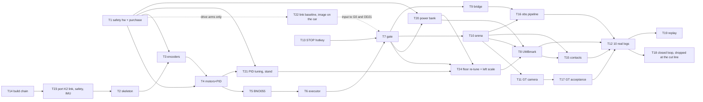

# M3 — Real car (W3 Pico firmware + W8 physical arena)

Written 2026-10-05 for BeaconMind (owner and sole participant: **Xiaohui Chen**). Read
`course-project/CONTEXT.md` and `course-project/plan/README.md` first (README §1.2 session protocol).
**The README wins over this file**; AGENT-DESIGN v3.3 wins over both (README §0 authority table).

## 0. Milestone summary

### 0.1 Goal

Make the physical kit car a safe, measured, scriptable platform that produces the same observation
logs (contract C9.1) as the simulator, then use it: record ≥ 10 real observation logs with ground
truth, run the L2 agent closed loop on the car with 2–3 models, and replay every available arm on
the real logs. This is workstream **W3** (Pico firmware) and **W8** (real arena) of
`APPROACH-LLM-SLAM.md` §10, under the acceptance tests of `AGENT-DESIGN.md` §W.

### 0.2 Exit criteria (README §3.1, restated as checks)

- [ ] Link baseline measured at the car's floor spot, with and without the camera streaming (the camera
      arms once M1.T6 is done), parked and with the wheels running, and handed to M3.T7 G0 and open
      decision OD21 (M3.T22; added 2026-10-24).
- [ ] Project firmware (K2 link, safety, and IMU layer ported — revised 2026-10-29; was "Assignment 7 link and safety layer" — motors, encoders, BNO055,
      bounded-move executor, watchdog, stall detection) is on the Pico and its host-side logic tests pass
      (M3.T2–T6, M3.T14, M3.T23).
- [ ] The wheel-speed PID is tuned on the stand (M3.T21) and re-checked on the floor together with the
      left encoder's scale (M3.T24) before UMBmark uses the odometry (added 2026-10-24).
- [ ] The 4.7 kΩ STBY pull-down is fitted and measured (M3.T1).
- [ ] The **wheels-down gate** passed, every item logged wheels-up (M3.T7).
- [ ] Out-of-band STOP drops STBY within **≤ 0.2 s** mid-move (M3.T7; C10.11; AGENT-DESIGN §W).
- [ ] Contact detection: ≥ 10 drives into the real wall material, head-on and at 30°, all detected (M3.T15; §W "motion").
- [ ] UMBmark done and `configs/car.json` updated (M3.T8).
- [ ] Physical arena built, tags printed at 100 %, measured and surveyed into `configs/arenas/real-*.json` (M3.T10).
- [ ] Overhead ground-truth camera accepted within **5 cm and 3°** of tape-measured floor points (M3.T11, M3.T17).
- [ ] ≥ 10 real observation logs (C9.1) with ground truth (M3.T12).
- [ ] Closed-loop real runs with 2–3 models (M3.T18) — **dropped at the cut line** (README §3.4).
- [ ] Every available arm replayed on the real logs (M3.T19).

### 0.3 What M3 unlocks

- M4.T13 (real-log replay sweep, the real-minus-sim comparison of research question 3 and the "Car"
  targets of C10.11); it reuses M3.T19's runs only when their hashes match the M4 freeze.
- M6.T3 (the ROSA demo on the car) and the car footage for M6.T4.
- M5.T13 (real setup in the Experiments section) and M5.T4/M5.T14 (real-car results), with the
  ground-truth error from M3.T17 reported next to every real metric (C8).

### 0.4 Entry criteria (tasks of other milestones that must be `done`)

| Needed by | Task | Why |
| --- | --- | --- |
| everything | M1.T1 | layout (L1), `.gitignore` lines (`wifi_config.h`, `data/`, `firmware/**/build/`), sync scripts, evidence folders |
| M3.T6 and later | M1.T2 | `configs/dv.json` (C0) and the JSON Schemas the firmware header generator and the log writers read |
| M3.T2, T7, T9, T11–T19 | M1.T3, M1.T13 | the `beaconmind-ros` container (M1.T3); the Pico's micro-ROS node proven visible from it in one graph (M1.T13) |
| M3.T4, T6, T8, T10 | M1.T9 | `configs/car.json` (wheel diameter, track width, lens height, sweep radius) |
| M3.T7 | M1.T6 | the camera streams over Wi-Fi (the watchdog is set from link latency **with the camera streaming**, §W) |
| M3.T22 (camera arms only) | M1.T6 | the same camera stream, measured early at the car's floor spot; without M1.T6 the no-camera arms run and the camera arms are `blocked` |
| M3.T9, T16 | M1.T7, M1.T8, M1.T12 | camera intrinsics/extrinsics; detector noise model; the camera bridge `bm_camera_bridge` + rectification + `apriltag_ros` launch (M1.T12), which the real observation pipeline subscribes to |
| M3.T10 | M2.T2 | the world checker `beaconmind.worlds.check` (C7) |
| M3.T9 | M2.T1, M2.T13 | `dispatch()`/validator (M2.T1) and the observation builder library (C3) with the C1 odometry function (`observation.py`, M2.T13) |
| M3.T12 | M2.T7, M2.T8, M2.T19, M2.T11 (B2 driver) | harness step loop and observation-log writer; B2 estimation (M2.T8) and its EXPLORE decisions (M2.T19); the recorder CLI (M2.T11) |
| M3.T18 | M1.T4, M1.T11, M2.T12 | closed-loop model setting; API keys and budget guard; which 2–3 models |
| M3.T19 | M2.T9, M2.T10, M2.T12 | B1, metrics, model list |
| M3.T13 (and `PicoClient.arm`) | M2.T1 | the latch: `beaconmind.validator.Latch` and the `bm-clear-latch` console script are **owned by M2.T1** (`M2-sim-mvp.md` module table); M3 reuses them and never writes a second latch module |
| M3.T2 (Python side) | M2.T5 if done | `beaconmind/envs/pico_wire.py` and `tests/test_pico_wire.py` are **owned by M2.T5**; M3.T2 extends the module additively and keeps its own tests in `tests/test_pico_wire_real.py` |
| M3.T9, T12, T18 | M2.T6, M2.T17, M2.T11 | `envs/ros_env.py` (`RosEnv`, `--capture-once` CLI), `harness/run.py` (`--env`, `--operator-arm`), `drivers/record.py` and `drivers/qc.py` — M3.T9 adds `--env real` to these CLIs |

M3.T1–T8, T14 and T21–T24 can run **in parallel with M2** (README §3.3): they need M1.T1/T2/T3/T9 and
Xiaohui at the bench. M3.T13 needs M2.T1 (an early M2 task). M3.T22 needs only M1.T1 (and M1.T6 for its
camera arms, M3.T1 for its drive arms), because it measures the link with the firmware on the car.
**Revised 2026-10-29:** the docs name Build K2, not Assignment 7 J2. The chip was not re-checked that day.
The four ≥ 600 s arms are still not done. Do not flash J2 to make the old check pass.

### 0.4a Shared code M3 must not duplicate (read before M3.T2, T9, T13)

M2 was planned at the same time and owns several modules M3 uses. The rule: **if a module or CLI below
already exists, extend it additively (new functions, new keys, new CLI choices) and never rename, move
or change existing behaviour without asking Xiaohui (README §1.4 item 6).** If it does not exist yet
and the M3 task must create it, create it at the path and with the names given here, and write in the
Notes column of `M2-sim-mvp.md`'s status table for the owning task: "created early by M3.T<k>; extend,
do not overwrite".

| Thing | Path / name (owner) | What M3 uses or adds |
| --- | --- | --- |
| Wire codec | `beaconmind/src/beaconmind/envs/pico_wire.py` (M2.T5): `encode_cmd(command) -> list[int]`, `decode_cmd(data)`, `check_caps(data, dv)`, `encode_result(result)`, `decode_result(data, car)`, constants `OP`, `RESULT_CODES` | M3.T2 adds `decode_state`, `probe_cmd`, `REASONS`, and the `estop`/`reason` keys in `decode_result` |
| Latch | `beaconmind.validator.Latch(path)` with `is_set()`, `set(reason, by)`, `read()`, `clear(operator)`; CLI `bm-clear-latch --operator <name> [--path <file>]`; default file `course_root()/"data"/"LATCH"` (M2.T1; `course_root()` from `beaconmind.config`) | M3.T2 `PicoClient`, M3.T13 hotkey, M3.T6/T7 scripts |
| Observation capture | `python3 -m beaconmind.envs.ros_env --capture-once …` (M2.T6) | M3.T9 adds `--source real`; M3.T9/T16 use it |
| Episode runner | `python3 -m beaconmind.harness.run --arm … --mode closed_loop|replay --env kinsim|isaac [--operator-arm] --worlds … --out data/runs [--record-obslog data/obslogs]` (M2.T7/T17) | M3.T9 adds `--env real`; M3.T18 uses it |
| Log recorder | `python3 -m beaconmind.drivers.record --driver B2 --env kinsim|isaac --worlds … --out data/obslogs [--operator-arm]`, `beaconmind.drivers.qc.qc_log` (M2.T11) | M3.T9 adds `--env real`; M3.T12 uses it |
| Baselines, metrics | `python -m beaconmind.baselines.run --arm B0|B1|B2 --obslogs …`, `python -m beaconmind.metrics.score --run … --worlds <dir>` (M2.T8–T10) | M3.T19 |
| Odometry scale | `observation.ticks_to_m(ticks, car)` uses the single key `ticks_per_wheel_rev` and `wheel_diameter_m` (M2.T13) | M3.T3/T8 keep `ticks_per_wheel_rev` current **and** add per-wheel calibrated keys; the real backend (M3.T9) uses the per-wheel keys |

**`configs/car.json` key names.** M1.T9 writes the file as `bm.car/1` with a `values` map whose exact
keys are fixed in M1.T9 step 5 (raw quantities plus the derived `wheel_diameter_m`, `track_width_m` and
`sweep_radius_m`). **Revised 2026-10-24:** M1.T9 writes only `wheel_diameter_m` for the wheels (the direct
reading; no roll-out, so no per-wheel diameters) and **no count keys** (M1.T9 step 5); M3.T3 step 8 adds
`ticks_per_wheel_rev`, `enc_counts_per_wheel_rev_left` / `_right` and the signs. **Read it through M2.T3's view**
`beaconmind.config.load_car()` (keys `wheel_diameter_m`, `ticks_per_wheel_rev`, `track_width_m`,
`lens_height_m`, `axle_to_front_m` (= `front_overhang_m`), `sweep_radius_m`), never by indexing the raw
file at the top level. M3 **writes** new keys (`ticks_per_wheel_rev`, `enc_counts_per_wheel_rev_left/right`
(one name everywhere, corrected 2026-10-24), `enc_sign_left/right`, `enc_ticks_per_m_left/right`,
`gyro_scale`) into the `values` map in the same per-value form
(`{value, unit, status: "measured", source: "M3.T<k>", evidence, updated, uncertainty}`).
**Verification step, first M3 task that reads the file:** Mac,
`course-project/.venv/bin/python -c "from beaconmind.config import load_car; c=load_car(); print({k: c[k] for k in ('wheel_diameter_m','ticks_per_wheel_rev','track_width_m','lens_height_m','axle_to_front_m','sweep_radius_m')}, c['assumptions'])"`.
If it raises `KeyError` or `ImportError` (M2.T3 not done), read
`python3 -c "import json;d=json.load(open('course-project/configs/car.json'));print(sorted(d['values']))"`
and use the M1.T9 step 5 names directly; if a quantity is missing, **stop and ask** (do not invent a value).

### 0.5 Command conventions used in this file

- **Spark host** commands are written as they run on `spark-2a60`. From the Mac, wrap them:
  `ssh -o ConnectTimeout=15 -o BatchMode=yes xiaohui_chen@spark-2a60 '<command>'`, or for a script,
  `ssh -o ConnectTimeout=15 -o BatchMode=yes xiaohui_chen@spark-2a60 'bash -s' < script.sh` (L5).
- `REPO` = `~/Projects/EN.665.715` on the Spark, `/Users/xiaohuichen/Projects/EN.665.715` on the Mac.
- **`[ros] <cmd>`** means, on the Spark host:
  `docker exec -it beaconmind-ros bash -lc 'source /opt/ros/humble/setup.bash && source /workspace/course-project/ros2_ws/install/setup.bash 2>/dev/null; <cmd>'`
  (drop `-it` when no keyboard is needed). Inside the container the repository is `/workspace`
  (L4). `ROS_DOMAIN_ID` is 0 everywhere (L5).
- **Fresh micro-ROS agent** (S11), in tmux window `bm:agent` on the Spark host.
  **Revised 2026-10-24: free UDP 8888 first** (once per session, before its first project agent; an
  immediate restart of the project agent in the same session, as in M3.T23 T2b, needs no new check). Two
  agents cannot share UDP 8888, and the Assignment 7 container `m7-gazebo` publishes `8888:8888/udp`
  (`assignments/assignment7/module-7-kinematics-control/docker-compose.yml:11`; `m7-micro-ros-agent`
  shares its network), so while it runs Docker forwards the Pico's datagrams into it, not to the project
  agent. Check (Spark host) `docker ps --format '{{.Names}}' | grep -cE '^(m7-micro-ros-agent|m7-gazebo)$'`
  → `0`. Non-zero → ask Xiaohui (they may be carrying Assignment 7 work); only with their OK:
  `docker stop m7-micro-ros-agent m7-gazebo` (never `docker rm` or `docker compose down`). Then
  `ss -uan | grep -c ":8888 "` must print `0` (as M1.T13 checks); non-zero → **stop and ask**. Then:
  ```bash
  tmux new-session -d -s bm -n agent 2>/dev/null || tmux new-window -t bm -n agent
  tmux send-keys -t bm:agent "docker run --rm -it --name pico-micro-ros-agent --network host microros/micro-ros-agent:humble udp4 --port 8888 -v6" Enter
  ```
  Stop it at the end of the session: `docker stop pico-micro-ros-agent` (it was started with `--rm`,
  so it is removed). **After an agent restart** (README S11, revised 2026-10-24): from M3.T23 on, the
  project firmware's session supervisor (ported from Assignment 7 Build J1) rebuilds its own session;
  reboot the Pico by hand (battery off, S6) only if `/bm_pico` has not reappeared within 30 s of the agent
  coming back. M3.T14's first node has no supervisor yet: until M3.T23 is flashed, reboot the Pico after
  any agent restart.
- **Exactly one Pico node** check: `[ros] ros2 node list` must print `/bm_pico` once (after M3.T14).
  Before M3.T14 the docs name `/pico_fusion` (K2, since 2026-10-25). If that node is absent, stop and ask. Do not treat `/pico_odometry` as the current node, and do not flash J2 to get it. Two or more → stop the agent, start a
  fresh one, and power-cycle the Pico only if the duplicate is still there 30 s later (S11).
- **No hand-turning of the wheels** (Xiaohui, since 2026-10-23: three of the four motors of the old model
  failed within days, and handling is one suspect; research note F6). Never ask Xiaohui to turn a wheel
  or a motor shaft by hand. Encoder signs, counts per turn and "does it turn freely" checks are powered
  runs on the stand (M3.T3). When a step turns or walks the whole car by hand (M3.T5, M3.T10, M3.T11),
  Xiaohui lifts it clear of the floor so the wheels do not roll, and sets it down again. **Revised
  2026-10-24:** the same holds for **every placement** of the car (onto the stand, a tape cross, a start
  mark or a start pose: M3.T8, T12, T15, T16, T17, T20, T24 and the integration test included): **lift
  it; never slide or roll it into place.** To correct a pose, lift it and set it down again.
- **Pico serial console** (Spark host, needs USB): `python3 $REPO/course-project/firmware/pico/tools/pico_serial.py`
  (written in M3.T14). The Pico's port is found by USB identity, as `spark-flash.sh` does.
- **Serial window `bm:serial`** (Spark host; added 2026-10-24). A coding agent cannot press Enter in a
  blocking process, and the Pico does not buffer its serial lines (a capture started after an event
  misses it), so triggered runs and captures that must run alongside other commands use a tmux window.
  Create it once per session:
  `tmux list-windows -t bm -F '#W' 2>/dev/null | grep -qx serial || { tmux new-session -d -s bm -n serial 2>/dev/null || tmux new-window -t bm -n serial; }`;
  start the tool in it with `tmux send-keys -t bm:serial "python3 ~/Projects/EN.665.715/course-project/firmware/pico/tools/pico_serial.py <options>" Enter`;
  press its Enter (for `--send-after-enter`) with `tmux send-keys -t bm:serial Enter`; stop a capture
  that has no `--capture` with `tmux send-keys -t bm:serial C-c`. The `--log` file is the record; each of
  its lines starts with the host time in UTC (M3.T14 step 3), the clock `docker inspect` reports.
- **Task-status check** (Mac, repository root). Paste this shell function once per session:
  ```bash
  status() { python3 course-project/tools/task_status.py "$@"; }
  ```
  `status M3.T4 M1.T9` prints one line per task, `<ID> <status>` (README convention L12; the helper
  reads only the status-table row, so a task ID that also appears in a dependency table cannot confuse
  it). Each line must read `done`. If `course-project/tools/task_status.py` does not exist yet, create it
  first from README L12. The prerequisite tables below write this check as `status <task ids>`.
- **Pipes in tables.** Inside a table cell, `\|` is only the markdown escape for the shell pipe: type
  `|` (for example `cc --version \| head -1` means `cc --version | head -1`).
- **Hardware steps** are addressed to **Xiaohui (bench)**. The executor writes What / Why / what to
  measure / pass threshold, then **waits** for Xiaohui's report (S1, README §1.4 item 1).

### 0.6 Facts this file was grounded on

Verified by Claude Opus 5.5 with read-only checks on **2026-10-05, 23:42 CDT** (spark-2a60):

| Fact | Result |
| --- | --- |
| Builder image | `pico-microros-builder:latest` present (4.94 GB) |
| Agent image | `microros/micro-ros-agent:humble` present |
| Host C toolchain | `/usr/bin/cc`, `gcc` 11.5.0, `make` present (closes README §9.1 "host C compiler") |
| Host Python libraries | system `python3`: OpenCV 4.13.0 with `cv2.aruco`, Pillow 11.3.0, matplotlib 3.10.8, numpy 2.3.5, pyserial 3.5 |
| USB / video | no `/dev/ttyACM*` (no Pico plugged in); **no `/dev/video*`** (no webcam) |
| Spark Ethernet | `192.168.5.1/22` on `enP7s7` (the agent address compiled into the Pico firmware) |
| Containers | `rosa-ros2`, `vllm-rosa` exited; no `pico-micro-ros-agent`; `beaconmind-ros` not built yet |
| Module 5 UF2 | still on the Spark at `assignments/assignment5/module-5-imu-tilt-control/pico2w_led/build/pico2w_led.uf2` |

Read from the repository on 2026-10-05:

| Fact | Source |
| --- | --- |
| Pins: `GP0` SDA, `GP1` SCL; `GP2` PWMA, `GP3` AIN2, `GP4` AIN1, `GP5` STBY; `GP10` BIN1, `GP11` BIN2, `GP12` PWMB; **`GP16`/`GP17` left encoder A/B; `GP18`/`GP19` right encoder A/B; motor channel A drives the RIGHT wheel, channel B the left** (corrected 2026-10-24: the 2026-10-05 reading had the encoder sides the other way round and channel A = left; **encoder sides and channels verified 2026-10-24**, see the 2026-10-24 table below) | pins: `reference/hardware/wiring-plan.md` §4 "Pin assignments — current, since 2026-10-01"; sides and channels: Assignment 7 `encoders.h:12-15`, `drive_control.c:333` (`tb6612_set(-right_duty, -left_duty)`), `research/2026-10-24-car-firmware-lessons-and-pid.md` F6 |
| TB6612FNG rows on the left board: control column `c` — PWMA 29, AIN2 28, AIN1 27, **STBY 26**, BIN1 25, BIN2 24, PWMB 23, **GND 22**; output column `g` — VM 29, VCC 28, GND 27, AO1 26, AO2 25, BO2 24, BO1 23, GND 22 | derived from `tb6612fng-pin-map.md` (back-view order, mirrored) and `car-build-notes.md` ("VM at row 29 col g, PWMA row 29 col c"; "BO2 (row 24)", "BO1 (row 23)"). **Derived, not recorded: M3.T1 step 4 verifies it with the meter** |
| Pico rows: pin *n* on the low side sits in row *n* (pins 1–20); power side: pin = 41 − row. So `GP5` = pin 7 = row 7; `RUN` = pin 30 = row 11 (power side); `GND` pin 28 = row 13 (power side) | `pico2w-pin-map.md` §1 table |
| STBY has an internal 200 kΩ pull-down on the driver; RP2350-E9 can let a pin float near 2.2 V; firmware must drive STBY/IN/PWM low at boot | `tb6612fng-pin-map.md` |
| Encoder: 12 pulses per channel per motor revolution, 1:90 gearbox → nominal **4320** counts per wheel revolution (all edges, both channels); about 2 kHz per channel at 113 RPM; stall 0.82 A per motor | `motor-encoder-cable-map.md` §6 |
| BNO055 at `0x28`, chip ID `0xA0`; the board's "pitch" axis lies along the car (the firmware's pitch is the car's roll); the instructor firmware runs NDOF | `pico-bringup.md`; `discussions/module5/DESIGN.md` §1; instructor `bno055.c` (read 2026-10-05; reusable since 2026-10-24, README L11) |
| Module 5 micro-ROS library: `RMW_UXRCE_MAX_PUBLISHERS=3`, `RMW_UXRCE_MAX_SUBSCRIPTIONS=2`; custom UDP transport registered with framing `false` | `assignments/assignment5/module-5-imu-tilt-control/micro-ros-builder/colcon.meta`; `pico2w_led.c` (read 2026-10-05; reusable since 2026-10-24, README L11) |
| `wifi_config.h` macro names: `WIFI_SSID`, `WIFI_PASSWORD`, `ROS_AGENT_IP`, `ROS_AGENT_PORT` | `pico2w_led/wifi_config.example.h` |
| STOP target: **≤ 0.2 s** STBY drop mid-move. The older "motor stop ≤ 0.5 s after link loss" target was replaced; the watchdog period is set from the measured p99 link latency | `proposal-talk-track.md` lines 196–200; `AGENT-DESIGN.md` §W |
| Tilt firmware "forward" = drive wheels first, camera end trailing (opposite of +x) | `discussions/module5/DESIGN.md` §1 |
| Wi-Fi is lossy where the car drives: only 22–52 of 60 status samples per 6 s **arrived** (31–52 at the start of the floor lane, 22 at its far end) | `CONTEXT.md` "Hardware state" (Wi-Fi bullet) |

Read from the repository on **2026-10-24** (research note
[`research/2026-10-24-car-firmware-lessons-and-pid.md`](../research/2026-10-24-car-firmware-lessons-and-pid.md)
and the files it cites; each row re-checked against the cited file by Claude Opus 5.5, read-only; line
numbers as of 2026-10-24):

| Fact | Source |
| --- | --- |
| **Historical, 2026-10-24 (not the current image):** J2 `buildJ2_b4298742` was adopted that day after its T1 boot check and a 20-min floor soak. J1 `buildJ1_9849874a` was the one-flash fallback named then. Both: node `pico_odometry`, `/pico/cmd_vel`, boots armed, not C2. The 2026-10-24 adoption rule (keep J2 unless the bench log's last flash line said J1) describes that day. It is not a reason to reflash J2. **Verified 2026-10-24** | research note F1, F5, F11; bench log `assignments/assignment7/evidence/new-motor-bench-2026-10-20.md:859-860`, `:880-891`, `:912` (J2 UF2), `:916-924` (J2 flashed, T1), `:926-944` ("Floor spot, J2": the soak and the adoption) |
| **The image the docs name since 2026-10-25 is Build K2** `buildK2_bd46b95f` (`~/fw_builds_m8/buildK2_bd46b95f.uf2`). Module 8 port of J2. Open-loop duty. Node `pico_fusion`. Boots armed. `/pico/cmd_vel`. Publishes `sensor_msgs/Imu` on `/pico/imu/data` at 50 Hz. Not C2. One-flash fallback is J2 `buildJ2_b4298742` (AGENTS.md §7.4; `assignments/assignment8/review/FIRMWARE-REVIEW.md`). J1 remains the fallback that 2026-10-24 entry named for J2. **The chip was not re-checked on 2026-10-29.** Confirm it is still K2 before any port or flash. Micro-ROS entity limits are still 3 publishers and 2 subscriptions (`assignments/assignment5/module-5-imu-tilt-control/micro-ros-builder/colcon.meta`; `pico_fusion.c`). M3.T14 is the gate that raises them to 6 and 6. `course-project/firmware/pico/` has no sources (only `.gitkeep`). **Recorded 2026-10-29** | AGENTS.md §7.4; `assignments/assignment8/review/FIRMWARE-REVIEW.md`; `assignments/assignment8/module-8-sensor-fusion/firmware/pico_fusion/pico_fusion.c`; `research/2026-10-29-urdf-firmware-camera-status.md` |
| **Encoder sides: left = `GP16`/`GP17`, right = `GP18`/`GP19`**; channel A drives the right wheel; in one-wheel powered runs the idle wheel read exactly 0 counts. **Verified 2026-10-24** | Assignment 7 `firmware/pico_odometry/encoders.h:12-15`, `drive_control.c:333`; bench log `:556-578` (`m25b_lifted`), `:709-718` (`m30a`) |
| **The left encoder runs in edge mode** (`ENCODER_LEFT_EDGE_MODE 1`; the right decodes plain x4): the left's two channels are not a clean quadrature pair, so a plain x4 decoder kept only 67–94 % of its edges (direction-dependent; bench log `:484`, `:545-546`, `:562-564`, `:732-733`); in edge mode every edge counts, signed by the recently decoded direction. Its scale needs a floor check against the IMU (M3.T24). **Verified 2026-10-24** | `encoders.h:20-29`, `encoders.c` (`update`, Build H); bench log `:474-487`, `:516-578`, `:732-734` |
| **Motors now:** left fitted 2026-10-22 (same model as before); right #3 is a different model (blue NULLLAB 1:90 TT "Low Noise & Hybrid Gear"), fitted 2026-10-23; lifted (`m30a`: 1–5 % slower than the left at the same duty; both lose 7–8 % when driven together on the AA pack). **First floor runs 2026-10-24** (corrected 2026-10-24; `m32a`–`m32c`, Assignment 7 J2, open loop): right #3 drove every floor segment, about 4 % slower than the left; the car veers right 4–5° per 34 cm forward; the left encoder's edge-mode scale agrees with the compass within about 0.3 % in pivots; a commanded 45°/s turn ran at about 160°/s (the lowest commandable duty moves each wheel about 0.17 m/s). Three of the four motors of the old model went stiff, weak or jammed within days. **Verified 2026-10-24** | research note F6; bench log `:461-463`, `:683-739`, `:946-969` (`m32a`–`m32c`, the last entry) |
| **PWM 1.2 kHz in use** (the instructor's divider 125 with TOP 999); a 20 kHz trial on 2026-10-17 cut Wi-Fi losses in pivots but left one wheel stuck and was reverted. **Verified 2026-10-24** | `tb6612.c:37-44`; research note F7 |
| Car power: the Pico (and the camera) on a USB power bank with the green AMS1117 wire **out**; the AA pack feeds the motors only; **the STBY pull-down (S5) is not fitted**. Verified 2026-10-24 | bench log `:138-143`; `assignments/assignment7/HANDOFF.md` "The car now"; research note F11 |
| The main loop blocks on the radio: worst passes 0.60 s (J1 soak), 0.61 s while driving, 2.2 s (J0); the CPU is busy about 12 % and the second core is unused. Verified 2026-10-24 | research note F3; bench log `:870-878`, `:312` (the 612 ms pass while driving, Build G.1, a send waiting for the radio); `safety.h:47-51` |
| The Wi-Fi link at the floor spot stalls for seconds because of the house mesh: Spark-to-Pico ping p99 2.5–11 s on 2026-10-23; ping p99 88–2,398 ms and longest telemetry gap 0.29–3.85 s in four 3-min runs on 2026-10-24; the camera's effect is not measured yet (M3.T22). Verified 2026-10-24 | research note F2; `assignments/assignment7/evidence/wifi-survey-2026-10-23.md:52`; bench log `:841-868` |

### 0.7 Gaps in the README that this milestone fills (each needs Xiaohui's OK where marked)

1. **Subscriptions.** C2 lists four Pico subscriptions (`/pico/move/cmd`, `/pico/heartbeat`,
   `/pico/arm`, `/estop`) but only says "≥ 4 publishers". The library also needs
   `RMW_UXRCE_MAX_SUBSCRIPTIONS ≥ 4` (Module 5 used 2). Not a design change; M3.T14 builds 6/6.
2. **Estop result and refusal reasons** (C2 has no result for a move aborted by `/estop`, and no
   field for why a move was refused). **Proposed extension, needs Xiaohui's OK (README §1.4 item 6):**
   `flags` bit 2 = aborted by estop (reported with `result_code` 4 `link_lost`, which the validator
   already auto-latches on, C5 item 2); `flags` bits 8–15 = refusal reason code (M3.T2 table).
   Registered as README open decision **OD15** (M1.T10 asks first; else whichever of M2.T5 and M3.T2 runs
   first). The twin and the car must report the same result for the same event (C12: the harness tells
   them apart only by `source`), so Xiaohui picks **one** mapping for both; M2.T5 now implements the
   recorded OD15 option (cross-plan consistency review, 2026-10-06).
3. **Bump threshold DV.** §W asks for a bump threshold "set from logged contacts"; C0 has no key.
   **Proposed new C0 key** `bump_lin_acc_mps2` (value `null` = bump detection off) until M3.T15
   sets it. Adding a key is a C0 change: asked in M3.T6.
4. **Floor reference tags** for the overhead camera use IDs **104–107** (inside the reserved
   100–109 ground-truth range, never on walls, C7). Roof tag = **100** (101 spare). Proposed
   default, confirmed in M3.T11.

### 0.8 Task status

| Task | Title | Status | Effort | Evidence | Last updated | Notes |
| --- | --- | --- | --- | --- | --- | --- |
| M3.T1 | Safety hardware: STBY pull-down, wheels-up stand, parts purchase, power-path decision | todo | S | — | 2026-10-05 | STOP hotkey part is M3.T13; power-bank trial is M3.T20 |
| M3.T2 | Firmware skeleton logic: boot disarmed, arm, `/estop`, heartbeat watchdog, boot id, state; host tests | todo | M | — | 2026-10-24 | needs M3.T14 and M3.T23; sets up the control context (core 1 or a timer) |
| M3.T3 | Encoders: quadrature counting, direction signs, counts per wheel revolution | todo | S | — | 2026-10-24 | powered stand runs, no hand-turning (2026-10-23); battery on, so needs M3.T1 |
| M3.T4 | Motors: direction mapping (forward = +x), wheel-speed PID, speed cap | todo | M | — | 2026-10-24 | settles OD10; PWM-frequency A/B before the curve; full PID tuning is M3.T21 |
| M3.T5 | BNO055: IMUPLUS yaw, gyro integration, motor magnetic interference | todo | M | — | 2026-10-05 | settles OD13 |
| M3.T6 | Bounded-move executor: five moves, stall and bump, timeout, result codes | todo | M | — | 2026-10-29 | **2026-10-29:** turn stop is the Pico yaw minus a coast lead measured on these motors, not `/odometry/filtered`. Distance stops on encoder counts. Coast lead is not the PID |
| M3.T7 | Wheels-down gate (§W), wheels up; link latency → `watchdog_ms` | todo | M | — | 2026-10-05 | |
| M3.T8 | UMBmark odometry calibration; update `configs/car.json` | todo | M | — | 2026-10-24 | after M3.T24 (the first floor runs are now M3.T24's) |
| M3.T9 | Real-car bridge in `beaconmind-ros`: Pico telemetry, move client, real env backend | todo | M | — | 2026-10-05 | |
| M3.T10 | W8 physical arena: walls, tags printed and measured, survey, real arena spec | todo | M | — | 2026-10-05 | |
| M3.T11 | Overhead ground-truth camera: mount, calibrate, roof tag, GT node | todo | M | — | 2026-10-05 | accuracy acceptance is M3.T17 |
| M3.T12 | Real runs part 1: ≥ 10 real observation logs (C9.1) | todo | L | — | 2026-10-05 | in the cut line |
| M3.T13 | Out-of-band STOP hotkey and the latch file | todo | S | — | 2026-10-05 | split from M3.T1 |
| M3.T14 | Firmware build chain: project micro-ROS library, UDP transport, first node | todo | M | — | 2026-10-29 | Stays todo. Gate before extra Pico topics. Library on the car is still 3 publishers and 2 subscriptions (Module 5 `colcon.meta`; K2 did not raise it). This task builds 6 and 6 |
| M3.T15 | Contact detection acceptance: ≥ 10 wall drives; bump threshold | todo | S | — | 2026-10-05 | |
| M3.T16 | Real observation pipeline on the car: static accuracy check | todo | S | — | 2026-10-05 | |
| M3.T17 | Ground-truth accuracy acceptance (5 cm / 3°) | todo | S | — | 2026-10-05 | split from M3.T11 |
| M3.T18 | Real runs part 2: closed-loop L2 runs with 2–3 models | todo | L | — | 2026-10-05 | dropped at the cut line |
| M3.T19 | Real runs part 3: replay of every available arm on the real logs | todo | M | — | 2026-10-05 | replay of 2–3 models is in the cut line |
| M3.T20 | Untethered power path: power-bank trial (OD9) | todo | S | — | 2026-10-29 | Stays todo. The Pico-on-bank / motors-on-AA split has been in use since 2026-10-20. That is not this trial's acceptance (jumper-out check, 30 min auto-off, arena watchdog) |
| M3.T21 | Wheel-speed PID tuning on the stand: step responses, low-speed hold, battery range | todo | M | — | 2026-10-29 | Stays todo. First question is whether these motors can hold about 0.05 m/s. If they cannot, the 45°/s limit is a C0 change, not an EKF change. PID is not yet justified by a real-car run. Feed-forward plus count stops plus IMU-closed turns stays the short-time fallback |
| M3.T22 | Link baseline at the floor spot with the camera streaming (Assignment 7 firmware as the instrument) | todo | M | — | 2026-10-29 | Stays todo. **2026-10-29:** the docs name K2 as the image, not Build J. Module 8 streamed the camera on the floor and did not run the four arms of ≥ 600 s. Camera rejoin is M3.T25, not this task |
| M3.T23 | Port the K2 link, safety, and IMU layer into the project firmware | todo | M | — | 2026-10-29 | Stays todo. **2026-10-29:** copy source is `assignments/assignment8/module-8-sensor-fusion/firmware/pico_fusion/` (K2), not Assignment 7 J2. J2's Float32 `/pico/imu/heading` cannot feed `ekf.yaml` imu0. The port has not been done. `course-project/firmware/pico/` has no sources |
| M3.T24 | Floor re-tune of the wheel PID and the left encoder's scale (after the wheels-down gate) | todo | M | — | 2026-10-24 | added 2026-10-24; must finish before M3.T8; sized M, though it may take S–M (one floor session per round) |
| M3.T25 | Camera Wi-Fi rejoin while running, or a dated replug decision | todo | S | `evidence/M3/M3.T25/` | 2026-10-29 | Not owned by M3.T22. Does not invent a firmware change. bm_cam-0.2 picks a mesh node only at boot |
| M3.T26 | Host adapter: C2 IMU and wheel topics into the EKF inputs | todo | S | `evidence/M3/M3.T26/` | 2026-10-29 | Pose for logs and for the agent between moves. The move executor does not stop on `/odometry/filtered`. No fifth Pico publisher. No on-Pico EKF |

### 0.9 Task list with dependencies and machines

| ID | Title (short) | Depends on | Effort | Machine(s) |
| --- | --- | --- | --- | --- |
| M3.T1 | Safety hardware | M1.T1 | S | Xiaohui (bench), Mac |
| M3.T22 | Link baseline (image on the car; docs name K2 as of 2026-10-29) | M1.T1; M1.T6 for the camera arms; M3.T1 for the drive arms | M | Spark host (`m7-micro-ros-agent`, `m7-gazebo`, ping), Mac (pytest), Xiaohui (car on the stand at the floor spot; battery on for the drive arms) |
| M3.T14 | Firmware build chain | M1.T1 | M | Spark host (`pico-microros-builder`), Pico, Xiaohui (USB) |
| M3.T23 | Port the K2 link, safety, and IMU layer | M3.T14 | M | Mac, Spark host (`pico-microros-builder`, host C tests), Pico, Xiaohui (USB, battery off) |
| M3.T2 | Firmware skeleton logic | M3.T14, M3.T23, M1.T3, M1.T13 | M | Spark host, Spark container beaconmind-ros, Mac (pytest), Pico |
| M3.T13 | STOP hotkey + latch | M1.T1, M1.T3, M2.T1 | S | Mac (pytest), Spark container beaconmind-ros |
| M3.T3 | Encoders (powered stand runs) | M3.T2, M3.T1 | S | Spark host, Pico, Xiaohui (bench, wheels up, battery on, phone camera) |
| M3.T4 | Motors + PID | M3.T3, M3.T1, M1.T9 | M | Spark host, Spark container beaconmind-ros, Pico, Xiaohui (bench, wheels up, battery on) |
| M3.T21 | PID tuning on the stand | M3.T4, M3.T1 | M | Spark host, Pico, Mac (pytest), Xiaohui (bench, wheels up, battery on) |
| M3.T5 | BNO055 | M3.T4 | M | Spark host, Pico, Xiaohui (bench) |
| M3.T6 | Move executor (local stops; coast lead; not the host pose) | M3.T4, M3.T5, M1.T2 | M | Spark host, Spark container beaconmind-ros, Pico, Xiaohui (wheels up) |
| M3.T7 | Wheels-down gate | M3.T6, M3.T13, M3.T1, M1.T6 | M | Spark host, Spark container beaconmind-ros, Pico, Xiaohui (bench) |
| M3.T20 | Power-bank trial | M3.T1 (purchase), M3.T7 | S | Xiaohui (bench), Spark host |
| M3.T24 | Floor re-tune of the PID + left encoder scale | M3.T7, M3.T21, M3.T20 | M | Xiaohui (floor, walled area, S10), Spark container beaconmind-ros, Spark host (rebuild if gains change), Mac (pytest) |
| M3.T25 | Camera rejoin, or a dated replug decision | M1.T6 far enough that the camera boots (need not be `done`) | S | Xiaohui (decision), Mac |
| M3.T26 | Host EKF adapter from C2 IMU and wheel topics | M3.T14, M3.T23 | S | Spark container beaconmind-ros, Mac |
| M3.T8 | UMBmark | M3.T7, M3.T20, M3.T10, M3.T24, M1.T9 | M | Xiaohui (floor), Spark container beaconmind-ros, Mac (pytest) |
| M3.T10 | Physical arena | M1.T9, M2.T2, M1.T7, M3.T7 | M | Xiaohui (floor), Spark host (tag sheets), Mac |
| M3.T15 | Contact acceptance | M3.T8, M3.T10 | S | Xiaohui (floor), Spark container beaconmind-ros |
| M3.T9 | Real-car bridge | M3.T7, M1.T3, M1.T7, M1.T12, M1.T13, M2.T1, M2.T13; M2.T6 + M2.T17 (`RosEnv`), M2.T11 (recorder) — see the step-1 branches if absent | M | Spark container beaconmind-ros, Mac (pytest) |
| M3.T11 | Overhead GT camera | M3.T10, M1.T3, M1.T7, M3.T7 | M | Xiaohui (mount), Spark host, Spark container beaconmind-ros |
| M3.T17 | GT accuracy acceptance | M3.T11 | S | Xiaohui (floor), Spark container beaconmind-ros |
| M3.T16 | Real observation pipeline | M3.T9, M3.T10, M1.T8, M1.T12 | S | Xiaohui (floor), Spark container beaconmind-ros |
| M3.T12 | ≥ 10 real logs | M3.T8, M3.T9, M3.T15, M3.T16, M3.T17, M2.T7, M2.T8, M2.T11, M2.T19 (or the operator branch) | L | Xiaohui (floor), Spark container beaconmind-ros |
| M3.T18 | Closed-loop real runs | M3.T12, M1.T4, M1.T11, M2.T12 | L | Xiaohui (floor), Spark (vLLM + beaconmind-ros) |
| M3.T19 | Replay on real logs | M3.T12, M2.T9, M2.T10, M2.T12 | M | Spark container beaconmind-ros, Spark host venv |

**Revised 2026-10-24:** M3.T4, T8 and T10 list M1.T9 (the table above and README §3.3) because they use
the car's measurements; M3.T3 and M3.T6 also read values M1.T9 wrote (a `configs/car.json` file row in
their prerequisites). M3.T1 (purchase, resistor, stand), M3.T14, M3.T23, M3.T2 and M3.T13 use none, so
they may start before M1.T9 — the purchase in particular should not wait. If an executor reads this as a
conflict with the README, ask Xiaohui (README §1.4 item 8).
**Revised 2026-10-24:** M3.T3 now runs the motors (powered encoder runs replace hand turns), so it needs
M3.T1 (the S5 pull-down and the stand), like M3.T4; README §3.3 lists that edge (`M3.T3 | M3.T1, M3.T2`).
Do not start M3.T3 before M3.T1 is `done`.
README §3.3 also makes M3.T9–T11 wait for M1.T7 and M3.T7. This file keeps that order. M3.T10's physical
build moves nothing, so **if Xiaohui asks to build the arena before M3.T7, that is allowed with their
OK**; record it in the status Notes.

### 0.10 Suggested execution order (parallel groups)



1. **Group A (no battery, mostly software; start any time after M1.T1):** M3.T1 (purchase request
   first, because delivery takes days), M3.T14 → M3.T23 → M3.T2, and M3.T13 in parallel (M3.T13 once
   M2.T1 is done). **M3.T22 early** (research note §4 "Order"): run it before M3.T14 flashes the project image, using the image already on the car.
   **Revised 2026-10-29:** that image is Build K2 in the docs (`buildK2_bd46b95f`, node `/pico_fusion`), not Build J. Do not flash J2 or J1 to satisfy M3.T22. Confirm the chip is still K2 before any flash (it was not re-checked on 2026-10-29). Its camera arms wait for M1.T6, and its drive
   arms (battery on; K2 boots armed, as J2 did) wait for M3.T1 (the S5 pull-down). It tells
   early whether a 0.2 s STOP and a 500 ms watchdog are reachable on this link.
2. **Group B (bench, car on the stand; battery on from M3.T3; one task per session):** M3.T3 → M3.T4 →
   M3.T5 → M3.T6 → M3.T7, with M3.T21 (PID tuning, wheels up) any time after M3.T4 — before M3.T6 if
   possible, so the executor starts from tuned gains (if it runs after M3.T6, its step 10a puts a
   production image back on the car).
3. **Group C (after M3.T7; can interleave):** M3.T10 first (every floor run happens inside the walled
   arena, S10), then M3.T20 → M3.T24 (needs M3.T21 too) → M3.T8 → M3.T15 (floor); M3.T11 → M3.T17 (ground
   truth); M3.T9 → M3.T16 (software + a static floor check).
   **Priority if time runs short** (research note §3): safety and the move executor first, then the IMU
   heading loop, then the wheel PID; per-wheel feed-forward plus count stops plus IMU-closed turns gets
   most of the way without a tuned PID, so M3.T21/T24 may be cut to their first rounds with Xiaohui's OK.
4. **Group D:** M3.T12, then M3.T19 and M3.T18 (M3.T18 is dropped at the cut line).

Cut-line triggers (README §3.4) apply: at ≤ 28 days left with M3.T12's ten logs not recorded, tell
Xiaohui the real-log replay is at risk (options: ≥ 5 logs, or sim only as a stated limitation).

---
## Tasks

### M3.T1 — Safety hardware: STBY pull-down, wheels-up stand, parts purchase, power-path decision

**Why.** AGENT-DESIGN §W (W3 electrical) makes an external pull-down of ≤ 8.2 kΩ from STBY/`GP5` to
GND **mandatory before any wheels-down run** (README S5): after a reset the RP2350's pins float for a
moment, and erratum RP2350-E9 can let a floating pin sit near 2.2 V, which the TB6612FNG may read as
HIGH; its own 200 kΩ pull-down is too weak to stop that (`reference/hardware/tb6612fng-pin-map.md`).
A 4.7 kΩ resistor holds STBY low whenever the Pico is not driving it, so the motors cannot start on
their own. This task also builds the wheels-up stand that S2 requires whenever the battery is on,
orders every part M3 needs in one go (README §1.4 item 2), and settles OD9 (the untethered power
path). The STOP hotkey that the README lists under this title is task **M3.T13**; the power-bank trial
is **M3.T20** (split for session size).

**Prerequisites.**
| Prerequisite | Kind | Check command (machine) | Expected result |
| --- | --- | --- | --- |
| M1.T1 done | task | `status M1.T1` (Mac, repo root) | status column `done` |
| Multimeter with continuity and 20 kΩ ranges | hardware | Xiaohui confirms | "yes" |
| Battery switch OFF, USB unplugged, cells out of the tray (S9) | hardware | Xiaohui confirms | "yes" to all three |

**Inputs.** README §7 (S1–S9) and §3.5 OD9; `AGENT-DESIGN.md` §W "W3 — electrical";
`reference/hardware/tb6612fng-pin-map.md` §2 and the erratum paragraph; `pico2w-pin-map.md` §1;
`car-build-notes.md` (2026-09-20 "as built", 2026-10-01 updates); `discussions/module5/DESIGN.md` §6
(the two power paths); `motor-encoder-cable-map.md` §6.

**Steps.**

1. **Mac.** `mkdir -p course-project/evidence/M3/M3.T1`.
2. **Mac → Xiaohui: purchase request (stop and ask, README §1.4 item 2).** Send this table and ask
   Xiaohui to mark each line "owned" or "buy", and to approve the purchase. Prices are rough guesses
   (not checked against a shop); Xiaohui checks them. Then **wait**.

   | # | Item | Why it is needed | Needed by |
   | --- | --- | --- | --- |
   | 1 | 4.7 kΩ ¼ W through-hole resistor (a small assorted kit is fine). Any value ≤ 8.2 kΩ is allowed by §W, but the measurement ranges in steps 6–8 assume 4.7 kΩ: with another value, ask for new ranges | S5 pull-down | M3.T1 |
   | 2 | USB power bank, 2 outputs, ≥ 5000 mAh, ≤ 200 g, ideally with an "always-on / low-current" mode | OD9 untethered Pico + camera | M3.T20 |
   | 3 | Short micro-USB cable (Pico), right-angle if possible; a cable for the camera of the type M1.T6 found the base board needs | power bank to Pico and camera (§W W1: plug routed back along the chassis) | M3.T20 |
   | 4 | 8–12 fresh AA alkaline cells | S8: replace the pack below 5.5 V | M3.T4 onward |
   | 5 | 12 foam boards about 20 × 30 in (51 × 76 cm), or stiff cardboard; binder clips; painter's tape | arena walls ≥ 0.30 m, soft (S10, D3) | M3.T10 |
   | 6 | Tape measure ≥ 3 m, a carpenter's square or set square | surveying | M3.T10 |
   | 7 | USB webcam, UVC ("driver-free"), **fixed focus or autofocus that can be switched off**, with a **horizontal and vertical field of view each ≥ the value computed in step 2a** (not the diagonal figure alone), plus a mount (tripod, boom or ceiling clamp) and, if the Spark is more than 2 m from the arena, an **active** USB extension | overhead ground truth (C8) | M3.T11 |
   | 8 | Matte paper or cardstock; access to a printer that can print at 100 % | tags (D3) | M3.T10 |

   Record the answer in `course-project/evidence/M3/M3.T1/purchase.md` (item, owned/buy, approved
   yes/no, date). If Xiaohui does not approve item 1, **stop**: no wheels-down run may ever happen
   (S5); set M3.T1 `blocked`.
   **2a. Webcam field of view — compute before item 7 is bought** (Mac, no hardware). *Why:* a
   camera looking straight down sees a floor patch `2·h·tan(FOV/2)` wide, where `h` is the lens height
   above the roof-tag plane. A "90° diagonal" 16:9 webcam has only about 78° × 49° (H × V), which at a
   normal ceiling height does **not** cover a 2.25 m arena plus margin. Ask Xiaohui: (i) the ceiling
   height, or the tallest tripod/boom they can use, in metres; (ii) the arena side they expect (default
   2.25 m). Then compute, with `h = mount height − 0.15 m` (roof-tag plane) and `need = arena side +
   0.30 m`:
   `python3 -c "import math;h=<H>-0.15;need=<S>+0.30;print('min FOV each axis (deg):',round(2*math.degrees(math.atan(need/(2*h))),1))"`.
   Example: mount 2.35 m, arena 2.25 m → h 2.20, need 2.55 → **60.2°** in both H and V. Write the
   number into item 7's row of `purchase.md` ("H and V FOV each ≥ …°, at the resolution used; check the
   product's spec sheet, which must state H and V or a 4:3 mode"). If no camera Xiaohui finds meets it,
   **stop and ask**: options are a 2.0 m arena (D3 minimum), a higher mount, or a wide-angle (≥ 120°
   diagonal) lens, which needs the stronger distortion model in M3.T11 step 4.
3. **Explain to Xiaohui before any hands-on step (S1).** Write this to them:
   - *What:* one resistor between the driver's STBY pin row and ground, plugged into the breadboard.
   - *Why:* STBY is the driver's master enable; LOW = all motor outputs off. The Pico drives it, but
     during a reset, a reflash or a brownout the Pico lets go of the pin for a moment, and the chip
     erratum RP2350-E9 can make a let-go pin drift to about 2.2 V, which the driver may read as ON.
     4.7 kΩ to ground wins against that drift, yet is weak enough that the Pico can still pull STBY
     up to 3.3 V (it then costs 0.7 mA and 2.3 mW: harmless).
   - *No soldering is needed:* the breadboard springs grip the resistor legs. (A soldered joint would
     only be needed on a permanent board.) The one failure mode is the same as the 2026-10-01 dead
     wheel: a leg that is not gripped. The continuity checks below catch it.
4. **Xiaohui (bench), battery off, USB out, cells out — verify which breadboard rows are STBY and GND.**
   The row numbers in §0.6 were derived from two documents, not recorded, so measure them.
   - *What:* meter on continuity (beep) mode.
   - (a) One probe on the Pico's **7th gold edge pad from the USB end, on the `GP0` side** (pin 7 =
     `GP5`). Other probe into a **free** hole of **row 26, column `a` or `b`, left board** (the
     driver's control side). Report: beep or not, and which holes in rows 26 and 22 (columns `a`, `b`)
     are free.
   - (b) One probe on the battery holder's **black** lead, the other in a free hole of **row 22,
     column `a` or `b`**. Report: beep or not.
   - *Pass:* both beep. If (a) does not beep, ask Xiaohui to probe rows 22–29 on the same side and
     report which row beeps with pin 7; use that row as the STBY row in the steps below and write it
     into `evidence/M3/M3.T1/rows.md`. If no row beeps, **stop and ask** (§1.4 item 3): STBY may not be
     wired to `GP5`. If (b) does not beep, use option B in step 5.
5. **Choose the two holes (default A).**
   - **Option A (default):** STBY row (26) ↔ GND row (22), both on the `a`/`b` side of the driver,
     4 rows apart (10.2 mm). Both nodes belong to the driver board, so nothing touches a power rail.
   - **Option B (only if row 22 has no free hole or step 4b failed):** STBY row ↔ the **`−`** column
     of the far-left rail strip (the column directly beside column `a`). ⚠ The far-left **`+`** column
     carries **5 V**; a resistor there would hold STBY permanently high. Before inserting, Xiaohui
     probes the chosen rail hole against the battery's black lead: it must **beep**.
6. **Xiaohui (bench): prepare the resistor.**
   - *Measure it first:* meter on the 20 kΩ range, probes on the two legs. *Pass:* 4.47–4.94 kΩ (4.7 kΩ
     ± 5 %). The colour bands (yellow-violet-red-gold, or yellow-violet-black-brown-brown) are a hint
     only; the meter decides.
   - Bend both legs down 90° so the leg spacing equals the hole spacing chosen in step 5 (4 rows =
     10.2 mm for option A). Trim each leg to about 8 mm below the bend with side cutters.
7. **Xiaohui (bench): insert** the resistor into the two holes, pushed fully down, body flat, not
   touching any other leg or wire. Take a photo from above (`evidence/M3/M3.T1/pulldown-photo.jpg`,
   resized to < 1 MB; no Wi-Fi details in view, L9).
8. **Xiaohui (bench): unpowered check.**
   - Resistance from a free STBY-row hole (or the pin-7 pad) to the battery's black lead. *Pass:*
     **4.3–4.9 kΩ** (4.7 kΩ in parallel with the driver's 200 kΩ and the Pico pad reads slightly low).
     An open circuit means a leg is not gripped: re-seat and re-measure.
   - Continuity from the STBY row to the neighbouring rows (AIN1 row 27, BIN1 row 25): **no beep**.
   - Record both in `evidence/M3/M3.T1/pulldown.csv` with columns
     `date,measurement,from,to,reading,unit,pass`.
   (The powered checks — STBY low in reset, high when driven — are M3.T4 step 3 and M3.T7 test G3.)
9. **Explain, then build the wheels-up stand.**
   - *What:* a rigid block (a box, a stack of books, a mug) under the chassis plate, between the drive
     wheels and the caster, so that **both drive wheels hang at least 1 cm clear** of everything.
   - *Why:* S2. Until M3.T7 passes, the firmware may move the wheels unexpectedly; a car on its wheels
     drives off the table. Lifting the car by hand is not a stand.
   - *Check:* look along each wheel from the side and from below: a visible gap of at least 1 cm all
     round between the tyre and the stand, the table and any wire (do **not** spin the wheels by hand,
     §0.5; the powered "turns freely" check is M3.T3's first run). Push the chassis sideways with one
     finger: the car does not slide or tip. Put a strip of painter's tape between the stand and the
     table. *Pass:* both checks. Photo: `evidence/M3/M3.T1/stand-photo.jpg`.
10. **Decide OD9 with Xiaohui (stop and ask, README §1.4 item 6).** Explain both options:
    - **Power bank (default, AGENT-DESIGN §W "untethered mode"):** the bank feeds the Pico through its
      micro-USB with the green `VSYS` jumper **out**; the battery feeds only the motors. This keeps the
      Toshiba order (Pico first, battery second) and S3 holds automatically. A second bank port can
      feed the camera.
    - **Regulator path (fallback):** the AMS1117 `OUT` → `VSYS` jumper **in**, no USB; one switch
      powers the Pico and the motors together, so VM rises with the Pico (against Toshiba's order).
      Allowed only with the pull-down fitted (now done) **and wheels up at every switch-on** (S4).
    Record Xiaohui's choice, the date and the reason in `evidence/M3/M3.T1/od9-decision.md` and in
    `CONTEXT.md` "Hardware state". If they pick the power bank but it has not arrived, M3.T20 waits;
    nothing else in M3.T2–T7 needs it (those run on USB).
11. **Update `CONTEXT.md` "Hardware state"**: pull-down fitted (rows, value measured), stand exists,
    OD9 decision, parts ordered, today's power state (jumper in/out, USB, battery switch) as reported
    by Xiaohui.

**Deliverables.** `course-project/evidence/M3/M3.T1/{purchase.md, rows.md (only if rows differed),
pulldown.csv, pulldown-photo.jpg, stand-photo.jpg, od9-decision.md}`; `CONTEXT.md` (hardware state);
this file's status table.

**Tests.**
- Unit tests: none (no code).
- Hardware tests:
  - Resistor value before fitting: meter, 1 reading, pass 4.47–4.94 kΩ.
  - STBY-to-GND resistance after fitting: meter, 2 readings (re-seat between), both pass 4.3–4.9 kΩ.
  - No short to rows 25 and 27: continuity, no beep.
  - Stand: wheel clearance by eye and side push, pass as in step 9.

**Acceptance criteria.**
- [ ] `purchase.md` lists every item with Xiaohui's owned/buy answer and approval, and item 7 carries the computed minimum H and V field of view (step 2a) with the mount height it assumed.
- [ ] `pulldown.csv` shows a pre-fit value in 4.47–4.94 kΩ and two fitted readings in 4.3–4.9 kΩ, and no short to rows 25/27.
- [ ] Photos of the resistor and the stand exist (< 1 MB each, no Wi-Fi details).
- [ ] OD9 decision recorded in `od9-decision.md` and `CONTEXT.md`.
- [ ] `CONTEXT.md` hardware state updated with today's power state.

**Evidence to save** (`evidence/M3/M3.T1/`): `purchase.md`, `rows.md` (only if the rows differed), `pulldown.csv`, `pulldown-photo.jpg`, `stand-photo.jpg`, `od9-decision.md`.

**Pitfalls and known gotchas.**
- The far-left `+` rail is the camera's **5 V** rail (`wiring-plan.md` §4). Never put the resistor
  there (option B uses the `−` column only, checked by a beep first).
- A breadboard contact that does not grip caused the 2026-10-01 dead wheel (`car-build-notes.md`).
  Measure after inserting; push the TB6612 board down if anything nearby looks lifted.
- Do not move any other wire. The seven control wires and the motor wires stay where they are (S9).
- Whatever image is on the Pico (the docs name Build K2 since 2026-10-25; the chip was not re-checked on 2026-10-29; K2 boots armed after a normal power-up, as J2 did): do not switch the battery on in this task.

**Stop-and-ask conditions.** Purchase not approved; STBY row not found by continuity; resistance
outside 4.3–4.9 kΩ after two re-seats; anything that would require moving an existing wire.

**Estimated effort.** S (plus delivery time for the parts).

**AI-disclosure note.** Evidence narratives (`purchase.md`, `od9-decision.md`) end with:
`AI-assisted: <model> via <tool>, <YYYY-MM-DD>: wrote the instructions and this record; Xiaohui Chen fitted the resistor, took the measurements and made the OD9 decision.`

---

### M3.T2 — Firmware skeleton logic: boot disarmed, arm, `/estop`, heartbeat watchdog, boot id, state; host tests

**Read first (added 2026-10-24): [`research/2026-10-24-car-firmware-lessons-and-pid.md`](../research/2026-10-24-car-firmware-lessons-and-pid.md)**
(F3: the main loop blocks on the radio for 0.6–2.2 s; F4: a short hardware watchdog and quick session
rebuilds made this link worse; F11: safety gaps of the Assignment 7 firmware). Step 7's loop rules were
rewritten from it on 2026-10-24.

**Why.** D6 layer 1–2 and §W require the Pico to boot **disarmed** with STBY/IN/PWM low, to move only
after an operator arm, to abort on `/estop`, to stop a move when the heartbeat goes stale
(`link_lost`), and to report a boot id that changes on every reset (the validator latches on a Pico
reboot, C5 item 2). This task writes that safety logic as pure C in `logic/` (no SDK includes, so it is
unit-tested on the Spark host), the wire-format codec of contract C2 on both sides (C on the Pico,
Python in the `beaconmind` package), and a thin host client. It also creates the **control context**
(core 1 or a 10 ms timer interrupt) in which the heartbeat watchdog and, from M3.T4 on, every motor
write and the PID run, because the main loop can block on the radio for 0.6–2.2 s (research note F3).
It builds on the Assignment 7 link and safety layer that M3.T23 ported (session supervisor, hardware
watchdog). No motor moves in this task.

**Prerequisites.**
| Prerequisite | Kind | Check command (machine) | Expected result |
| --- | --- | --- | --- |
| M3.T14 done | task | `status M3.T14` (Mac) | `done` |
| M3.T23 done (link and safety layer ported) | task | `status M3.T23` (Mac) | `done` |
| M1.T3 done | task | `status M1.T3` (Mac) | `done` |
| `beaconmind-ros` running | service | `docker ps --filter name=beaconmind-ros --format '{{.Status}}'` (Spark host) | `Up …` |
| Host C compiler | tool | `cc --version \| head -1` (Spark host) | `cc (Ubuntu 11.5.0…)` or newer (verified 2026-10-05) |
| Pico on Spark USB, `VSYS` jumper out, battery off | hardware | `ls /dev/serial/by-id/ \| grep -c Raspberry_Pi_Pico` (Spark host); Xiaohui confirms jumper and switch | `1`; "yes" |

**Inputs.** README C2 (whole section), C5 item 5, L4 (firmware tests), L11 (reuse), S6, S11 (revised
2026-10-24); `AGENT-DESIGN.md` D5 "Validator", D6, §W "Wheels-down gate"; the M3.T14 sources
(`firmware/pico/beaconmind_fw/main.c`, `ros_if.c`); the M3.T23 sources (`session.c`, `logic/session_sm.c`,
`hw_safety.c`, `wifi_link.c`) and `evidence/M3/M3.T23/port-notes.md`; research note F3, F4, F11; §0.7 item 2
of this file.

**Steps.**

1. **Stop and ask Xiaohui about the C2 extension (§0.7 item 2; README §1.4 item 6; README open decision
   OD15).** First check whether OD15 is already settled (M1.T10 or M2.T5 may have asked):
   `grep -n "OD15" course-project/AGENT-DESIGN.md course-project/CONTEXT.md` (Mac). If it is, copy that
   answer into `c2-extension.md` and do not ask again. Otherwise explain: an
   `/estop` during a move needs a result, and a refused move needs a reason. Three options, one of
   which must hold for **both** the twin and the car:
   - **(a) default:** result code `4` (`link_lost`) with `flags` bit 2 set for an estop abort, and
     `flags` bits 8–15 carrying the refusal reason from the table in step 2. Additive; nothing that
     reads bits 0–1 changes. `link_lost` already auto-latches the episode (C5 item 2), which is what an
     operator STOP should do. M2.T5 implements whichever OD15 option is recorded (its test
     `test_abort_estop_per_od15_and_watchdog_link_lost`); if M2.T5 code already exists with another
     mapping, list the lines that must change for Xiaohui and do not edit M2 code yourself.
   - **(b)** keep M2.T5's mapping: estop → `refused` (`result_code` 5) with reason code 9 `estop` in
     bits 8–15. Then the firmware in step 7 and M3.T6 uses `BM_RES_REFUSED` for an estop abort.
     Weakness: `refused` does not auto-latch under C5 item 2; the latch file written by the hotkey
     (C5 item 5) still stops the episode.
   - **(c)** add result `6 stopped` to C2 (M2's `sim_pico`, validator and the result enum all change).
   Record Xiaohui's answer in `evidence/M3/M3.T2/c2-extension.md`, and tell Xiaohui the README C2 line to add
   (do **not** edit README yourself). If they decline every option, implement (a) without the flag and
   without reasons. Every later reference in this file to "`link_lost` + bit 2" means "the mapping
   recorded in `c2-extension.md`".
2. **Mac: write `course-project/firmware/pico/beaconmind_fw/logic/bm_types.h`** — shared types,
   standard C only (`<stdint.h>`, `<stdbool.h>`):
   ```c
   enum { BM_OP_PROBE = 0, BM_OP_FORWARD = 1, BM_OP_BACKWARD = 2, BM_OP_TURN_LEFT = 3, BM_OP_TURN_RIGHT = 4 };
   enum { BM_RES_DONE = 0, BM_RES_STALLED = 1, BM_RES_BUMPED = 2, BM_RES_TIMEOUT = 3,
          BM_RES_LINK_LOST = 4, BM_RES_REFUSED = 5 };
   enum { BM_FLAG_STALL = 1u << 0, BM_FLAG_BUMP = 1u << 1, BM_FLAG_ESTOP = 1u << 2 };  /* bit 2: §0.7 */
   #define BM_FLAG_REASON_SHIFT 8
   enum { BM_REASON_NONE = 0, BM_REASON_DISARMED = 1, BM_REASON_BAD_SEQ = 2, BM_REASON_BUSY = 3,
          BM_REASON_CAP = 4, BM_REASON_BAD_OP = 5, BM_REASON_IMU = 6, BM_REASON_HB_STALE = 7,
          BM_REASON_LATCHED = 8, BM_REASON_ESTOP = 9 /* used only under option (b) of step 1 */ };
   #define BM_CMD_LEN 7
   #define BM_RESULT_LEN 8
   #define BM_STATE_LEN 8
   typedef struct { int32_t cmd_seq, op, distance_mm, angle_cdeg, v_max_mmps, w_max_cdegps, timeout_ms; } bm_move_cmd_t;
   typedef struct { int32_t cmd_seq, result_code, duration_ms, left_ticks, right_ticks,
                    gyro_dyaw_mdeg, boot_id, flags; } bm_move_result_t;
   typedef struct { int32_t boot_id, armed, moving, last_cmd_seq, uptime_ms, heartbeat_age_ms,
                    imu_ok, fw_version; } bm_state_t;
   typedef struct { int32_t max_distance_mm, max_angle_cdeg, max_timeout_ms, max_v_mmps,
                    max_w_cdegps, watchdog_ms; } bm_limits_t;
   ```
   Caps (C2): `max_distance_mm` 250, `max_angle_cdeg` 3000, `max_timeout_ms` 5000; `max_v_mmps` =
   `v_max_mps`·1000 and `max_w_cdegps` = `turn_rate_dps`·100 and `watchdog_ms` from `configs/dv.json`
   via the generated header (step 6).
3. **Mac: write `logic/safety.h` / `logic/safety.c`** (no SDK includes):
   ```c
   typedef struct { bool armed, latched, moving, hb_seen; int32_t last_cmd_seq, last_hb_seq; uint32_t last_hb_ms; } bm_safety_t;
   void     sf_init(bm_safety_t *s);                                   /* disarmed, not latched, last_cmd_seq = 0 */
   void     sf_on_heartbeat(bm_safety_t *s, int32_t seq, uint32_t now_ms); /* any seq refreshes; stores seq */
   uint32_t sf_heartbeat_age_ms(const bm_safety_t *s, uint32_t now_ms);  /* UINT32_MAX if never seen */
   bool     sf_on_arm(bm_safety_t *s, int32_t value, uint32_t now_ms, const bm_limits_t *lim);
            /* value 1: arms only if heartbeat age <= watchdog_ms; clears `latched`. value 0: disarms. returns armed */
   void     sf_on_estop(bm_safety_t *s, bool value); /* true: armed=false, latched=true. false: no change */
   int      sf_check_command(const bm_safety_t *s, const bm_move_cmd_t *c, const bm_limits_t *lim, uint32_t now_ms);
            /* returns BM_REASON_*; order of checks: BAD_SEQ (seq <= last_cmd_seq), BAD_OP (op not 0..4),
               PROBE → NONE (a probe is allowed while disarmed), LATCHED, DISARMED, BUSY (moving),
               HB_STALE (age > watchdog_ms), CAP (distance <0 or > max, angle <0 or > max, timeout <=0 or > max,
               v <=0 or > max_v, w <=0 or > max_w; for forward/backward angle must be 0, for turns distance must be 0) */
   bool     sf_watchdog_tripped(const bm_safety_t *s, uint32_t now_ms, const bm_limits_t *lim); /* moving && age > watchdog_ms */
   ```
   `sf_check_command` does **not** change `last_cmd_seq`; the caller sets it after accepting or
   refusing (a refused command still consumes its sequence number, so a replay of it is `BAD_SEQ`).
4. **Mac: write `logic/wire.h` / `logic/wire.c`:**
   ```c
   bool wire_decode_cmd(const int32_t *data, size_t len, bm_move_cmd_t *out);   /* false unless len == BM_CMD_LEN */
   void wire_encode_result(const bm_move_result_t *r, int32_t out[BM_RESULT_LEN]); /* C2 order */
   void wire_encode_state(const bm_state_t *s, int32_t out[BM_STATE_LEN]);       /* C2 order */
   int32_t wire_reason_flags(int reason);  /* reason << BM_FLAG_REASON_SHIFT */
   ```
5. **Mac: write `logic/boot_id.h` / `logic/boot_id.c`:** `int32_t boot_id_from_random(uint32_t r)`
   returns `r & 0x7fffffff`, or `1` when that is 0. (`main.c` passes `get_rand_32()` from the SDK's
   `pico_rand`; a random id changes on every reset with probability 1 − 2⁻³¹, and needs no flash
   writes. Alternative: a counter in flash — only if Xiaohui wants consecutive ids.)
6. **Mac: write `course-project/firmware/pico/tools/gen_config_header.py`** (standard library only).
   It reads `course-project/configs/dv.json` (C0) and, when it exists, `configs/car.json`, and writes
   `firmware/pico/beaconmind_fw/logic/config_gen.h` with one `#define` per value it needs, plus the
   first 12 hex characters of the SHA-256 of each source file:
   ```c
   /* GENERATED by firmware/pico/tools/gen_config_header.py — do not edit. dv_sha12=… car_sha12=… */
   #define BM_DV_V_MAX_MMPS 150          /* v_max_mps 0.15 */
   #define BM_DV_TURN_RATE_CDEGPS 4500   /* turn_rate_dps 45.0 */
   #define BM_DV_MOVE_TIMEOUT_MS 5000    /* move_timeout_s 5.0 */
   #define BM_DV_WATCHDOG_MS 500
   #define BM_DV_STALL_GRACE_MS 200
   #define BM_DV_STALL_WINDOW_MS 200
   #define BM_DV_STALL_FRAC_PCT 50
   #define BM_DV_BUMP_LIN_ACC_CMPS2 0    /* 0 = bump detection off (key absent or null) */
   /* car.json keys (M3.T3/T8), 0 when absent: */
   #define BM_CAR_TICKS_PER_M_LEFT 0
   #define BM_CAR_TICKS_PER_M_RIGHT 0
   #define BM_CAR_ENC_SIGN_LEFT 1
   #define BM_CAR_ENC_SIGN_RIGHT 1
   #define BM_CAR_MOTOR_SIGN_LEFT 1
   #define BM_CAR_MOTOR_SIGN_RIGHT 1
   ```
   CLI: `python3 gen_config_header.py --dv <path> --car <path> --out <path>`; exit code 1 with a clear
   message if a required DV key (`v_max_mps`, `turn_rate_dps`, `move_timeout_s`, `watchdog_ms`,
   `stall_grace_ms`, `stall_window_ms`, `stall_frac`) is missing. Read the value from each entry's
   `"value"` field (C0 format). If `configs/dv.json` does not follow C0's per-key object format,
   **stop and ask** (§1.4 item 3). Run it and commit nothing.
7. **Mac: integrate into the firmware** (edit the M3.T14 files, which M3.T23 extended):
   - `main.c`: keep the boot order M3.T23 set — `safety_boot()` (in `hw_safety.c`; boot cause, read
     before anything touches the watchdog), then `hal_motor_init_safe()` (all seven driver pins low), then
     `stdio_init_all()`, with **no sleep before the pins are low** (the Assignment 7 firmware drives them
     low only after a 1.5 s sleep, `pico_odometry.c:679-682`, research note F11). Then
     `boot_id = boot_id_from_random(get_rand_32())` (link `pico_rand` in `CMakeLists.txt`), `sf_init`.
   - `ros_if.c`: create **all** C2 entities now: publishers `/pico/move/result` (reliable),
     `/pico/state` (best effort, 5 Hz), `/pico/imu` (best effort, 10 Hz, publish zeros and
     `imu_ok = 0` until M3.T5), `/pico/wheels` (best effort, 10 Hz, zeros until M3.T3); subscriptions
     `/pico/move/cmd` (reliable, `Int32MultiArray`), `/pico/heartbeat` (best effort, `Int32`),
     `/pico/arm` (reliable, `Int32`), `/estop` (reliable, `Bool`). **Pre-allocate** each
     `Int32MultiArray`/`Float32MultiArray` `data` buffer (static array, set `capacity` and `size`);
     a subscription without a buffer drops every message silently.
   - Callbacks only store data or call `sf_on_*`; the `/estop` callback drops STBY **inside the
     callback** with one SIO write (`hal_motor_stby_off()`, allowed from any context, see the ownership
     rule below) before `sf_on_estop(true)`, and posts a stop request to the control context.
   - `/pico/move/cmd` callback: decode; reason = `sf_check_command`; set `last_cmd_seq`; if reason ≠
     NONE publish a `refused` result with `wire_reason_flags(reason)`; if op = probe publish `done`
     with `duration_ms` 0; otherwise (a real move) publish `refused` with reason `BAD_OP` **in this
     task** (M3.T6 replaces this branch with the executor). Every result carries `boot_id`.
   - **Control context (new 2026-10-24; research note F3).** The main loop can block for 0.6–2.2 s
     inside one radio call (each cyw43 send waits up to 1 s for the chip's credits and a reliable
     `rcl_publish` up to 1000 ms; `safety.h:47-51` of the Assignment 7 firmware; bench log "Is the Pico
     CPU-bound?", `:870-878`), so nothing that stops the motors may depend on it. Write
     `control.c` / `control.h`: a **10 ms control tick** that runs `sf_watchdog_tripped` and is the
     **only** code that writes PWM duty and the IN pins (`hal_motor_*`). Proposed default (record the
     choice and the reason in `evidence/M3/M3.T2/control-context.md`): **core 1**
     (`multicore_launch_core1`, link `pico_multicore`), a loop paced by `sleep_until` on 10 ms
     deadlines, because M3.T4–T6 add the 100 Hz PID, the move executor and the BNO055 read (about 0.8 ms
     over I2C, F3) to this tick, which is too long for an interrupt handler; the second core is unused
     today (F3). Alternative: a 10 ms `add_repeating_timer_ms(-10, …)` callback, the pattern of the
     Assignment 7 deadman (`drive_control.c:108-128`, `:371`); then the IMU read must be kept out of the
     callback. Print `BM EV=ctrl ctx=<core1|timer> period_ms=10` once at boot (through the main loop's
     print queue below), so the smoke test of step 14 can see which context runs. Rules either way:
     - the main loop only **posts** commands and setpoints to the control context through a `queue_t`
       (`pico/util/queue.h`, safe across cores and interrupts) and reads its state; the control context
       never calls micro-ROS, Wi-Fi or `printf` (bench tick lines and events go back through a second
       `queue_t`, and the main loop prints them);
     - any context may **drop** STBY (one atomic SIO write, `hal_motor_stby_off()`), but only the control
       context raises it, and only while armed, not latched and with a fresh heartbeat;
     - **exception, BENCH builds only** (`BM_BENCH_CMDS` ON): a motion command posted by the serial bench
       parser (`raw`, `stby`, `pwm`, `starts`, `pivot`, `spd`, `spd2`; M3.T3–T5, M3.T21) may raise STBY for
       its own duration without arm or heartbeat. It ends on `EV=end`, on any received serial byte, on the
       stall cut-off or on `/estop`, and always calls `hal_motor_stop_all()`. Production builds compile no
       such path (M3.T3 step 3, M3.T7 step 1); M3.T6 step 9 checks that a disarmed production image refuses
       a move;
     - shared single-word fields (`last_hb_ms`, `armed`, `latched`) are `volatile`, each written in one
       context only.
     In this task no move exists, so the tick only runs `sf_watchdog_tripped` (it never trips here) and
     holds STBY low.
   - **Main loop:** the executor spin, the publishers, and M3.T23's session and Wi-Fi supervisors
     (`session.c`, `wifi_link.c`). Agent silence is measured from the last datagram from the agent:
     quiet from 1.5 s; at 3 s the motors are stopped (STBY dropped, the control context told) and the
     Pico disarms (`sf_on_arm(…, 0, …)`; only an operator `/pico/arm 1` re-arms it), the session is kept;
     the session is rebuilt only after 20 s of silence, on an IP change, or when two "unknown client"
     pongs prove that the agent restarted (Build J1's rules, research note F4; `pico_odometry.c:195-226`).
     **No reboot on agent loss**, so the boot id stays the same across an agent restart; the harness still
     latches on the `link_lost` of any interrupted move (C5 item 2). This replaces the earlier rule
     "after 3 failed pings, `watchdog_reboot`" and S11's "reboot the Pico after an agent restart" (README
     S11, revised 2026-10-24). The earlier rule "never block for more than 200 ms in the loop" is gone too:
     the radio makes it impossible (F3), and the control context makes it unnecessary.
   - **Hardware watchdog** (`hw_safety.c` from M3.T23; the Assignment 7 pattern, `safety.h:45-51`): 16 s
     while the Wi-Fi link or the session is being (re)made (`wifi_link_busy()`; fed between the
     entity-creation steps), 2 s while a move runs, 8 s parked; fed once per main-loop pass. A flat
     1000 ms is not used: on this link single passes of 2–3 s rebooted a healthy parked car twice, each
     costing 20–34 s offline (F4). The motors never depend on it: the control context's heartbeat
     watchdog stops them.
   - *Safety note for later tasks (tell Xiaohui when M3.T3 first runs with the battery on):* the hardware
     watchdog (a main loop stuck past 2 / 8 / 16 s) and `wifi_link.c`'s reboot after 90 s without a link
     (`WIFI_REBOOT_AFTER_MS`, `wifi_link.h:37`) can still reboot the Pico with the battery on. After a
     reset the driver inputs float until `hal_motor_init_safe()` runs (milliseconds with this boot order;
     about 1.5 s in the Assignment 7 and tilt firmware, Assignment 5 review HS-3); only the S5 pull-down
     holds STBY low then. That is why M3.T3 and M3.T4 require M3.T1 (pull-down fitted) and why M3.T7 G3
     proves it. Never run M3.T3 or later with the battery on before the pull-down is fitted.
   - Serial log lines start with `BM ` and use `key=value` pairs, for example
     `BM t=12345 EV=arm armed=1 hb_age=80`, `BM t=… EV=estop`, `BM t=… EV=refused seq=7 reason=1`,
     and M3.T23's `BM t=… EV=agent_silent ms=3010 disarm=1`, `BM t=… EV=session_rebuild why=agent_restart`.
     Never print `WIFI_PASSWORD` or `WIFI_SSID` (L9).
   - `fw_version.h`: `#define BM_FW_VERSION 3` (M3.T14 used 1, M3.T23 2; increment on every flashed
     change and note it in the evidence).
8. **Mac: host-side unit tests** in `course-project/firmware/pico/tests/` — the framework exists from
   M3.T23 (step 4 there; if it does not, create it as described here) — a tiny framework of your
   own (`test_util.h`: `CHECK(cond)`, `CHECK_EQ_INT(a,b)`, `CHECK_NEAR(a,b,tol)`; each failure prints
   file, line and values and increments a failure counter), `test_main.c` that calls every
   `test_*` function and prints `ALL <n> CHECKS PASSED (<m> tests)` and exits 0, or
   `FAILED <k> of <n> CHECKS` and exits 1, and a `Makefile` whose `test` target compiles
   `../beaconmind_fw/logic/*.c` plus `test_*.c` with
   `cc -std=c11 -Wall -Wextra -Werror -O1 -I../beaconmind_fw/logic` into `build/run_tests` and runs it.
   Test cases (one function each):
   - `test_safety.c`: `boot_disarmed` (after `sf_init`: not armed, not latched, `last_cmd_seq` 0);
     `arm_needs_fresh_heartbeat` (arm with no heartbeat → not armed; heartbeat at t=1000, arm at
     t=1100 → armed); `arm_refused_when_heartbeat_stale` (heartbeat at 0, arm at `watchdog_ms`+1 → not
     armed); `arm_zero_disarms`; `estop_disarms_and_latches`; `arm_after_estop_clears_latch`;
     `heartbeat_age_never_seen_is_max`; `check_bad_seq` (seq equal to last → `BAD_SEQ`);
     `check_bad_op` (op 5 → `BAD_OP`); `check_probe_allowed_disarmed` (op 0 while disarmed → NONE);
     `check_disarmed` (op 1 while disarmed → `DISARMED`); `check_latched`; `check_busy`;
     `check_hb_stale`; `check_caps` (distance 251, angle 3001, timeout 5001, v 151, w 4501, timeout 0,
     forward with angle ≠ 0 → each `CAP`); `check_ok_forward` (250 mm, 150 mm/s, 5000 ms → NONE);
     `watchdog_trips_only_when_moving`.
   - `test_wire.c`: `decode_cmd_ok`; `decode_cmd_wrong_length` (6 and 8 → false);
     `encode_result_order`; `encode_state_order`; `reason_flags_shift` (`wire_reason_flags(4)` = 1024);
     `vectors_file` (reads `wire_vectors.txt`, see step 9, and checks each line).
   - `test_boot_id.c`: `zero_maps_to_one`; `top_bit_cleared` (0xffffffff → 0x7fffffff).
9. **Mac: write `course-project/firmware/pico/tests/wire_vectors.txt`** — one vector per line, used by
   both the C test and the Python test (step 11). Lines starting with `#` are comments. Exact format
   (fields separated by single spaces):
   - `cmd <cmd_seq> <op> <distance_mm> <angle_cdeg> <v_max_mmps> <w_max_cdegps> <timeout_ms> | <action> <distance_m> <angle_deg>`
     where `<action>` is a C2 action name or `PROBE`;
   - `result <cmd_seq> <result_code> <duration_ms> <left> <right> <gyro_mdeg> <boot_id> <flags> | <result> <reason_or_-> <estop_0_or_1>`.
   ```
   cmd 17 1 250 0 150 4500 5000 | FORWARD_25 0.25 0
   cmd 18 1 100 0 150 4500 5000 | FORWARD_10 0.10 0
   cmd 19 2 80 0 150 4500 5000 | BACKWARD_10 0.08 0
   cmd 20 3 0 3000 150 4500 5000 | TURN_LEFT_30 0 30
   cmd 21 4 0 3000 150 4500 5000 | TURN_RIGHT_30 0 -30
   cmd 22 0 0 0 0 0 0 | PROBE 0 0
   result 17 0 1920 1490 1502 400 3 0 | done - 0
   result 18 1 600 120 4 0 3 1 | stalled - 0
   result 19 2 900 300 310 0 3 2 | bumped - 0
   result 20 3 5000 900 -900 0 3 0 | timeout - 0
   result 21 4 700 400 410 0 3 4 | link_lost - 1
   result 22 5 0 0 0 0 3 1024 | refused cap 0
   ```
   (`cmd` lines for turns use the C2 MoveCommand `angle_deg`: +30 left, −30 right; the wire carries
   the magnitude. If Xiaohui chose option (b) in step 1, replace the `link_lost … 1` line with
   `result 21 5 700 400 410 0 3 2308 | refused estop 1` — 2308 = 9 << 8 | bit 2.)
   *C test (`vectors_file`):* for each `cmd` line, `wire_decode_cmd` on the 7 ints returns true and
   each struct field equals the int in order; for each `result` line, building the struct from the 8
   ints and calling `wire_encode_result` reproduces the same 8 ints, and `result_code` indexes the
   expected name in `{"done","stalled","bumped","timeout","link_lost","refused"}`. *Python test:* see
   step 11.
10. **Mac: the Python codec in `course-project/beaconmind/src/beaconmind/envs/pico_wire.py`**
    (standard library only; owned by M2.T5, §0.4a). First check:
    `ls course-project/beaconmind/src/beaconmind/envs/pico_wire.py` (Mac).
    - **If it exists:** read it in full. Keep `encode_cmd`, `decode_cmd`, `check_caps`, `encode_result`,
      `decode_result`, `OP`, `RESULT_CODES` exactly as they are. **Add** only: the constant `REASONS`,
      the functions `decode_state` and `probe_cmd`, and, inside `decode_result`, three **additional**
      keys in the returned dict (`estop` from bit 2, `reason_code` and `reason` from bits 8–15; under
      option (b) of step 1 `reason == "estop"` marks an estop). Existing keys and values must not change.
      If its `encode_cmd` does not produce the C2 order `[cmd_seq, op, distance_mm, angle_cdeg,
      v_max_mmps, w_max_cdegps, timeout_ms]` with non-negative magnitudes, **stop and ask** (§1.4 item 3).
    - **If it does not exist** (M3 ran first): create `envs/__init__.py` if missing and write the module
      with M2.T5's names and signatures so M2.T5 can extend it later, then add the note "created early by
      M3.T2; extend, do not overwrite" to M2.T5's Notes in `M2-sim-mvp.md`'s status table (only that
      cell). `check_caps` and `encode_result` may be minimal but must satisfy the tests below.
    ```python
    OP = {"probe": 0, "forward": 1, "backward": 2, "turn_left": 3, "turn_right": 4}
    RESULT_CODES = {0: "done", 1: "stalled", 2: "bumped", 3: "timeout", 4: "link_lost", 5: "refused"}
    REASONS = {0: None, 1: "disarmed", 2: "bad_seq", 3: "busy", 4: "cap", 5: "bad_op", 6: "imu",
               7: "heartbeat_stale", 8: "latched", 9: "estop"}
    def encode_cmd(command: dict) -> list:   # C2 MoveCommand dict -> 7 ints; ValueError on unknown action
        # action FORWARD_25/FORWARD_10 -> op 1, BACKWARD_10 -> op 2, TURN_LEFT_30 -> 3, TURN_RIGHT_30 -> 4, PROBE -> 0
    def decode_result(data: list, car: dict | None = None) -> dict:
        # -> C2 MoveResult dict: schema "bm.move_result/1", cmd_seq, result, reason, boot_id, duration_s,
        #    enc_left_ticks, enc_right_ticks, gyro_dyaw_deg, achieved_forward_m, stall (bit 0), bump (bit 1)
        #    + (added by M3.T2) estop (bit 2), reason_code (bits 8-15); ValueError unless len == 8 and 0 <= code <= 5
    def decode_state(data: list) -> dict     # 8 ints -> dict with C2 names; armed/moving/imu_ok as bool
    def probe_cmd(cmd_seq: int) -> list      # [cmd_seq, 0, 0, 0, 0, 0, 0]
    ```
    Units: `distance_mm = round(abs(distance_m)*1000)`, `angle_cdeg = round(abs(angle_deg)*100)`,
    `v_max_mmps = round(v_max_mps*1000)`, `w_max_cdegps = round(w_max_dps*100)`,
    `timeout_ms = round(timeout_s*1000)`; `gyro_dyaw_deg = mdeg/1000`; `duration_s = ms/1000`.
    `achieved_forward_m`: if `car` has `enc_ticks_per_m_left` and `enc_ticks_per_m_right` (M3.T3/T8),
    `(left/tpm_l + right/tpm_r)/2`; else if M2's `observation.ticks_to_m` exists and `car` is given, use it
    on the mean of the two tick counts; else `None`. Rounded to 3 decimals; negative for backward.
    Module docstring ends with the L11 disclosure line (or, if the file existed, add a one-line
    `# AI-assisted (<model>, <date>): M3.T2 additions` comment above the added code).
11. **Mac: `course-project/beaconmind/tests/test_pico_wire_real.py`** (a new file; `test_pico_wire.py`
    belongs to M2.T5 — do not edit it) — cases:
    `test_forward25_encodes` (→ `[17, 1, 250, 0, 150, 4500, 5000]`); `test_forward10_encodes`
    (distance 100); `test_backward_uses_given_distance` (0.08 m → op 2, 80); `test_turn_right_encodes`
    (op 4, angle 3000, distance 0); `test_unknown_action_raises`; `test_decode_done`;
    `test_decode_refused_reason` (flags 1024 → `reason_code == 4`, `REASONS[4] == "cap"`);
    `test_decode_estop_flag` (flags 4 → `estop is True`); `test_decode_wrong_length_raises`;
    `test_achieved_forward_none_without_car`; `test_vectors_file_matches` (reads
    `course-project/firmware/pico/tests/wire_vectors.txt` via
    `Path(__file__).resolve().parents[2] / "firmware/pico/tests/wire_vectors.txt"`, skips `#` lines; for
    each `cmd` line `encode_cmd({"cmd_seq": …, "action": <action>, "distance_m": …, "angle_deg": …,
    "v_max_mps": 0.15, "w_max_dps": 45.0, "timeout_s": 5.0})` equals the 7 ints (for `PROBE` use
    `probe_cmd`); for each `result` line `decode_result(ints)["result"]` equals the expected name, the
    reason name from `REASONS[reason_code]` equals the expected reason (`-` = None) and `estop` equals the
    expected 0/1); `test_decode_state_bools`.
12. **Mac: `course-project/ros2_ws/src/beaconmind_robot/beaconmind_robot/pico_client.py`** — the host
    side, used by every later M3 task. If the package `beaconmind_robot` does not exist yet, create it
    inside the container: `[ros] cd /workspace/course-project/ros2_ws/src && ros2 pkg create --build-type ament_python beaconmind_robot --dependencies rclpy std_msgs`
    then delete its `test/test_copyright.py` (no licence header is used) unless M2 already chose
    otherwise for its packages. Class:
    ```python
    class PicoClient:
        def __init__(self, node: rclpy.node.Node, heartbeat_hz: float = 10.0): ...
            # publishers /pico/move/cmd (reliable), /pico/heartbeat, /pico/arm (reliable), /estop (reliable);
            # subscriptions /pico/move/result (reliable), /pico/state, /pico/imu, /pico/wheels (best effort).
            # A timer publishes the heartbeat (increasing int) at heartbeat_hz. The heartbeat lives in the
            # process that sends moves, so a dead harness = no heartbeat = the Pico's watchdog trips.
            # arm() and send() first wait until this client has published >= 3 heartbeats (>= 0.3 s),
            # because the Pico refuses an arm or a move while its heartbeat age > watchdog_ms
            # (a fresh CLI process has sent none yet).
        def arm(self) -> bool            # refuses (returns False, logs why) if the latch file is set (below)
        def disarm(self) -> None
        def estop(self, reason: str) -> None   # publishes /estop true 3 times 20 ms apart; sets the latch file
        def send(self, cmd_ints: list, wait_s: float) -> list | None  # publish, wait for result with same cmd_seq
        def probe(self, wait_s: float = 2.0) -> tuple                 # (result_ints or None, rtt_s)
        def next_seq(self) -> int        # strictly increasing within this client (see the rule below)
        latest_state / latest_imu / latest_wheels   # last decoded messages + receive time
    ```
    **Sequence rule.** The Pico refuses any `cmd_seq ≤` the last one it saw since boot (`BAD_SEQ`), and
    several clients (`bm-pico`, `bm-moves`, the gate script's child process, the harness) talk to the
    same Pico in turn. So on the first `next_seq()` call the client waits up to 2.0 s for one
    `/pico/state` message and starts at `state.last_cmd_seq + 1` (a freshly booted Pico reports 0); if no
    state arrives it raises `RuntimeError("no /pico/state: is the Pico node up?")`. After that it
    increments by 1. Put the rule in a pure function `first_seq(last_cmd_seq: int | None) -> int` so it is
    unit-tested without ROS (`test/test_pico_client_seq.py`: `test_first_seq_after_boot_is_1`,
    `test_first_seq_follows_pico`, `test_first_seq_none_raises`).
    **Latch.** Use M2.T1's `beaconmind.validator.Latch(course_root() / "data" / "LATCH")` (§0.4a;
    `course_root` from `beaconmind.config`). If M2.T1 is not done yet, import it lazily and treat a
    missing module as "not latched" **only in this task's smoke test** (write that in `smoke.md`);
    M3.T7 re-checks it with the real latch.
    Add a console script `bm-pico` with subcommands `state` (print 5 decoded states), `arm`, `disarm`,
    `probe [--n N]` (prints each RTT and p50/p95/max), `estop`, and `move <ACTION>` (one C2 action,
    encoded with `pico_wire.encode_cmd` using `v_max_mps`, `turn_rate_dps`, `move_timeout_s` from
    `configs/dv.json`; `BACKWARD_10` uses 0.10 m; prints the decoded result; refuses while latched).
13. **Spark host: sync and test.**
    - `bash $REPO/course-project/tools/sync_to_spark.sh` (from the Mac; L6).
    - `make -C ~/Projects/EN.665.715/course-project/firmware/pico/tests test` → last line
      `ALL <n> CHECKS PASSED (<m> tests)`.
    - Mac: `cd course-project/beaconmind && ../.venv/bin/python -m pytest -q tests/test_pico_wire_real.py` → `12 passed`
      (and, if M2.T5 is done, `tests/test_pico_wire.py` still passes unchanged).
    - Spark host: generate the header, build, flash (battery OFF, S6):
      `python3 ~/Projects/EN.665.715/course-project/firmware/pico/tools/gen_config_header.py --dv ~/Projects/EN.665.715/course-project/configs/dv.json --car ~/Projects/EN.665.715/course-project/configs/car.json --out ~/Projects/EN.665.715/course-project/firmware/pico/beaconmind_fw/logic/config_gen.h`
      then `bash ~/Projects/EN.665.715/course-project/firmware/pico/spark-build.sh` and
      `BM_BATTERY_OFF=yes bash ~/Projects/EN.665.715/course-project/firmware/pico/spark-flash.sh`.
14. **Smoke test on the Pico** (Spark; battery off; agent fresh, S11):
    - `[ros] cd /workspace/course-project/ros2_ws && colcon build --symlink-install --packages-select beaconmind_robot`
    - `[ros] ros2 node list` → exactly one `/bm_pico` (plus the CLI's own node).
    - `[ros] bm-pico state` → `armed False`, `boot_id` non-zero, `fw_version 3`.
    - `[ros] bm-pico probe --n 20` → 20 results `done`, RTTs printed.
    - `[ros] bm-pico arm` then `bm-pico state` → `armed True` (the client's heartbeat is running).
    - Send a forward command while armed: `[ros] bm-pico move FORWARD_25` → result `refused`, reason
      `bad_op` (no executor yet; battery off, so nothing could move anyway).
    - `[ros] bm-pico estop` → state `armed False`; the serial log shows `EV=estop`.
    - Reset test: Xiaohui unplugs and replugs the USB (battery off). `bm-pico state` → a **different**
      `boot_id`, `armed False`.
    - Serial capture for the two agent tests (Spark host). The Pico does not buffer its serial lines, so
      a capture started after a `docker` command misses its events: start it first, in the serial window
      of §0.5, and leave it running through both tests:
      `tmux send-keys -t bm:serial "python3 ~/Projects/EN.665.715/course-project/firmware/pico/tools/pico_serial.py --log ~/Projects/EN.665.715/course-project/data/bench/M3.T2-agent.log" Enter`;
      stop it after the restart test with `tmux send-keys -t bm:serial C-c`. `pico_serial.py` prefixes
      every line with the host time in UTC (M3.T14 step 3), the clock `docker inspect … StartedAt` uses.
    - Agent pause (M3.T23's T2a, now with the arm logic): `bm-pico arm`, then Spark host
      `docker pause pico-micro-ros-agent`, wait 10 s, `docker unpause pico-micro-ros-agent`. Pass: the
      serial log shows `EV=agent_silent` with a disarm at 3.0 ± 0.3 s of silence and no
      `EV=session_rebuild`; afterwards `bm-pico state` shows the **same** `boot_id` and `armed False`
      (re-arm needed).
    - Agent restart (M3.T23's T2b): Spark host `docker kill pico-micro-ros-agent` (immediate; `--rm` then
      removes it: wait until `docker ps -a --format '{{.Names}}' | grep -cx pico-micro-ros-agent` prints
      `0`, usually under 1 s), and at once, with no further wait, start the fresh agent in the existing
      window: `tmux send-keys -t bm:agent "docker run --rm -it --name pico-micro-ros-agent --network host microros/micro-ros-agent:humble udp4 --port 8888 -v6" Enter`
      (§0.5's command); read its start time with
      `docker inspect -f '{{.State.StartedAt}}' pico-micro-ros-agent`. *Why `kill`, not `stop`:* `docker stop`
      waits out the agent's SIGTERM grace (about 10 s on the J1 bench, bench log `:837-839`), so with a
      further wait the agent came back only after the Pico's 20 s silence rule had fired
      (`SESSION_LOST_J1_MS`, `pico_odometry.c:215`) and the agent-restart detection (two "unknown client"
      pongs) would never run. Pass: within 10 s **after** that start time the serial log shows
      `EV=session_rebuild why=agent_restart` and then `EV=node_ready`, `ros2 node list` shows exactly one
      `/bm_pico`, and `bm-pico state` shows the **same** `boot_id` (no reboot) and `armed False`. If the
      reason is `silence_20s`, record that the restart path was not exercised and repeat the test once.
      If `/bm_pico` is still missing 30 s after the agent came back, reboot the Pico by hand (battery
      off) and record a FAIL (S11).
    - Control context: the serial boot lines name it (`BM EV=ctrl ctx=core1 period_ms=10` or
      `BM EV=ctrl ctx=timer period_ms=10`, printed once at boot, step 7). Its motor paths are exercised from M3.T3 on, and M3.T7 G2
      proves the heartbeat watchdog stops a move.

**Deliverables.**
- `course-project/firmware/pico/beaconmind_fw/logic/{bm_types.h, safety.h, safety.c, wire.h, wire.c, boot_id.h, boot_id.c, config_gen.h}`
- `course-project/firmware/pico/beaconmind_fw/{main.c, ros_if.c, ros_if.h, fw_version.h, CMakeLists.txt}` (edited)
- `course-project/firmware/pico/beaconmind_fw/{control.c, control.h}` (the control context; `hal_motor_stby_off()` added to `hal_motor.{h,c}`)
- `course-project/firmware/pico/tools/gen_config_header.py`
- `course-project/firmware/pico/tests/{Makefile, test_util.h, test_main.c, test_safety.c, test_wire.c, test_boot_id.c, wire_vectors.txt}`
- `course-project/beaconmind/src/beaconmind/envs/pico_wire.py` (created or extended), `course-project/beaconmind/tests/test_pico_wire_real.py`
- `course-project/ros2_ws/src/beaconmind_robot/test/test_pico_client_seq.py`
- `course-project/ros2_ws/src/beaconmind_robot/` (package; `pico_client.py`; `setup.py` console script `bm-pico`)

**Tests.**
- Unit tests (C): `make -C ~/Projects/EN.665.715/course-project/firmware/pico/tests test` (Spark host;
  `cc` verified present 2026-10-05) → `ALL <n> CHECKS PASSED (37 tests)` (17 safety, 6 wire, 2 boot id,
  and the 12 session tests from M3.T23).
- Unit tests (Python): Mac `cd course-project/beaconmind && ../.venv/bin/python -m pytest -q tests/test_pico_wire_real.py` → `12 passed`; the same on the Spark host venv and in `beaconmind-ros` (L4) → `12 passed`. If M2.T5 is done, also `tests/test_pico_wire.py` → its own count, 0 failed (proves the additions changed nothing).
- ROS package test: `[ros] cd /workspace/course-project/ros2_ws && colcon build --symlink-install --packages-select beaconmind_robot && colcon test --packages-select beaconmind_robot && colcon test-result --verbose` → the 3 `test_pico_client_seq.py` cases pass, 0 failures.
- Generator test: `course-project/firmware/pico/tests/test_gen_config_header.py` (pytest, Mac:
  `course-project/.venv/bin/python -m pytest -q course-project/firmware/pico/tests/test_gen_config_header.py`)
  with cases `test_values_from_fixture` (a temporary dv.json with `v_max_mps` 0.15 → `BM_DV_V_MAX_MMPS 150`),
  `test_missing_key_exits_1`, `test_bump_null_is_zero`, `test_car_absent_gives_zero_ticks`,
  `test_header_has_sha12` → `5 passed`.
- Smoke test: step 14 on the Pico; pass = every bullet's observable result.

**Acceptance criteria.**
- [ ] C tests and Python tests pass on the stated machines (outputs saved).
- [ ] The Pico boots disarmed; arm works only with a fresh heartbeat; `/estop` disarms; probes answer `done`.
- [ ] Boot id changes across a USB replug and stays the same across an agent pause and an agent restart (no reboot).
- [ ] Exactly one `/bm_pico` node after an agent restart, without touching the Pico (session rebuilt within 10 s of the agent coming back).
- [ ] The heartbeat watchdog runs in the control context, which is the only writer of PWM and IN pins; the choice (core 1 or timer) is recorded in `control-context.md`.
- [ ] Xiaohui's answer on the C2 extension is recorded.

**Evidence to save** (`course-project/evidence/M3/M3.T2/`): `c2-extension.md`; `control-context.md`;
`c-tests.txt`; `pytest-mac.txt`, `pytest-spark.txt`, `pytest-container.txt`; `build.txt` (build output
tail with the UF2 sha256); `flash.txt`; `smoke.md` (each step-14 command and its real output, the serial
log lines, the agent start time of the restart test); `config_gen.h` copy is in the tree (no evidence
copy needed).

**Pitfalls and known gotchas.**
- **Reuse rule (README L11, revised 2026-10-24):** the instructor's `pico2w_led.c`, `tb6612.c`,
  `bno055.c`, `picow_udp_transport.c` may be reused, with a `Reused from:` header and the AI disclosure
  on every part a model changed; code already written for Xiaohui (the Assignment 7 layer of M3.T23) keeps
  its disclosure plus a `Copied from:` line. Upstream, tutorial and internet code is still never pasted:
  name the approach source in a comment where it shaped your code (for example
  `// Approach: micro-ROS custom transport API (micro-ROS docs, "Custom transport")`).
- Two writers of the motor pins (the main loop and the control context) would race: keep every
  `hal_motor_set`/IN/PWM write in the control context; only the STBY drop is allowed everywhere.
- A best-effort publisher cannot reach a reliable subscriber: on the host, subscribe to best-effort
  Pico topics with a best-effort QoS (`rclpy.qos.qos_profile_sensor_data`).
- `ros2 topic pub` on `/pico/move/cmd` from the CLI works but is hard to type correctly; use
  `bm-pico` or the client.
- Reflash only with the battery off (S6, Assignment 5 review HS-3). `spark-flash.sh` refuses without
  `BM_BATTERY_OFF=yes`.
- Ghost nodes after reboots (S11): if two `/bm_pico` appear, the agent kept a dead session; restart the
  agent; the session supervisor rebuilds the session (reboot the Pico by hand, battery off, only if one
  `/bm_pico` has not come back within 30 s of the agent).

**Stop-and-ask conditions.** The C2 extension (step 1); a DV key missing or in an unexpected format;
`/bm_pico` never appears after two fresh agents; the session not rebuilt within 30 s of an agent
restart; a test failing after two fix attempts.

**Estimated effort.** M (session break after step 11: logic and tests done; second session flashes
and runs the smoke test).

**AI-disclosure note.** Every C file and `gen_config_header.py`: header comment
`AI-assisted: <model> via <tool>, <YYYY-MM-DD>: wrote <file purpose>.` plus, in `main.c` and
`ros_if.c`, `Derived from: micro-ROS documentation (rclc API, custom transport); approach only, no code copied.`
`pico_wire.py`, `pico_client.py`: the same line in the module docstring.

---
### M3.T3 — Encoders: quadrature counting, direction signs, counts per wheel revolution

**Read first (added 2026-10-11): [`research/2026-10-11-sim-to-real-drive-lessons.md`](../research/2026-10-11-sim-to-real-drive-lessons.md).** The Module 6 run showed motor channel A drives the
**right** wheel (F1). Open items O1–O3 and O6 there are encoder measurements this task can close (O2's
hand-turn test is superseded: the sides were settled on 2026-10-24, §0.6, and nobody turns a wheel by
hand, §0.5).

**Read first (added 2026-10-24): [`research/2026-10-24-car-firmware-lessons-and-pid.md`](../research/2026-10-24-car-firmware-lessons-and-pid.md)**
(F6: the motors and encoders on the car today). The encoder sides are settled (left = `GP16`/`GP17`,
right = `GP18`/`GP19`, §0.6, verified 2026-10-24); the left encoder needs **edge mode**; and since
2026-10-23 **nobody turns a wheel by hand** (Xiaohui), so this task measures counts per turn and signs with
**powered runs on the stand**, filmed by Xiaohui. The floor cross-check of the scale against the IMU is
**M3.T24**.

**Why.** The observation's odometry needs the arc length of each wheel (C1: `s = (s_L + s_R)/2`), and
the move executor needs wheel distance and speed. The project firmware has not read the encoders yet;
their direction per wheel and the counts per wheel revolution are **unverified** for the current motors
(README §9.1; nominal 4320 counts for all edges of both channels, `motor-encoder-cable-map.md` §6; the
left motor was replaced on 2026-10-22 and the right on 2026-10-23, so every earlier count is of other
motors). The left encoder's two channels are not a clean quadrature pair: a plain x4 decoder kept only
67–94 % of its edges (direction-dependent; bench log `:484`, `:545-546`, `:562-564`, `:732-733`), so the
Assignment 7 firmware counts it by its edges (edge mode, `encoders.h:20-29`; bench log
`assignments/assignment7/evidence/new-motor-bench-2026-10-20.md:474-487`, `:516-578`, `:732-734`). The right decodes plain x4 and loses about 0 % below 4,500 counts/s but about 1.6 % at duty
0.96 (bench log `:727-729`), so the counts per turn are measured at a low duty.

**Prerequisites.**
| Prerequisite | Kind | Check command (machine) | Expected result |
| --- | --- | --- | --- |
| M3.T2 done | task | `status M3.T2` (Mac) | `done` |
| M3.T1 done (STBY pull-down fitted, wheels-up stand; the battery is on in this task) | task | `status M3.T1` (Mac) | `done` (see the §0.9 note: an added safety prerequisite) |
| Pico on USB, `VSYS` jumper out, battery off at the start | hardware | `ls /dev/serial/by-id/ \| grep -c Raspberry_Pi_Pico` (Spark host); Xiaohui confirms | `1`; "yes" |
| Car on the stand, both drive wheels ≥ 1 cm clear (S2) | hardware | Xiaohui confirms | "yes" |
| Pack ≥ 5.5 V idle (S8) | hardware | Xiaohui measures VM (TB6612 row 29, col `g` side) to GND with the motors idle, once the battery is on | ≥ 5.5 V |
| A phone that can film the tyres | hardware | Xiaohui confirms | "yes" (slow motion if it has it) |
| `configs/car.json` has the wheel diameter | file | `grep -n wheel_diameter course-project/configs/car.json` (Mac) | a line with a measured value (M1.T9) |

**Inputs.** README C1 (odometry), L4, L11 (reuse), S2–S9; research note F6, F7; bench log `:474-487`
(the hand-turn tables of 2026-10-22, for comparison only), `:516-578` (Build H edge mode, `m25b_lifted`),
`:701-739` (right #3, `m30a`); the Assignment 7 `encoders.h` / `encoders.c` (the instructor's file with
the car's edge mode, reusable under README L11) and `tb6612.c` / `tb6612.h`; `motor-encoder-cable-map.md`
§2–§6; `wiring-plan.md` §4 (encoder pins; corrected 2026-10-24: **its encoder sides are out of date** —
it says right = `GP16`/`GP17`, left = `GP18`/`GP19`; the car is left = `GP16`/`GP17`, right = `GP18`/`GP19`,
§0.6, `encoders.h:12-15`); M3.T4 step 1 (bench power order).

**Steps.**

1. **Mac: write `firmware/pico/beaconmind_fw/logic/quad.h` / `quad.c`:**
   ```c
   /* state = (A << 1) | B. Returns +1, -1 or 0; an impossible jump (both bits changed) returns 0 and increments *illegal. */
   int quad_delta(uint8_t prev_state, uint8_t new_state, uint32_t *illegal);
   typedef struct { int8_t trend; uint32_t last_edge_us; } bm_edge_t;
   int edge_count_step(bm_edge_t *e, int qd, uint32_t now_us);
       /* edge mode, one call per edge interrupt: if now_us - last_edge_us > 50000 the trend restarts at 0;
          last_edge_us = now_us; trend = clamp(trend + qd, -8, +8); returns +1 if trend > 0, -1 if trend < 0,
          0 while the direction is still unknown */
   ```
   For `quad_delta` use the instructor's `QDEC` table unchanged (`encoders.c:17-22`), indexed
   `prev*4 + new` (X = illegal: `QDEC` holds 0 there and `update()` counts an error; `quad_delta` returns 0
   and increments `*illegal`):
   `prev 00: [0, −1, +1, X]`, `prev 01: [+1, 0, X, −1]`, `prev 10: [−1, X, 0, +1]`, `prev 11: [X, +1, −1, 0]`.
   (Gray-code order 00 → 10 → 11 → 01 → 00 counts +1 per edge; the physical sign is fixed by
   `enc_sign_*`, step 7.) `edge_count_step` is the Assignment 7 edge mode (`encoders.c` `update()`, Build H,
   `EDGE_TREND_MAX 8`, `EDGE_REST_US 50000`) moved into a pure function: read `encoders.c` and match it
   exactly; if it differs from the comment above, follow `encoders.c` and note the difference in the file
   header. Header: `Reused from: instructor Module 7 guide, encoders.c (EN.665.715, 2026), via the Assignment 7 copy (edge mode added there for Build H); changes: moved into a pure function for host tests` plus the AI line (README L11).
2. **Mac: write `hal_encoder.c` / `hal_encoder.h`** (SDK; may start from the Assignment 7 `encoders.c`,
   README L11): `void hal_encoder_init(void)` sets `GP16`–`GP19` as inputs with the **internal pull-ups
   on** (`gpio_pull_up`, the Assignment 7 setting, `encoders.c:98` `setup_pin`). Every result this task
   relies on was measured with them — the left encoder's edge mode, the `m26` IMU agreement, `m30a` — and
   the left encoder is already marginal (its plain decode keeps 79–90 %, bench log `:732-733`), so the
   input conditions stay the same while its scale is measured. (The RP2350-E9 issue concerns pull-downs,
   not pull-ups. Disabled pulls, which the actively driven 0 ↔ 3.32 V outputs would allow,
   `car-build-notes.md` 2026-09-19, are only an optional A/B in M3.T4 step 6.) It enables rise+fall
   interrupts on all four pins with one shared callback; the
   callback reads `gpio_get_all()`, computes each wheel's 2-bit state (**left: A = `GP16`, B = `GP17`;
   right: A = `GP18`, B = `GP19`**, `encoders.h:12-15`) and updates, per wheel, a `volatile int32_t`
   plain x4 count (`quad_delta`) and the published count: plain x4, or `edge_count_step` when that
   wheel's edge mode is on. `#define BM_ENC_LEFT_EDGE_MODE 1` and `#define BM_ENC_RIGHT_EDGE_MODE 0` in
   `hal_encoder.h` (the Assignment 7 values, `encoders.h:28-29`; step 6 confirms them). `int32_t
   hal_encoder_left(void)` / `hal_encoder_right(void)` return `BM_CAR_ENC_SIGN_* × count`;
   `hal_encoder_quad(int wheel)`, `hal_encoder_edges(int wheel)`, `hal_encoder_illegal(int wheel)`;
   `hal_encoder_zero(void)`. Publish `/pico/wheels` `[left_total, right_total]` at 10 Hz.
3. **Mac: the motor driver for the powered runs and the bench commands.**
   - Copy the Assignment 7 `tb6612.c` / `tb6612.h` into `beaconmind_fw/hal_tb6612.c` / `hal_tb6612.h`
     (README L11: the instructor's file plus this car's half-period slice offset, Build A change R1,
     `tb6612.c:45-57`; it runs at the instructor's 1.2 kHz, `tb6612.c:37-44`, the frequency in use on the
     car, F7). Check its pin defines against §0.6 (`GP2` PWMA, `GP4` AIN1, `GP3` AIN2, `GP12` PWMB, `GP10`
     BIN1, `GP11` BIN2, STBY `GP5`); a difference → stop and ask (§1.4 item 3). Header:
     `Reused from: instructor Module 7 guide, tb6612.c (EN.665.715, 2026), as changed for this car in assignments/assignment7/module-7-kinematics-control/firmware/pico_odometry/tb6612.c (Build A R1, AI-assisted, kept); copied <date>; changes: <…>`.
     M3.T4 builds `hal_motor.c` on it.
   - Bench commands (`bench_cmds.c` / `.h`, compiled only when CMake option `BM_BENCH_CMDS` is ON;
     `spark-build.sh` passes `-DBM_BENCH_CMDS=ON` when the environment has `BENCH=1`). A line parser on USB
     stdio (`getchar_timeout_us(0)`, accumulate to `\n`), in the main loop; it **posts** motion requests to
     the control context (M3.T2), which runs them without arm or heartbeat under the BENCH-only exception
     of M3.T2 step 7 (STBY high only for the command's own duration). Commands in this task: `enc` → prints
     `BM EV=enc rawL=… rawR=… L=… R=… qL=… qR=… edgL=… edgR=… illL=… illR=…`; `encz` → zero all;
     `raw <A|B> <duty_pct> <ms>` → drives **one** driver channel at a raw signed duty (−60..60 %, ms ≤
     30000; no sign mapping yet), STBY high only while it runs, then `hal_motor_stop_all()` and
     `BM EV=end`; any byte received on the serial port during the command stops it at once; a **stall
     cut-off** stops it when the commanded channel's wheel gains fewer than 15 counts in any 0.5 s after
     the first 0.5 s (`BM EV=stall_cutoff`; the Assignment 7 Build I rule, `drive_control.c` `CUTOFF_MS`,
     bench log `:664-681`), so a stuck motor is never held powered (research note F6).
   - Later tasks add commands to the same parser. **Every build used from M3.T7 on is a production build
     (`BENCH` unset)**, so no serial command can move a motor on the floor.
4. **Mac: unit tests `firmware/pico/tests/test_quad.c`:** `forward_cycle_plus4` (00→10→11→01→00 sums
   to +4, illegal 0); `reverse_cycle_minus4` (00→01→11→10→00 sums to −4); `no_change_zero`; `illegal_jump_counted` (00→11 returns
   0, illegal 1); `back_and_forth_nets_zero`; `edge_forward_counts_every_edge` (10 edges with `qd` +1 →
   +10); `edge_lossy_decoder_still_counts` (`qd` sequence +1, +1, 0, +1, −1, +1, +1, 0 at 1 ms spacing →
   trend 1, 2, 2, 3, 2, 3, 4, 4 → +8, where the plain sum is +4); `edge_rest_resets_trend` (trend +8, then
   one edge 60 ms later with `qd` −1 → −1); `edge_reversal_needs_the_trend` (trend +8, then nine edges at
   1 ms with `qd` −1 → +1 seven times, 0 once, −1 once: net +6); `edge_unknown_direction_no_count` (first
   edge with `qd` 0 → 0). Add them to `test_main.c`.
5. **Spark host:** sync (L6), `make -C ~/Projects/EN.665.715/course-project/firmware/pico/tests test`,
   `BENCH=1 bash ~/Projects/EN.665.715/course-project/firmware/pico/spark-build.sh`,
   `BM_BATTERY_OFF=yes bash ~/Projects/EN.665.715/course-project/firmware/pico/spark-flash.sh`.
6. **Xiaohui (bench) and the executor — powered counts per wheel turn and signs (wheels up, battery on).**
   - *What:* each wheel in turn is driven slowly (raw duty 48 %, about 0.8 wheel turns per second
     lifted) for 30 s while the Pico counts and Xiaohui films the tyre; a tape flag on the tyre passes a
     fixed mark on the chassis once per turn.
   - *Why:* no hand-turning since 2026-10-23 (Xiaohui: three of the four motors of the old model failed,
     and handling is one suspect; research note F6). A slow powered run gives the counts per wheel turn
     and, from the way the tyre moves, the encoder's sign. Duty 48 % is the lowest duty tested on the
     current motors, and both turned at it lifted (`m30a`: right 3,409, left 3,587 counts/s, bench log
     `:715-718`), slow enough that the right's plain x4 decoding loses almost nothing (bench log `:727-729`).
   - *Setup (once):* a 2 cm strip of painter's tape pressed flat across the tread of each tyre (press it
     on; do not turn the wheel), and a pencil or tape mark on the chassis right beside where the flag sits
     now. "Forward" for a wheel in the air = **the top of the tyre moves toward the camera/caster end**
     (that is the direction which pushes the car toward +x on the floor, C1).
   - *Power up* in the order of M3.T4 step 1 (USB in with the `VSYS` jumper out and VBAT 0 V with the
     switch off; then the battery switch on). Measure the pack (prerequisite row). Hands off the tyres.
   - *Each run:* the executor sends `encz`; Xiaohui starts filming the tyre and says "rolling"; the
     executor sends `raw <channel> <±48> 30000`, waits for `EV=end` plus 3 s of rest (so the coast is
     counted: rest to rest), then sends `enc`. The tool runs in the serial window `bm:serial` (§0.5) and
     each step is triggered with `tmux send-keys` (Spark host):
     ```bash
     LOG=~/Projects/EN.665.715/course-project/data/bench/M3.T3-<channel>-<sign>-<k>.log
     tmux send-keys -t bm:serial "python3 ~/Projects/EN.665.715/course-project/firmware/pico/tools/pico_serial.py --send encz --send-after-enter 'raw <channel> <±48> 30000' --send-after-enter enc --capture 3 --log $LOG" Enter
     # after Xiaohui says "rolling": send the raw command
     tmux send-keys -t bm:serial Enter
     # when `grep -c 'EV=end' $LOG` prints 1, wait 3 s more, then send enc (the tool exits 3 s later)
     tmux send-keys -t bm:serial Enter
     ```
     (`--send-after-enter` is repeatable; each waits for one Enter in its terminal, here sent by
     `tmux send-keys`; `--capture 3` ends the run 3 s after the last line was sent, M3.T14 step 3; never
     send the second Enter before `EV=end`, because any byte stops a running command). Xiaohui stops
     filming and reports from the video: (1) which tyre turned; (2) which way its top moved (toward the
     camera end or away); (3) how many times the flag passed the mark; (4) where the flag stopped after
     the last pass, to the nearest quarter turn (0, ¼, ½ or ¾ of the way round to the mark).
     `turns = passes + fraction`. Before the next run Xiaohui moves the chassis mark next to the flag's
     new rest position (tape on the chassis only; never turn the wheel).
   - *Runs:* channel A at +48 and −48, channel B at +48 and −48, each twice (8 runs of about a minute).
   - *Record* in `evidence/M3/M3.T3/counts.csv`:
     `channel,duty_pct,wheel_seen,direction_seen,trial,passes,end_fraction,turns,raw_count,quad_count,edges,illegal`
     (`raw_count` = the published count of the wheel that turned; for the left in edge mode
     `quad_count / raw_count` shows how much a plain decoder would lose).
   - *Pass:* (a) channel A turns the **right** tyre and channel B the left (as built, §0.6), and the idle
     wheel's count stays within ±2 in every run (this confirms the encoder sides); (b) for each wheel and
     direction the two trials' counts per turn (`|raw_count| / turns`) agree within **±1.0 %** of their
     mean (a quarter-turn reading over about 24 turns is ±0.5 %); (c) forward and backward means agree
     within 1.0 % in magnitude and have opposite signs; (d) the right's `illegal` ≤ 0.1 % of its counts.
   - *Branches:* a wheel reads 0 while its tyre turns → its encoder wiring or supply: **stop and ask**
     (S9; do not rewire without Xiaohui). A tyre does not move at 48 % (or `EV=stall_cutoff`) → one run at
     56 % (record it); still not → **stop and ask** (a stuck motor, research note F6). The two trials
     disagree by > 1 % → a third trial; still out → stop and ask. Channel A turns the left tyre → stop
     and ask (§1.4 item 3: it contradicts §0.6). Counts per revolution outside 3900–4750 (±10 % of 4320)
     → not a failure, but report it: the gear ratio differs from the vendor figure.
7. **Signs and polarity.** `enc_sign_left` = +1 if the run that turned the left tyre **forward** gave a
   **positive** raw count, else −1; same for the right. Write `evidence/M3/M3.T3/raw-polarity.md`: which
   channel and raw sign turned each tyre forward — that is the expected answer for M3.T4 step 5 (OD10;
   the Module 6 drive used `tb6612_set(-right, -left)`, research note 2026-10-11 F1).
8. **Mac: update `configs/car.json`** — follow the per-key format M1.T9 used (if it uses C0-style
   objects `{value, unit, status, source, evidence, updated}`, use that; if its JSON Schema
   (`bm.car-1`, M1.T2) forbids unknown keys, add these keys to the schema in the same session —
   an additive change to a measured-values file, not a DV change). Keys:
   `enc_counts_per_wheel_rev_left`, `enc_counts_per_wheel_rev_right` (measured, unit `ticks`, method
   "powered stand run at duty 0.48, filmed flag", the left in edge mode),
   `enc_sign_left`, `enc_sign_right` (unitless), and **derived** `enc_ticks_per_m_left` =
   `enc_counts_per_wheel_rev_left` / (π × `wheel_diameter_m`), same for right (status `derived`; M3.T24 checks the
   scale on the floor and M3.T8 replaces them with calibrated values). Evidence path: `evidence/M3/M3.T3/counts.csv`.
   **Keep M2's key consistent:** M2's `observation.ticks_to_m` reads the single key
   `ticks_per_wheel_rev` (§0.4a). Set it to the mean of the two wheels' counts per revolution (status
   `measured`, this evidence path) so the twin, kinsim and any M2 code agree with the car.
   **Comparisons (no hand-turn cross-check):** M1.T9's hand-turn counts, if any, were made on motors that
   have since been replaced, so they are not compared. Write into `summary.md`: each wheel's counts per
   revolution against 4,320, and the left against the Assignment 7 floor pivots (`m26_cpr`, bench log
   `:588-593`: the left's edge count at 4,320 per turn agreed with the IMU within about 0.4 %). A left value
   more than 2 % from 4,320 → report it (not a failure; M3.T24 measures the scale against the IMU).
9. **Regenerate the header, rebuild, reflash (battery off), verify:** a short forward powered run of each
   wheel (`raw <channel> <forward sign>48 3000`, from `raw-polarity.md`) now gives an **increasing** `L`
   and `R` in `enc` and on `/pico/wheels` (`[ros] ros2 topic echo --once /pico/wheels` with best-effort
   QoS: `--qos-reliability best_effort`, one echo before and one after). Power down: battery switch first.

**Deliverables.** `logic/quad.{h,c}` (with `edge_count_step`), `hal_encoder.{h,c}`, `hal_tb6612.{h,c}`,
`bench_cmds.{h,c}`, `CMakeLists.txt` (option `BM_BENCH_CMDS`), `main.c`/`ros_if.c` (wheels publisher),
`tests/test_quad.c`, `tools/pico_serial.py` (a repeatable `--send-after-enter` if M3.T14 did not add it),
`configs/car.json` (+ schema if needed), `fw_version.h` (+1).

**Tests.**
- Unit: `make -C ~/Projects/EN.665.715/course-project/firmware/pico/tests test` (Spark host) → `ALL … CHECKS PASSED`, now including the 10 quad and edge-mode tests.
- Generator test still passes (M3.T2 command) with the new car keys present: add case
  `test_car_ticks_and_signs` to `test_gen_config_header.py` → `6 passed`.
- Hardware: 2 channels × 2 directions × 2 powered trials of 30 s (8 runs, plus any third trials); pass
  as in step 6.
- Smoke: a forward powered run of each wheel → both `/pico/wheels` values increase (one echo before, one after).

**Acceptance criteria.**
- [ ] `counts.csv` has at least 8 rows; each wheel and direction agrees within ±1.0 %; forward and backward within 1.0 % with opposite signs; the right's `illegal` ≤ 0.1 %.
- [ ] Channel A turned the right tyre, channel B the left, and the idle wheel stayed at 0 ± 2 in every run (encoder sides confirmed).
- [ ] Counts per revolution, signs and the left's edge mode written to `configs/car.json` / `hal_encoder.h` with the evidence path.
- [ ] After reflash, forward powered runs increase both totals (output saved).
- [ ] Every trial's serial log shows `encz`, the `raw` command with its `EV=end`, and `enc`; no step asked Xiaohui to turn a wheel by hand (§0.5).

**Evidence to save** (`evidence/M3/M3.T3/`): `counts.csv`; `film-notes.md` (Xiaohui's reading of each
video: tyre, direction, passes, end fraction; the videos stay on the phone or the Spark, never in git:
`*.mp4` is ignored); `raw-polarity.md`; `c-tests.txt`; `wheels-echo.txt`; `summary.md` (counts per
revolution per wheel, deviation from 4320, signs, the left's `quad_count / raw_count`, pack voltage).

**Pitfalls and known gotchas.** The rainbow cable's two reds: only the inner red is the encoder
supply (`motor-encoder-cable-map.md` §3). Keep the duty low: the right's plain x4 decoding loses edges
at speed; the at-speed check of illegal transitions is in M3.T4 step 6. Hands off the tyres while the
battery is on; the battery switch is the hard kill (S7). Press the flag flat so it cannot catch the
chassis or the stand. A quarter-turn reading of the end position is ±⅛ turn; that is why each run lasts
about 24 turns. A buzzing motor that does not turn: the stall cut-off stops it within about 1 s; never
keep a stuck motor powered (research note F6, bench log `:649-662`). A dead wheel → press the TB6612 board
down first (S9). Never turn a wheel by hand to "reset" the flag: move the chassis mark instead.

**Stop-and-ask conditions.** A wheel reads no counts while it turns; channel A does not drive the right
wheel; trials disagree after a third run; a tyre does not turn at 56 %; any uncommanded motion; the pack
below 5.5 V (S8).

**Estimated effort.** S (the code, then about 30 minutes of filmed runs at the bench).

**AI-disclosure note.** C files and `pico_serial.py`: `AI-assisted: <model> via <tool>, <YYYY-MM-DD>: wrote <purpose>.`
`hal_tb6612.c` and `logic/quad.c` (edge mode) also carry the `Reused from:` line of step 1 / step 3 (README L11).
`summary.md`: the AI line plus "Xiaohui Chen filmed the runs and read the flag passes."

---

### M3.T4 — Motors: direction mapping (forward = toward the caster/camera end), wheel-speed PID, speed cap

**Read first (added 2026-10-11): [`research/2026-10-11-sim-to-real-drive-lessons.md`](../research/2026-10-11-sim-to-real-drive-lessons.md).** Expected direction answer from the Module 6 drive firmware:
`tb6612_set(-right, -left)` (channel A = right wheel, raw forward = drive-wheel end), verified with the IMU (F1).
Open-loop duty→speed lines for straight driving and pivoting (F2, F3) are a feed-forward starting point; the
left veer (F6) and short-move losses (F5) are what the PID must remove. Short-move averages topped out near
0.1 m/s while 10 s full-power runs were ~0.15–0.2 m/s, so check that the 0.15 m/s cap is reachable after spin-up.

**Read first (added 2026-10-24): [`research/2026-10-24-car-firmware-lessons-and-pid.md`](../research/2026-10-24-car-firmware-lessons-and-pid.md)**
(§3: the PID is the inner loop of the move executor; F3: it runs at 100 Hz in the control context, never in
the main loop; F7: choose the PWM frequency before measuring the duty-to-speed curve; F9: the Module 7
simulator's gains do not transfer). The instructor's PID code may now be reused (README L11, step 0); this
task ends with a short wheels-up first check, and the full tuning is **M3.T21** (stand) and **M3.T24** (floor).

**Why.** OD10: the project firmware's forward must be +x (toward the camera/caster end, AGENT-DESIGN
D3, README C1), the **opposite** of the Module 5 tilt firmware (`discussions/module5/DESIGN.md` §1).
Bounded moves need each wheel to hold a commanded speed although the two motors are different models
that keep changing (right #3 runs 1–5 % slower than the left at the same duty lifted, and both lose
7–8 % when driven together on the shared AA pack; research note F6) and the pack sags, under the
0.15 m/s cap (D4, C0 `v_max_mps`). The PWM frequency changes the duty-to-speed curve, so it is chosen
first (F7).

**Prerequisites.**
| Prerequisite | Kind | Check command (machine) | Expected result |
| --- | --- | --- | --- |
| M3.T3 done | task | `status M3.T3` (Mac) | `done` |
| M3.T1 done (pull-down fitted, stand) | task | `status M3.T1` (Mac) | `done` |
| M1.T9 done | task | `status M1.T9` (Mac) | `done` |
| The instructor's PID source is on the Mac | file | `ls -l ~/Downloads/pid-source-files.html` (Mac) | a file of about 53 KB (53,468 bytes on 2026-10-24); or `head -3 course-project/firmware/pico/beaconmind_fw/logic/pid.c` shows its `Reused from:` header (step 0 already done) |
| Pack ≥ 5.5 V idle (S8) | hardware | Xiaohui measures VM (TB6612 row 29, col `g` side) to GND, battery on, motors idle | ≥ 5.5 V |
| Car on the stand, wheels clear (S2) | hardware | Xiaohui confirms | "yes" |

**Inputs.** README C0 (`v_max_mps`, `turn_rate_dps`), C1, OD10, L11 (reuse), S2–S9; research note §3,
F3, F6, F7, F9; `tb6612fng-pin-map.md` §2 (truth table, sequencing); `wiring-plan.md` §4 (channel A =
left, B = right — **the plan; as built, A drives the RIGHT wheel**, see the "Read first" notes above and
§0.6; `AO1`/`BO1` → motor `+`); `motor-encoder-cable-map.md` §6 (stall current); `pico2w-pin-map.md`
(PWM slices: `GP2` = 1A, `GP12` = 6A); `hal_tb6612.c` and `raw-polarity.md` from M3.T3; the control
context of M3.T2 (`control.c`); `discussions/module7/README.md` (the instructor's PID, simulated).

**Steps.**

0. **Mac: archive the instructor's PID source** (README L11; research note §0: it exists only as
   `~/Downloads/pid-source-files.html`, and files in `~/Downloads` get moved or deleted, AGENTS.md §4.1).
   If the prerequisite check found no file, **stop and ask** Xiaohui to re-download the Module 7 PID
   "Source Files" page from Canvas into `~/Downloads/` (do not write the PID from memory).
   - Copy the page into its own new folder and extract the four C files with the standard library only
     (the page is downloaded data: `python3 -I`, no code from the page is run). Mac, repository root;
     paste the block without its indentation (the closing `PY` must start its line):
     ```bash
     S=$(mktemp -d) && cp ~/Downloads/pid-source-files.html "$S/" && shasum -a 256 "$S/pid-source-files.html"
     mkdir -p course-project/firmware/pico/beaconmind_fw/logic/instructor
     python3 -I - "$S/pid-source-files.html" course-project/firmware/pico/beaconmind_fw/logic/instructor <<'PY'
     import html, pathlib, re, sys
     page, out = pathlib.Path(sys.argv[1]).read_text(encoding="utf-8"), pathlib.Path(sys.argv[2])
     want = {"pid.h", "pid.c", "wheel_control.h", "wheel_control.c"}
     for m in re.finditer(r"(?s)(.{0,400})<pre[^>]*>(.*?)</pre>", page):
         names = re.findall(r"firmware/pico_pid/([A-Za-z_]+\.[ch])\b", re.sub(r"<[^>]+>", " ", m.group(1)))
         if names and names[-1] in want:
             body = html.unescape(re.sub(r"<[^>]+>", "", m.group(2))).strip("\n") + "\n"
             (out / names[-1]).write_text(body, encoding="utf-8")
             want.discard(names[-1])
             print(names[-1], len(body.splitlines()), "lines")
     print("missing:", sorted(want) or "none")
     PY
     ```
     *Expected* (this block was run on a copy of the page on 2026-10-24, whose sha256 began `1ea75048`):
     `pid.h 22 lines`, `pid.c 44 lines`, `wheel_control.h 47 lines`, `wheel_control.c 175 lines`,
     `missing: none`. Anything missing → stop and ask; a different sha256 → the page changed: say so in the
     evidence and compare the line counts. Save the printed lines, the page's size and its sha256 in
     `evidence/M3/M3.T4/instructor-pid-source.txt`.
   - Add at the top of each extracted file:
     `/* Reused from: instructor Module 7 guide, <file> (EN.665.715, 2026), page "pid-source-files.html" (Canvas), archived <YYYY-MM-DD>; changes: none (verbatim; reference copy, not compiled). */`
   - Then **copy** `logic/instructor/pid.h` and `pid.c` to `logic/pid.h` and `logic/pid.c` (the compiled
     base of step 8), and in the two copies replace "reference copy, not compiled" in the header with
     "compiled copy of logic/instructor/pid.c" (or `pid.h`); check `grep -n '#include' logic/pid.c logic/pid.h` lists only `"pid.h"` and
     `<stdbool.h>`, so `logic/` stays free of SDK includes, L1). `wheel_control.c` includes the motor
     driver (`tb6612.h`), so it stays in `logic/instructor/`, which neither the host-test `Makefile`
     (`logic/*.c`) nor CMake compiles; read it for the instructor's speed measurement, setpoint ramp,
     feed-forward and dead zone.
1. **Explain the bench power state to Xiaohui (S1, S3, S4).** USB in from the Spark with the green
   `VSYS` jumper **out**; with USB in and the switch off, the VBAT rail must read **0 V** (proves no
   back-feed). Power **up**: USB first, then the battery switch. Power **down**: battery switch first.
   The car stays on the stand the whole session. Any surprise motion → Xiaohui switches the battery
   off (the hard kill, S7).
2. **Mac: write `hal_motor.c` / `hal_motor.h`** (SDK), built on `hal_tb6612.c` (the instructor's
   `tb6612.c` as changed for this car, copied in M3.T3 step 3; copy it now if it is absent). Only the
   control context (M3.T2) calls these, except `hal_motor_stby_off()`:
   - `void hal_motor_init_safe(void)` — already called first in `main` since M3.T14/M3.T23:
     `GP2,3,4,5,10,11,12` as SIO outputs, all low.
   - `void hal_motor_pwm_init(uint32_t freq_hz)` — `GP2` and `GP12` to the PWM function, duty 0, with
     `freq_hz` 1200 (clock divider 125, TOP 999: the instructor's value in use on the car, `tb6612.c:37-44`)
     or 20000 (divider 7.5, TOP 999: the 2026-10-17 trial, same comment); keep the half-period offset of
     slice B (`tb6612.c:45-57`). The value used is `BM_PWM_FREQ_HZ` in `logic/tuning.h`, chosen in step 6a
     (1200 until then). **Create `logic/tuning.h` now** (tracked, hand-edited, not generated) with
     `#define BM_PWM_FREQ_HZ 1200`; step 8 adds the rest. The TB6612FNG accepts up to 100 kHz (its datasheet).
   - `void hal_motor_set(float duty_left, float duty_right)` — duty in [−1, 1], multiplied by
     `BM_CAR_MOTOR_SIGN_*`; per channel: duty > 0 → IN1 = H, IN2 = L; duty < 0 → IN1 = L, IN2 = H;
     PWM = |duty|. **Channel A (`AIN1` = `GP4`, `AIN2` = `GP3`, `PWMA` = `GP2`) drives the RIGHT wheel and
     channel B (`BIN1` = `GP10`, `BIN2` = `GP11`, `PWMB` = `GP12`) the left** (as built, §0.6, confirmed by
     M3.T3 step 6).
   - `void hal_motor_stby(bool on)`; `void hal_motor_stby_off(void)` (one SIO write, safe from any
     context, M3.T2); `void hal_motor_brake(void)` (IN1 = IN2 = H, PWM = 1: short brake);
     `void hal_motor_stop_all(void)` (PWM 0, all IN low, **STBY low**). Rule: **STBY is high only while a
     motion command runs**; every path that ends a command calls `hal_motor_stop_all()`.
3. **Bench commands** (add to `bench_cmds.c`; each motion command is posted to the control context):
   `stby <0|1> <ms>` (STBY only, PWM 0, max 3000 ms);
   `pwm <left_pct> <right_pct> <ms>` (−100..100, ms ≤ 3000; prints a tick line every 20 ms:
   `BM t=… EV=tick vl=<mm/s> vr=<mm/s> ul=<duty×1000> ur=… tl=<ticks> tr=…`);
   `freq <1200|20000>` (switches `hal_motor_pwm_init` at rest, for step 6a);
   `starts <L|R> <pct> <n>` (n starts from rest of one wheel, 0.6 s on and 0.6 s off, printing each
   start's first-move time, the time to 15 counts, and `fail` if it took more than 0.5 s);
   `pivot <pct> <ms>` (left at +pct, right at −pct, ms ≤ 60000, with M3.T3's stall cut-off);
   `spd <mps> <ms>` and `spd2 <mps_left> <mps_right> <ms>` (closed loop, step 8; a wheel whose setpoint
   is 0 gets output 0 and its PID is reset, so it is never regulated at standstill); `spd`/`spd2` apply
   the setpoint as a step (no ramp; the instructor's `wheel_control.c` ramp is not used here);
   `BM_ACCEL_MPS2` is used only by M3.T6's profile. Every motion command
   ends with `hal_motor_stop_all()` and prints `EV=end`.
   **STBY powered check (Xiaohui, battery off is fine):** executor sends `stby 1 3000`; Xiaohui
   measures the STBY row to GND. *Pass:* ≥ **3.0 V** (the pull-down costs ≈ 0.7 mA; the driver needs
   ≥ 2.31 V). Then with no command running: *pass* ≤ 0.1 V. Record in `evidence/M3/M3.T4/stby.csv`.
4. **Build and flash** (`BENCH=1`, battery **off** for the flash, S6). Then power up in order (step 1).
5. **Direction mapping — OD10 (Xiaohui watches, executor sends).** Expected answer: `raw-polarity.md`
   from M3.T3.
   - `pwm 30 0 1000`: Xiaohui reports whether the **left** tyre's top moved toward the camera end
     ("forward") or away; the tick line shows the sign of `tl`.
   - `pwm 0 30 1000`: the same for the right tyre.
   - Set `motor_sign_left` = +1 if positive duty turned the left wheel forward, else −1; same for the
     right. *Consistency check:* with the signs applied, positive duty must also give positive ticks
     (encoder signs from M3.T3), and the answer must match `raw-polarity.md`. If the motor says forward
     but the ticks are negative, or the two disagree, **stop and ask** (§1.4 item 3): one of the sign
     measurements is wrong.
   - Write `motor_sign_left`, `motor_sign_right` into `configs/car.json` (as in M3.T3 step 8), regenerate
     the header, rebuild, flash (battery off), power up, and confirm `pwm 30 30 1000` turns **both**
     tyres forward with positive `tl` and `tr`. Record OD10 as **settled** in `evidence/M3/M3.T4/od10.md`
     and in `CONTEXT.md`.
6. **Encoder at speed.** `encz`, `pwm 100 100 2000`, `enc`. *Pass:* `illL` and `illR` ≤ 0.1 % of the
   counts (the left in edge mode counts every edge; its `qL` shows the plain decoder's loss, for the
   record), with the internal pull-ups on (M3.T3 step 2, the Assignment 7 setting). If higher → **stop
   and ask** (the alternative is a PIO-based decoder, a larger change). *Optional A/B* (only if Xiaohui
   wants it): the same run on a temporary build with the internal pulls disabled, reported against this
   pull-up baseline (`illL`, `illR`, `qL / L`) in `illegal-at-speed.txt`; the pull-ups stay unless
   Xiaohui decides otherwise.
6a. **PWM frequency A/B — 1.2 kHz against 20 kHz, before the curve (research note F7).**
   - *What:* the same short wheels-up tests at both frequencies, alternated 1.2 / 20 / 1.2 / 20 kHz in
     one sitting, with a fresh agent running (§0.5) and exactly one `/bm_pico`: (1) `starts L 48 10` and
     `starts R 48 10`; (2) `pivot 63 60000` (one minute of
     counter-rotation at duty 63 %, the Assignment 7 spin duty), with
     `[ros] bm-pico watch --seconds 60 --out /workspace/course-project/evidence/M3/M3.T4/pwm-<freq>-<k>-watch.csv`
     running in another window to count the Wi-Fi gaps of `/pico/state` during it.
   - *Why:* on 2026-10-17 a 20 kHz trial cut Wi-Fi losses during pivots but left one wheel stuck in
     pivots (old motors, a sagging pack), so it was reverted (`tb6612.c:37-42`). The current motors are
     different, and the duty-to-speed curve of step 7 depends on the frequency, so it is chosen first.
     The bench is near the Spark, so this measures the motors' effect on the Pico's radio, not the floor
     spot's network (M3.T22 does that).
   - *Add first* (Mac): `bm-pico watch --seconds N [--out <csv>]` in `pico_client.py`: records each
     `/pico/state` arrival time and its `uptime_ms`, prints the message count, the longest gap, gaps
     > 0.5 s and > 1 s, and for each gap > 1 s whether the Pico's uptime advanced by more than 60 % of it
     ("held by the Pico") or not ("delayed by the network"). Put the summary in a pure function
     `gap_summary(times_s, uptimes_ms)`; test file `ros2_ws/src/beaconmind_robot/test/test_pico_watch.py`:
     `test_gap_summary_counts` (arrivals at 0, 0.2, 0.4, 1.6, 1.8 s → longest gap 1.2 s, one > 1 s),
     `test_held_vs_delayed` (uptime +1150 ms across a 1.2 s gap → held; +40 ms → delayed).
   - *Measure, per frequency:* failed starts (out of 20), median first-move time, stall cut-offs in the
     pivots, `/pico/state` gaps > 0.5 s and the longest gap in each 60 s pivot. Record every arm in
     `evidence/M3/M3.T4/pwm-ab.csv`: `arm,freq_hz,fail_starts_L,fail_starts_R,first_move_med_ms,cutoffs,gaps_gt_0p5s,longest_gap_s,pack_v`.
   - *Choice rule:* a frequency with any failed start or any stall cut-off is out. If both are in, take
     the one with fewer `/pico/state` gaps > 0.5 s summed over its two pivot arms; within 1 of each other,
     take 20 kHz (inaudible). Both out → **stop and ask**. Write the choice and the numbers in
     `evidence/M3/M3.T4/pwm-choice.md`, set `BM_PWM_FREQ_HZ` in `logic/tuning.h`, rebuild, flash (battery
     off), and tell Xiaohui.
7. **Open-loop characterisation** (at the chosen frequency). For duty 10 %, 20 %, …, 100 % (both wheels
   together, 1500 ms each, forward), then the same backward: record the mean speed of each wheel over
   the last 500 ms of each step (from the tick lines). Write `firmware/pico/tools/fit_motor_curve.py`
   (standard library): `--curve <log…>` prints a CSV `wheel,direction,duty,speed_mps` and fits, per wheel
   and direction, the line `duty = d0 + speed / k_v` over the points above the deadband (the first duty
   with speed > 0.01 m/s), printing `d0`, `k_v` and R². *Checks:* R² ≥ 0.95; speed at 100 % ≥ **0.25 m/s**
   wheels-up (≥ 1.6 × `v_max_mps`). If the 100 % speed is < 0.20 m/s, measure the pack (S8) and
   **stop and ask**. Save `evidence/M3/M3.T4/curve.csv` and `curve-fit.txt`.
   *Session break here.*
8. **Mac: `logic/pid.h` / `logic/pid.c` — the instructor's PID, reused (step 0).** Keep it as it is:
   `wheel_pid_t`, `pid_init(pid, kp, ki, kd)`, `pid_reset(pid)`,
   `float pid_step(wheel_pid_t *pid, float setpoint, float measured, float u_ff, float dt)` returning an
   effort in [−1, 1]; the derivative acts on the measurement (no kick on a setpoint step), and the
   integral is kept only while the output is not saturated (anti-windup). Any change is marked
   `CHANGED for BeaconMind (M3.T4; AI-assisted: <model>, <date>): <what, why>` and recorded in the
   `Reused from:` line's `changes:` (none is expected). The plan's earlier fresh PID API (2026-10-05) is
   replaced by this one. Then add to `logic/tuning.h` (created in step 2): per wheel and
   direction `BM_FF_D0_*`, `BM_FF_KV_*` from step 7; `BM_PID_KP = 0.5 / k_v`, `BM_PID_KI = 2.0 / k_v`
   (effort per m/s and per m; use the smaller of the two wheels' `k_v`), `BM_PID_KD 0`,
   `BM_ACCEL_MPS2 0.3`, `BM_CTRL_PERIOD_MS 10`, `BM_PWM_FREQ_HZ` (step 6a). Feed-forward:
   `u_ff = sign(v) × (d0 + |v| / k_v)` for |v| > 0.005 m/s, else 0. Speed estimate: ticks over the last
   10 ms period, averaged over 3 periods, divided by `ticks_per_m`. The setpoint is clamped to
   ±`BM_DV_V_MAX_MMPS`/1000 (the speed cap).
   **Where it runs:** at **100 Hz in the control context** (M3.T2: core 1 or the 10 ms timer), which
   reads the encoders, runs `pid_step` per wheel and writes the duties; the main loop only posts
   setpoints (`spd`/`spd2` now, M3.T6's executor later) and reads the state. The instructor's node runs
   `wheel_control_update` every 20 ms from its main loop after each `spin_some` (`pid-source-files.html`,
   the node's main loop), which the radio blocking of F3 rules out here.
9. **Unit tests `firmware/pico/tests/test_pid.c`** (for the instructor's semantics):
   `p_only_output` (kp 2, setpoint 0.1, measured 0 → u 0.2); `integral_accumulates`; `output_clamped`
   (to ±1); `anti_windup_holds_integral_when_saturated`; `feedforward_added`; `reset_clears_state`;
   `derivative_on_measurement_no_setpoint_kick` (kd 1, measured constant, setpoint jumps 0 → 0.1 → the
   derivative term is 0); `first_order_plant_tracks_step` — simulate
   `dv/dt = (k_v·(u − d0) − v)/τ` with `k_v` 0.5, `d0` 0.15, `τ` 0.1 s, 10 ms steps, step to 0.10 m/s with
   the initial gains: within 5 % by 0.3 s, overshoot ≤ 20 %, error < 1 % at 2 s.
10. **First check (wheels up); the full tuning is M3.T21.** `spd2 0.10 0 2000`, then `spd2 0 0.10 2000`,
    once each. `fit_motor_curve.py --step <log>` prints per wheel: rise time to 90 %, overshoot %, mean
    error over the last 1 s (%), and the peak-to-peak speed ripple over the last 1 s (% of the setpoint).
    *Pass:* each wheel reaches 90 % of 0.10 m/s within 1.0 s, overshoot ≤ 50 %, ripple ≤ 20 %, and both
    stop at `EV=end`. These loose limits only show that the loop works and is stable; M3.T21 tunes to
    the final thresholds. If it fails: halve `BM_PID_KP` and `BM_PID_KI` once and repeat; still failing →
    **stop and ask**. Save `evidence/M3/M3.T4/first-check.txt`.
11. **Speed-cap test.** `spd 0.30 1500` → measured mean speed of each wheel ≤ **0.16 m/s** (the setpoint
    is clamped to 0.15). Record.
12. **Power down** in order (battery first). Update `CONTEXT.md` (OD10 settled; the PWM frequency and
    why; the first-check gains; pack voltage).

**Deliverables.** `logic/instructor/{pid.h, pid.c, wheel_control.h, wheel_control.c}` (verbatim, with
the reuse header), `logic/pid.{h,c}` (the instructor's, compiled), `hal_motor.{h,c}`, `logic/tuning.h`,
`bench_cmds.c` (new commands), `tests/test_pid.c`, `tools/fit_motor_curve.py`, `pico_client.py`
(`watch`) and `test/test_pico_watch.py`, `configs/car.json` (motor signs), `fw_version.h` (+1).

**Tests.**
- Unit: `make … test` (Spark host) → `ALL … CHECKS PASSED` including 8 PID tests.
- `fit_motor_curve.py` self-test: `firmware/pico/tests/test_fit_motor_curve.py` (pytest, Mac) with
  `test_fit_recovers_line` (synthetic points from d0 0.15, k_v 0.5 → recovered within 1 %),
  `test_deadband_points_excluded`, `test_step_metrics_on_synthetic_step` (a synthetic first-order
  response with known rise time), `test_ripple_on_synthetic_sine` (0.10 m/s ± 0.01 m/s sine over the
  last 1 s → ripple 20 %) → `4 passed`.
- ROS package test: `colcon test --packages-select beaconmind_robot` (M3.T2 command) → the 2
  `test_pico_watch.py` cases pass, 0 failures.
- Hardware: STBY voltages (step 3); directions (step 5); illegal counts at speed (step 6); PWM A/B, 4
  arms (step 6a); curve (step 7); first check, 2 runs (step 10); cap (step 11).

**Acceptance criteria.**
- [ ] The instructor's PID source archived with reuse headers (`instructor-pid-source.txt` saved), or the stop-and-ask recorded.
- [ ] STBY ≥ 3.0 V driven, ≤ 0.1 V idle, with the pull-down fitted.
- [ ] Both wheels turn forward (toward the camera end) for positive duty, with positive ticks; OD10 recorded as settled.
- [ ] Illegal transitions ≤ 0.1 % at full speed.
- [ ] PWM frequency chosen by the step 6a rule and recorded (`pwm-choice.md`, `BM_PWM_FREQ_HZ`); the curve measured at that frequency.
- [ ] The first check passes on both wheels; the cap holds; the PID runs in the control context at 100 Hz.

**Evidence to save** (`evidence/M3/M3.T4/`): `instructor-pid-source.txt`, `stby.csv`, `od10.md`,
`illegal-at-speed.txt`, `pwm-ab.csv`, `pwm-*-watch.csv`, `pwm-choice.md`, `curve.csv`, `curve-fit.txt`,
`first-check.txt`, `cap.txt`, `c-tests.txt`, `pytest-mac.txt`, `colcon-test.txt`.

**Pitfalls and known gotchas.** A dead wheel → press the TB6612 board down first (S9;
`car-build-notes.md` 2026-10-01). Never hold a wheel stalled for long (0.82 A, S8); the stall cut-off of
M3.T3 also guards `pivot`. Wheels-up speeds are higher than on the floor; M3.T24 re-tunes on the floor.
Brownouts → the tray spring first (S8). Do not reflash with the battery on (S6). The Module 7
simulator's final gains (Kp 40, Ki 100) are not a starting point here: its motor model was chosen, not
measured, and its effort scale differs (Kp 40 is about 22 in this plan's duty per m/s, 7–17 times the
`0.5 / k_v` start; research note F9). A different PWM frequency moves the whole curve: never mix curve
points from two frequencies.

**Stop-and-ask conditions.** The PID source missing or incomplete; motor and encoder signs disagree (or
disagree with `raw-polarity.md`); illegal counts above 0.1 % at full speed; both PWM frequencies fail
the A/B; 100 % speed < 0.20 m/s; the first check failing after the gain halving; any uncommanded motion.

**Estimated effort.** M (break after step 7).

**AI-disclosure note.** C files and the tools: `AI-assisted: <model> via <tool>, <YYYY-MM-DD>: wrote <purpose>.`
`hal_motor.c` also: `Reused from: instructor Module 7 guide, tb6612.c (EN.665.715, 2026), through hal_tb6612.c (M3.T3); changes: <…>`.
`logic/pid.c` / `pid.h`: `Reused from: instructor Module 7 guide, pid.c (EN.665.715, 2026); changes: none` (README L11's
example), plus an AI line only if a model changed them. `logic/instructor/*`: the verbatim header of step 0.

---

### M3.T5 — BNO055: IMUPLUS yaw, gyro integration during a move, motor magnetic interference

**Why.** The observation's `dtheta_deg` is the BNO055 yaw integrated during the move (D5); turns are
closed on it (M3.T6); its linear acceleration feeds bump detection (§W). OD13 says IMUPLUS (no
magnetometer) unless the motors are shown **not** to disturb the magnetometer; W3 asks to measure that
interference before choosing (APPROACH §10 W3; design review v1 item on IMUPLUS). The board is
mounted so that its "pitch" is the car's roll (`discussions/module5/DESIGN.md` §1); yaw sign and the
horizontal axes are unverified.

**Prerequisites.**
| Prerequisite | Kind | Check command (machine) | Expected result |
| --- | --- | --- | --- |
| M3.T4 done | task | `status M3.T4` (Mac) | `done` |
| BNO055 datasheet at hand | document | the executor opens Bosch BST-BNO055-DS000 (URL in `CONTEXT.md` "Sources used in the decision") | register map table open |
| Floor space 1 m × 1 m beside the Spark with a taped right angle | hardware | Xiaohui confirms | "yes" |

**Inputs.** README C1, C2 (`/pico/imu` layout), C0, OD13; `reference/hardware/bno055-pin-map.md` §5–6
(placement, start-up time, CONFIG mode at power-on); AGENT-DESIGN D5 (odometry, slip rule), §W;
the BNO055 datasheet (register map, operation modes, units).

**Steps.**

1. **Verification step — register facts.** Before coding, check each of these against the datasheet's
   register map and unit tables and write the page numbers into the header comment of `hal_bno055.c`.
   Values as remembered (unverified until checked): `CHIP_ID` 0x00 = 0xA0; `ACC_DATA_X_LSB` 0x08;
   `MAG_DATA_X_LSB` 0x0E; `GYR_DATA_X_LSB` 0x14 (Z at 0x18); `EUL_HEADING_LSB` 0x1A; `LIA_DATA_X_LSB`
   0x28; `GRV_DATA_X_LSB` 0x2E; `CALIB_STAT` 0x35; `UNIT_SEL` 0x3B; `OPR_MODE` 0x3D; `PWR_MODE` 0x3E;
   `SYS_TRIGGER` 0x3F; modes CONFIG 0x00, AMG 0x07, IMUPLUS 0x08, NDOF 0x0C; default scales: Euler
   16 LSB/°, gyro 16 LSB/(°/s), acceleration 100 LSB/(m/s²), magnetometer 16 LSB/µT.
   *If any differs → use the datasheet value and note the difference in `evidence/M3/M3.T5/registers.md`.
   If the datasheet cannot be opened → stop and ask.*
2. **Mac: write `hal_bno055.c` / `.h`** (I2C0 on `GP0`/`GP1`, 400 kHz; may start from the
   instructor's `bno055.c` under README L11 — the Assignment 7 copy is unchanged from the instructor's,
   research note F1 — adding the gyro, linear-acceleration, gravity, magnetometer and calibration reads
   that C2's `/pico/imu` needs; the reads run in the control context, M3.T2):
   `bool bno_init(uint8_t mode)` (wait up to 1000 ms for `CHIP_ID` = 0xA0 — the chip needs ≈ 650 ms
   after a reset, `bno055-pin-map.md` §6 — then CONFIG, normal power, the mode, wait 20 ms);
   `bool bno_read_heading_deg(float *)`, `bool bno_read_gyro_dps(float xyz[3])`,
   `bool bno_read_lia(float xyz[3])`, `bool bno_read_grv(float xyz[3])`, `bool bno_read_mag(float xyz[3])`,
   `bool bno_read_calib(uint8_t *sys, uint8_t *gyr, uint8_t *acc, uint8_t *mag)`. Each 6-byte group is one
   burst read. `imu_ok` = the last 3 reads succeeded **and** gyro calibration ≥ 1. If reads fail at
   400 kHz (> 1 % errors in a 60 s run), use 100 kHz and note it.
3. **Mac: write `logic/yaw.h` / `yaw.c`:** `float yaw_wrap_deg(float a)` → (−180, 180];
   `float yaw_delta_deg(float prev, float now)` → wrapped difference; a `bm_yaw_acc_t` accumulator
   (`yaw_acc_reset`, `yaw_acc_add_heading(acc, heading_deg)` summing deltas, `yaw_acc_add_rate(acc,
   rate_dps, dt_s)`). Tests `tests/test_yaw.c`: `wrap_boundaries` (180 → 180, −180 → 180, 190 → −170);
   `delta_across_wrap` (170 → −170 = +20); `accumulates_full_turn` (36 steps of 10° → 360);
   `rate_integration` (45 °/s for 2 s in 10 ms steps → 90 ± 0.01).
4. **Bench commands:** `imu` (prints heading, gyro xyz, lia xyz, grv xyz, calib, averaged over 1 s),
   `mode <amg|imuplus|ndof>`, `mag <s>` (streams mag xyz at 20 Hz), `yawacc <0|1>` (start/stop both
   accumulators and print `fused=<deg> gyro=<deg>`). Build `BENCH=1`, flash (battery off).
5. **Verification step — axes and signs (Xiaohui, battery off, USB, car on the floor).**
   - Gravity: `imu` with the car level. Expect `grv` ≈ (0, 0, +9.8) (board flat, component side up).
     If z ≈ −9.8 → the board is upside down: yaw sign flips (handled by the sign below). If x or y ≈
     ±9.8 → the board is on its edge: **stop and ask** (needs an axis remap).
   - Forward axis: Xiaohui slides a 2–3 cm book under the **camera end**. The board axis whose `grv`
     reading **drops** (goes negative by ≈ 9.8 × sin of the tilt) points toward car +x. Record
     `imu_x_axis` = `+X`, `−X`, `+Y` or `−Y`; car +y follows (right-handed, z up).
   - Yaw sign: `yawacc 1`; Xiaohui lifts the car just clear of the floor (so the wheels do not roll,
     §0.5), turns it **counter-clockwise seen from above** by about 90° and sets it down;
     `yawacc 0`. If `fused` and `gyro` are both about +90 → signs +1. If about −90 → set the sign
     to −1 for that source. Write `imu_yaw_sign`, `imu_gyro_sign`, `imu_x_axis` into `configs/car.json`,
     regenerate, rebuild, reflash, repeat once: both ≈ +90.
6. **Yaw accuracy (Xiaohui, floor, battery off).** Two perpendicular tape lines and a set square give
   90° references. Mode IMUPLUS. Leave the car still 10 s (gyro calibration; `imu` shows `gyr` = 3 when
   done; record how long it took after boot). Then four 90° turns CCW by hand (each time lifted just
   clear of the floor and set down again, so the wheels never roll, §0.5), aligning a straight
   chassis edge to the tape each time, then four CW; after each turn `imu` (1 s average) and the
   `yawacc` values. *Pass:* each 90° step within **±2°**, back to the start within **±3°**, for the
   fused heading. Then 60 s still: drift ≤ **0.5°**. Record `evidence/M3/M3.T5/yaw-steps.csv`
   (`step,expected_deg,fused_deg,gyro_int_deg`).
   **Choose the source of `gyro_dyaw_mdeg`:** the method (fused heading difference or raw gyro
   integration) with the lower mean absolute step error; on a tie within 0.5°, fused. Record in
   `evidence/M3/M3.T5/yaw-source.md`.
7. **Magnetic interference (Xiaohui, wheels up on the stand, battery on — power order as M3.T4 step 1).**
   - *What:* read the raw magnetometer (mode AMG) with the motors off, then with each motor running.
   - *Why:* a heading from the magnetometer (NDOF) is only usable if the motors' magnets and currents
     do not bend the field the chip sees.
   - Sequence, 3 s each, `mag 3` streaming throughout: motors off; `pwm 50 0`; `pwm 100 0`; `pwm 0 50`;
     `pwm 0 100`; `pwm 50 50`; `pwm 100 100`; motors off again.
   - Write `firmware/pico/tools/mag_interference.py` (standard library): from the log it prints, per
     state, the mean horizontal heading `atan2(m_y, m_x)` in degrees, its change against the first
     "off" state, and the field magnitude |B| in µT and its change in %.
   - *Decision rule (OD13):* **IMUPLUS stays** (the default) unless **every** state shows |Δheading|
     ≤ 2° **and** |Δ|B|| ≤ 5 %. If both hold, NDOF is *eligible*: tell Xiaohui and **stop and ask**
     (the arena floor may add its own disturbance; NDOF also needs a figure-eight calibration). Record
     the table and the decision in `evidence/M3/M3.T5/interference.md` and in `CONTEXT.md` (OD13 settled).
8. **Firmware integration (production behaviour):** mode IMUPLUS (or the approved choice);
   `/pico/imu` at 10 Hz = `[yaw_deg (C1: CCW +, wrapped), gyro_z_dps (CCW +), lin_acc_x, lin_acc_y (car
   frame, m/s²), calib_sys]`; state field `imu_ok`; re-read `OPR_MODE` every 1 s and re-initialise if
   the chip reset itself (print `BM EV=imu_reinit`). Rebuild, flash, check
   `[ros] ros2 topic echo --once /pico/imu --qos-reliability best_effort`.

**Deliverables.** `hal_bno055.{h,c}`, `logic/yaw.{h,c}`, `tests/test_yaw.c`, `bench_cmds.c`,
`tools/mag_interference.py`, `configs/car.json` (IMU signs and axis), `fw_version.h`.

**Tests.**
- Unit: `make … test` → passes including 4 yaw tests. `firmware/pico/tests/test_mag_interference.py`
  (pytest, Mac): `test_heading_change_from_synthetic_log`, `test_magnitude_percent` → `2 passed`.
- Hardware: step 5 (signs, once each, repeated after reflash); step 6 (8 steps + drift); step 7 (8 states).
- Smoke: `/pico/imu` echo shows `calib_sys`, a yaw that increases when the car is turned CCW.

**Acceptance criteria.**
- [ ] Register facts checked against the datasheet (`registers.md`).
- [ ] Yaw and gyro signs give +90 for a CCW quarter turn after reflash.
- [ ] Yaw steps within ±2°, return within ±3°, drift ≤ 0.5°/min; `gyro_dyaw` source chosen.
- [ ] Interference table saved; OD13 recorded (IMUPLUS unless Xiaohui approved NDOF).

**Evidence to save** (`evidence/M3/M3.T5/`): `registers.md`, `axes.md`, `yaw-steps.csv`,
`yaw-source.md`, `gyro-calib-time.txt`, `interference.md` (with the raw table), `imu-echo.txt`,
`c-tests.txt`.

**Pitfalls and known gotchas.** After power-up the BNO055 sits in CONFIG mode and outputs nothing until
a mode is set (`bno055-pin-map.md` §6). PS1 high hides the chip from I2C (same file). The car's
"pitch" from Module 5 is the car's roll; do not reuse that firmware's axis assumptions. Turning the car
by hand (lifted, §0.5) with the USB cable attached: keep the cable slack so it does not pull the car.

**Stop-and-ask conditions.** Datasheet unavailable; board on its edge; yaw errors above threshold after
one repeat; NDOF eligible (needs Xiaohui's choice).

**Estimated effort.** M (break after step 6).

**AI-disclosure note.** C files and the tool: `AI-assisted: <model> via <tool>, <YYYY-MM-DD>: wrote <purpose>.`
`hal_bno055.c` also: `Derived from: Bosch BNO055 datasheet BST-BNO055-DS000 (register map).` and, if it starts from the
instructor's file, `Reused from: instructor Module 7 guide, bno055.c (EN.665.715, 2026); changes: <…>` (README L11).

---
### M3.T6 — Bounded-move executor: the five moves, stall and bump detection, timeout, result codes

**Read first (added 2026-10-24): [`research/2026-10-24-car-firmware-lessons-and-pid.md`](../research/2026-10-24-car-firmware-lessons-and-pid.md)**
(§3: the executor's three nested layers — distance, heading, wheel speed — and why the wheel PID is the
inner one; F3: the executor and the PID run in the control context, never in the main loop; F8: a 45°/s
turn needs about 0.05 m/s at each wheel, which M3.T21 tests). If M3.T21 is done, start from its gains.

**Why.** D4 makes the Pico execute five bounded moves (`FORWARD_25`, `FORWARD_10`, `BACKWARD_10`,
`TURN_LEFT_30`, `TURN_RIGHT_30`) under the speed cap and a 5 s timeout, and D6/§W require stall and
bump detection, the heartbeat watchdog (`link_lost`) and one result enum (C2). This is the firmware
that every real observation log and every closed-loop run depends on. The logic is pure C and is
tested on the host against a simulated plant before it touches the car.

**2026-10-29 — local stops, and a coast lead.** Status stays **todo**. Distance completes on encoder counts. Turns and straight heading use the BNO055 yaw read on the Pico. A turn completes when the remaining angle, after subtracting a coast lead, is inside `BM_TURN_TOL_DEG`. The lead is its own constant, measured on these motors in this task (`evidence/M3/M3.T6/coast-lead.md`), not a PID gain and not a copy of Module 8's `--coast-time 0.09` (that value was already applied, and the fused squares still ended long). Wheels-up is not the floor coast: record the stand value, and say the floor value is still open for M3.T24 if the car has not been driven on the floor with this image. Do not complete a move from `/odometry/filtered` or any other host pose. That policy produced the 17.5 cm squares (`assignments/assignment8/Chen_Xiaohui_Module8_Sensor_Fusion_Lab.tex`). During a Wi-Fi stall the host filter goes blind (run r07, about 17 cm) and the Pico still has the gyro and the counts. No on-Pico EKF is added here.

**Prerequisites.**
| Prerequisite | Kind | Check command (machine) | Expected result |
| --- | --- | --- | --- |
| M3.T4, M3.T5 done | task | `status M3.T4 M3.T5` (Mac) | both `done` |
| M1.T2 done (`configs/dv.json`) | task | `status M1.T2` (Mac) | `done` |
| `track_width_m` in `configs/car.json` | file | `grep -n track_width course-project/configs/car.json` (Mac) | measured value (M1.T9) |
| Car on the stand, pack ≥ 5.5 V | hardware | Xiaohui confirms and reads VM | "yes"; ≥ 5.5 V |

**Inputs.** README C0 (motion and stall keys), C2 (whole), C5 items 1–2, §0.7 item 3 of this file;
AGENT-DESIGN D4, D5 ("`move(action)`", result enum), D6, §W "W3 — motion"; M3.T2–T5 code.

**Steps.**

1. **Stop and ask (README §1.4 item 6): the bump-threshold key.** Ask Xiaohui to approve a new C0 entry
   `"bump_lin_acc_mps2": {"value": null, "unit": "m/s^2", "status": "DV", "source": "AGENT-DESIGN §W W3 motion: threshold set from logged contacts (M3.T15)", "evidence": null, "updated": "<date>"}`.
   `null` means "bump detection off" (stall detection still runs). If Xiaohui approves, add it to
   `configs/dv.json` (and to the `bm.dv-1` schema if the schema lists keys). If they decline, bump
   detection stays off for the whole project and M3.T15 checks stall detection alone. Record in
   `evidence/M3/M3.T6/bump-key.md`.
2. **Mac: write `logic/profile.h` / `profile.c`** (trapezoidal profile, units SI):
   ```c
   typedef struct { float dist, v_peak, a, t_acc, t_flat, t_total; } bm_profile_t;
   void  pf_init(bm_profile_t *p, float distance, float v_max, float a_max);   /* distance > 0 */
   void  pf_eval(const bm_profile_t *p, float t_s, float *pos, float *vel);    /* t >= t_total: pos = dist, vel = 0 */
   float pf_total_s(const bm_profile_t *p);
   ```
   If `distance < v_max²/a_max` the profile is a triangle with `v_peak = sqrt(distance·a_max)`.
   The same struct drives turns, with degrees for metres.
3. **Mac: write `logic/stall.h` / `stall.c`** (§W: "200 ms grace, then < 50 % of the profile over 200 ms"):
   ```c
   #define BM_STALL_MAX_N 64
   typedef struct { float exp_buf[BM_STALL_MAX_N], meas_buf[BM_STALL_MAX_N]; uint16_t n, head, count;
                    uint32_t grace_ms; float frac, min_expected; } bm_stall_t;
   void st_init(bm_stall_t *s, uint32_t grace_ms, uint32_t window_ms, uint32_t period_ms, float frac, float min_expected_m);
   bool st_update(bm_stall_t *s, uint32_t t_since_start_ms, float expected_delta_m, float measured_delta_m);
        /* push |expected| and |measured|; returns true when t >= grace, the window is full,
           sum(expected) >= min_expected and sum(measured) < frac * sum(expected) */
   ```
   One `bm_stall_t` per wheel. `period_ms` = 10, `window_ms` / `grace_ms` / `frac` from the generated
   header (C0 `stall_window_ms`, `stall_grace_ms`, `stall_frac`), `min_expected_m` =
   `BM_STALL_MIN_EXPECTED_M` 0.005 in `tuning.h` (so the slow tail of the profile cannot look like a
   stall).
4. **Mac: write `logic/move.h` / `move.c`** — the executor, no SDK calls:
   ```c
   typedef struct { uint32_t now_ms; int32_t left_ticks, right_ticks; float yaw_deg, gyro_z_dps;
                    bool imu_ok; float lin_acc_x, lin_acc_y; uint32_t hb_age_ms; } bm_sense_t;
   typedef struct { float duty_left, duty_right; bool stby, brake; } bm_drive_t;
   typedef struct { float ticks_per_m_left, ticks_per_m_right, track_width_m; bm_limits_t lim;
                    uint32_t stall_grace_ms, stall_window_ms; float stall_frac, stall_min_expected_m;
                    float bump_mps2; /* 0 = off */ int32_t boot_id; bool yaw_from_gyro_rate; } bm_mover_cfg_t;
   typedef struct { /* private state: phase, cmd, profile, PIDs, stall detectors, start ticks/yaw, yaw accumulator, brake timer */ } bm_mover_t;
   void mv_init(bm_mover_t *m, const bm_mover_cfg_t *cfg);
   bool mv_busy(const bm_mover_t *m);
   int  mv_start(bm_mover_t *m, const bm_move_cmd_t *c, const bm_sense_t *s);  /* BM_REASON_NONE or BM_REASON_IMU (turn while !imu_ok) */
   bool mv_tick(bm_mover_t *m, const bm_sense_t *s, bm_drive_t *out, bm_move_result_t *res); /* true when finished */
   void mv_abort(bm_mover_t *m, const bm_sense_t *s, int32_t result_code, int32_t flags, bm_move_result_t *res);
   ```
   Behaviour of `mv_tick` (100 Hz), checks in this order on every tick:
   1. `hb_age_ms > lim.watchdog_ms` → finish `link_lost`.
   2. bump: `bump_mps2 > 0`, more than 100 ms since start, and `hypot(lin_acc_x, lin_acc_y) > bump_mps2`
      on **2 consecutive** ticks → finish `bumped`, `flags |= BM_FLAG_BUMP`.
   3. stall (either wheel) → finish `stalled`, `flags |= BM_FLAG_STALL`.
   4. `now − start > cmd.timeout_ms` → finish `timeout`.
   5. a turn and `!imu_ok` → finish `link_lost` with reason `BM_REASON_IMU` in bits 8–15 (a lost sensor
      auto-latches, C5 item 2; the next observation reports the IMU error, C3).
   6. completion → brake for 50 ms (`out->brake`), then finish `done`.
   - **Forward/backward:** profile on |distance| with `v = min(cmd.v_max_mmps, cap)/1000` and
     `BM_ACCEL_MPS2`; each wheel's speed setpoint = profile speed + `BM_K_POS` × (profile position −
     measured mean distance) (default `BM_K_POS` 2.0 /s) ∓ heading correction `BM_K_HEAD_MPS_PER_DEG` ×
     wrap(yaw_start − yaw_now) (default 0.002 m/s per degree; left gets −, right +, so a drift to the
     left speeds up the left wheel); sign negative for backward. Complete when the mean distance ≥
     |distance| − 0.002 m.
   - **Turns:** profile on 30.00° (the commanded `angle_cdeg`/100) with `w = min(cmd.w_max_cdegps, cap)/100`
     °/s and `BM_ANG_ACCEL_DPS2` 180; wheel setpoints ∓ ω·(track_width/2) (left turn: left wheel
     backward, right forward); progress = yaw accumulated since start (M3.T5 chosen source). Complete
     when |remaining| ≤ `BM_TURN_TOL_DEG` 1.0, after the coast lead of the 2026-10-29 note (remaining = commanded angle − yaw so far − lead). The lead is 0 until `coast-lead.md` records a measured value. Completion never reads `/odometry/filtered`.
   - Results: `duration_ms` from start to finish (including the brake); `left_ticks`/`right_ticks`
     = signed deltas since start; `gyro_dyaw_mdeg` = round(yaw accumulated × 1000); `boot_id`;
     `flags`. On every finish the drive output is all zero with `stby = false`.
5. **Mac: firmware integration** (`main.c`, `ros_if.c`, `control.c`): the executor runs **in the
   control context with the PID** (M3.T2: core 1 or the 10 ms timer; research note F3), never in the
   main loop. The `/pico/move/cmd` callback (main loop) calls `sf_check_command`, then for ops 1–4 posts
   the command to the control context, which calls `mv_start` (a non-zero return → `refused` with that
   reason, posted back); the 100 Hz control tick fills `bm_sense_t` from the HALs (encoders, BNO055,
   the heartbeat age), calls `mv_tick`, applies `bm_drive_t` (`hal_motor_stby`, `hal_motor_set`,
   `hal_motor_brake`), sets `moving` in `bm_safety_t`, and posts the result when finished; the main loop
   publishes it. So a main loop blocked on the radio for 0.6–2.2 s can delay a result, but never a stop.
   The `/estop` callback: `hal_motor_stby_off()` first (one SIO write, at once), then posts an abort; the
   control context calls `mv_abort` on its next tick (≤ 10 ms later) with the mapping recorded in
   `evidence/M3/M3.T2/c2-extension.md` — option (a):
   `mv_abort(…, BM_RES_LINK_LOST, BM_FLAG_ESTOP)`; option (b): `mv_abort(…, BM_RES_REFUSED,
   BM_FLAG_ESTOP | (BM_REASON_ESTOP << BM_FLAG_REASON_SHIFT))`; all declined: `mv_abort(…, BM_RES_LINK_LOST, 0)`
   — then the result is published and `sf_on_estop(true)` runs. The unit test `estop_abort_sets_flag`
   asserts the chosen mapping. After every finished move also publish
   **`/pico/move/diag`** (`std_msgs/Int32MultiArray`, reliable; the 5th publisher of the 6 built in
   M3.T14): `[cmd_seq, peak_lin_acc_h_cmps2, peak_abs_gyro_cdps, stall_ratio_min_pct, trk_flat_err_left_mmps, trk_flat_err_right_mmps, trk_max_err_left_mmps, trk_max_err_right_mmps]` — the largest
   horizontal linear acceleration during the move (after the 100 ms bump grace), the largest yaw rate,
   the smallest measured/expected ratio either stall detector saw, and per wheel the mean |speed − PID
   setpoint| over the profile's flat part and the largest |speed − setpoint| after the first 100 ms (the
   last four added 2026-10-24 so that M3.T24 can judge the PID on the floor without a firmware change).
   It is an **additive diagnostic topic**, not part of C2 (tell Xiaohui; M3.T15 sets the bump threshold
   from it). Serial lines: `BM t=… EV=move_start seq=… op=…`,
   `EV=move_end seq=… res=… dur=… tl=… tr=… dyaw=…`, and `EV=watchdog age=…` when it trips.
6. **Mac: unit tests `firmware/pico/tests/test_profile.c`, `test_stall.c`, `test_move.c`.**
   `test_move.c` contains a small plant simulator (`sim_plant_t`: per wheel `dv/dt = (k_v·(u − d0·sign(u)) − v)/τ`
   with `k_v` 0.5, `d0` 0.15, `τ` 0.08 s; encoders integrate `v·ticks_per_m`; yaw integrates
   `(v_r − v_l)/track` in degrees; a "locked" flag per wheel forces v = 0; an injectable lin-acc spike;
   an injectable heartbeat age). Cases:
   - profile: `area_equals_distance`; `triangle_when_short` (0.01 m, 0.15 m/s, 0.3 m/s² → v_peak < 0.15);
     `speed_never_exceeds_vmax`; `position_monotonic`; `holds_after_end`.
   - stall: `free_running_no_stall`; `held_wheel_stalls_in_time` (stall flagged by grace + window + 10 ms);
     `no_stall_inside_grace`; `slow_tail_no_false_stall`; `threshold_45_vs_55_percent`.
   - move: `forward25_done_within_3mm`; `forward10_done`; `backward10_done_negative_ticks`;
     `turn_left30_within_1p5deg` (yaw +30 ± 1.5); `turn_right30_within_1p5deg`; `held_left_wheel_stalled`
     (result `stalled`, duration ≤ 600 ms); `bump_detected_when_enabled` (spike 6 m/s² at 0.5 s,
     threshold 3 → `bumped`); `bump_ignored_when_off`; `watchdog_link_lost_same_tick`
     (hb age 501 → `link_lost` and zero output on that tick); `estop_abort_sets_flag`;
     `turn_refused_without_imu`; `imu_lost_mid_turn_link_lost_reason_imu`; `speed_cap_respected`
     (max wheel speed ≤ 0.155 m/s even when cmd asks 0.30 — the command is refused earlier by
     `sf_check_command`, so call `mv_start` directly here); `timeout_when_too_slow` (plant gain
     halved so motion is slow but not stalled, `timeout_ms` 2000 → `timeout`); `diag_tracking_fields`
     (a `FORWARD_25` on the nominal plant → both `trk_flat_err_*` ≤ 5 % of 150 mm/s and both
     `trk_max_err_*` > 0).
7. **Bench commands → host script.** On the host, write
   `ros2_ws/src/beaconmind_robot/beaconmind_robot/bench_moves.py` (console script `bm-moves`):
   `bm-moves --arm --moves FORWARD_25,FORWARD_10,BACKWARD_10,TURN_LEFT_30,TURN_RIGHT_30 --repeat 3 --out <csv>`
   uses `PicoClient` and `beaconmind.envs.pico_wire.encode_cmd` with C0 limits (`v_max_mps`, `turn_rate_dps`,
   `move_timeout_s`), `BACKWARD_10` distance = min(0.10, the previous forward's achieved distance), and
   writes one CSV row per move: `t_send,action,cmd_seq,result,reason,duration_s,enc_left,enc_right,gyro_dyaw_deg,achieved_forward_m,rtt_s,peak_lin_acc_mps2,stall_ratio_min,trk_flat_err_left_mps,trk_flat_err_right_mps,trk_max_err_left_mps,trk_max_err_right_mps`
   (the last six from `/pico/move/diag`, matched by `cmd_seq`; empty if it did not arrive).
   It refuses to run if the latch file exists (M3.T13). `--dry-run` prints the commands without sending.
   `--out` is optional; without it the CSV goes to `/workspace/course-project/data/bench/bm-moves-<UTC time>.csv`.
8. **Build and flash the production image** (`BENCH` unset; `fw_version` +1; battery off for flashing).
9. **Bench smoke (wheels up, battery on, power order of M3.T4 step 1).**
   *First, disarmed* (proves the production image has no path that raises STBY without an arm, M3.T2
   step 7's BENCH-only exception): `[ros] bm-pico state` → `armed False`; `[ros] bm-pico move FORWARD_25`
   → result `refused`, reason `disarmed`, and Xiaohui reports that no wheel moved. Then
   `[ros] bm-moves --arm --moves FORWARD_25,FORWARD_10,BACKWARD_10,TURN_LEFT_30,TURN_RIGHT_30 --repeat 3 --out /workspace/course-project/evidence/M3/M3.T6/bench-moves.csv`.
   **Expected wheels up:** forward and backward moves → `done` with |achieved − commanded| ≤ 3 mm
   (wheels spin freely; encoders track the profile); **turns → `timeout`** after 5 s, because the
   car on its stand cannot rotate and the IMU sees no yaw (this also proves the timeout path; the
   wheels turn in opposite directions at a low speed). Turn accuracy is measured on the floor in
   M3.T24 and M3.T8. Any `stalled` wheels-up → stop and ask (false stall).

**Deliverables.** `logic/{profile,stall,move}.{h,c}`, `logic/tuning.h` (new constants), `main.c`,
`ros_if.c`, `control.c`, `tests/{test_profile.c, test_stall.c, test_move.c}`, `bench_moves.py` + `setup.py` entry,
`configs/dv.json` (+ `bump_lin_acc_mps2` if approved), `fw_version.h`.

**Tests.**
- Unit (C): `make -C ~/Projects/EN.665.715/course-project/firmware/pico/tests test` → `ALL … CHECKS PASSED`
  with the 5 + 5 + 15 new tests (profile, stall, move).
- Unit (Python): `course-project/beaconmind/tests/test_pico_wire_real.py` still `12 passed`;
  `ros2_ws/src/beaconmind_robot/test/test_bench_moves.py` (colcon test, L4) with
  `test_backward_distance_is_min_of_previous_forward`, `test_dry_run_prints_commands`,
  `test_refuses_when_latched` (patch the latch path to a temp dir) → `colcon test-result --verbose`
  shows 0 failures.
- Smoke (wheels up): step 9, pass as stated.

**Acceptance criteria.**
- [ ] All C and Python tests pass (outputs saved).
- [ ] Bench smoke: a disarmed `FORWARD_25` refused with reason `disarmed` and no wheel motion; 9 linear moves `done` within 3 mm; 6 turns `timeout` (wheels up); no false stall.
- [ ] Bump key decision recorded; production image flashed with its `fw_version` and sha256 recorded.
- [ ] `coast-lead.md` records a lead measured on these motors, or says the measurement was not run. No move-completion path reads `/odometry/filtered`.

**Evidence to save** (`evidence/M3/M3.T6/`): `bump-key.md`, `c-tests.txt`, `colcon-test.txt`,
`bench-moves.csv`, `serial-bench.log` (the `EV=move_*` lines), `build.txt` (sha256, fw_version).

**Pitfalls and known gotchas.** The wheels-up turn timeout is expected, not a bug. Keep the estop
path free of waiting: STBY drops inside the callback and must not wait for the next control tick; only
the result follows on that tick. Never call `mv_tick` or a motor HAL from the main loop (two writers
race, and the main loop can freeze for 0.6–2.2 s, F3). Heading hold uses the IMU; if the IMU
is not ok during a straight move, drive without heading hold (do not refuse) and set nothing else —
the next observation reports the IMU state.

**Stop-and-ask conditions.** The bump key (step 1); a false stall wheels-up; any move overrunning its
distance by more than 3 mm wheels-up; tests failing after two fix attempts.

**Estimated effort.** M (break after step 6).

**AI-disclosure note.** C files and `bench_moves.py`: `AI-assisted: <model> via <tool>, <YYYY-MM-DD>: wrote <purpose>.`

---

### M3.T7 — Wheels-down gate (AGENT-DESIGN §W), every item logged on the bench with the wheels up

**Read first (added 2026-10-24): [`research/2026-10-24-car-firmware-lessons-and-pid.md`](../research/2026-10-24-car-firmware-lessons-and-pid.md)**
(F2: the floor spot's mesh stalls for seconds and the network varies more between runs than builds do;
a `FORWARD_25` takes about 2.2 s, so a watchdog near p99 trips on some moves by construction, and C5
latches every `link_lost`; F4: the session supervisor rebuilds the session itself). G0 takes M3.T22's
floor-spot baseline as an input (an input, not a prerequisite), and open decision OD21 (README §3.5)
waits for these numbers.

**Why.** §W forbids any wheels-down motion until five bench tests pass and are logged: STOP drops
STBY within ≤ 0.2 s mid-move; the watchdog trips when Wi-Fi or the harness dies mid-move; boot is
disarmed with the pull-down fitted (Pico held in reset with VM live → wheels still); stall trips when a
wheel is held; the boot id changes on reset. §W also sets the heartbeat watchdog period **from the
measured p99 link latency with the camera streaming** (C0 `watchdog_ms`, proposed 500 ms; this task
confirms it). The talk track's motor-stop target is the **0.2 s STOP** (`proposal-talk-track.md`
lines 196–200); the older "stop ≤ 0.5 s after link loss" target was replaced, so link-loss stopping is
reported against `watchdog_ms`, and whether it is also ≤ 0.5 s is reported for information only.

**Prerequisites.**
| Prerequisite | Kind | Check command (machine) | Expected result |
| --- | --- | --- | --- |
| M3.T6, M3.T13, M3.T1 done | task | `status M3.T6 M3.T13 M3.T1` (Mac) | all `done` |
| M1.T6 done (camera streams to ROS) | task | `status M1.T6` (Mac) | `done` |
| Production firmware on the Pico | firmware | `[ros] bm-pico state` | `fw_version` = the M3.T6 production value, or a later one recorded in `evidence/M3/M3.T21/gains.md` as "M3.T6 production firmware plus a `tuning.h` change, bench smoke passed" (M3.T21 step 10a) |
| Camera streaming | service | start the camera bridge as M1.T6's evidence records, then `[ros] timeout 10 ros2 topic hz /camera/image_raw` | ≥ 5 Hz (or the rate M1.T6 measured) |
| Car on the stand, USB in, jumper out, pack ≥ 5.5 V | hardware | Xiaohui confirms; VM reading | "yes"; ≥ 5.5 V |

**Inputs.** README C0 (`watchdog_ms`, `estop_max_s`), C2, C5 item 5, OD21, S2, S6, S7, S11; AGENT-DESIGN §W
"Wheels-down gate" and "W3 — motion"; `pico2w-pin-map.md` (pin 30 `RUN`, pin 28 `GND`); M3.T2/T6/T13 code;
**M3.T22's baseline** `evidence/M3/M3.T22/baseline.md` and `od21-note.md` if M3.T22 is done (check:
`status M3.T22`; if it is not, G0 runs without it and says so in `watchdog-decision.md`).

**Steps.**

1. **Mac: firmware addition — heartbeat gap statistics.** In `logic/safety.c` keep the **last 1000**
   heartbeat inter-arrival gaps in a ring buffer (`uint16_t` ms, saturating at 65535), updated in
   `sf_on_heartbeat`; `sf_hb_gap_percentile_ms(s, pct)` (nearest-rank over the ring) and
   `sf_hb_gap_max_ms(s)`. At 10 Hz the ring covers the last ≈ 100 s, the length of one `bm-gate latency`
   run. Test `hb_gap_percentiles` in `test_safety.c` (980 gaps of 100 ms and 20 of 900 ms → nearest-rank
   p50 100, p99 900, max 900; 999 × 100 and 1 × 900 → p99 100, max 900). Publish **`/pico/diag`**
   (`std_msgs/Int32MultiArray`, best effort, 1 Hz; the 6th publisher of M3.T14):
   `[boot_id, hb_gap_p50_ms, hb_gap_p95_ms, hb_gap_p99_ms, hb_gap_max_ms, i2c_errors, enc_illegal_left, enc_illegal_right]`
   — an **additive diagnostic topic**, not part of C2 (tell Xiaohui). It is what M3.T20 reads when the
   car is untethered and has no serial console. Production builds keep **read-only** serial commands
   `ver`, `hb` (prints the same statistics), `enc`, `imu`; no motion command exists in a production
   build. Rebuild (production), flash (battery off), `fw_version` +1.
2. **Mac: write `ros2_ws/src/beaconmind_robot/beaconmind_robot/gate_tests.py`** (console script
   `bm-gate`), subcommands below. Each writes a CSV under the `--out` folder and prints a PASS/FAIL line
   per trial and a summary. All timing uses `time.monotonic()` on the host.
   - `latency --n 1000 --hz 10`: sends probes (op 0) at 10 Hz with the heartbeat running; records RTT
     per probe (`None` if no reply within 1 s); prints loss count, p50, p95, p99, max.
   - `estop --n 20 [--hotkey]`: per trial: clear the latch with
     `Latch(course_root()/"data"/"LATCH").clear("gate script, operator present")` if it is set (print
     that line), arm, send `FORWARD_25`, wait 0.5 s, `t0`; call `PicoClient.estop("gate")` (or, with
     `--hotkey`, wait for Xiaohui to press the hotkey in the `bm:estop` window; `t0` is then the
     `t_monotonic` that `bm_estop` publishes on `/beaconmind/estop_log`, M3.T13 — both processes run in
     `beaconmind-ros` on the same kernel, so their `time.monotonic()` clocks agree); `t1` = arrival of
     the move result with the estop mapping of `c2-extension.md`. Latency upper bound = `t1 − t0` (the
     Pico drops STBY **before** it publishes the result, so the true STBY latency is smaller).
     A trial whose result never arrives within 2 s counts as **FAIL**.
   - `watchdog-harness --n 5`: a child process (`multiprocessing.get_context("spawn")`, so it does not
     inherit the parent's `rclpy` state; it calls `rclpy.init()` itself) owns the
     heartbeat and sends `FORWARD_25`; the parent (a passive listener on `/pico/move/result` and
     `/pico/wheels`) kills the child with SIGKILL 0.5 s after the send (`t0`) and records `t1` = the
     result (`link_lost`) arrival and the time the wheel totals stop changing.
   - The link-kill test is **not** a `bm-gate` subcommand, because it needs the docker CLI, which the
     container does not have. Write it for the **Spark host** as `firmware/pico/tools/gate_link_kill.sh`:
     it tells the operator to start a move with
     `[ros] bm-moves --arm --moves FORWARD_25 --repeat 1 --out /workspace/course-project/evidence/M3/M3.T7/G2b/move-<k>.csv` in another window, sleeps 0.5 s after Enter,
     runs `docker pause pico-micro-ros-agent`, sleeps 2 s, runs `docker unpause pico-micro-ros-agent`,
     and timestamps each action. The Pico's serial log (`EV=watchdog age=…`, captured by
     `pico_serial.py --log`) is the evidence.
   - `stall --n 3 --wheel left|right`: arm, prompt "hold the <wheel> tyre now, press Enter", send
     `FORWARD_25`, record result and duration.
   - `bootid`: records `boot_id` from `/pico/state` each time Xiaohui presses Enter after a reset.
3. **Explain each gate test to Xiaohui before running it (S1).** For each: what will move, what they
   must do, what they must watch, what to report (wheels moved yes/no, STBY voltage).
4. **G0 — link latency and the watchdog period (provisional at the bench).** Camera streaming
   (prerequisite), battery may be off (probes do not move). Run
   `[ros] bm-gate latency --n 1000 --hz 10 --out /workspace/course-project/evidence/M3/M3.T7/G0`,
   then read one `/pico/diag` message (`[ros] ros2 topic echo --once --qos-reliability best_effort /pico/diag`)
   immediately after the run. Compute
   `candidate = ceil_to_100(p99 heartbeat gap at the Pico, ms) + 100`; proposed
   `watchdog_ms = max(300, candidate)`. If `candidate > 1000` → **stop and ask**: the link is too lossy
   (options: move the router/Spark closer, lower the camera frame rate, accept a longer stop
   distance `v_max × watchdog_ms`). If the proposed value differs from the DV (500), **stop and ask**
   (C0 change, README §1.4 item 6); on approval update `configs/dv.json` (`value`, `status:
   "measured"`, `evidence: "evidence/M3/M3.T7/G0/…"`, `updated`), regenerate the header, rebuild,
   reflash. **M3.T20 repeats G0 at the arena with the untethered power path**; the value set there is
   final.
   **M3.T22 as an input (added 2026-10-24).** In `G0/watchdog-decision.md`, put this bench candidate
   next to M3.T22's proxy candidates for the same conditions (parked with the camera streaming), and
   say which is larger and by how much. M3.T22's numbers are a ping/telemetry proxy measured at the
   floor spot with the Assignment 7 firmware, not the heartbeat gap at the Pico, so they never replace
   this measurement; but if M3.T22's camera-arm candidate is above 1000 ms or its `od21-note.md` shows
   that most moves would trip the watchdog, tell Xiaohui before the first floor run that OD21 is still
   open (README §3.5: keep C5's auto-latch, or a non-latching `link_stall` outcome, which changes C2 and
   C5), and record the answer here.
5. **G1 — out-of-band STOP ≤ 0.2 s (wheels up, battery on).**
   `[ros] bm-gate estop --n 20 --out …/G1` then `[ros] bm-gate estop --n 3 --hotkey --out …/G1-hotkey`
   (the hotkey runs in tmux window `bm:estop`, M3.T13). *Pass:* **every** trial `t1 − t0 ≤ 0.200 s`,
   the serial log shows `EV=estop` each time, and Xiaohui reports the wheels stopped each time.
6. **G2 — watchdog: harness killed (wheels up, battery on).** `[ros] bm-gate watchdog-harness --n 5 --out …/G2`.
   *Pass:* 5/5 results `link_lost`, the serial `EV=watchdog age=<a>` has `a ≤ watchdog_ms + 20`, and the
   wheel totals stop changing within `watchdog_ms + 150 ms` of the kill.
7. **G2b — watchdog: link killed.** Spark host: `bash ~/Projects/EN.665.715/course-project/firmware/pico/tools/gate_link_kill.sh`
   5 times (serial log running). *Pass:* each trial's serial log shows `EV=watchdog age ≤ watchdog_ms + 20`
   and `EV=move_end … res=4`; Xiaohui confirms the wheels stopped within about half a second. After the
   trials, check exactly one `/bm_pico` node (S11); if not, fresh agent (the session supervisor
   rebuilds the session; reboot the Pico by hand, battery off, only if `/bm_pico` is not back within
   30 s). A 2 s pause stays below the supervisor's 3 s disarm, so the session must survive each trial.
8. **G3 — boot disarmed with the pull-down, Pico held in reset with VM live.**
   - *What:* with the battery on (wheels up), Xiaohui connects a jumper wire from the Pico's `RUN` pin
     (pin 30: breadboard **row 11 on the power side**, the yellow header — check the colour) to a
     `GND` pin (pin 28: **row 13, power side**, black header). That holds the Pico in reset, so every
     Pico pin lets go, exactly the situation of a brownout or a reflash.
   - *Why:* it proves the 4.7 kΩ pull-down, not the firmware, keeps STBY low when the Pico is not
     driving it (§W).
   - *Safety:* touch only rows 11 and 13 on the power side; never row 2 (`VSYS`) or row 5 (`3V3`).
   - *Measure:* while held in reset, STBY row to GND with the meter. *Pass:* **≤ 0.3 V** and the wheels
     do not move for 10 s. Then remove the jumper: the Pico boots; the wheels stay still for 10 s;
     `[ros] bm-pico state` shows `armed False` and a new `boot_id` (run `bm-gate bootid` across all
     five trials). Repeat 5 times.
9. **G4 — stall when a wheel is held (wheels up, battery on).** *Before G4,* ask Xiaohui once whether
   holding a tyre against the motor is acceptable under the 2026-10-23 no-handling rule (§0.5: three of
   the four old-model motors failed, and handling is one suspect). If not, use a stiff foam block wedged
   under the tyre on the stand, or M3.T15's wall contacts, as the stall source. Record the answer and the
   stall source in `G4/stall-source.md`. Then `[ros] bm-gate stall --n 3 --wheel left --out …/G4`
   then `--wheel right`. Xiaohui grips the tyre firmly (or wedges the block) **before** pressing Enter (a
   held wheel at start-up is the safe way; never grab a spinning wheel). *Pass:* 6/6 `stalled`, each
   `duration_s ≤ 0.6`.
10. **G5 — boot id changes on reset.** From G3 (5 resets) plus 2 USB replugs with the battery **off**
    (`bm-gate bootid`). *Pass:* 7 distinct non-zero ids.
11. **Gate record.** Write `evidence/M3/M3.T7/gate.md`: a table G0–G5 with the command, the numbers,
    PASS/FAIL, the firmware version and UF2 sha256, the pull-down reading, the date; then ask Xiaohui
    to confirm they watched G1–G4 and add "Observed by Xiaohui Chen, <date>". **Only when every row is
    PASS** set M3.T7 `done` and update `CONTEXT.md`: "wheels-down allowed with firmware
    `fw_version` N; S2 lifted for this firmware only". Any later firmware change that touches
    `safety.c`, `move.c`, `hal_motor.c` or `main.c` — or, since 2026-10-24, `control.c`, `session.c`,
    `logic/session_sm.c` or `hw_safety.c` — **re-runs G1, G2 and G3** before the next floor run. A change
    to `logic/tuning.h` only (gains, feed-forward) re-runs the M3.T6 step 9 bench smoke instead (R9).

**Deliverables.** `logic/safety.{h,c}` (histogram), `tests/test_safety.c`, `gate_tests.py` + `setup.py`
entry, `firmware/pico/tools/gate_link_kill.sh`, `configs/dv.json` (`watchdog_ms`, if changed),
`fw_version.h`.

**Tests.**
- Unit: `make … test` (with the histogram test); `colcon test` for `beaconmind_robot` with
  `test/test_gate_tests.py`: `test_percentiles` (known list → p50/p95/p99), `test_ceil_to_100`,
  `test_watchdog_candidate_rule` (p99 230 → 400; p99 120 → 300 floor; p99 950 → flagged > 1000).
- Hardware: G0 (1000 probes), G1 (20 + 3), G2 (5), G2b (5), G3 (5 + meter), G4 (6), G5 (7 ids).

**Acceptance criteria.**
- [ ] G1: all 23 STOP trials ≤ 0.200 s (upper bound), wheels observed stopping.
- [ ] G2/G2b: all 10 trials stop by the watchdog at `≤ watchdog_ms + 20 ms` Pico time.
- [ ] G3: STBY ≤ 0.3 V in reset, wheels still, disarmed after boot, 5/5.
- [ ] G4: 6/6 stalls within 0.6 s. G5: 7 distinct boot ids.
- [ ] G0 numbers saved; `watchdog_ms` either confirmed at 500 or changed with Xiaohui's approval.
- [ ] `gate.md` signed off by Xiaohui; `CONTEXT.md` updated.

**Evidence to save** (`evidence/M3/M3.T7/`): `G0/latency.csv`, `G0/diag.txt`, `G0/watchdog-decision.md`;
`G1/estop.csv`, `G1-hotkey/estop.csv`; `G2/watchdog-harness.csv`; `G2b/serial.log`, `G2b/actions.txt`;
`G3/reset.csv` (trial, STBY volts, wheels moved, boot_id); `G4/stall.csv`, `G4/stall-source.md`; `G5/bootid.csv`;
`gate.md`; `c-tests.txt`; `colcon-test.txt`.

**Pitfalls and known gotchas.** If two `/bm_pico` nodes appear during G2b, commands get lost (S11).
Never grab a turning wheel (G4 holds it before the move). The `RUN` jumper must go to a `GND` pin, never
to `3V3_EN` (pin 37, row 4), which switches the whole board off instead. The tilt-firmware rule "do not
reach for the switch of an armed robot" no longer applies to this firmware, but the switch is still
the hard kill (S7).

**Stop-and-ask conditions.** Any gate trial failing (do not retry silently: report, fix, re-run the
whole test); `watchdog_ms` change; candidate > 1000 ms; STBY > 0.3 V in reset (pull-down not working:
re-check M3.T1).

**Estimated effort.** M (break after G1).

**AI-disclosure note.** Code: `AI-assisted: <model> via <tool>, <YYYY-MM-DD>: wrote <purpose>.`
`gate.md`: the same line plus "Xiaohui Chen ran the hardware steps and observed the wheels."

---
### M3.T8 — UMBmark odometry calibration; update `configs/car.json`

**Read first (added 2026-10-11): [`research/2026-10-11-sim-to-real-drive-lessons.md`](../research/2026-10-11-sim-to-real-drive-lessons.md).** A real run can end at the right point with a 40° heading
error (F7), so report heading error with position error; the in-place turn may also translate the car (O4).

**Why.** The agent's odometry is the chord at mid-heading built from the encoder arc length and the
gyro yaw (C1, D5); B0 is exactly that odometry, and the slip rule compares encoder yaw with IMU yaw
(D5: > 10° disagreement). Wheel-diameter errors, a left/right diameter mismatch and a gyro scale error
are systematic, so they bias every real log. UMBmark (Borenstein and Feng 1996, bidirectional square
path; README §8 glossary) measures them on the floor. This plan drives the square with the **same
bounded moves the agent uses** and fits the parameters of **our** odometry model by least squares
(no sign-convention risk), and reports UMBmark's figure of merit `E_max,syst` (the larger distance of
the clockwise and counter-clockwise end-error centroids from the true end point) before and after.
These are the car's first long wheels-down runs; M3.T24's floor re-tune (short out-and-back patterns) comes
first, so the scales this task fits start from a PID tuned on this floor (added 2026-10-24).

**Prerequisites.**
| Prerequisite | Kind | Check command (machine) | Expected result |
| --- | --- | --- | --- |
| M3.T7 done (gate passed) | task | `status M3.T7` (Mac) | `done` |
| M3.T20 done (untethered power) | task | `status M3.T20` (Mac) | `done` |
| M3.T24 done (PID re-tuned on the floor, left encoder scale checked) | task | `status M3.T24` (Mac) | `done` |
| M3.T10 walls up (S10: floor runs only inside a walled arena) | task | `status M3.T10` (Mac) | `done` |
| Firmware = the gated version | firmware | `[ros] bm-pico state` | `fw_version` recorded in `evidence/M3/M3.T7/gate.md`, or a later one recorded in `evidence/M3/M3.T24/gains-floor.md` (or `evidence/M3/M3.T21/gains.md`) as "gated firmware plus a `tuning.h` change, bench smoke passed" |
| Pack ≥ 5.5 V idle | hardware | Xiaohui measures VM | ≥ 5.5 V |

**Inputs.** README C1 (odometry formula), C0, S8, S10, §8 "UMBmark"; AGENT-DESIGN D5 (odometry,
slip); `configs/car.json`; M3.T6 `bench_moves.py`.

**Steps.**

1. **Explain to Xiaohui (S1).** *What:* the car drives a 1 m square five times anticlockwise and five
   times clockwise, then 1 m straight three times and two full spins; after each run they measure where it
   stopped.
   *Why:* the end-point errors reveal the wheel-size and gyro errors; we correct them in software.
   *Safety:* inside the arena walls, nobody in the arena, the hotkey window open (`bm:estop`), the
   battery switch within reach.
2. **Mac: write `course-project/beaconmind/src/beaconmind/calibration.py`** (standard library only):
   ```python
   def move_increment(enc_left, enc_right, gyro_dyaw_deg, p) -> tuple   # (forward_m, left_m, dtheta_deg), C1 chord
   def odometry_endpoint(moves: list, p: dict, start=(0.0, 0.0, 0.0)) -> tuple   # compose increments; (x, y, theta_deg)
   def encoder_yaw_deg(enc_left, enc_right, p: dict) -> float           # degrees((s_R - s_L) / track_width_eff_m)
   def fit_odometry(runs: list, p0: dict, names=("scale_left", "scale_right", "gyro_scale"), w_m_per_deg=0.01) -> dict
       # runs: [{"direction": "cw"|"ccw"|"straight"|"spin", "moves": [...], "true_end": (x, y, theta_deg)}]
       # damped Gauss-Newton (numeric Jacobian, lambda 1e-3, max 50 iterations); residual per run =
       # (x_err, y_err, w*theta_err). Returns {"params": …, "rms_before": …, "rms_after": …, "iterations": …}
   def fit_track_width(turn_moves: list, p: dict) -> float             # median over turns of (s_R - s_L)/dtheta_gyro_rad
   def umbmark_emax(runs: list, nominal_end=(0.0, 0.0)) -> dict          # {"cw_centroid", "ccw_centroid", "e_max_syst_m"}
   ```
   `p` holds `enc_ticks_per_m_left/right` (nominal, from M3.T3), `scale_left/right` (true metres =
   ticks / tpm × scale), `gyro_scale`, `track_width_eff_m`. Use `math` only.
3. **Mac: tests `course-project/beaconmind/tests/test_calibration.py`:** `test_straight_endpoint`
   (1000 ticks per wheel at 1000 ticks/m → (1, 0, 0)); `test_pure_turn` (equal and opposite ticks, gyro
   90 → (0, 0, 90)); `test_chord_matches_c1` (s 0.25, dθ 30° → forward = c·cos 15°, left = c·sin 15°,
   c = s·sinc(15° in rad)); `test_fit_recovers_known_errors` (synthetic: true scales 1.02 / 0.98, gyro
   1.01; 5 CW + 5 CCW squares of the nominal moves; Gaussian noise σ 2 mm with `random.Random(1)`; fit
   within 0.3 % of truth); `test_track_width_fit`; `test_umbmark_emax_known_centroids`. Run on the Mac:
   `cd course-project/beaconmind && ../.venv/bin/python -m pytest -q tests/test_calibration.py` → `6 passed`.
4. **Mac: add `--pattern` to `bm-moves`:** `square-ccw` = 4 × (4 × `FORWARD_25`, 3 × `TURN_LEFT_30`);
   `square-cw` = the same with `TURN_RIGHT_30`; `straight1m` = 4 × `FORWARD_25`; `spin360` =
   12 × `TURN_LEFT_30` then 12 × `TURN_RIGHT_30` (the run file marks the point between). Each run
   writes `/workspace/course-project/data/umbmark/<run_id>.csv` (the M3.T6 columns; the folder is
   created if missing) and stops on any result other than `done` (prints the result; the run is then
   discarded and repeated after Xiaohui checks the car).
   **Why 1 m and not 2 m:** from the CCW start (0.60 m from the west wall) a 2 m straight would end at
   x = 2.60 m, through the east wall of a 2.25 m arena. Every pattern must keep the axle midpoint ≥
   `front_overhang_m` + 0.15 m from every wall; check each pattern's planned end points against the
   arena size before the first run and write the check into `evidence/M3/M3.T8/clearance.md`.
   Add test `test_patterns_expand` (counts per pattern: square-ccw 28 moves, square-cw 28, straight1m 4,
   spin360 24) to `test_bench_moves.py`.
5. **Mac: write `course-project/tools/umbmark_analyze.py`** (standard library; imports
   `beaconmind.calibration` by adding `course-project/beaconmind/src` to `sys.path`). Run on the
   **Spark host** from `~/Projects/EN.665.715/course-project`:
   `python3 tools/umbmark_analyze.py --runs data/umbmark/*.csv --truth evidence/M3/M3.T8/truth.csv --car configs/car.json --out evidence/M3/M3.T8/fit.json`
   → prints `E_max,syst` before, the fitted parameters, RMS before/after, and the predicted
   `E_max,syst` after correction.
6. **Xiaohui (floor, inside the arena): marks.** Painter's-tape crosses: **CCW start** at (0.60, 0.60) m
   from the south-west inside corner, **CW start** at (0.60, 1.65) m, both with a heading line along
   +x (east, parallel to the south wall). The axle midpoint goes on the cross: put two small tape tabs
   on the chassis above each wheel's centre (M1.T9 measured the axle position); place the car so the
   cross sits midway between the tabs and the chassis edge is parallel to the heading line (set square).
   **Revised 2026-10-24:** lift it into place; never slide or roll it into place (§0.5): to correct the
   pose, lift it and set it down again. Expected placement error ±5 mm, ±1°.
   **End-pose measurement** (default, by tape): the axle midpoint's offset from the start cross along
   the heading line (x) and across it (y, left positive), each ±5 mm; the heading from two points on
   one straight chassis edge a known length `L_e` apart: θ = atan2(d_front − d_rear, L_e) where `d` is
   each point's perpendicular distance to the heading line (left positive). If **M3.T17 is done**, use
   the overhead camera instead (`[ros] ros2 topic echo --once /ground_truth/pose`, converted to the
   start frame), and say so in `truth.csv`.
7. **Runs.** Start the fresh agent (S11), hotkey window, one-node check, `bm-pico arm` (operator).
   5 × `[ros] bm-moves --arm --pattern square-ccw --run-id ccw<k>`, measuring after each; then
   5 × `square-cw`; 3 × `straight1m` (from the CCW start; measure the distance travelled along the
   line and the lateral offset); 2 × `spin360` (measure the heading after the left and after the right
   12 turns). Battery reading before every 4 runs (S8; < 5.5 V → stop, change cells). Record every
   measurement in `evidence/M3/M3.T8/truth.csv`: `run_id,pattern,x_m,y_m,theta_deg,method,notes`.
8. **Fit.** The step-5 command (Spark host, where `data/umbmark/` lives); save its printed output as
   `evidence/M3/M3.T8/fit.txt`.
   Sanity bounds: each scale within 0.90–1.10, gyro scale 0.95–1.05. Outside → **stop and ask** (a
   measurement or wiring problem, not a calibration).
9. **Update `configs/car.json`**: `enc_ticks_per_m_left = nominal / scale_left` (status `calibrated`),
   same for right; `gyro_scale`; `track_width_eff_m` (from `fit_track_width` on all turn moves);
   `umbmark` block `{date, e_max_syst_before_m, e_max_syst_after_m, evidence}`. Regenerate the firmware
   header; also apply `gyro_scale` in the firmware (multiply the accumulated yaw in `move.c`:
   add `BM_CAR_GYRO_SCALE_PPM` to the generator, test `test_gyro_scale_applied` in `test_move.c`).
   Rebuild, flash (battery off). This changes `move.c` → re-run gate tests G1–G3 (M3.T7 rule) before the
   verification runs; save under `evidence/M3/M3.T8/regate/`. **Revised 2026-10-24:** write the new
   `fw_version` and UF2 sha256 into `regate/gate.md` with the G1–G3 PASS lines (the milestone
   integration test step 2 accepts this version).
   **Two consequences to write down (and check in M3.T9):** (i) from this firmware on, the move result's
   `gyro_dyaw_mdeg` is already multiplied by `gyro_scale`, so host code must **not** apply it again;
   (ii) the host converts ticks to metres with the per-wheel `enc_ticks_per_m_left/right` (calibrated),
   not with M2's `ticks_to_m` (single nominal `ticks_per_wheel_rev`) — M3.T9 step 4 enforces this with
   a unit test.
10. **Verification runs** (corrected firmware): 2 × `square-ccw`, 2 × `square-cw`, 1 × `straight1m`,
    1 × `spin360`. *Pass:* `E_max,syst` after ≤ 50 % of before **or** ≤ 0.05 m; straight-line distance
    error ≤ 2 %; each 360° spin within ±5°. Fail → one more fit including the verification runs; still
    failing → **stop and ask**.
11. **False-stall count.** Count `stalled`/`bumped` results across all floor moves of this task: must
    be **0** (nothing was in the way). Any → stop and ask (stall thresholds too tight on this floor).

**Deliverables.** `beaconmind/src/beaconmind/calibration.py`, `beaconmind/tests/test_calibration.py`,
`tools/umbmark_analyze.py`, `bench_moves.py` (`--pattern`), `test_bench_moves.py`, `configs/car.json`,
`gen_config_header.py` + its test (gyro scale), `logic/move.c` + `test_move.c`, `fw_version.h`.

**Tests.**
- Unit: `test_calibration.py` → `6 passed` (Mac, Spark host venv, container); `test_bench_moves.py`
  (colcon) passes; `make … test` passes with `test_gyro_scale_applied`; generator test passes.
- Hardware: 10 UMBmark runs + 3 straight + 2 spins; then 6 verification runs; thresholds in step 10.

**Acceptance criteria.**
- [ ] `truth.csv` has every run with its method; `fit.json` saved with before/after numbers.
- [ ] Verification thresholds met (`E_max,syst`, straight 2 %, spin ±5°).
- [ ] `configs/car.json` updated with the calibrated values and evidence paths; firmware reflashed; G1–G3 re-run and passing.
- [ ] Zero false stalls/bumps in all floor moves.

**Evidence to save** (`evidence/M3/M3.T8/`): `truth.csv`, `fit.json`, `fit.txt` (printed output),
`runs/` (copies of the small per-run CSVs from `data/umbmark/`), `verify.csv`, `regate/`,
`pytest-*.txt`, `photo-start-marks.jpg`.

**Pitfalls and known gotchas.** Re-place the car on the start cross carefully, lifting it (never slide
or roll it into place, §0.5; revised 2026-10-24): placement error enters every run. The floor surface changes slip; calibrate on the floor the arena will use. A brownout or a
mid-run cut → the tray spring first (S8). Do not tune stall thresholds to hide a real contact.

**Stop-and-ask conditions.** Fitted values outside the sanity bounds; verification failing twice; any
false stall; anything moving outside the arena.

**Estimated effort.** M (break after step 7).

**AI-disclosure note.** Python files: `AI-assisted: <model> via <tool>, <YYYY-MM-DD>: wrote <purpose>.`
`calibration.py` also: `Derived from: Borenstein & Feng (1996), UMBmark test protocol; reimplemented as a least-squares fit, no code copied.`

---

### M3.T9 — Real-car bridge in `beaconmind-ros`: Pico telemetry, move client, real environment backend

**2026-10-29.** Do not stop a move on `/odometry/filtered`. Host EKF inputs come from M3.T26, not from a new Pico publisher. This task stays todo.

**Why.** The harness must drive the car through the same interface as the twin (C12: `sim_pico` and the
real Pico expose the same `/pico/*` topics, so the harness tells them apart only by `source`). This task
adds what is specific to the real car: `/odom` and `/imu/data` from the Pico's telemetry
(`bm_pico_bridge`), the real backend of the harness environment (`envs/ros_env.py` with
`source: "real"`), per-detection truth from the surveyed arena (C8 "real: nearest surveyed tag with
that ID, given the overhead-camera pose"), and the launch file that brings the real graph up.

**Prerequisites.**
| Prerequisite | Kind | Check command (machine) | Expected result |
| --- | --- | --- | --- |
| M3.T7 done | task | `status M3.T7` (Mac) | `done` |
| M1.T3, M1.T7 done | task | `status M1.T3 M1.T7` (Mac) | both `done` |
| M2.T1 and M2.T13 done (tools/validator; observation library with the C1 odometry function) | task | `status M2.T1 M2.T13` (Mac) | `done` |
| M1.T12, M1.T13 done (camera bridge + `apriltag_ros` launch; live Pico node in the project graph) | task | `status M1.T12 M1.T13` (Mac) | `done` |
| M2.T6, M2.T17, M2.T11 (`RosEnv`, `--capture-once`, recorder CLI) | task | `status M2.T6 M2.T17 M2.T11` (Mac) | `done`; otherwise follow the step-1 branches |
| The C1 odometry function exists | code | `grep -rn "sinc\|def .*odometry" course-project/beaconmind/src/beaconmind/` (Mac) | at least one function implementing C1 |

**Inputs.** README C1, C2, C3, C5, C8, C9.1, C12, L8 (data governance); `beaconmind/src/beaconmind/envs/`
(whatever M2 wrote: `kinsim.py`, `ros_env.py`); `ros2_ws/src/beaconmind_robot/` (`sim_pico` if
present), `ros2_ws/src/beaconmind_perception/` (`bm_observation_builder` if present);
`configs/camera.json` (M1.T7); `configs/car.json`.

**Steps.**

1. **Read what M2 built** and write the findings into `evidence/M3/M3.T9/interfaces.md`: the env
   interface (public methods and their arguments in `envs/kinsim.py` and, if present, `envs/ros_env.py`);
   the name of the C1 odometry function; whether `bm_observation_builder` exists and how it is
   started; how the harness writes observation logs (C9.1); the exact flags of
   `python3 -m beaconmind.envs.ros_env --help`, `python3 -m beaconmind.harness.run --help` and
   `python3 -m beaconmind.drivers.record --help` (run them with `[ros]`, paste the output). **Branches:**
   if `envs/ros_env.py` exists (M2.T6/M2.T17), extend it (step 4); if it does not exist but
   `envs/kinsim.py` does, **stop and ask** — the default is to wait for M2.T6/M2.T17 rather than write a
   second ROS environment that M2 would later collide with; **exception (cross-plan consistency review,
   2026-10-06):** if Xiaohui approved the README §3.4 Isaac fallback (kinsim) and recorded it in
   `CONTEXT.md`, M2.T6/M2.T17 will never run, so M3.T9 creates `envs/ros_env.py` itself, at that path and
   with the `RosEnv` / `--capture-once` interface that `M2-sim-mvp.md` M2.T6 and M2.T17 specify (read
   both tasks first), marks those M2 rows' Notes "ros_env created by M3.T9 under the Isaac fallback", and
   tells Xiaohui. If neither `ros_env.py` nor `kinsim.py` exists, **stop and ask** (M2.T1, M2.T3 and
   M2.T13 own the interface). If `bm_observation_builder` does not exist, create it in
   `beaconmind_perception` following C3 exactly (detection pipeline: wait `obs_settle_s`, collect
   `obs_frames` frames from `/apriltag/detections`, keep tags seen in ≥ `obs_min_frames`, median
   position in `base_link` via TF, `range_m = hypot(x, y)`, `bearing_deg = degrees(atan2(y, x))`,
   `quality = frames_seen / obs_frames`; ids outside 0–29 dropped) and note in M2's status table Notes
   that it now exists.
2. **Mac: `ros2_ws/src/beaconmind_robot/beaconmind_robot/pico_bridge_node.py`** (node `bm_pico_bridge`):
   subscribes `/pico/wheels` and `/pico/imu` (best effort); integrates the pose in the `odom` frame
   with the C1 function between consecutive wheel samples (arc length from `enc_ticks_per_m_*` in
   `configs/car.json`, heading change from the IMU yaw difference); publishes `/odom`
   (`nav_msgs/Odometry`, `frame_id: odom`, `child_frame_id: base_link`), `/imu/data`
   (`sensor_msgs/Imu`: orientation from yaw, angular velocity z in rad/s, linear acceleration x/y,
   covariances `-1` in element 0 = unknown, REP 145) and the TF `odom → base_link`. Radians and SI on
   the ROS side (C1). Put the integration in a pure function `integrate_wheels(prev_pose, d_left_m,
   d_right_m, dyaw_deg)` in the same package, so it is unit-tested without ROS.
3. **Mac: `course-project/beaconmind/src/beaconmind/real_truth.py`** (standard library):
   ```python
   def det_world_xy(gt_pose_world: dict, det_base_xy: tuple) -> tuple
   def assign_det_truth(gt_pose_world: dict, detections_internal: list, world: dict, max_dist_m: float = 0.5) -> list
       # -> [{"det": i, "uid": "T03" or None, "dist_m": float or None}]; ids not in 0..29 or None -> uid None;
       # among the world's tags with that id choose the nearest to the detection's world position;
       # if that distance > max_dist_m -> uid None (logged as unassigned)
   ```
   `detections_internal[i]` carries the tag position in `base_link` (C3); `gt_pose_world` is
   `{x_m, y_m, theta_deg}` in the arena frame.
4. **Mac: the real backend** in `envs/ros_env.py` (`source="real"`), on top of what M2 wrote:
   - moves through `PicoClient` (M3.T2), which owns the heartbeat inside the harness process; wait
     `timeout_s + 2.0` s for a result; no result → `link_lost` (C5 item 2 latches);
   - `boot_id` from every result and from `/pico/state`; a change → the next observation has
     `status: "error"`, `odometry: null` (C3) and the validator latches (C5);
   - `sensors.pico` = `armed`/`disarmed` from `/pico/state`; `sensors.imu` = `ok` if `imu_ok`;
     `sensors.camera` = `ok` if the last `/camera/image_raw` is < 1.0 s old, `stale` if older, `down` if
     none for 5.0 s (**proposed default**; if M2 already defined these thresholds for the twin, use M2's);
   - odometry of the observation from the move result (ticks → metres with the calibrated
     `enc_ticks_per_m_*`; `gyro_dyaw_deg`) through the C1 function; `quality` per the D5 slip rule (M2's
     code, with the encoder yaw `degrees((s_r − s_l) / track)`, where `track` = `track_width_eff_m` if M3.T8
     wrote it, else M1.T9's `track_width_m`; use `beaconmind.calibration.encoder_yaw_deg` if that module
     exists);
   - ground truth: the median of `/ground_truth/pose` over the first 1.0 s after `obs_settle_s`
     (the car is stopped, C8), converted to the map frame (C1: `T_map←world` from the step-0 pose); null if
     no message arrived (then the log is flagged, step 7 of M3.T12);
   - `det_truth` from `assign_det_truth` with the arena file (`configs/arenas/real-a.json`, M3.T10);
   - episode start checklist (interactive, printed to the operator, answers stored in the obslog header
     `notes`): pack voltage typed by Xiaohui (refuse < 5.5 V, S8), exactly one `/bm_pico` node (checked
     with `rclpy` graph API), latch clear, Pico armed by the operator command, nobody in the arena (S10);
   - **ticks → metres:** a pure function `real_wheel_m(left_ticks, right_ticks, car) -> (s_l, s_r)` using
     `enc_ticks_per_m_left/right` from `configs/car.json`; it raises `KeyError` if those keys are absent
     (never silently falls back to the nominal `ticks_per_wheel_rev`). `gyro_dyaw_deg` from the result is
     used as is (the firmware already applies `gyro_scale`, M3.T8 step 9);
   - **CLI choices (additive, §0.4a):** add `real` to the `--env` choices of `harness/run.py` and
     `drivers/record.py` (building `RosEnv(source="real", operator_arm=args.operator_arm, …)`), and
     `--source real` to `envs/ros_env.py --capture-once` (one observation, **no move**, no start
     checklist, printed as JSON with `detections_internal`; `--out <file>` also writes it). Nothing
     existing changes for `kinsim`/`isaac`.
5. **Mac: launch file `ros2_ws/src/beaconmind_bringup/launch/real_car.launch.py`** with arguments
   `with_gt` (default `true`) and `camera` (default `true`): `bm_pico_bridge`; the camera bridge of
   M1.T6; `image_proc` rectify; `apriltag_ros` with the parameters M1.T3/M1.T8 used (family `36h11`,
   size 0.16 m); the static transform `base_link → camera_link` from `configs/camera.json` (M1.T7), or
   `robot_state_publisher` with the M2.T4 URDF if it exists; `bm_observation_builder` with
   `source:=real`; `bm_overhead_gt` (M3.T11) when `with_gt:=true`. Parameters in
   `beaconmind_bringup/config/real_car.yaml`.
6. **Tests (Mac and container).**
   - `course-project/beaconmind/tests/test_real_truth.py`: `test_unique_id_assigned`;
     `test_duplicated_id_picks_nearer_tag`; `test_far_detection_unassigned`; `test_id_100_ignored`;
     `test_null_id_unassigned`; `test_det_world_xy_rotation` (pose θ 90°, detection (1, 0) → world
     (x, y + 1)) → `6 passed`.
   - `ros2_ws/src/beaconmind_robot/test/test_integrate_wheels.py`: `test_straight`, `test_arc_matches_c1`,
     `test_pure_rotation` → colcon test 0 failures.
   - `course-project/beaconmind/tests/test_ros_env_real_logic.py` (pure parts, small fakes, no ROS):
     `test_boot_id_change_gives_status_error_and_null_odometry`; `test_camera_age_ok_stale_down`
     (0.5 s → ok, 2.0 s → stale, none for 6 s → down); `test_pack_below_5p5_refused`;
     `test_real_wheel_m_uses_per_wheel_calibration` (left 1000 ticks at 4000/m, right 1000 at 5000/m →
     (0.25, 0.20)); `test_real_wheel_m_missing_keys_raises` → `5 passed`.
   - `course-project/beaconmind/tests/test_run_cli_env_choices.py`: `test_env_real_accepted`
     (`harness.run` and `drivers.record` argument parsers accept `--env real`; build only the parser,
     do not start ROS) → `1 passed`; M2's existing CLI tests still pass.
7. **Smoke test (Spark, wheels up on the stand, battery on, production firmware):**
   `[ros] colcon build --symlink-install` then
   `[ros] ros2 launch beaconmind_bringup real_car.launch.py with_gt:=false` in tmux window `bm:graph`.
   - `[ros] ros2 node list` shows `/bm_pico` once, `/bm_pico_bridge`, the camera bridge, `apriltag`,
     `bm_observation_builder`.
   - `[ros] timeout 10 ros2 topic hz /odom` ≈ 10 Hz; `/imu/data` ≈ 10 Hz.
   - `[ros] bm-moves --arm --moves FORWARD_25 --repeat 1 --out /workspace/course-project/evidence/M3/M3.T9/odom-forward-move.csv` → `/odom` x increases by 0.25 ± 0.01 m
     (wheels up: the encoders turn, the IMU yaw stays).
   - One observation, no move: `[ros] cd /workspace/course-project && python3 -m beaconmind.envs.ros_env --capture-once --source real --world configs/arenas/real-a.json --out evidence/M3/M3.T9/observation-sample.json`
     (if M3.T10 is not done yet, use any C7 world file M2 provides and say so). Then validate:
     `[ros] cd /workspace/course-project && python3 -c "import json,jsonschema;o=json.load(open('evidence/M3/M3.T9/observation-sample.json'));s=json.load(open('beaconmind/src/beaconmind/schemas/bm.observation-1.schema.json'));jsonschema.validate(o.get('observation',o),s);print('valid',o.get('observation',o)['source'])"`
     → prints `valid real`; `sensors.camera` is `"ok"`.

**Deliverables.** `pico_bridge_node.py` (+ `integrate_wheels`), `beaconmind/src/beaconmind/real_truth.py`,
`envs/ros_env.py` (real backend), `beaconmind_bringup/launch/real_car.launch.py`,
`beaconmind_bringup/config/real_car.yaml`, possibly `bm_observation_builder` (branch of step 1),
`harness/run.py` and `drivers/record.py` (`--env real` choice only), tests listed in step 6,
`evidence/M3/M3.T9/interfaces.md`.

**Tests.** As step 6 (commands: Mac `cd course-project/beaconmind && ../.venv/bin/python -m pytest -q`;
container `[ros] cd /workspace/course-project/ros2_ws && colcon test --packages-select beaconmind_robot beaconmind_perception beaconmind_bringup && colcon test-result --verbose`), plus the step-7 smoke test.

**Acceptance criteria.**
- [ ] All new unit tests pass on the Mac and in `beaconmind-ros` (3.10).
- [ ] The real graph launches with one `/bm_pico`; `/odom` and `/imu/data` at ≈ 10 Hz.
- [ ] A wheels-up `FORWARD_25` moves `/odom` by 0.25 ± 0.01 m.
- [ ] A real observation validates against `bm.observation-1` with `source: "real"`.

**Evidence to save** (`evidence/M3/M3.T9/`): `interfaces.md`, `pytest-mac.txt`, `pytest-container.txt`,
`colcon-test.txt`, `nodes.txt`, `hz.txt`, `odom-forward.txt`, `observation-sample.json`.

**Pitfalls and known gotchas.** QoS: Pico telemetry is best effort (M3.T2). Do not run host Jazzy nodes
on domain 0 (L5). Real camera frames stay local (L8, D10 data governance): nothing in this task sends
images anywhere.

**Stop-and-ask conditions.** No env interface from M2; the C1 function missing; anything that would
change C3/C9 field names.

**Estimated effort.** M (break after step 4).

**AI-disclosure note.** `AI-assisted: <model> via <tool>, <YYYY-MM-DD>: wrote <purpose>.` in each new
module and launch file.

---

### M3.T10 — W8 physical arena: walls, tags printed at 100 % and measured, survey, real arena spec (C7)

**Why.** D3 fixes the arena (convex rectangle 2.0–2.5 m a side, walls ≥ 0.30 m, nothing inside,
10–16 tags on the walls spaced ≤ 0.8 m, tag36h11 with a 0.16 m black square and 0.20 m with border,
printed at 100 % and measured, centre at max(lens height, 0.12 m), up to 3 duplicated IDs ≥ 1.5 m
apart). The surveyed tag poses are the real map's ground truth (C7 `measured`; C10.3 map error) and the
basis of real per-detection truth (C8). Soft walls are a safety rule (S10).

**Prerequisites.**
| Prerequisite | Kind | Check command (machine) | Expected result |
| --- | --- | --- | --- |
| M1.T9 done (lens height) | task | `status M1.T9` (Mac) | `done` |
| M2.T2 done (world generator and checker) | task | `status M2.T2` (Mac) | `done` |
| M1.T7 and M3.T7 done (README §3.3 order; see §0.9) | task | `status M1.T7 M3.T7` (Mac) | `done` |
| Materials (M3.T1 items 5, 6, 8) | hardware | Xiaohui confirms | "yes" |
| Host Python with OpenCV aruco and Pillow | tool | `python3 -c "import cv2, PIL; print(cv2.__version__, hasattr(cv2,'aruco'), PIL.__version__)"` (Spark host) | `4.13.0 True 11.3.0` (verified 2026-10-05) |

**Inputs.** AGENT-DESIGN D3; README C7, C8, C10.3, S10, L8; `beaconmind/src/beaconmind/worlds.py`
(M2.T2: the generator's function names and arguments); `configs/car.json` (lens height); M1.T8 evidence
(how tags were printed for the pilot, and the detector check).

**Steps.**

1. **Stop and ask: where.** Ask Xiaohui for a floor area of at least **2.6 m × 2.6 m** (a 2.25 m arena
   plus room to walk), flat, no rug edges or thresholds, no stairs or drop-offs nearby, even light, and
   within reach of the Spark for the overhead webcam's USB cable (M3.T11) — and how far the Spark is
   from it. Default arena size **2.25 × 2.25 m inside**; if the floor allows less, 2.0 × 2.0 m (the D3
   minimum). Record in `evidence/M3/M3.T10/site.md`.
2. **Mac: the design layout.** Read `worlds.py`; call its generator with condition `duplicated`,
   **seed 3000** (outside the dev 1000–1099 and test 2000–2199 ranges of C7, so it never collides;
   proposed default), arena 2.25 × 2.25 m (or the chosen size), `source: "real"`, **12 tags**, tag
   centre height `z_m = max(lens_height_m, 0.12)`. Run `beaconmind.worlds.check` on it; it must pass.
   Save as `configs/arenas/real-a-design.json`. If the generator cannot produce a real-source world,
   write the 12 tags by hand meeting every D3 constraint (≥ 1 duplicated pair, at most 3) and check it.
3. **Explain to Xiaohui (S1), then build the walls.**
   - *What:* foam boards standing on their long edge (0.51 m tall) end to end around a 2.25 m square,
     joined with binder clips or tape, braced on the **outside** with books or folded cardboard.
   - *Why:* the walls are where the tags hang; they also stop the car softly (S10), and they must not
     slide when the car touches them (M3.T15 drives into them on purpose).
   - *Checks:* inside lengths of all four walls at floor level, two readings each (±5 mm); the two
     diagonals equal within **1 cm** (for 2.25 m: 3.182 m); straightness: a string from corner to
     corner along each wall, largest gap ≤ **1 cm**. Record in `evidence/M3/M3.T10/walls.csv`.
4. **Spark host: `course-project/tools/make_tag_sheets.py`** (system `python3`, OpenCV + Pillow).
   **Reuse first (cross-plan consistency review, 2026-10-06):** M1.T3 already wrote
   `course-project/tools/make_tags.py` (`--ids … --black-mm 160 --dpi 300`), from which the M1.T8 pilot tags were
   printed. If it exists, import its marker-drawing function into `make_tag_sheets.py` (or add the
   `--paper` page layout to `make_tags.py` itself) instead of writing a second marker generator, and
   check that both produce the same black-square size; the 1-px-per-cell method below then applies only
   if `make_tags.py` is absent. Interface:
   `--ids 0,3,… --black-mm 160 --paper a4|letter --out ~/Projects/EN.665.715/course-project/data/tags/`.
   For each id: `cv2.aruco.generateImageMarker(cv2.aruco.getPredefinedDictionary(cv2.aruco.DICT_APRILTAG_36h11), id, 8, borderBits=1)`
   gives the 8 × 8-cell tag at one pixel per cell (black border + 6 × 6 data); pad one white cell all
   round (10 × 10 px), then scale with **nearest-neighbour** (`cv2.resize(..., interpolation=cv2.INTER_NEAREST)`)
   to `round(10 × cell_mm / 25.4 × 600)` px square (cell_mm = black_mm / 8, so 20 mm per cell → 4724 px
   for 200 mm total, of which the black square is ≈ 3780 px = 160 mm; at 600 dpi a 20 mm cell is
   472.4 px, so cells differ by at most 1 px, 0.04 mm). Centre it on the page at 600 dpi, add thin cut marks
   outside the white border and a small caption "ID <id> — black square must measure 160 mm", and save
   one PDF per page with `PIL.Image.save(…, resolution=600)`. **Before printing**, the script decodes
   each generated image with `cv2.aruco.ArucoDetector` and asserts the id (self-check). If M1.T8 already
   wrote a tag generator, reuse it instead and only add what is missing.
   **Verification step — family match:** OpenCV's `DICT_APRILTAG_36h11` is assumed to be the same family
   that `apriltag_ros` decodes. Print one sheet, hold it in front of the chassis camera with the M1.T8
   pipeline running, and check `/apriltag/detections` reports the same id. Same → continue. Different
   or not detected → **stop and ask**.
5. **Xiaohui: print and measure.** Print at **100 % / "Actual size"** (never "fit to page") on matte
   paper. Measure each black square with a ruler, both directions. *Pass:* **160 ± 1 mm**. Otherwise
   adjust the printer scale and reprint; record the setting. Glue or tape each sheet flat onto a stiff
   backing (foam-board offcut), no bubbles. Record `evidence/M3/M3.T10/print-check.csv`
   (`id,black_mm_h,black_mm_v,pass`).
6. **Xiaohui: mount** each tag per the design: wall, distance along the wall, centre height `z_m`, top
   edge up, flat against the inner face. **Survey convention (counter-clockwise walk):** S wall measured
   from the SW corner eastward (`x = s`, `y = 0`, `normal_deg = 90`); E wall from the SE corner
   northward (`x = size_x`, `y = s`, normal 180); N wall from the NE corner westward
   (`x = size_x − s`, `y = size_y`, normal −90); W wall from the NW corner southward (`x = 0`,
   `y = size_y − s`, normal 0). `s` to the tag centre = (distance to the white border's near edge +
   distance to its far edge)/2; height = bottom of the white border + 100 mm (check: top − 100 mm).
7. **Xiaohui: survey twice.** Each tag measured twice, independently (re-hook the tape each time). If the
   two `s` or `z` readings differ by more than **5 mm**, measure a third time and use the median.
   Record `evidence/M3/M3.T10/survey.csv`: `uid,id,wall,s1_m,s2_m,z1_m,z2_m,notes`.
8. **Mac: write `configs/arenas/real-a.json`** (C7 `bm.world/1`): `world_id: "real-a"`, `source: "real"`,
   `seed: 3000`, `condition: "duplicated"`, arena size = the measured inside lengths (mean of opposite
   walls), `wall_height_m` = board height, tags from the survey (mean of the readings, uids `T00`…
   in counter-clockwise order from the SW corner), `duplicates`, `roof_tags: [100]` (M3.T11),
   `start_pose` = the arena centre facing +x (each log gets its own start pose in M3.T12),
   `measured: {"by": "Xiaohui Chen", "date": …, "instrument": "<tape model>, set square", "method": "two independent tape readings per tag, CCW wall convention of plan M3.T10 step 6", "error_estimate_m": max(0.005, largest reading difference), "diagonal_diff_m": …, "wall_straightness_max_m": …}`.
   Run `beaconmind.worlds.check` on it → pass. If the checker rejects `start_pose`/`measured` fields for
   a real source, **stop and ask** (C7 change).
9. **Visual check (if M1.T8's pipeline runs):** the car at the arena centre (battery off, or on with
   the car idle), Xiaohui turns it slowly by hand, lifted just clear of the floor so the wheels do not roll
   (§0.5); every tag id decodes at least once on
   `/apriltag/detections`. Save the list. Missing ids → check print, lighting, height.
10. **Photo** of the arena from above, with no people, pets or personal items in view (L8):
    `evidence/M3/M3.T10/arena.jpg`.

**Deliverables.** `configs/arenas/real-a-design.json`, `configs/arenas/real-a.json`,
`course-project/tools/make_tag_sheets.py`, `course-project/beaconmind/tests/test_make_tag_sheets.py`
(README L4: every test lives in `beaconmind/tests/`; load the tool by path with `importlib`, as M5.T8 step 8c
does, and mark the module `pytest.importorskip("cv2")` so the Mac venv skips it), evidence files.

**Tests.**
- Unit: `beaconmind/tests/test_make_tag_sheets.py` (Spark host:
  `cd ~/Projects/EN.665.715/course-project/beaconmind && python3 -m pytest -q tests/test_make_tag_sheets.py`;
  needs OpenCV, so it is skipped in the Mac venv): `test_generated_tag_decodes` (ids 0, 7, 29, 100), `test_page_size_a4_600dpi` (4961 × 7016 px),
  `test_black_square_is_160mm_in_pixels` (8 cells × 20 mm at 600 dpi = 3780 px ± 2) → `3 passed`.
- World check: `beaconmind.worlds.check` passes on both JSON files (output saved).
- Hardware: print check 160 ± 1 mm; survey repeatability ≤ 5 mm; diagonals ≤ 1 cm; straightness ≤ 1 cm.

**Acceptance criteria.**
- [ ] Walls built and measured; diagonal and straightness within 1 cm.
- [ ] Every tag's black square 160 ± 1 mm; family match verified on the real detector.
- [ ] Survey with two readings per tag (≤ 5 mm apart or a third reading).
- [ ] `real-a.json` passes the world checker; `measured` block filled.
- [ ] Every tag decoded from the arena centre (if the pipeline is available; else labelled "not executed").

**Evidence to save** (`evidence/M3/M3.T10/`): `site.md`, `walls.csv`, `print-check.csv`, `survey.csv`,
`world-check.txt`, `family-check.txt`, `decode-check.txt`, `arena.jpg`, `pytest-spark.txt`.

**Pitfalls and known gotchas.** "Fit to page" silently shrinks tags. Glossy paper glares. Tags that
bow off the wall change the range. Moving a wall after the survey invalidates it: re-survey that wall.
Keep IDs 100–109 off the walls (C7).

**Stop-and-ask conditions.** Site choice; family mismatch; checker failure on a real-source field;
any wall that will not stay put.

**Estimated effort.** M (break after step 5).

**AI-disclosure note.** `make_tag_sheets.py`: `AI-assisted: <model> via <tool>, <YYYY-MM-DD>: wrote the tag-sheet generator.`
`site.md`/`survey.csv` README line: "Xiaohui Chen built the arena and took every measurement."

---
### M3.T11 — Overhead ground-truth camera: mount, calibrate, roof tag, ground-truth node

**Why.** Real-car metrics need the robot's true pose at every step (C8): the talk track's protocol uses
"a ceiling camera that tracks roof tags", accepted only within 5 cm and 3° of tape-measured floor points
(acceptance is M3.T17). The research warns that a single webcam can be about as inaccurate as the
estimators it judges and that a single marker at 3 m is not good enough
(`research/2026-09-27-llm-slam-feasibility/topic2-fiducial-slam-baseline.md` lines 52–63), so the
design keeps the camera as low as coverage allows, uses a large roof tag, and measures its own error.

**Design (proposed default; Xiaohui confirms in step 1).**
- **Capture and detection run on the Spark host** with the system `python3` (OpenCV 4.13 with
  `cv2.aruco`, verified 2026-10-05), not in the container: the container's OpenCV and its aruco module
  are unverified, and no device has to be passed into `beaconmind-ros`. The host script sends one JSON
  line per frame over UDP to `127.0.0.1:9870`; a small node `bm_overhead_gt` in `beaconmind-ros`
  (network host) republishes it as `/ground_truth/pose` (`geometry_msgs/PoseStamped`, frame `world`, C12).
  *Alternative:* everything in the container, if `[ros] python3 -c "import cv2; print(hasattr(cv2,'aruco'))"`
  prints `True` and Xiaohui prefers it.
- **Pose from geometry, not from a single-tag PnP:** the camera's pose in the arena (extrinsic) comes
  from four flat **floor reference tags** (IDs 104–107) at surveyed points; the roof tag's four corners
  are back-projected as rays and intersected with the horizontal plane at the roof-tag height. The
  tag's centre is the mean of the four points; its heading is the direction from its bottom-edge
  midpoint to its top-edge midpoint. The side lengths of the four points must match the printed size
  (a per-frame consistency check).
- **IDs:** roof tag **100** (101 spare), floor references **104–107** (§0.7 item 4; C7 reserves 100–109
  for ground truth, never on walls; the builder drops ids outside 0–29).

**Prerequisites.**
| Prerequisite | Kind | Check command (machine) | Expected result |
| --- | --- | --- | --- |
| M3.T10 done | task | `status M3.T10` (Mac) | `done` |
| M1.T3, M1.T7 done; M3.T7 done (README order) | task | `status M1.T3 M1.T7 M3.T7` (Mac) | `done` |
| Webcam bought (M3.T1 item 7) | hardware | Xiaohui confirms the model; executor finds its datasheet field of view | model name, HFOV/VFOV or diagonal FOV |
| Host OpenCV with aruco | tool | `python3 -c "import cv2; print(cv2.__version__, hasattr(cv2,'aruco'))"` (Spark host) | `4.13.0 True` |
| A calibration checkerboard (from M1.T7) | hardware | Xiaohui confirms | "yes" |

**Inputs.** README C1, C7, C8, C12, L8; `configs/arenas/real-a.json`; `configs/car.json` (top-plate
size, M1.T9); M1.T7's calibration script and its evidence (reuse it if it accepts another camera);
the topic2 research file above.

**Steps.**

1. **Coverage check (verification step).** Mac: write `course-project/beaconmind/src/beaconmind/overhead.py`
   (standard library) with `footprint_m(h_m, hfov_deg, vfov_deg) -> (w_m, d_m)` (`2·h·tan(fov/2)`) and
   `min_height_m(hfov_deg, vfov_deg, need_w_m, need_d_m)`, and a CLI `course-project/tools/gt_coverage.py`.
   Needed footprint at the **roof-tag plane** = arena inside size + 0.30 m (2.55 m for a 2.25 m arena).
   (M3.T1 step 2a already computed the minimum field of view before the camera was bought; here the
   check is repeated with the real camera's datasheet FOV and the real mount height.)
   Use the webcam's FOV at the resolution that will be used (1920 × 1080 by default; 4:3 modes give a
   larger vertical FOV — check what the camera offers in step 3). If the minimum height above the roof
   tag (+ roof height) exceeds what Xiaohui can mount (ask: ceiling height, tripod or boom height),
   **stop and ask**; options: a wider-angle camera, a 2.0 m arena, or a 4:3 mode.
2. **Explain and mount (Xiaohui; S1).** *What:* the webcam on a tripod, boom or ceiling clamp, lens
   pointing straight down, centred over the arena centre (a plumb line from the lens lands within
   **5 cm** of a tape mark at the centre), at the height from step 1. *Why:* the camera must see the
   whole arena and must not move afterwards, or the calibration is lost. *Safety:* no cable across a
   walking path; the stand cannot fall into the arena. Measure the lens height above the floor (±1 cm).
   Photo (no people or personal items, L8).
3. **Connect and verify (Spark host).** USB into the Spark (active extension if needed). Then:
   `lsusb` (a new device), `ls -l /dev/video*` (record which node), and
   `python3 - <<'PY'` that opens `cv2.VideoCapture(<index>, cv2.CAP_V4L2)`, sets FOURCC `MJPG`,
   1920 × 1080, 30 fps, reads back the actual width/height/fps, sets `CAP_PROP_AUTOFOCUS` 0 and reads it
   back, grabs 30 frames and prints the measured frame rate. *Branches:* no `/dev/video*` → the account
   may lack the `video` group: `id -nG | grep -c video`; if 0 → **stop and ask** (needs `sudo usermod`,
   Xiaohui's decision). Autofocus cannot be turned off → **stop and ask** (a focusing lens changes the
   intrinsics; a fixed-focus camera may be needed).
4. **Intrinsics.** Using M1.T7's checkerboard and, if possible, its calibration script (otherwise write
   `course-project/tools/calibrate_overhead.py`: capture 25 views on keypress, `cv2.findChessboardCorners`
   + `cornerSubPix`, `cv2.calibrateCamera`), at the **same resolution and focus** as operation, the
   board held flat at many angles and positions across the image at roughly the operating distance.
   *Pass:* RMS reprojection ≤ **0.5 px** (≤ 1.0 px acceptable with a note). If the RMS is above
   1.0 px with the default 5-coefficient model and the lens is wide (≥ 100° diagonal), recalibrate once
   with `flags=cv2.CALIB_RATIONAL_MODEL` (8 coefficients) and keep whichever has the lower RMS; record
   the model used in `intrinsics.txt` and in `configs/overhead_camera.json` (`"dist_model"`). Save to
   `configs/overhead_camera.json` (`bm.overhead_camera/1`, new file): `{"camera": {"model", "device",
   "width", "height", "K", "dist", "rms_px", "date", "evidence"}, "extrinsic": null, "roof": null,
   "floor_refs": []}`.
5. **Floor reference tags.** `make_tag_sheets.py --ids 104,105,106,107 --black-mm 100`; print at 100 %,
   check 100 ± 1 mm; tape each **flat** in an inside corner, centre 0.15 m from both walls, edges
   parallel to the walls, **caption toward −y (south)** so the tag's top edge faces +y. Survey each
   centre twice (≤ 5 mm apart). Write them into `floor_refs` (`id, x_m, y_m, black_size_m`). (Inside the
   corners, because walls hide floor points just outside them from a camera above the centre. The car
   may roll over a flat sheet; nothing is an obstacle.)
6. **Mac/Spark: `course-project/tools/overhead_gt_host.py`** (Spark host, system `python3`):
   - `--calibrate-extrinsic`: detect 104–107 (`cv2.aruco.ArucoDetector`, `DICT_APRILTAG_36h11`, corner
     refinement on), undistort the corner points, build the 16 world corners (top-left
     `(cx − a, cy + a, 0)`, top-right `(cx + a, cy + a, 0)`, bottom-right `(cx + a, cy − a, 0)`,
     bottom-left `(cx − a, cy − a, 0)`, `a` = half the black size; OpenCV returns the corners clockwise from
     the marker's top-left), `cv2.solvePnP` (iterative), average over 30 frames; *pass:* mean
     reprojection ≤ **1.0 px**; write `extrinsic {R, t, reproj_px, date}`.
   - default mode: per frame, detect tag 100; back-project its four corners to the plane
     `z = roof.height_m` with `overhead.ray_plane_xy(...)`; centre, heading and side lengths; base pose =
     roof pose combined with `roof.offset_x_m`, `roof.offset_y_m`, `roof.yaw_offset_deg`
     (`overhead.roof_to_base`); send `{"t": time.time(), "x_m", "y_m", "theta_deg", "side_err_m", "ok"}`
     over UDP to `127.0.0.1:9870`; `ok` is false when the tag is missing or `side_err_m > 0.005`. Also
     append to `~/Projects/EN.665.715/course-project/data/gt/<YYYYMMDD>.jsonl`.
   - Put every piece of math that does not need OpenCV in `overhead.py`: `ray_plane_xy(ray_cam, R, t, z)`,
     `square_center_heading(pts4)`, `roof_to_base(roof_pose, offset_x, offset_y, yaw_offset)`,
     `world_to_map(pose_world, start_world)` (C1), `side_lengths(pts4)`.
7. **Roof tag (Xiaohui).** Size: the largest of 0.10, 0.08 or 0.06 m (black square) that fits flat on
   a rigid card above the breadboard with 1 cm margin, **without** covering the chassis camera's view
   or the Wi-Fi antenna. Mount it **level** on standoffs (foam blocks), its centre above the axle
   midpoint as closely as possible, caption toward the **rear** so the tag's top edge faces the car's
   front (+x). Measure: height of the tag surface above the floor (±2 mm, car on the floor); offset of
   the tag centre from the axle midpoint along +x and +y (±2 mm). Write `roof {tag_id: 100,
   black_size_m, height_m, offset_x_m, offset_y_m, yaw_offset_deg: 0.0 (M3.T17 calibrates)}`.
   A tilted tag shifts the measured position by about `height × tilt`: level it with a phone level app or a
   bubble level (≤ 1°).
8. **Mac: `ros2_ws/src/beaconmind_perception/beaconmind_perception/overhead_gt_node.py`** (node
   `bm_overhead_gt`): a UDP socket on 9870, publishes `/ground_truth/pose` (`PoseStamped`, frame
   `world`, yaw as a quaternion, z = 0) for `ok` lines only, and `/ground_truth/status` (`String`,
   the raw JSON) for every line. Add it to `real_car.launch.py` (`with_gt:=true`, M3.T9).
9. **Live check.** Host: `tmux new-window -t bm -n gt 'python3 ~/Projects/EN.665.715/course-project/tools/overhead_gt_host.py'`;
   container: launch the node. `[ros] timeout 10 ros2 topic hz /ground_truth/pose` ≥ **10 Hz**; car
   still at the centre for 10 s: standard deviation ≤ **2 mm** in x and y and ≤ **0.2°** in heading
   (`tools/gt_noise.py` over the `data/gt` file, or computed in the test helper). Then Xiaohui walks the
   car by hand slowly around the arena, carried just clear of the floor so the wheels do not roll (§0.5):
   `ok` true in ≥ **95 %** of frames everywhere inside the walls
   (coverage check).

**Deliverables.** `beaconmind/src/beaconmind/overhead.py`, `beaconmind/tests/test_overhead.py`,
`tools/{gt_coverage.py, overhead_gt_host.py, calibrate_overhead.py (if needed), test_overhead_gt_host.py}`,
`configs/overhead_camera.json`, `beaconmind_perception/overhead_gt_node.py` (+ `setup.py` entry),
`real_car.launch.py` (edited).

**Tests.**
- Unit (Mac): `test_overhead.py`: `test_footprint_90deg` (h 1 m, 90° → 2.0 m); `test_min_height`;
  `test_ray_plane_straight_down` (camera at (1, 1, 2.5) looking down, centre ray → (1, 1));
  `test_square_center_heading` (a square rotated 30° → heading 30); `test_roof_to_base_offset`
  (roof at (1, 1, 90°), offset (0.02, 0) → base (1, 0.98)); `test_world_to_map_identity_at_start`;
  `test_side_lengths` → `7 passed`.
- Unit (Spark host, OpenCV): `tools/test_overhead_gt_host.py`: `test_synthetic_render_recovers_pose`
  (render tag 100 with `generateImageMarker`, project it through a known K, R, t at a known pose with
  `cv2.projectPoints` + `warpPerspective`, run the detection and back-projection → position within
  2 mm and heading within 0.3°); `test_extrinsic_from_synthetic_floor_tags` (reprojection < 0.5 px) →
  `2 passed` (`python3 -m pytest -q`).
- Smoke: step 9 (rate, static noise, coverage).

**Acceptance criteria.**
- [ ] Coverage computed and the camera mounted at a height that covers the arena + 0.30 m.
- [ ] Intrinsics RMS ≤ 0.5 px (or ≤ 1.0 with a note); extrinsic reprojection ≤ 1.0 px.
- [ ] `/ground_truth/pose` ≥ 10 Hz; static noise ≤ 2 mm / 0.2°; `ok` ≥ 95 % across the arena.
- [ ] All unit tests pass (outputs saved).

**Evidence to save** (`evidence/M3/M3.T11/`): `coverage.txt`, `mount.md` (+ photo), `device.txt`,
`intrinsics.txt`, `extrinsic.txt`, `roof.md` (+ photo), `hz.txt`, `static-noise.txt`, `coverage-walk.txt`,
`pytest-mac.txt`, `pytest-spark.txt`.

**Pitfalls and known gotchas.** Autofocus or auto-zoom silently changes the intrinsics. A camera bumped
after calibration → redo step 6 `--calibrate-extrinsic` (keep the floor tags in place for this). The
roof tag must not block the chassis camera (D10 data governance does not apply to the overhead
frames, which never leave the Spark, but people must stay out of its view, L8).

**Stop-and-ask conditions.** Coverage impossible at the available height; no `video` group access;
autofocus cannot be locked; reprojection limits not met after one redo.

**Estimated effort.** M (break after step 5).

**AI-disclosure note.** Each new file: `AI-assisted: <model> via <tool>, <YYYY-MM-DD>: wrote <purpose>.`

---

### M3.T12 — Real runs part 1: ≥ 10 real observation logs (C9.1)

**Why.** Every model and level is replayed on the same recorded observations (D1d, C9.1), and the
talk-track target for the car is "≥ 10 real logs replayed per model" (C10.11). This task records them on
the real arena with ground truth. It is part of the **cut line** (README §3.4): if time runs short, the
moves are chosen by B2 or by the operator, not an LLM — which is the default here anyway.

**Prerequisites.**
| Prerequisite | Kind | Check command (machine) | Expected result |
| --- | --- | --- | --- |
| M3.T8, T9, T15, T16, T17 done | task | `status M3.T8 M3.T9 M3.T15 M3.T16 M3.T17` (Mac) | all `done` |
| M2.T7, M2.T8, M2.T19 and M2.T11 done (harness; B2 estimation; B2 EXPLORE decisions, D7 step 7; recorder CLI `drivers.record`) | task | `status M2.T7 M2.T8 M2.T19 M2.T11` (Mac) | `done` (M2.T19 not done → B2 cannot choose moves: use the step-1 operator branch, with Xiaohui's OK) |
| An observation-log recorder exists | code | `grep -rln "bm.obslog/1" course-project/beaconmind/src` (Mac) | at least one file |
| Pack ≥ 5.5 V; power bank charged | hardware | Xiaohui | ≥ 5.5 V; bank full |

**Inputs.** README C3, C5, C7, C8, C9.1, C10.11, L2 (ids), L8, S7–S11, §3.4; the recorder's `--help`
(M2.T7/M2.T11); `configs/arenas/real-a.json`; `configs/overhead_camera.json` (its `accuracy` from M3.T17).

**Steps.**

1. **Plan the logs (proposed default; tell Xiaohui).** 10 logs = **5 start poses × 2 repeats**, mission
   `EXPLORE`, driver **B2** (the D7 procedure as code, closed loop through the validator), up to
   `steps_explore` (150) steps or until B2 decides `DONE`. Start poses for a 2.25 m arena (all ≥ 0.5 m
   from the walls, C7): `(0.75, 0.75, 0°)`, `(1.50, 0.75, 90°)`, `(1.50, 1.50, 180°)`, `(0.75, 1.50, −90°)`,
   `(1.125, 1.125, 45°)` (for a 2.0 m arena: 0.65/1.35 instead of 0.75/1.50, centre 1.0). For each start
   pose `n` (1–5) write the **tracked** file `configs/arenas/real-a-<n>.json` (C7: real arenas live in
   `configs/arenas/`; a copy of `real-a.json` with that `start_pose` and `world_id: "real-a-<n>"`) and run
   the checker on each: `[ros] cd /workspace/course-project && python3 -m beaconmind.worlds check configs/arenas/real-a-<n>.json`
   (use the exact `check` sub-command that `python3 -m beaconmind.worlds --help` prints) → pass. Log
   ids `real-a-<n>-B2-<k>` (L2). Record the plan in `evidence/M3/M3.T12/plan.md`.
   **Branch — B2 unavailable:** write `ros2_ws/src/beaconmind_robot/beaconmind_robot/teleop.py`
   (`bm-teleop`): keys `w` `FORWARD_25`, `e` `FORWARD_10`, `s` `BACKWARD_10`, `a` `TURN_LEFT_30`,
   `d` `TURN_RIGHT_30`, `x` DONE; it shows the current observation's `safety` flags and **sends only
   moves the validator allows** (through the same env and validator); driver label `operator`. Test
   `test_teleop_keymap` (colcon). Ask Xiaohui before switching.
2. **Session start (every session).** Fresh agent (S11); one `/bm_pico`; latch clear
   (`bm-clear-latch` only by Xiaohui); overhead GT host script and node running, `/ground_truth/pose`
   ≥ 10 Hz; `real_car.launch.py with_gt:=true`; hotkey window `bm:estop` open; nobody in the arena;
   pack ≥ 5.5 V. Record in `evidence/M3/M3.T12/session-<date>.md`.
3. **Per log.** Xiaohui places the car on the start cross (axle tabs, heading by set square; **revised
   2026-10-24:** lift it; never slide or roll it into place, §0.5); the executor checks the GT pose against
   the planned start pose: within **5 cm and 3°**, else re-place (lifted again).
   Run the recorder (M2.T11 CLI with M3.T9's `--env real`), in tmux window `bm:rec`:
   `[ros] cd /workspace/course-project && python3 -m beaconmind.drivers.record --driver B2 --env real --operator-arm --worlds configs/arenas/real-a-<n>.json --out data/obslogs`
   (if `--help` shows a flag for the log id or the maximum steps, add it; if the recorder names logs
   differently from `real-a-<n>-B2-<k>`, keep its name and add a column mapping the two in
   `real_logs.csv`; if `--env real` is not accepted, M3.T9 is not done — **stop**). It runs the
   episode-start checklist of M3.T9 step 4. Xiaohui supervises with the hotkey; the executor watches
   the console. At the end the recorder writes the footer; `[ros] bm-pico disarm`.
4. **Mac: write `course-project/tools/real_log_check.py`** (standard library; `jsonschema` used when
   importable; it calls M2's `beaconmind.drivers.qc.qc_log` for the fields that already exist there and
   adds the real-only ones): for one or
   more obslog files print one CSV row each: `log_id, steps, reason_ended, schema_ok, gt_coverage
   (fraction of steps with gt_pose_map), det_truth_assigned (fraction of detections with a uid),
   contacts, slips, link_lost, reboots, distance_m (GT path length), tags_seen, unique_ids_seen,
   dup_pair_seen (bool)`. Tests `course-project/beaconmind/tests/test_real_log_check.py` on a small fixture
   log in `tests/fixtures/obslogs/` (write one by hand: 3 steps, one detection with a duplicated id):
   `test_counts_steps`, `test_gt_coverage`, `test_det_truth_fraction`, `test_schema_failure_reported`
   → `4 passed`. (The script lives in `tools/`; the test imports it by path.)
5. **After each log** (Spark host, the venv has `jsonschema`):
   `cd ~/Projects/EN.665.715/course-project && ~/.venvs/beaconmind/bin/python tools/real_log_check.py data/obslogs/real-a-*-B2-*.jsonl | tee -a evidence/M3/M3.T12/check-rows.csv`.
   A log **counts** when `schema_ok`, `steps ≥ 30`, `reason_ended` ∈ {`DONE`, `budget`},
   `gt_coverage ≥ 0.95`, `det_truth_assigned ≥ 0.90`. A log ended by a latch is kept (renamed
   `…-latched`) but does not count unless Xiaohui decides otherwise; investigate every latch (S8 battery,
   S11 node count, contacts) before the next log.
6. **Battery and breaks.** Pack before every log (S8); fresh cells below 5.5 V. Power bank charge
   checked every 2 logs.
7. **Session end.** Disarm, battery off, stop the agent, stop the GT script, pull the small evidence
   (CSV rows, session notes) to the Mac (L6) in the same session. Logs stay in `data/obslogs/` on the
   Spark (L8). Update `CONTEXT.md` (logs recorded, what is left running).
8. **When 10 logs count:** write `evidence/M3/M3.T12/real_logs.csv` (all rows) and `summary.md`
   (counts, total steps, GT accuracy from `configs/overhead_camera.json` reported next to them (C8),
   anything unusual). Check the ≤ 28-days trigger (README §3.4) at every session start.

**Deliverables.** `configs/arenas/real-a-<n>.json` (tracked, n = 1–5), `data/obslogs/real-a-*.jsonl` (Spark, git-ignored),
`tools/real_log_check.py`, `beaconmind/tests/test_real_log_check.py`, fixture log, optional `teleop.py`,
evidence files.

**Tests.**
- Unit: `test_real_log_check.py` → `4 passed` (Mac; Spark host venv).
- Smoke: the first log is a short one (`--max-steps 10` if the recorder supports it; otherwise stop it
  with DONE from B2 or the hotkey after 10 steps) and must pass the check except the step count.
- Acceptance run: ≥ 10 counting logs.

**Acceptance criteria.**
- [ ] ≥ 10 logs meet every rule of step 5 (rows in `real_logs.csv`).
- [ ] The duplicated-ID pair is seen in at least 5 logs (`dup_pair_seen`), so the replay tests association.
- [ ] Every log's header carries the DV, car and camera SHA-12s (C9.1) and the pack voltage.
- [ ] `summary.md` reports the GT accuracy next to the counts.

**Evidence to save** (`evidence/M3/M3.T12/`): `plan.md`, `session-*.md`, `real_logs.csv`, `summary.md`,
`pytest-*.txt`, one photo of a run (no people).

**Pitfalls and known gotchas.** A Pico reboot mid-log (brownout) changes the boot id and latches the
episode (by design); the tray spring is the first suspect. Ghost nodes after reboots (S11). A camera
`stale` status stops moves (C3/C5) — check Wi-Fi and the camera bridge rate before blaming the agent.

**Stop-and-ask conditions.** Switching to the operator driver; repeated latches (> 2 in a session);
GT coverage < 0.95 in a log; anything entering the arena.

**Estimated effort.** L (about 3–4 logs per session).

**AI-disclosure note.** `real_log_check.py` and `teleop.py`: the L11 header line. `summary.md`: "AI-assisted
… wrote the checker and this summary; Xiaohui Chen supervised every run."

---

### M3.T13 — Out-of-band STOP hotkey and the latch file

**Why.** D6 layer 1 and C5 item 5: a harness hotkey or `/estop` aborts any move, drops STBY and writes
a **persistent** latch file `data/LATCH`; nothing moves while it exists; only the operator command
`bm-clear-latch` removes it. The hotkey must run in its **own** terminal, so that it still works when
the harness hangs. It is the out-of-band STOP that the wheels-down gate times (M3.T7 G1). The latch
itself (`beaconmind.validator.Latch`, the `bm-clear-latch` command) is **M2.T1's** (§0.4a); this task
adds the hotkey node and proves the latch path end to end on the real stack. It never writes a second
latch module or a second `bm-clear-latch` entry point (a duplicate console-script name in
`pyproject.toml` would silently shadow one of them).

**Prerequisites.**
| Prerequisite | Kind | Check command (machine) | Expected result |
| --- | --- | --- | --- |
| M1.T1, M1.T3 done | task | `status M1.T1 M1.T3` (Mac) | `done` |
| M2.T1 done (latch) | task | `status M2.T1` (Mac) | `done` |
| The latch class exists | code | `grep -n "class Latch" course-project/beaconmind/src/beaconmind/validator.py` (Mac) | one line |
| The operator command exists | code | `grep -n "bm-clear-latch" course-project/beaconmind/pyproject.toml` (Mac) | one line pointing at `beaconmind.validator:clear_latch_main` |
| `course_root()` exists | code | `grep -n "def course_root" course-project/beaconmind/src/beaconmind/config.py` (Mac) | one line |

If any code check fails, M2.T1 is not really done: **stop and ask** (do not write the latch here).

**Inputs.** README C5 item 5, C12 (`/estop`), L1 (`data/`), S7; AGENT-DESIGN D6;
`M2-sim-mvp.md` M2.T1 step 5 (the `Latch` API: `Latch(path)`, `is_set()`, `set(reason, by)`, `read()`,
`clear(operator)`; CLI `bm-clear-latch --operator <name> [--path <file>]`, default path
`course_root()/"data"/"LATCH"`); `validator.py` itself.

**Steps.**

1. **Mac: read `validator.py`** and write the exact `Latch` signatures you found into
   `evidence/M3/M3.T13/latch-api.md`. If they differ from the Inputs line above (names, arguments,
   default path), use what the code says and note the difference; if the default path is **not**
   `<course-project>/data/LATCH`, **stop and ask** (C5 item 5 fixes that path).
2. **Mac: tests of the contract M3 relies on**, `course-project/beaconmind/tests/test_latch_m3.py`
   (M2's own latch tests stay as they are): `test_default_path_is_course_data_latch`
   (`course_root()/"data"/"LATCH"` is what `clear_latch_main` uses when `--path` is absent — read it
   from the parser default or by calling with a monkeypatched `course_root` that returns `tmp_path`);
   `test_set_then_is_set` (with `Latch(tmp_path/"LATCH")`); `test_clear_requires_operator`
   (`clear("")` raises `ValueError`, the file stays); `test_clear_cli_removes_file`
   (`clear_latch_main(["--path", str(p), "--operator", "xiaohui"])` returns 0 and the file is gone)
   → Mac `cd course-project/beaconmind && ../.venv/bin/python -m pytest -q tests/test_latch_m3.py` → `4 passed`.
3. **Mac: `ros2_ws/src/beaconmind_robot/beaconmind_robot/estop_hotkey.py`** (node `bm_estop`, console
   script `bm-estop` in the package's `setup.py`): puts the terminal in raw mode (`termios`/`tty`,
   restored on every exit path with `try/finally`); **SPACE** or **s** → publish `/estop` `true` three
   times 20 ms apart (reliable QoS, depth 10), then
   `Latch(course_root()/"data"/"LATCH").set("operator STOP (hotkey)", "bm_estop")`, then publish
   `{"t_monotonic": time.monotonic(), "time_utc": …}` as JSON on `/beaconmind/estop_log`
   (`std_msgs/String`), and print a large `STOP SENT` banner. The `/estop` publish comes **first**: the
   motors must not wait for a file write. **q** then **y** → quit. Every 0.2 s it prints one status
   line from `/pico/state` (best-effort QoS: armed, moving, heartbeat age, boot id) so the operator sees
   the car's state. A pure function `key_action(ch: str) -> str | None` returns `"stop"`, `"quit"` or
   `None`.
4. **Tests:** `ros2_ws/src/beaconmind_robot/test/test_estop_hotkey.py`: `test_space_is_stop`,
   `test_s_is_stop`, `test_q_is_quit`, `test_other_keys_ignored` (`"a"`, `"\n"`, `"x"` → `None`) →
   `[ros] cd /workspace/course-project/ros2_ws && colcon build --symlink-install --packages-select beaconmind_robot && colcon test --packages-select beaconmind_robot && colcon test-result --verbose`
   → 0 failures.
5. **Smoke (Spark, no Pico needed):** tmux window `bm:estop`:
   `docker exec -it beaconmind-ros bash -lc 'source /opt/ros/humble/setup.bash && source /workspace/course-project/ros2_ws/install/setup.bash && bm-estop'`;
   in another window `[ros] ros2 topic echo /estop`; press SPACE → `data: true` appears three times;
   Spark host `cat ~/Projects/EN.665.715/course-project/data/LATCH` shows the JSON with
   `"by": "bm_estop"`; `[ros] bm-clear-latch --operator xiaohui` → prints `latch cleared by xiaohui`
   and the file is gone (`ls` fails). If the Pico runs M3.T2 firmware: its serial log shows `EV=estop`
   and `[ros] bm-pico state` shows `armed False`; then `[ros] bm-pico arm` **with** a latch set must
   print a refusal (set one with SPACE first), and succeed after `bm-clear-latch`.

**Deliverables.** `beaconmind_robot/estop_hotkey.py`, `beaconmind_robot/setup.py` (entry `bm-estop`),
`ros2_ws/src/beaconmind_robot/test/test_estop_hotkey.py`, `beaconmind/tests/test_latch_m3.py`,
`evidence/M3/M3.T13/latch-api.md`.

**Tests.** Unit: `test_latch_m3.py` → `4 passed` (Mac; also on the Spark host venv and in
`beaconmind-ros`, L4); colcon test of `beaconmind_robot` → 0 failures. Smoke: step 5, pass = each
observable result stated there.

**Acceptance criteria.**
- [ ] `test_latch_m3.py` passes on the Mac and in `beaconmind-ros`; colcon tests pass.
- [ ] SPACE in `bm-estop` publishes `/estop true` three times and creates `data/LATCH`; `bm-clear-latch --operator …` removes it.
- [ ] `PicoClient.arm()` (M3.T2) refuses while the latch exists (if M3.T2 is done; else checked in M3.T7 before G1).
- [ ] No second latch module or second `bm-clear-latch` entry exists (`grep -rn "bm-clear-latch" course-project/beaconmind/pyproject.toml` prints exactly one line).

**Evidence to save** (`evidence/M3/M3.T13/`): `latch-api.md`, `pytest-mac.txt`, `pytest-container.txt`,
`colcon-test.txt`, `smoke.md` (the echo output, the `cat` of the latch file, the clear output).

**Pitfalls and known gotchas.** `docker exec` without `-it` gives no keyboard. Raw mode must be
restored on every exit path (`try/finally`), or the terminal is left unusable. `data/` is git-ignored
(M1.T1); the latch is local to the Spark by design. The repository is mounted at `/workspace` in the
container, so the container and the host see the **same** `data/LATCH` (check once:
`[ros] ls /workspace/course-project/data/` lists what the host lists). The package must be installed
editable (`pip install -e`, L3); a non-editable install would make `course_root()` point into
`site-packages`.

**Stop-and-ask conditions.** M2.T1's latch missing or with a different default path; any wish to
change the latch API (it is M2's).

**Estimated effort.** S.

**AI-disclosure note.** `estop_hotkey.py` and `test_latch_m3.py`: `AI-assisted: <model> via <tool>, <YYYY-MM-DD>: wrote <purpose>.`

---

### M3.T14 — Firmware build chain: project micro-ROS library, UDP transport, first node

**Read first (added 2026-10-24): [`research/2026-10-24-car-firmware-lessons-and-pid.md`](../research/2026-10-24-car-firmware-lessons-and-pid.md)**
(F1: which Assignment 7 files are the instructor's and which were written for the car; F10: the entity
limits; §4: what to reuse). M3.T23 ports the Assignment 7 link and safety layer on top of this task.

**Why.** The Module 5 micro-ROS library allows 3 publishers and 2 subscriptions; the project needs at
least 4 of each (C2; §0.7 item 1) plus two diagnostic publishers (M3.T6/T7). **2026-10-29:** K2 did not raise that limit (`pico_fusion.c`; Module 5 `colcon.meta`; Module 8 review counted 3/3 and 2/2). This task stays todo and stays the gate before extra Pico topics. M3.T26 feeds the host EKF without a fifth Pico publisher. **Since 2026-10-24 the
instructor's firmware and build files may be reused** (README L11, Xiaohui's decision): this task builds
the project's library configuration, CMake project, micro-ROS UDP transport and time shim — starting
from the instructor's Module 5/7 files where they fit (`colcon.meta`, `toolchain.cmake`, `CMakeLists.txt`,
`lwipopts.h`, `picow_udp_transport.c`, `microros_time.c`), and from the Assignment 7 transport with its
Build G/J additions (fixed local port, proof-of-life stamps, the pong's implementation status and the
agent-datagram counters that M3.T23's session supervisor reads) — each with a `Reused from:` or
`Copied from:` header, and a first node `/bm_pico` that only publishes a state message. Upstream,
tutorial and internet code is still never pasted. The Assignment 5 **flash** script was written for
Xiaohui by Claude Fable 5.1 and may be reused (README L11), with its disclosure kept.

**Prerequisites.**
| Prerequisite | Kind | Check command (machine) | Expected result |
| --- | --- | --- | --- |
| M1.T1 done | task | `status M1.T1` (Mac) | `done` |
| `wifi_config.h` is git-ignored | git | `git check-ignore -v course-project/firmware/pico/beaconmind_fw/wifi_config.h` (Mac, repo root) | prints the matching `.gitignore` rule |
| Builder image | tool | `docker image inspect pico-microros-builder --format '{{.Id}}'` (Spark host) | an image id (present 2026-10-05) |
| Agent image | tool | `docker image inspect microros/micro-ros-agent:humble --format '{{.Id}}'` (Spark host) | an image id |
| Spark Ethernet still `192.168.5.1` | network | `ip -4 addr show enP7s7 \| grep inet` (Spark host) | `inet 192.168.5.1/22` |
| Pico on the Spark's USB, `VSYS` jumper out, battery off | hardware | Xiaohui confirms; `ls /dev/serial/by-id/ \| grep Raspberry_Pi_Pico` (Spark host) | one line |

**Inputs.** README C2, L1, L4, L5, L9, L11, S3, S6, S11; `reference/hardware/pico-bringup.md`
("Reflash", "Connect again"); `assignments/assignment5/module-5-imu-tilt-control/spark-flash.sh`
(reusable); `spark-build.sh` there (pattern only; Claude-written); the instructor's `colcon.meta`,
`toolchain.cmake`, `build-library.sh`, `pico2w_led.c`, `picow_udp_transport.c` (**reusable since
2026-10-24**, README L11); the Assignment 7 `picow_udp_transport.c/.h` (the instructor's file with the
car's Build G/J additions, `picow_udp_transport.h` "ADDED for Build J"), `CMakeLists.txt`, `lwipopts.h`
and `microros_time.c` (`assignments/assignment7/module-7-kinematics-control/firmware/pico_odometry/`;
which are the instructor's: `assignments/assignment7/tools/guide-files.sha256`); research note F1, F10;
micro-ROS documentation (custom transports; `micro_ros_setup` "generate_lib"); Pico SDK documentation
(`pico_cyw43_arch_lwip_threadsafe_background`, lwIP raw UDP API).

**Steps.**

1. **Verification step — builder contents (Spark host).**
   `docker run --rm pico-microros-builder bash -lc 'grep -E "set\(PICO_SDK_VERSION_(MAJOR|MINOR|REVISION)" /opt/pico-sdk/pico_sdk_version.cmake; arm-none-eabi-gcc --version | head -1; ls /opt/micro_ros_ws/install/share | grep -c micro_ros_setup'`
   Record the output in `evidence/M3/M3.T14/builder.txt`. *Expected:* an SDK version line, a GCC line,
   `1`. If the image is missing, **stop and ask** (rebuilding it downloads several GB; the command would
   be the `docker build` line in the Assignment 5 `spark-build.sh`, which uses the instructor's Dockerfile
   as a tool, not as pasted code).
2. **Mac: library configuration** (`course-project/firmware/pico/microros_lib/`); the Module 5
   `colcon.meta` and `toolchain.cmake` may be copied as the start (README L11, `Reused from:` header), with
   the project's values below:
   - `colcon.meta` — JSON in micro_ros_setup's `names → <package> → cmake-args` form, with:
     `rmw_microxrcedds`: `-DRMW_UXRCE_MAX_NODES=1`, `-DRMW_UXRCE_MAX_PUBLISHERS=6`,
     `-DRMW_UXRCE_MAX_SUBSCRIPTIONS=6`, `-DRMW_UXRCE_MAX_SERVICES=0`, `-DRMW_UXRCE_MAX_CLIENTS=0`,
     `-DRMW_UXRCE_MAX_HISTORY=4`, `-DRMW_UXRCE_TRANSPORT=custom`;
     `microxrcedds_client`: custom transport on, the UDP/TCP/serial/discovery profiles off, MTU 1024;
     `rcl`, `rcutils`, `tracetools`, `rosidl_typesupport`: the embedded options (testing, logging,
     filesystem and threads off, single type support). The Module 5 file is a reference for *which*
     options exist; the values above are the project's. *Verification:* if the library build in step 4
     rejects `MAX_SERVICES=0`/`MAX_CLIENTS=0`, use 1 and note it.
   - `toolchain.cmake` — a CMake cross-toolchain for `arm-none-eabi` with the **same CPU and float
     flags as the Pico SDK uses for RP2350 Arm** (step 5 verifies the match): `-mcpu=cortex-m33 -mthumb
     -march=armv8-m.main+fp+dsp -mfloat-abi=softfp`, `-ffunction-sections -fdata-sections`, C11, no
     exceptions/RTTI for C++. *Known requirements of a bare-metal micro-ROS library build* (the Module 5
     `toolchain.cmake` has the same ones and may be copied, README L11): the compilers are found from `PICO_SDK_PATH` (`pico_find_compiler`) with
     `CMAKE_SYSTEM_NAME Generic`, `CMAKE_TRY_COMPILE_TARGET_TYPE STATIC_LIBRARY` and the
     `CMAKE_*_COMPILER_WORKS` cache flags set; the flags also need `-nostdlib`, `-fno-exceptions`,
     `-DPICO_RP2350=1`, `-DCLOCK_MONOTONIC=0` and `-D'__attribute__(x)='` (newlib on bare metal has no
     `CLOCK_MONOTONIC`, and some ROS headers use attributes the cross compiler rejects). If the library
     build fails, compare the first error with this list before changing anything else.
   - In `colcon.meta`, also set `microxrcedds_client` `-DUCLIENT_PROFILE_STREAM_FRAMING=ON` (the
     agent's `udp4` mode does not use it, but `micro_ros_setup`'s custom-transport build expects the
     option to be defined) and `rmw_microxrcedds` `-DRMW_UXRCE_ENTITY_DESTROY_TIMEOUT=100` (a dead
     session's entity destruction then cannot stall the loop for long).
   - `build_lib.sh` — runs **inside** the builder: source `/opt/ros/humble/setup.bash` and
     `/opt/micro_ros_ws/install/local_setup.bash`; work in `/workspace/microros_lib/build/ws`;
     `apt-get update`; `ros2 run micro_ros_setup create_firmware_ws.sh generate_lib`;
     `ros2 run micro_ros_setup build_firmware.sh /workspace/microros_lib/toolchain.cmake /workspace/microros_lib/colcon.meta`;
     check the archive: extract it, `arm-none-eabi-readelf -A` on every object, refuse if any says
     `v6-M`/`Cortex-M0`, require `Cortex-M33` or `v8-M.main`; copy `include/` and `libmicroros.a` to
     `/workspace/microros_lib/build/libmicroros/`; print
     `grep -rhE "RMW_UXRCE_MAX_(PUBLISHERS|SUBSCRIPTIONS)" /workspace/microros_lib/build/libmicroros/include/rmw_microxrcedds_c/config.h`
     (*expected:* 6 and 6 — this proves the limits took).
3. **Mac: host scripts** (`course-project/firmware/pico/`):
   - `spark-build.sh` — modelled on the Assignment 5 script (keep its idea, write it for this tree):
     `--lib` (or a missing `microros_lib/build/libmicroros/libmicroros.a`) runs `build_lib.sh` in
     `pico-microros-builder` with `-v <firmware/pico>:/workspace`; then refuses to compile if
     `beaconmind_fw/wifi_config.h` is missing (exit 2, message only — never print the file); removes
     the old `beaconmind_fw/build` from inside the container (root-owned); configures and builds with
     `cmake -S beaconmind_fw -B beaconmind_fw/build -DPICO_BOARD=pico2_w -DPICO_SDK_PATH=/opt/pico-sdk`
     (+ `-DBM_BENCH_CMDS=ON` when `BENCH=1`); prints `ls -l` and `sha256sum` of
     `beaconmind_fw/build/beaconmind_fw.uf2`.
   - `spark-flash.sh` — **copy** `assignments/assignment5/module-5-imu-tilt-control/spark-flash.sh`,
     change the default UF2 to `$ROOT/beaconmind_fw/build/beaconmind_fw.uf2`, and add at the top: refuse
     unless `BM_BATTERY_OFF=yes` is set (print "S6: battery switch OFF before flashing"). Keep its
     disclosure line and add `Copied from assignments/assignment5/module-5-imu-tilt-control/spark-flash.sh
     (Claude Fable 5.1 for Xiaohui Chen); default UF2 path and battery guard changed by <model>, <date>.`
   - `tools/pico_serial.py` (Spark host, pyserial 3.5 verified): finds the port by
     `/dev/serial/by-id/usb-Raspberry_Pi_Pico_*`, opens it at 115200 (never at 1200 baud), prints and
     logs every line prefixed with the host time; `--send <line>` (repeatable), `--send-after-enter <line>`,
     `--capture <seconds>`, `--log <path>`. The host time is **UTC** (ISO 8601 with a `Z`, milliseconds),
     the clock `docker inspect -f '{{.State.StartedAt}}'` reports. `--send-after-enter <line>` (repeatable)
     waits for one Enter on the tool's own terminal before sending its line (in an agent session that
     Enter comes from `tmux send-keys`, §0.5 "Serial window"); `--capture <seconds>` ends the run that many
     seconds after the last line was sent (or after the start, when nothing is sent); without `--capture`
     the tool runs until Ctrl-C. It **redacts** (before printing or logging, L9) every line that matches
     `WIFI_SSID|WIFI_PASSWORD|PASSWORD|(^|[^B_A-Z])SSID\b`, so `BSSID` and the event name `SET_SSID` are
     kept (M3.T23's T1 checks them) while a line such as `SSID=home` is redacted.
4. **Mac: firmware sources** (`course-project/firmware/pico/beaconmind_fw/`); the instructor's
   `CMakeLists.txt`, `lwipopts.h` and `microros_time.c` (the last two unchanged in Assignment 7, research
   note F1) and the Assignment 7 transport may be the start (README L11; each reused file gets its
   `Reused from:` / `Copied from:` header):
   - `CMakeLists.txt`: project `beaconmind_fw` (C, CXX, ASM), `pico_sdk_init()`, sources `main.c`,
     `ros_if.c`, `transport_udp.c`, `time_shim.c`, `hal_motor.c`, `logic/*.c`; imported static library
     from `../microros_lib/build/libmicroros/`; links `pico_stdlib`,
     `pico_cyw43_arch_lwip_threadsafe_background`, `hardware_gpio`, `hardware_pwm`, `hardware_i2c`,
     `hardware_watchdog`, `pico_rand`; USB stdio on, UART stdio off; option `BM_BENCH_CMDS` (OFF);
     own sources compiled with `-Wall -Wextra`; `lwipopts.h` (the instructor's, unchanged in Assignment 7,
     or written new) with the options the cyw43
     background mode needs (`NO_SYS 1`, UDP on, TCP off unless the SDK requires it; *verification:* the
     build fails with a clear missing-option error if one is required — add it then).
   - `wifi_config.example.h` (tracked): the four macros `WIFI_SSID`, `WIFI_PASSWORD`, `ROS_AGENT_IP`
     (`"192.168.5.1"`), `ROS_AGENT_PORT` (8888) with placeholder values.
   - `wifi_config.h` (**git-ignored, Spark only**): the executor creates it on the Spark by copying
     Xiaohui's existing file, without printing it:
     `cp ~/Projects/EN.665.715/assignments/assignment5/module-5-imu-tilt-control/pico2w_led/wifi_config.h ~/Projects/EN.665.715/course-project/firmware/pico/beaconmind_fw/wifi_config.h && grep -c ROS_AGENT_IP ~/Projects/EN.665.715/course-project/firmware/pico/beaconmind_fw/wifi_config.h`
     (expect `1`), then `grep ROS_AGENT_IP <file>` may be printed (an address, not a secret) and must
     show `192.168.5.1`; otherwise **stop and ask**.
   - `transport_udp.c` / `.h`: the four callbacks micro-ROS calls through
     `rmw_uros_set_custom_transport(false /* packet-oriented, no framing */, &ctx, open, close, write, read)`.
     **Default (2026-10-24):** copy the Assignment 7 `picow_udp_transport.c/.h` as `transport_udp.c/.h`
     (the instructor's file plus the car's Build G fixed local port 8889 and Build J additions: the
     proof-of-life stamp, the INFO-reply implementation status that tells an agent restart apart, the
     agent-datagram and drop counters, the long-gap latch; `picow_udp_transport.h`), keeping every
     "ADDED for Build X" disclosure; the receive queue stays at 4 unless M3.T23 decides 8 (design §4.3
     "Receive queue"). The description below is what the file must do either way.
     *Verification:* read the exact callback prototypes from
     `microros_lib/build/libmicroros/include/uxr/client/profile/transport/custom/custom_transport.h`
     before writing or copying them. `open`: `udp_new_ip_type`, `udp_recv` with a callback that copies each
     datagram into a small ring buffer (`PICOW_UDP_RECEIVE_QUEUE_DEPTH` entries, 4 in the Assignment 7 copy,
     `picow_udp_transport.h:11`, of 1024 bytes each; drop and count on overflow, `picow_udp_rx_drops`), remember the
     agent address; `write`: `pbuf_alloc` + `udp_sendto`, inside `cyw43_arch_lwip_begin()/end()`;
     `read`: wait up to `timeout` ms for a datagram in the ring (polling with `sleep_us(100)`), copy it
     out, return its length or 0; `close`: `udp_remove`.
   - `time_shim.c`: the `clock_gettime` that micro-ROS needs, from `time_us_64()`.
   - `hal_motor.c` / `.h`: only `hal_motor_init_safe()` for now (all seven driver pins SIO outputs,
     low) and `hal_motor_stop_all()`; M3.T4 adds the rest.
   - `main.c`: **first** `stdio_init_all()` then `hal_motor_init_safe()` (M3.T23 moves the pins-low call
     before `stdio_init_all()`); Wi-Fi join with
     `cyw43_arch_wifi_connect_timeout_ms(…, 30000)` retried every 5 s forever (M3.T23 replaces this with
     the Assignment 7 `wifi_link` supervisor; motors stay safe; print
     `BM EV=wifi_retry`, never the SSID; on success print `BM EV=wifi_ok`); register the transport;
     print `BM EV=agent_wait` once, then ping the agent (`rmw_uros_ping_agent(1000, 1)`) until it
     answers; create node **`bm_pico`** and print `BM EV=node_ready`; one publisher
     `/pico/state` (`std_msgs/Int32MultiArray`, best effort, 5 Hz, 8 values per C2 with `boot_id` = 1,
     `armed` 0, `fw_version` = `BM_FW_VERSION` 1 from `fw_version.h`) and one subscription
     `/pico/heartbeat` (`std_msgs/Int32`, best effort) whose callback stores the receive time;
     `heartbeat_age_ms` in the state = now − last receive (or `INT32_MAX` if never). Serial lines start
     with `BM `.
   - `ros_if.c` / `.h`: entity creation and the publish helpers (M3.T2 extends them).
5. **Spark host: build.** Sync (L6). `bash ~/Projects/EN.665.715/course-project/firmware/pico/spark-build.sh --lib`
   (the first library build takes several minutes). Save the output tail. **Verification of the float
   ABI:** `docker run --rm -v ~/Projects/EN.665.715/course-project/firmware/pico:/workspace pico-microros-builder bash -lc 'cd /workspace/beaconmind_fw/build && grep -ohE "\-m(cpu|float-abi|arch)=[^ ]+" compile_commands.json CMakeFiles/*.dir/flags.make 2>/dev/null | sort -u'`
   must show the same `-mcpu`, `-march` and `-mfloat-abi` as `toolchain.cmake`; a mismatch shows up as
   link errors about VFP registers — **stop and ask** after one fix attempt.
6. **Xiaohui (bench): USB on, battery off.** Explain S3 first: the green `VSYS` jumper must come out
   **before** the USB cable goes in; with USB in and the switch off, the VBAT rail must read 0 V.
   Ask Xiaohui to report: jumper out, USB in, battery off, VBAT = 0 V.
7. **Flash and boot.** *First check M3.T22* (`status M3.T22`, Mac). **Revised 2026-10-29:** flashing replaces the image the docs name, Build K2 `~/fw_builds_m8/buildK2_bd46b95f` (node `/pico_fusion`). The chip was not re-checked on 2026-10-29. Confirm with Xiaohui that it is still K2 before flashing. J2 `~/fw_builds_m7/buildJ2_b4298742.uf2` is the one-flash fallback, not the image to put back so that an old "Build J" line appears. If M3.T22 is not `done`, ask whether to run its four arms first. Do not flash J2 or J1 to satisfy M3.T22. This task stays the gate before extra Pico topics: the library on the car is still 3 publishers and 2 subscriptions until this task builds 6 and 6. Then
   `BM_BATTERY_OFF=yes bash ~/Projects/EN.665.715/course-project/firmware/pico/spark-flash.sh`
   → `flashed: Pico is running again on /dev/ttyACM…`. Serial: `python3 …/tools/pico_serial.py --capture 30 --log ~/Projects/EN.665.715/course-project/data/bench/M3.T14-boot.log`
   → `BM EV=wifi_ok`, `BM EV=agent_wait` (the agent is not running yet).
8. **Agent and graph.** **Revised 2026-10-24:** first free UDP 8888 as §0.5 "Fresh micro-ROS agent" says
   (two agents cannot share it, and `m7-gazebo` publishes `8888:8888/udp`): with Xiaohui's OK stop
   **both** `m7-micro-ros-agent` and `m7-gazebo`, then `ss -uan | grep -c ":8888 "` (Spark host) → `0`.
   Then start the fresh agent (§0.5). Serial shows `BM EV=node_ready`.
   `[ros] ros2 node list` → exactly `/bm_pico` (the Assignment 7 node `/pico_odometry` is gone because
   the image was replaced). `[ros] ros2 topic echo --once --qos-reliability best_effort /pico/state` → 8 values,
   the last is `1`. Heartbeat: `[ros] timeout 5 ros2 topic pub -r 10 /pico/heartbeat std_msgs/msg/Int32 "{data: 1}"`
   while echoing `/pico/state`: `heartbeat_age_ms` < 200 during, rising after. **The firmware image on
   the Pico is now the project image**; record this in `CONTEXT.md` (the Assignment 7 image, J2 or J1 as
   noted in step 7, which boots armed, is gone; S2 still holds until M3.T7).

**Deliverables.** `firmware/pico/microros_lib/{colcon.meta, toolchain.cmake, build_lib.sh}`,
`firmware/pico/{spark-build.sh, spark-flash.sh, tools/pico_serial.py}`,
`firmware/pico/beaconmind_fw/{CMakeLists.txt, lwipopts.h, main.c, ros_if.c, ros_if.h, transport_udp.c, transport_udp.h, time_shim.c, hal_motor.c, hal_motor.h, fw_version.h, wifi_config.example.h}`;
`wifi_config.h` on the Spark only (git-ignored).

**Tests.**
- Build: library limits print 6 and 6; firmware builds; ABI flags match (step 5).
- `firmware/pico/tests/test_pico_serial.py` (pytest, Mac; no hardware): `test_redacts_secret_lines`,
  `test_port_glob_pattern`, `test_keeps_bssid_and_event_names` (the J1 read-back line
  `Wi-Fi radio (Build J1): PM 0; … BSSID pinning on (node ..bd2b48)` and `JOIN, SET_SSID` pass unchanged;
  a line `SSID=home` is redacted) → `3 passed`.
- Smoke (hardware): step 7–8 observable results; then unplug/replug USB (battery off) and confirm the
  node comes back alone (one `/bm_pico`).

**Acceptance criteria.**
- [ ] `config.h` of the built library shows `RMW_UXRCE_MAX_PUBLISHERS 6` and `RMW_UXRCE_MAX_SUBSCRIPTIONS 6`.
- [ ] `beaconmind_fw.uf2` built; its sha256 recorded.
- [ ] One `/bm_pico` node; `/pico/state` echoes; the heartbeat age responds to published heartbeats.
- [ ] No Wi-Fi credential appears in any evidence file (`grep -nE "sk-|api_key|password|ssid" evidence/M3/M3.T14/*` prints nothing, L9).

**Evidence to save** (`evidence/M3/M3.T14/`): `builder.txt`, `lib-build-tail.txt`, `abi-flags.txt`,
`fw-build.txt`, `flash.txt`, `boot-serial.txt` (redacted), `nodes.txt`, `state-echo.txt`,
`heartbeat-age.txt`, `pytest-mac.txt`.

**Pitfalls and known gotchas.** This is usually the first task that reuses instructor code: README L11
records Xiaohui's 2026-10-24 decision, and AGENTS.md §5 has the same exception since that day, so there is
nothing to ask (Revised 2026-10-24). A library built with too few entities builds fine and fails only on the
board (the Assignment 5 script warns about the same). Build directories made by the container are
root-owned: delete them from inside the container. The Pico halts its old image's Wi-Fi retry loop after
a failure; if the boot drive does not appear, unplug and replug USB with the battery off
(`spark-flash.sh` message). Never open the serial port at 1200 baud unless you mean to reboot into the
bootloader (`pico-bringup.md`).

**Stop-and-ask conditions.** Builder image missing; `ROS_AGENT_IP` not `192.168.5.1`; ABI mismatch after
one fix; `/bm_pico` not appearing after two fresh agents and a replug.

**Estimated effort.** M (break after step 5).

**AI-disclosure note.** Each new file: `AI-assisted: <model> via <tool>, <YYYY-MM-DD>: wrote <purpose>.`
`transport_udp.c` (copied by default): `Reused from: instructor Module 7 guide, picow_udp_transport.c (EN.665.715, 2026); changes: <…>`
plus `Copied from: assignments/assignment7/module-7-kinematics-control/firmware/pico_odometry/picow_udp_transport.c on <YYYY-MM-DD>`
(its "ADDED for Build G/J" blocks keep their own disclosure); if written fresh instead, `Derived from: micro-ROS custom
transport API and Pico SDK lwIP examples (approach only)`. `main.c`: that `Derived from:` line. Every other reused
instructor file (`colcon.meta`, `toolchain.cmake`, `CMakeLists.txt`, `lwipopts.h`, `microros_time.c`): its `Reused from:`
line, plus the AI line for the parts a model changed (README L11).
`spark-flash.sh`: the copy line given in step 3.

---
### M3.T15 — Contact detection acceptance: ≥ 10 drives into the wall material; bump threshold

**Why.** The car has no range sensor; walls are invisible between tags, and D6 states the residual risk
that "a contact is expected to be caught by stall or bump detection. *This is a W3 acceptance target,
not yet a fact.*" §W sets the test: **≥ 10 drives into the real wall material at 0.15 m/s, head-on and
at 30°, all detected**, and the bump threshold on the IMUPLUS linear acceleration is "set from logged
contacts". This task makes the claim a measured fact (or records honestly that it is not).

**Prerequisites.**
| Prerequisite | Kind | Check command (machine) | Expected result |
| --- | --- | --- | --- |
| M3.T8 and M3.T10 done | task | `status M3.T8 M3.T10` (Mac) | `done` |
| `/pico/move/diag` published (M3.T6 step 5) | firmware | `[ros] ros2 topic info /pico/move/diag` | `Publisher count: 1` |
| Bump-key decision recorded | file | `ls course-project/evidence/M3/M3.T6/bump-key.md` (Mac) | exists |
| Non-contact peaks available | data | `ls ~/Projects/EN.665.715/course-project/data/umbmark/` (Spark host) | M3.T8 runs with diag columns |

**Inputs.** AGENT-DESIGN D6 item 4, §W "W3 — motion"; README C0 (`bump_lin_acc_mps2`, stall keys),
C2, S8, S10; M3.T6 `move.c`; M3.T8 run files.

**Steps.**

1. **Explain to Xiaohui (S1).** *What:* the car is aimed at a wall from close range and told to drive
   forward 0.25 m, so it hits the wall at full speed (0.15 m/s, slower than a walk). Ten times: five
   head-on, five at 30°. *Why:* the firmware must notice every contact (wheels slowing = stall, or the
   jolt = bump) and stop by itself. *Safety:* the walls are soft and braced; the hotkey is ready; a
   contact draws up to 0.82 A per motor until it is detected (≈ 0.4 s), which is fine.
2. **Mac: add a `contact` subcommand to `bm-gate`** (M3.T7): `bm-gate contact --angle 0|30 --trial k --out …`
   arms, sends `FORWARD_25` **directly through `PicoClient`, bypassing the validator's wall limit**
   (the only place in the project that does; it requires the flag `--i-am-supervising` and prints a
   warning), records the result, `duration_s`, and the `/pico/move/diag` row (`peak_lin_acc_h`,
   `stall_ratio_min`), and asks Xiaohui to report whether the wall moved.
3. **Xiaohui: placements.** Tape a mark on the floor along the wall's foot (to see if it moves).
   **Revised 2026-10-24:** lift the car into each placement; never slide or roll it into place (§0.5).
   *Head-on:* car square to the wall (set square), the front-most point (camera, plug, cable bend:
   M1.T9's overhang) **0.10 m** from the wall. *30°:* the car's heading 30° from the wall's normal (a
   paper 30° template), front corner 0.10 m from the wall. Use a different wall section for each trial.
4. **Run** 5 × `--angle 0` and 5 × `--angle 30`:
   `[ros] bm-gate contact --angle 0 --trial <k> --i-am-supervising --out /workspace/course-project/evidence/M3/M3.T15/calibration`
   (then `--angle 30`). Pack ≥ 5.5 V checked before trial 1 and trial 6. The latch file must be clear
   before each trial (`bm-gate` refuses to arm otherwise; Xiaohui clears it with `bm-clear-latch`).
   `bm-gate` talks to the Pico directly, so the harness validator's auto-latch after two contacts
   (C5 item 2) does **not** apply here; that rule is exercised in closed loop (M3.T12). Record
   `evidence/M3/M3.T15/contacts-calibration.csv` (step 7's acceptance runs go to `contacts.csv`, same columns):
   `trial,angle_deg,result,duration_s,peak_lin_acc_mps2,stall_ratio_min,wall_moved_mm`.
5. **Non-contact peaks.** From all M3.T8 floor moves (and the 0.10 m approach phases here), collect
   `peak_lin_acc_mps2` of moves that ended `done`: `P_n_max` = the maximum.
   `P_c_min` = the minimum peak among the 10 contacts.
6. **Bump threshold (stop and ask: a C0 change, README §1.4 item 6).** If `P_c_min > 1.5 × P_n_max`,
   propose `bump_lin_acc_mps2 = (P_c_min + P_n_max) / 2`, rounded to 0.1. Otherwise propose leaving it
   `null` (bump off; contacts rely on stall detection). On approval: update `configs/dv.json` (status
   `measured`, evidence path), regenerate the header, rebuild, flash (battery off); config-only change →
   re-run the M3.T6 bench smoke (wheels up) and gate G1.
7. **Acceptance runs.** With the final firmware, repeat the 10 contacts. *Pass:* **10/10** results are
   `stalled` or `bumped` (never `done` or `timeout`), each with `duration_s ≤ 1.0`, and every wall
   moved ≤ 10 mm (otherwise brace it and repeat that trial). Then ordinary moves in open space from the
   M3.T8 CCW start: `[ros] bm-moves --arm --pattern square-ccw --run-id t15-open --out /workspace/course-project/evidence/M3/M3.T15/open-moves.csv`
   (28 moves): **0** `bumped`/`stalled`.
8. **If fewer than 10/10** after the threshold step: **stop and ask**. Options (Xiaohui chooses):
   lower `stall_frac` (C0 change), stiffer walls, a slower speed cap, or accept and state the miss rate
   as a limitation in the report and the prompt's residual-risk line (D6) — the last option keeps the
   numbers honest but must be written into `CONTEXT.md` and the M5 limitations list.

**Deliverables.** `gate_tests.py` (`contact`), `configs/dv.json` (if approved), `fw_version.h` (if
reflashed), evidence.

**Tests.**
- Unit: `test_gate_tests.py` gains `test_threshold_rule` (P_c_min 6.0, P_n_max 2.0 → 4.0; P_c_min 2.5,
  P_n_max 2.0 → None) → colcon 0 failures.
- Hardware: 10 contacts (calibration), 10 contacts (acceptance), 28 open moves; thresholds in step 7.

**Acceptance criteria.**
- [ ] 10/10 contacts detected with the final firmware, walls moved ≤ 10 mm.
- [ ] 0 false detections in the 28 open moves.
- [ ] Bump threshold set with Xiaohui's approval, or `null` with the reason recorded.

**Evidence to save** (`evidence/M3/M3.T15/`): `contacts-calibration.csv`, `contacts.csv`,
`peaks.txt` (P_c_min, P_n_max, the rule's output), `bump-decision.md`, `open-moves.csv`, `colcon-test.txt`.

**Pitfalls and known gotchas.** At 30° the car may slide along a smooth wall without stalling — that is
exactly the case this task exists to find. Do not hold the car or the wall during a trial.

**Stop-and-ask conditions.** The threshold (step 6); any miss (step 8); a wall that keeps moving.

**Estimated effort.** S.

**AI-disclosure note.** `AI-assisted: <model> via <tool>, <YYYY-MM-DD>: wrote the contact test and the threshold rule; Xiaohui Chen placed the car and observed every trial.`

---

### M3.T16 — Real observation pipeline on the car: static accuracy check

**Why.** Before any real log is recorded, the full chain on the car — ESP32-CAM on the chassis →
`bm_camera_bridge` → `image_proc` → `apriltag_ros` → `bm_observation_builder` → the real env — must
produce detections that agree with tape-measured geometry within the noise model measured in M1.T8 (C3
"detection pipeline"; `configs/detector_noise.json`). It also checks that per-detection truth picks the
right physical tag when an ID is duplicated (C8).

**Prerequisites.**
| Prerequisite | Kind | Check command (machine) | Expected result |
| --- | --- | --- | --- |
| M3.T9, M3.T10 done | task | `status M3.T9 M3.T10` (Mac) | `done` |
| M1.T8 done (`configs/detector_noise.json`) | task | `status M1.T8` (Mac) | `done` |
| Camera on the chassis, upright, as calibrated in M1.T7 | hardware | Xiaohui confirms nothing moved since M1.T7 | "yes" |

**Inputs.** README C3, C8; `configs/detector_noise.json`, `configs/camera.json`,
`configs/arenas/real-a.json`; `beaconmind.geometry` (M1.T2: the D5 `predict_observation` geometry).

**Steps.**

1. **Choose six placements** inside the arena (write them in `evidence/M3/M3.T16/placements.csv`):
   ranges ≈ 0.5, 1.0, 1.5 m to a chosen tag, bearings ≈ 0° and ±20°, and at least one placement that
   sees **one tag of the duplicated pair** while the other is out of view. For each, compute the
   expected range and bearing to every tag in the camera's field of view (HFOV from `configs/camera.json`)
   with `beaconmind.geometry` from the tape pose and `real-a.json`.
2. **Xiaohui: place the car** on each tape-marked pose (axle tabs, set square; **revised 2026-10-24:**
   lift it; never slide or roll it into place, §0.5), battery off (the camera and Pico are on the power
   bank), nobody in view.
3. **Observe.** With `real_car.launch.py` running (M3.T9 step 7), take one observation with no move,
   per placement `<p>`, timed by the shell:
   `[ros] cd /workspace/course-project && /usr/bin/time -f "obs_wall_s=%e" python3 -m beaconmind.envs.ros_env --capture-once --source real --world configs/arenas/real-a.json --out evidence/M3/M3.T16/observations/<p>.json`
   (the M3.T9 CLI; it writes the observation and `detections_internal`). The printed `obs_wall_s`
   includes Python start-up; if it exceeds 3 s, also read the capture's own duration if the JSON
   carries one, and report both. (If `/usr/bin/time` is absent in the container, use bash `time`.)
4. **Compare.** Write `course-project/tools/static_obs_check.py` (standard library): for each matched
   detection, `Δrange` and `Δbearing` (wrapped), the allowed error from `detector_noise.json` at that
   range (3σ) with a floor of 0.05 m and 3°, pass/fail; and the `det_truth` uid from `assign_det_truth`
   with the tape pose against the expected physical tag. Test
   `course-project/beaconmind/tests/test_static_obs_check.py`: `test_wrapped_bearing_error`,
   `test_threshold_floor_applies`, `test_dup_pair_uid_correct` → Mac
   `cd course-project/beaconmind && ../.venv/bin/python -m pytest -q tests/test_static_obs_check.py` → `3 passed`
   (the test imports the script by path with `importlib`). Run it on the real data (Spark host, venv):
   `cd ~/Projects/EN.665.715/course-project && ~/.venvs/beaconmind/bin/python tools/static_obs_check.py --placements evidence/M3/M3.T16/placements.csv --obs evidence/M3/M3.T16/observations --world configs/arenas/real-a.json --noise configs/detector_noise.json --out evidence/M3/M3.T16/check.csv`
   → prints one row per detection and a final line `within=<k>/<n> dup_ok=<True|False>`. The format of
   `detector_noise.json` is M1.T8's: read it first and map its σ-versus-range fields; if it has no σ per
   range, **stop and ask**.
5. **Pass:** ≥ **90 %** of detections within their allowed error; every duplicated-pair detection
   assigned to the correct uid; observation time ≤ **3 s**; no detection with an id outside 0–29 in the
   observation (roof/floor tags filtered).

**Deliverables.** `tools/static_obs_check.py`,
`beaconmind/tests/test_static_obs_check.py`, evidence.

**Tests.** Unit as step 4 (Mac). Hardware: 6 placements, thresholds in step 5.

**Acceptance criteria.**
- [ ] ≥ 90 % of detections within 3σ (floor 0.05 m / 3°); mean errors reported.
- [ ] Duplicated-ID detections assigned to the right physical tag.
- [ ] Observation time ≤ 3 s; ids ≥ 100 never in observations.

**Evidence to save** (`evidence/M3/M3.T16/`): `placements.csv`, `observations/*.json`, `check.csv`,
`summary.md`, `pytest-mac.txt`.

**Pitfalls and known gotchas.** A camera knocked since M1.T7 invalidates the extrinsics: re-run M1.T7's
extrinsic step rather than tuning thresholds. The car's own roof-tag platform must not appear in the
chassis camera's view.

**Stop-and-ask conditions.** < 90 % within limits after re-checking placement and calibration; a
duplicated-ID detection assigned to the wrong tag.

**Estimated effort.** S.

**AI-disclosure note.** `AI-assisted: <model> via <tool>, <YYYY-MM-DD>: wrote <purpose>.`

---

### M3.T17 — Ground-truth accuracy acceptance (5 cm / 3°)

**Why.** The talk track accepts the ceiling camera "only if it is within 5 cm and 3 degrees of
tape-measured floor points, with its own error reported next to every car metric" (C8; C10.11). This
task calibrates the roof-tag offsets and measures that error on placements not used for calibration.

**Prerequisites.**
| Prerequisite | Kind | Check command (machine) | Expected result |
| --- | --- | --- | --- |
| M3.T11 done | task | `status M3.T11` (Mac) | `done` |
| `/ground_truth/pose` ≥ 10 Hz | service | `[ros] timeout 10 ros2 topic hz /ground_truth/pose` | ≥ 10 Hz |

**Inputs.** README C1, C8; `configs/overhead_camera.json`; `beaconmind/src/beaconmind/overhead.py`.

**Steps.**

1. **Xiaohui: floor marks.** A 3 × 3 grid of tape crosses at x, y ∈ {0.55, 1.125, 1.70} m (2.25 m arena;
   for 2.0 m: {0.5, 1.0, 1.5}), each with a heading line along +x; at the centre also lines for 90°,
   180°, −90°. Survey every cross twice from the walls (≤ 5 mm apart). Record `marks.csv`.
2. **Mac: `overhead.py` additions:** `fit_roof_offset(samples) -> (offset_x_m, offset_y_m, yaw_offset_deg)`
   (least squares: tag-centre positions observed at known axle-midpoint poses), and
   `acceptance_stats(pairs) -> {"n", "rms_pos_m", "max_pos_m", "rms_yaw_deg", "max_yaw_deg", "fails"}`.
   Tests in `test_overhead.py`: `test_fit_roof_offset_recovers_known` (synthetic offsets (0.015, −0.008),
   2.0°, 4 headings → within 1 mm and 0.1°), `test_acceptance_stats` → test file now `9 passed`.
3. **Calibration placements:** the car at the **centre** cross at 0°, 90°, 180°, −90° (axle tabs on the
   cross, chassis edge on the heading line; **revised 2026-10-24:** every placement here and in step 4 is
   lifted and set down; never slide, roll or turn the car into place on the floor, §0.5). At each, record 3 s of `/ground_truth/status` (raw roof-tag
   pose) and take the median. Fit the roof offsets; write them into `configs/overhead_camera.json`
   `roof`; restart `overhead_gt_host.py`.
4. **Evaluation placements (held out):** the 8 non-centre crosses at 0°, plus the centre at the four
   headings **placed again from scratch** (12 placements, each lifted into place). Record 3 s medians of `/ground_truth/pose`.
5. **Pass:** **every** placement within **0.05 m** and **3°**; report RMS and max. Write
   `accuracy {n, rms_pos_m, max_pos_m, rms_yaw_deg, max_yaw_deg, placement_error_m: 0.005, date, evidence}`
   into `configs/overhead_camera.json`. If any placement fails, re-check that placement once; still
   failing → **stop and ask** (options: lower the camera, a larger roof tag, re-level the tag, a second
   roof tag 101).

**Deliverables.** `overhead.py` (functions), `test_overhead.py` (cases), `configs/overhead_camera.json`
(`roof`, `accuracy`), evidence.

**Tests.** Unit: `test_overhead.py` → `9 passed` (Mac). Hardware: 4 calibration + 12 evaluation placements.

**Acceptance criteria.**
- [ ] 12/12 evaluation placements within 5 cm and 3°.
- [ ] `accuracy` block written; the numbers are the ones every real-car metric will quote (C8).

**Evidence to save** (`evidence/M3/M3.T17/`): `marks.csv`, `calibration.csv`, `evaluation.csv`,
`accuracy.txt`, `pytest-mac.txt`.

**Pitfalls and known gotchas.** Placement error (±5 mm, ±1°) is part of the measured error; place
carefully. Do not evaluate on the calibration placements (circular).

**Stop-and-ask conditions.** Any evaluation placement out of tolerance after one re-check.

**Estimated effort.** S.

**AI-disclosure note.** `AI-assisted: <model> via <tool>, <YYYY-MM-DD>: wrote <purpose>; Xiaohui Chen placed and measured.`

---

### M3.T18 — Real runs part 2: closed-loop L2 runs with 2–3 models

**Why.** The M3 exit criterion includes "closed-loop real runs with 2–3 models" (README §3.1): the L2
agent choosing every move on the real car, scored from ground truth (C10.5). **Dropped at the cut line**
(README §3.4): only start it when M2.T12 and M3.T12 are done and the ≤ 42-day trigger has not fired.

**Prerequisites.**
| Prerequisite | Kind | Check command (machine) | Expected result |
| --- | --- | --- | --- |
| M3.T12 done | task | `status M3.T12` (Mac) | `done` |
| M1.T4, M1.T11 done | task | `status M1.T4 M1.T11` (Mac) | `done` |
| M2.T12 done (model list, closed-loop protocol) | task | `status M2.T12` (Mac) | `done` |
| vLLM serving | service | `curl -sf http://127.0.0.1:8000/v1/models` (Spark host) | JSON listing `Qwen/Qwen3.5-35B-A3B` |
| Days left > 42, or Xiaohui approves | calendar | `echo $(( ( $(date -d 2026-12-13 +%s) - $(date +%s) ) / 86400 ))` (Spark host) | > 42 |

**Inputs.** README C5, C9, C10.5, C10.8, C11, §3.4, S7–S11; M2.T12 evidence (models, missions, episode
protocol, per-decision cost and latency); M1.T4 (closed-loop setting, OD8).

**Steps.**

1. **Stop and ask: models and budget.** Default models: the 2–3 that M2.T12 ran closed loop and that
   passed the p95 ≤ 60 s gate (OD8), always including the local Qwen setting chosen in M1.T4. Default
   frontier budget for this task: **≤ $15** total (estimate = M2.T12's cost per decision × planned
   decisions × 1.5; show the arithmetic). The harness budget guard enforces it (C10.8). Record Xiaohui's
   answer in `evidence/M3/M3.T18/plan.md`.
2. **Episodes (default):** per model, the same mission mix and episode protocol M2.T12 used for
   closed-loop simulated episodes (read its evidence; do not invent a new protocol), **≥ 3 episodes per
   model**, start poses from M3.T12's list, models **interleaved** (A, B, C, B, C, A, …) so battery and
   time-of-day effects spread across models.
3. **Per episode:** the M3.T12 session-start checks; then the harness in closed loop (M2.T7 CLI with
   M3.T9's `--env real`), in tmux window `bm:run`:
   `[ros] cd /workspace/course-project && python3 -m beaconmind.harness.run --arm L2 --model <key> --mode closed_loop --env real --operator-arm --worlds configs/arenas/real-a-<n>.json --missions <mission from step 2> --k 1 --budget-usd <per-model share of the approved cap> --out data/runs --record-obslog data/obslogs`
   (check `--help` first; adapt flag spellings only). Every move passes the validator (C5); Xiaohui
   supervises with the hotkey. The run writes the run log (C9.2) **and** an observation log with driver `L2:<model_key>`
   (it can then be replayed by other models; it counts toward M3.T12's set only if it meets M3.T12's
   rules).
4. **No operator requests on the car.** The refusal suite runs in simulation and replay (M4.T3); on the
   car `operator_request` stays null except in the M6 demo.
5. **Score** with the M2.T10 metrics: mission success from ground truth at DONE (C10.5), SPL, unaligned
   ATE, final pose error, latency p50/p95, cost, violations per 100 decisions; the GT accuracy of
   M3.T17 next to every number. Table `evidence/M3/M3.T18/closed_loop_real.csv`.
6. **Latency gate on the car.** If a model's p95 decision latency exceeds 60 s here (for example
   because something else shares the GPU), stop that model's runs and **ask**.

**Deliverables.** Run logs `data/runs/<run_id>/` and obslogs (Spark), `closed_loop_real.csv`, `plan.md`,
`summary.md`.

**Tests.** Smoke: the first episode of the first model is stopped after 5 steps by the operator (hotkey)
to prove the latch path in closed loop; its run log ends with `ended_by: "latch"`. Then the real
episodes. No new code is expected; if code is changed, its unit tests run as in M2.

**Acceptance criteria.**
- [ ] ≥ 3 scored episodes per model for 2–3 models, interleaved.
- [ ] Spend within the approved budget (header totals).
- [ ] Every number reported with the GT accuracy beside it.

**Evidence to save** (`evidence/M3/M3.T18/`): `plan.md`, `closed_loop_real.csv`, `summary.md`,
`budget.txt` (the guard's totals), `smoke-latch.txt`.

**Pitfalls and known gotchas.** A long think is not a fault: the car is stopped while the model thinks;
the heartbeat (in the harness process) keeps the Pico from tripping its watchdog. Never let the
harness process hang with the car mid-move: the watchdog handles it, and the episode latches.

**Stop-and-ask conditions.** Budget; latency gate failure; any unexpected motion or repeated latch.

**Estimated effort.** L (about one model per session).

**AI-disclosure note.** `summary.md`: "AI-assisted: <model> via <tool>, <date>: ran the harness and wrote this summary; Xiaohui Chen supervised every run."

---

### M3.T19 — Real runs part 3: replay of every available arm on the real logs

**Why.** "≥ 10 real logs replayed per model" (C10.11) and the real-minus-sim comparison of research
question 3 need every arm run on the same real observations (D1d replay rule, C9.2). In M3 the
"roster" is the 2–3 models of M2.T12 plus B0, B1 and B2; M4.T4 extends the replay to the full roster.
The replay of those 2–3 models is part of the cut line (README §3.4).

**Prerequisites.**
| Prerequisite | Kind | Check command (machine) | Expected result |
| --- | --- | --- | --- |
| M3.T12 done | task | `status M3.T12` (Mac) | `done` |
| M2.T9, M2.T10, M2.T12 done | task | `status M2.T9 M2.T10 M2.T12` (Mac) | `done` |
| GTSAM in the host venv | tool | `~/.venvs/beaconmind/bin/python -c "import gtsam; print(gtsam.__version__)"` (Spark host) | a version (M2.T9 installed it) |
| vLLM serving | service | `curl -sf http://127.0.0.1:8000/v1/models` (Spark host) | lists the model |

**Inputs.** README C9.2 (replay rule), C10, C11, OD3, §3.4; M2.T7–T10 CLIs and their `--help`;
`evidence/M3/M3.T12/real_logs.csv`.

**Steps.**

1. **Replay set.** Write the list of counting real logs (M3.T12, plus M3.T18 logs that meet M3.T12's
   rules) to `~/Projects/EN.665.715/course-project/data/obslogs/real-replay-set.txt`, one path per line,
   relative to `course-project/` (for example `data/obslogs/real-a-1-B2-1.jsonl`), and copy it to
   `evidence/M3/M3.T19/replay-set.txt`.
2. **Stop and ask: repeats and budget.** Default K = 3 for local models, K = 1 for frontier models;
   frontier spend estimate = cost per decision (M2.T12) × total steps in the set × K. If the estimate
   exceeds **$25**, ask (the frontier pilot's total cap is $100, AGENT-DESIGN "API budget").
3. **Run** in tmux `bm:replay`, one arm at a time, with the M2 CLIs (§0.4a; check each `--help` first
   and adapt only flag spellings, never semantics). `LOGS` is set **inside** each command, because
   `[ros]` runs a fresh shell in the container:
   - B0 and B2 (container): `[ros] cd /workspace/course-project && LOGS=$(cat data/obslogs/real-replay-set.txt) && python3 -m beaconmind.baselines.run --arm B0 --mode replay --obslogs $LOGS --k 1 --out data/runs`
     and the same with `--arm B2` (deterministic arms: K = 1).
   - B1 (**Spark host venv**, M2.T9; oracle association from `det_truth` when IDs repeat, OD3):
     `cd ~/Projects/EN.665.715/course-project && LOGS=$(cat data/obslogs/real-replay-set.txt) && ~/.venvs/beaconmind/bin/python -m beaconmind.baselines.run --arm B1 --obslogs $LOGS --out data/runs`.
   - Each L2 model (container): `[ros] cd /workspace/course-project && LOGS=$(cat data/obslogs/real-replay-set.txt) && python3 -m beaconmind.harness.run --arm L2 --model <key> --mode replay --obslogs $LOGS --k <K> --budget-usd <approved cap, 0 for local> --out data/runs`.
   Run ids per L2 naming. Each run writes its header (C9.2) with the prompt, tool-schema, DV and
   harness hashes.
4. **Replay-rule check:** count executed moves in all replay runs → must be **0** (any `move` call is
   refused and logged, D1d). Any executed move → stop (a harness bug).
5. **Metrics** with the M2.T10 CLI over all run directories (Spark host venv; the real world files are
   in `configs/arenas/`, not `data/worlds/`):
   `cd ~/Projects/EN.665.715/course-project && ~/.venvs/beaconmind/bin/python -m beaconmind.metrics.score --run data/runs/<run_1> --run data/runs/<run_2> … --worlds configs/arenas --out evidence/M3/M3.T19/score`
   (if `score` cannot read worlds from `configs/arenas`, copy the `real-a-*.json` files into
   `data/worlds/` and pass `--worlds data/worlds`; write which in `summary.md`). Per arm and log, unaligned ATE (primary),
   aligned ATE, final pose error, RPE per metre, map correct/phantom, association precision (primary) and
   recall with `det_truth`, violations per 100 decisions, latency p50/p95, cost. Table
   `evidence/M3/M3.T19/real_replay_summary.csv` (one row per arm, medians and IQR across logs) and
   `real_replay_per_log.csv`; the GT accuracy (M3.T17) in the table caption/notes (C8).
6. **Real minus sim** (if M2.T12 has the same models on simulated duplicated-ID replay): per model, the
   median ATE difference with a bootstrap CI clustered by start pose (use the M2.T10/M4 statistics
   helper if it exists; otherwise report the difference without a CI and write "CI in M4.T6").
7. **Sanity checks to state in `summary.md`:** whether B1 ≤ B0 on ATE (expected); whether any L2 model
   beats B0 and stays within 2× B1 (the replay target, C10.11; descriptive here, tested in M4).

**Deliverables.** Run directories in `data/runs/` (Spark), the CSVs, `summary.md`, an ATE-per-arm figure
if M2.T10 has a plotting function (`evidence/M3/M3.T19/ate_by_arm.png`, < 1 MB).

**Tests.** Smoke: replay one log with B0 and one local model first and check that the metrics CLI
produces a row for each. Unit tests: none new unless code changes.

**Acceptance criteria.**
- [ ] Every arm × every counting log has a complete run log (footer present).
- [ ] 0 executed moves in replay.
- [ ] Summary tables written with the GT accuracy reported beside them.
- [ ] Frontier spend within the approved amount.

**Evidence to save** (`evidence/M3/M3.T19/`): `replay-set.txt`, `budget.txt`, `real_replay_summary.csv`,
`real_replay_per_log.csv`, `summary.md`, figure.

**Pitfalls and known gotchas.** Real logs have a different `source` (`real`) and noise than sim logs;
do not pool them in one table without a column for source. Large data stays in `data/` (L8).

**Stop-and-ask conditions.** Budget; an executed move in replay; a metrics definition question (C10).

**Estimated effort.** M.

**AI-disclosure note.** `summary.md`: "AI-assisted: <model> via <tool>, <date>: ran the replays and metrics and wrote this summary."

---

### M3.T20 — Untethered power path: power-bank trial (OD9)

**2026-10-29.** Status stays **todo**. Since 2026-10-20 the Pico has run from the two-port bank and the motors from the AA pack (`car-build-notes.md`; `CONTEXT.md` 2026-10-24). That physical split is not this trial. Acceptance is still the jumper-out check, the 30-minute auto-off test, and the arena watchdog. Bank mass and pose are M1.T16, not this task.

**Why.** Floor runs cannot drag a USB cable to the Spark. OD9's default (AGENT-DESIGN §W "untethered
mode") powers the Pico from a USB power bank on its micro-USB with the `VSYS` jumper **out**, so the
battery feeds only the motors and the Toshiba order holds; a second port feeds the camera. Power banks
often switch themselves off at low current, which would look like a random Pico reboot. This task also
repeats the link-latency measurement **at the arena**, untethered, which sets the final `watchdog_ms`.

**Prerequisites.**
| Prerequisite | Kind | Check command (machine) | Expected result |
| --- | --- | --- | --- |
| M3.T7 done | task | `status M3.T7` (Mac) | `done` |
| Power bank and cables (M3.T1 items 2–3), or Xiaohui chose the regulator path in M3.T1 | hardware | `cat course-project/evidence/M3/M3.T1/od9-decision.md` (Mac) | the decision |
| `/pico/diag` published (M3.T7 step 1) | firmware | `[ros] ros2 topic info /pico/diag` | `Publisher count: 1` |

**Inputs.** README OD9, S3, S4, S8; AGENT-DESIGN §W (W1: right-angle plug routed back along the
chassis; W3 untethered mode); `discussions/module5/DESIGN.md` §6 (power-path table); M3.T7 G0.

**Steps.**

1. **Branch on OD9.** Regulator path chosen → skip to step 5 with these rules: `VSYS` jumper in, USB out,
   pull-down fitted (done), and **the car on the stand at every switch-on** (S4); record that floor runs
   start only after a probe answers and the car is set down by hand.
2. **Explain to Xiaohui (S1, S3, S4).** *What:* the bank is fixed to the chassis; its cable goes to the
   Pico's micro-USB (right-angle plug, routed back along the chassis so it cannot catch a wall); a
   second cable feeds the camera. *Why:* the Pico then always powers up before the motors, and USB and
   `VSYS` can never be live together because the jumper stays out. *Checks:* jumper **out** (look: the
   green wire from the AMS1117 `OUT` is not in Pico row 2); bank plugged in, battery switch **off** →
   VBAT rail **0 V** with the meter (no back-feed).
3. **Mount and balance.** Fix the bank with tape or a strap where it does not block the camera, the
   roof tag or the antenna; the car must not tip forward or back when the chassis is pressed down gently
   at the front and back (revised 2026-10-24); do not push it along (S13). Re-measure the sweep
   radius if the bank sticks out beyond the chassis (tell Xiaohui: `configs/car.json` sweep radius may
   change → M1.T9's value is then updated with evidence; the validator uses it).
4. **Auto-off test.** Bank on (Pico + camera), battery off, car idle in the arena: write
   `bm-gate watch-state --minutes 30` (records every `/pico/state` arrival; reports the longest gap and
   any `boot_id` change). *Pass:* no gap > 5 s and no boot-id change in 30 min. Fail → try the bank's
   "always-on/low-current" mode if it has one, then repeat; still failing → **stop and ask** (another
   bank, or the regulator path).
5. **Power-up order check.** Bank (or regulator) first, battery switch second; probe answers; one
   `/bm_pico` node. Power-down: battery first.
6. **G0 at the arena (final watchdog).** The car at three spots (arena centre and two far corners, on the
   floor, battery **off** — probes move nothing), camera streaming: at each,
   `[ros] bm-gate latency --n 600 --hz 10 --out …/G0-arena-<spot>` and read `/pico/diag` (heartbeat gap
   p99, max). Apply the M3.T7 rule to the **worst** spot. If the result differs from the current
   `watchdog_ms`, **stop and ask** (C0 change); on approval update `configs/dv.json` (status `measured`,
   evidence here), rebuild, flash (battery off, USB — temporarily back on the Spark with the jumper out,
   S3), and re-run gate G1–G3 (M3.T7 rule).
7. **Record** the power path, bank model, auto-off result and final `watchdog_ms` in `CONTEXT.md`
   "Hardware state".

**Deliverables.** `gate_tests.py` (`watch-state`), possibly `configs/dv.json` and `configs/car.json`,
evidence.

**Tests.** Unit: `test_gate_tests.py` gains `test_longest_gap` (timestamps → longest gap) → colcon 0
failures. Hardware: VBAT 0 V check; 30-min auto-off test; G0 at three spots.

**Acceptance criteria.**
- [ ] Jumper out and VBAT 0 V with the bank in and the switch off (photo + reading).
- [ ] 30 min without a gap > 5 s or a reboot.
- [ ] Final `watchdog_ms` set from the arena G0 (or confirmed), with Xiaohui's approval if changed.

**Evidence to save** (`evidence/M3/M3.T20/`): `power-path.md` (+ photo), `vbat-check.txt`,
`watch-state.txt`, `G0-arena-*/latency.csv`, `diag.txt`, `watchdog-decision.md`.

**Pitfalls and known gotchas.** A bank that turns itself off reboots the Pico (new boot id → latch):
that is the visible symptom. A loose micro-USB plug does the same. The battery pack still powers the
motors: S8 applies.

**Stop-and-ask conditions.** Auto-off failure; `watchdog_ms` change; the bank changes the sweep radius.

**Estimated effort.** S.

**AI-disclosure note.** `power-path.md`: "AI-assisted: <model> via <tool>, <date>: wrote the procedure and record; Xiaohui Chen mounted the bank and took the readings."

---

### M3.T21 — Wheel-speed PID tuning on the stand: step responses, low-speed hold, battery range

**Read first (added 2026-10-24): [`research/2026-10-24-car-firmware-lessons-and-pid.md`](../research/2026-10-24-car-firmware-lessons-and-pid.md)**
§3 (is the wheel PID useful, and how to build it), F6 (motors), F8 (speeds needed against speeds
measured), F9 (the Module 7 PID exists only in the simulator).

**Why.** The wheel-speed PID is the inner loop of the move executor (research note §3): the distance
layer stops at a count target and the heading layer closes turns on the IMU yaw, but each wheel must
follow the profile's speed for the car to drive straight, for moves to take the same time every time,
and for the stall check (C0 `stall_*`: below 50 % of the profile for 200 ms after a 200 ms grace) to
compare against a profile the wheels actually follow. This car needs it more than most: the two motors
are different models that keep changing (right #3 is 1–5 % slower than the left lifted; both lose 7–8 %
when driven together, F6), the AA pack sags, and a 45°/s turn (C0 `turn_rate_dps`) needs about 0.05 m/s
at each wheel (ω × half the 0.1335 m track, F8), far below anything open loop has held (the lowest
measured so far is about 0.166 m/s lifted at duty 0.48). M3.T4 ended with a loose first check; this task
tunes the gains on the real car, wheels up, at the speeds the moves use (0.05–0.15 m/s) and across the
battery range. The Module 7 simulator's numbers do not transfer (F9), but its **procedure** does. The
floor re-tune is M3.T24.

**2026-10-29.** Status stays **todo**. The first question is whether these motors can hold about 0.05 m/s per wheel. If they cannot, the 45°/s limit (`turn_rate_dps`) is a C0 change, not an EKF change. The current map cannot command that speed (2026-10-24: the lowest commandable duty moved each wheel about 0.17 m/s). Sim gains do not transfer. A wheel-speed PID has never run on this Pico. The Module 7 PID discussion was Gazebo only. Until this task shows the hold, the short-time fallback stays: feed-forward from a curve measured on these motors, count stops, and IMU-closed turns (M3.T6). The PID is not yet justified by a real-car run.

**Prerequisites.**
| Prerequisite | Kind | Check command (machine) | Expected result |
| --- | --- | --- | --- |
| M3.T4 done | task | `status M3.T4` (Mac) | `done` |
| M3.T1 done (pull-down, stand) | task | `status M3.T1` (Mac) | `done` |
| The Pico runs M3.T4's bench build | firmware | `python3 ~/Projects/EN.665.715/course-project/firmware/pico/tools/pico_serial.py --send enc --capture 3` (Spark host) | a `BM EV=enc` line (the bench parser is present) |
| M3.T4's first-check gains and curve | file | `ls course-project/evidence/M3/M3.T4/{first-check.txt,curve-fit.txt,pwm-choice.md}` (Mac) | three files |
| Pico on USB, `VSYS` jumper out, car on the stand, wheels clear (S2, S3) | hardware | `ls /dev/serial/by-id/ \| grep -c Raspberry_Pi_Pico` (Spark host); Xiaohui confirms | `1`; "yes" |
| Two sets of fresh AA cells (the start, and step 8(a)), and the meter | hardware | Xiaohui confirms | "yes" |

**Inputs.** Research note §3, F6, F8, F9; `discussions/module7/README.md` lines 24–43 (the tuning
procedure and the "buzz" against "oscillation" distinction) and `discussions/module7/module7-pid.html`
lines 183–190 (the simulated gains are only a starting point); README C0 (`v_max_mps`, `turn_rate_dps`),
S2, S7, S8; M3.T4's `logic/pid.c` (the instructor's), `logic/tuning.h`, `bench_cmds.c`,
`tools/fit_motor_curve.py`, and its evidence (`curve-fit.txt`, `pwm-choice.md`, `first-check.txt`);
`configs/car.json` (`track_width_m`).

**Steps.**

1. **Mac:** `mkdir -p course-project/evidence/M3/M3.T21`. **Explain to Xiaohui (S1):** *What:* the car
   stays on its stand; the Pico drives one or both wheels at fixed speeds for 2–4 s at a time, about 60
   short runs over one or two sessions, and the pack is measured three times (fresh cells twice: at the
   start and after the gains are chosen). *Why:* to choose PID gains that
   make each wheel reach and hold its speed quickly without oscillating, before the car drives on the
   floor. *What to watch and report:* any buzzing or chattering wheel (say "buzz" and when), any wheel
   that stops while commanded, anything unexpected. *Safety:* hands off the tyres; the battery switch is
   the hard kill (S7).
2. **Mac: bench and tool additions** (BENCH builds only):
   - `gains <kp> <ki> <kd>` sets both wheels' runtime gains (accepts 0 ≤ kp ≤ 200, 0 ≤ ki ≤ 2000,
     0 ≤ kd ≤ 10, else prints `EV=gains_rejected`), prints `BM EV=gains kp=… ki=… kd=…`; `gains?` prints
     them. The gains apply from the next `spd`/`spd2` command; each command starts with `pid_reset`.
   - `fit_motor_curve.py --step <log>` (M3.T4) also prints, per wheel: `ripple_pct` (peak-to-peak speed
     over the last 1 s, % of the setpoint), `crossings_per_s` (setpoint crossings per second of the speed
     over the last 1 s), `zero_windows` (100 ms windows with no count change in the
     last 3 s of a run — a wheel that stops and starts), and `rest_flips` (duty sign changes while that
     wheel's setpoint is 0). Tests in `firmware/pico/tests/test_fit_motor_curve.py`:
     `test_hold_metrics_on_synthetic_log` (a 0.05 m/s run with two stopped 100 ms windows → `zero_windows`
     2), `test_rest_flips_counted` (duty +0.1, −0.1, +0.1 at setpoint 0 → 2), `test_crossings_per_s`
     (0.10 m/s ± 0.01 m/s sine at 2 Hz over the last 1 s → 4.0) → with M3.T4's four, `7 passed`.
   - **Run template for every run of steps 4–9** (Spark host; the tool sends both lines at once and ends
     by itself, so no Enter is needed):
     `python3 ~/Projects/EN.665.715/course-project/firmware/pico/tools/pico_serial.py --send 'gains <kp> <ki> <kd>' --send '<spd or spd2 command>' --capture <run seconds + 3> --log ~/Projects/EN.665.715/course-project/data/bench/M3.T21-<name>.log`
     then `python3 ~/Projects/EN.665.715/course-project/firmware/pico/tools/fit_motor_curve.py --step ~/Projects/EN.665.715/course-project/data/bench/M3.T21-<name>.log`
     (Spark host, where the logs are). `<name>`: `kp<k>` (step 4), `ki<k>-<v>` (step 5),
     `r<round>-<L|R|LR>-<±v>` (step 6), `low-<run>` (step 7), `bat<a|b>-<run>` (step 8), `confirm`
     (step 9, without the `gains` line). Copy each printed result into the step's CSV.
   - Build `BENCH=1`, flash (battery **off**, S6), power up in the order of M3.T4 step 1.
3. **Xiaohui (bench): pack at the start (S8).** VM to GND with the motors idle, fresh cells: record in
   `evidence/M3/M3.T21/battery.csv` (`time_utc,phase,pack_v,notes`). Below 5.5 V → replace the cells first.
4. **Kp sweep (the Module 7 procedure: raise Kp until the speed oscillates or the wheels buzz, then use
   about half).** Ki 0, Kd 0, feed-forward on (from `tuning.h`). Start at M3.T4's `BM_PID_KP` (`KP0`) and
   multiply by 2 each run (KP0, 2·KP0, 4·KP0, …), at most 9 values or until kp reaches the `gains` cap of
   200 (the last value is then 200): `gains <kp> 0 0`, then `spd2 0.10 0.10 2000` (the run template of
   step 2, log `kp<k>`). The wide range is deliberate: Module 7's Kp 40 is about 7–17 × KP0 in this plan's
   units, and its speed oscillated only from Kp 130 (research note F9; `discussions/module7/README.md:33`).
   - *Oscillation:* `ripple_pct` > 20 % on either wheel, with `crossings_per_s` ≥ 3 (the speed crossing the
     setpoint at least 3 times per second in the last 1 s).
   - *Buzz:* Xiaohui hears or sees a wheel chatter, or `rest_flips` > 2. **A buzz on a wheel whose
     setpoint is 0, or after `EV=end`, is the stop logic, not a gain limit** (Module 7: the wheel buzzed at
     rest at Kp 80 from a stop-logic cycle while the held speed oscillated only from Kp 130,
     `discussions/module7/README.md:31-35`): check that a zero setpoint gives output 0 with a PID reset
     (M3.T4 step 3) and that every command ends in `hal_motor_stop_all()`, fix it, and repeat that Kp.
   - At the first Kp with an oscillation, or with a buzz while driving, do **one bisection run** at the
     midpoint between it and the last stable Kp. `Kp_limit` = the midpoint if it is unstable too,
     otherwise the first unstable Kp. Choose `Kp = 0.5 × Kp_limit` (two significant digits). No limit up
     to kp 200 → **stop and ask** (the effort scale or the speed estimate may be wrong). Record every run
     in `kp-sweep.csv` (`kp,ripple_l,ripple_r,crossings_l,crossings_r,rest_flips_l,rest_flips_r,buzz_reported,cause`).
5. **Ki (with the chosen Kp; Kd stays 0** — derivative action on a quantised speed mostly adds effort
   noise, `discussions/module7/README.md:39`). Try `KI0/2`, `KI0`, `2·KI0`, `4·KI0` (`KI0` = M3.T4's
   `BM_PID_KI`), each with `spd2 0.10 0.10 2000` and `spd2 0.05 0.05 3000`. Choose the **smallest** Ki
   that meets all four thresholds of step 6 at both speeds. If the overshoot exceeds 20 % before the
   error is within 5 %, **stop and ask**. If none of the four passes and the overshoot stays ≤ 20 % (for
   example a rise-time failure that Ki cannot fix), take the Ki with the lowest |error| and go to step 6's
   rounds. Record in `ki-sweep.csv`.
6. **Step-response matrix (one tuning round).** With the chosen gains, for setpoints **0.05, 0.10 and
   0.15 m/s**, forward and backward, run each wheel alone (`spd2 v 0 2000`, `spd2 0 v 2000`; the idle
   wheel's output stays 0) and both together (`spd2 v v 2000`): 18 runs. `spd`/`spd2` apply the setpoint
   as a step (no ramp; M3.T4 step 3); `BM_ACCEL_MPS2` is used only by M3.T6's profile, so the rise time
   below is the loop's own. *Pass, every run* (the
   thresholds of M3.T4's earlier step 10): rise time to 90 % ≤ **0.3 s**, overshoot ≤ **20 %**, |mean error
   over the last 1 s| ≤ **5 %**, and for the both-together runs a left–right mean-speed mismatch ≤ **3 %**.
   Save `matrix-round<k>.csv`. *Adjustment rule* if a run fails (one change per round): overshoot > 20 %
   → halve Ki; rise > 0.3 s → Kp = min(1.25 × Kp, 0.6 × `Kp_limit`), and if Kp is already at
   0.6 × `Kp_limit` → **stop and ask** (motor-limited); error > 5 % → Ki × 1.5;
   mismatch > 3 % with the errors inside 5 % → re-fit that wheel's feed-forward (`d0`, `k_v`) from the
   step-7 curve of M3.T4 and check the wheel's `tuning.h` entries. **At most 4 rounds; then stop and ask.**
7. **Low-speed hold for the 45°/s pivot (research note F8).** Run step 8(a) (the fresh-pack point) first.
   Compute the pivot wheel speed:
   `python3 -c "import math;print(round(math.radians(45.0)*<track_width_m>/2,4))"` (Mac, with
   `track_width_m` from `configs/car.json`; about 0.052 m/s with 0.1335 m; research note F8 rounds it to
   0.05). Run `spd2 0.05 0 4000`, `spd2 -0.05 0 4000`, `spd2 0 0.05 4000`, `spd2 0 -0.05 4000`, and the two
   counter-rotations `spd2 0.05 -0.05 4000`, `spd2 -0.05 0.05 4000` (6 runs). *Pass, every run:* mean speed over the last 2 s within **±10 %** of 0.05 m/s
   per commanded wheel, and `zero_windows` = 0. Save `low-speed.csv`.
   *If a wheel cannot hold it* after one gain round aimed at it (Ki × 1.5, or `d0` raised by 0.02):
   run the same six-run hold test at 0.06, 0.07 and 0.08 m/s; `v_min` = the slowest that passes (none →
   say so); then **stop and ask** with `v_min` and the options, recorded in `low-speed.md`: (i) a faster turn rate, a C0 `turn_rate_dps`
   change that is Xiaohui's decision (README §1.4 item 6), computed as
   `turn_rate_dps = degrees(2 × v_min / track_width_m)`; (ii) pulsed drive (bursts at a holdable speed
   with pauses, averaging 0.05 m/s), a change to M3.T6's executor; (iii) accept a faster turn's overshoot
   with the IMU closing the turn (research note §3 "Where it will not help").
8. **Battery range (S8).** Two points, each the both-together `spd2 0.10 0.10 2000` and the
   counter-rotation `spd2 0.05 -0.05 4000`, with the gains of step 6:
   (a) **fresh pack**, before step 7: the session after the step-6 break starts with fresh cells and a new
   step-3 reading (phase `fresh-2` in `battery.csv`); if steps 4–9 run without a break, Xiaohui changes the
   cells after step 6 and step 3 is repeated first;
   (b) **used pack**, once at least 20 minutes have passed since (a) with motor runs in between (step 7;
   if it ends sooner, repeat `spd2 0.10 0.10 2000` with 2 s rests, recorded but not judged, until the
   20 minutes are up): Xiaohui measures the pack again with the motors idle first (below 5.5 V → stop,
   replace the cells, and record that run as not done). *Pass:* both points
   meet the step 6 thresholds and the step 7 hold. Record the voltages, the mean duty each wheel needed
   and the results in `battery.csv`.
9. **Save the gains.** Write the final `BM_PID_KP`, `BM_PID_KI`, `BM_PID_KD` (and any changed `BM_FF_*`)
   into `logic/tuning.h` with a comment citing `evidence/M3/M3.T21/gains.md`; rebuild (`BENCH=1`), flash
   (battery off), and repeat one both-together 0.10 m/s run **without** the `gains` command, to prove the
   compiled-in gains match. Write `gains.md`: `Kp_limit` and its cause (oscillation or buzz while
   driving), the chosen Kp, Ki, Kd, each round's change and reason, the final matrix result, the
   low-speed result, the battery points.
10. **Power down** (battery first). Update `CONTEXT.md`: gains, pack voltages, whether 0.05 m/s was held.
10a. **If M3.T6 is done** (`status M3.T6`, Mac), do not leave the bench image on the car (M3.T3 step 3:
    every build from M3.T7 on is a production build): rebuild the **production** image (`BENCH` unset)
    with the new `tuning.h`, flash it (battery off, S6), power up in the order of M3.T4 step 1, run the
    M3.T6 step 9 bench smoke (wheels up), power down, and record the new `fw_version` and UF2 sha256 in
    `gains.md` and `CONTEXT.md` as "gated firmware plus a `tuning.h` change, bench smoke passed" if M3.T7
    is done, else "M3.T6 production firmware plus a `tuning.h` change, bench smoke passed" (a
    `tuning.h`-only change re-runs the bench smoke, not G1–G3: M3.T7 step 11, R9). M3.T7, M3.T8 and
    M3.T24 accept these labels in their firmware prerequisites.

**Deliverables.** `bench_cmds.c` (`gains`), `logic/tuning.h` (final gains), `tools/fit_motor_curve.py`
(hold, rest and crossing metrics), `tests/test_fit_motor_curve.py`, `fw_version.h` (+1; +1 more if step
10a reflashed), the evidence below.

**Tests.**
- Unit: `make -C ~/Projects/EN.665.715/course-project/firmware/pico/tests test` (Spark host) → `ALL … CHECKS PASSED` (no change to the C tests); Mac
  `course-project/.venv/bin/python -m pytest -q course-project/firmware/pico/tests/test_fit_motor_curve.py` → `7 passed`.
- Hardware: the Kp sweep (≤ 9 runs plus 1 bisection run), the Ki choice (≤ 8 runs), the 18-run matrix per round (≤ 4 rounds),
  6 low-speed runs, 2 × 2 battery-range runs, 1 confirming run with the compiled-in gains; the M3.T6
  bench smoke if step 10a ran.

**Acceptance criteria.**
- [ ] `kp-sweep.csv` shows `Kp_limit` and its cause (oscillation or a buzz while driving; a stop-logic buzz fixed, not counted).
- [ ] The final `matrix-round<k>.csv` (k ≤ 4) has all 18 runs passing rise ≤ 0.3 s, overshoot ≤ 20 %, error ≤ 5 %, mismatch ≤ 3 %.
- [ ] `low-speed.csv`: all 6 runs held 0.05 m/s ± 10 % with no zero windows, or Xiaohui's decision on the options is recorded in `low-speed.md`.
- [ ] `battery.csv`: both pack points (voltages measured) pass.
- [ ] `logic/tuning.h` holds the final gains, and the confirming run without `gains` passes.

**Evidence to save** (`evidence/M3/M3.T21/`): `kp-sweep.csv`, `ki-sweep.csv`, `matrix-round<k>.csv`,
`low-speed.csv`, `low-speed.md`, `battery.csv`, `gains.md`, `c-tests.txt`, `pytest-mac.txt`; the raw
serial logs stay in `course-project/data/bench/` on the Spark (`M3.T21-*.log`).

**Pitfalls and known gotchas.** The simulator's Kp 40 / Ki 100 are not starting values (research note
F9: a chosen motor model and a different effort scale). Wheels-up speeds are higher than on the floor
for the same duty, so M3.T24 re-checks on the floor. A buzz at rest is the stop logic (step 4). Three of
the four motors of the old model failed within days (F6): stop at once if a wheel runs rough, slows run
after run, or buzzes without turning, and never hold a stalled wheel (0.82 A, S8). Compare speeds within
one session: across days the pack confounds them (bench log `:725-726`). The PID runs in the control
context at 100 Hz (M3.T4 step 8): if the tick lines show gaps longer than 20 ms, the control loop is
being starved, which is a firmware fault, not a gain problem — stop and ask.

**Stop-and-ask conditions.** No limit up to kp 200; the Ki rule overshoots before the error
settles; a rise-time failure with Kp already at 0.6 × `Kp_limit`; 4 matrix rounds without a pass; a
wheel cannot hold 0.05 m/s (the options of step 7); the pack below 5.5 V before point (b); any
uncommanded motion.

**Estimated effort.** M (break after step 6).

**AI-disclosure note.** Code: `AI-assisted: <model> via <tool>, <YYYY-MM-DD>: wrote <purpose>.` `gains.md`:
the same line plus "Xiaohui Chen ran the bench, listened for buzz and measured the pack; the gains were
chosen by the rules of this task."

---

### M3.T22 — Link baseline at the floor spot with the camera streaming (Assignment 7 firmware as the instrument)

**2026-10-29.** Status stays **todo**. The heading's "Assignment 7 firmware" was the instrument on 2026-10-24. The image the docs name since 2026-10-25 is Build K2 (`buildK2_bd46b95f`, node `/pico_fusion`), not Build J. The chip was not re-checked on 2026-10-29. Do not flash J2 so that step 2 prints a `Build J` line. If the graph is not `/pico_fusion`, stop and ask. Module 8 streamed the camera at the floor spot (`assignments/assignment8/VISION-SETUP.md`) and did not run the four arms of at least 600 s. That stream does not close this task. Camera-side rejoin is M3.T25. This task only measures the link.

**Read first (added 2026-10-24): [`research/2026-10-24-car-firmware-lessons-and-pid.md`](../research/2026-10-24-car-firmware-lessons-and-pid.md)**
§1 item 3, F2 (the floor spot's stalls), F3, F5 (the Build J stages), §4 "Order"; and
`assignments/assignment7/HANDOFF.md` (containers, tools and the privacy rule: never an SSID, password or
full BSSID; its firmware section, dated 2026-10-21, still describes Build G.1 and is superseded by the
bench log's entries of 2026-10-24).

**Why.** The Wi-Fi link, not the PID, is the project's largest hardware risk (research note §1 item 3).
At the car's floor spot the house mesh (6 eero nodes, all on 2.4 GHz channel 6) stalls for seconds:
Spark-to-Pico ping p99 2.5–11 s on 2026-10-23; ping p99 88–2,398 ms and telemetry gaps up to 3.85 s in
four 3-min runs on 2026-10-24 (F2). The project wants a 0.2 s out-of-band STOP, a heartbeat watchdog
near 500 ms (C0 `watchdog_ms`) and an episode latched on every `link_lost` (C5 item 2), and a
`FORWARD_25` takes about 2.2 s, so a watchdog near the p99 trips on some moves by construction (F2).
**Not yet measured:** the link with the ESP32-CAM streaming from the car (a second 2.4 GHz radio on a busy
channel) and with the wheels running. This task measures both at the floor spot now, with the
Assignment 7 firmware on the car as the instrument (its telemetry carries the link and session
counters), long before the project firmware exists. Its numbers are a proxy for M3.T7 G0 (which
measures the heartbeat gap at the Pico) and the input for open decision OD21 (README §3.5).

**Prerequisites.**
| Prerequisite | Kind | Check command (machine) | Expected result |
| --- | --- | --- | --- |
| M1.T1 done | task | `status M1.T1` (Mac) | `done` |
| M1.T6 done (camera arms only) | task | `status M1.T6` (Mac) | `done`; otherwise run arms 1 and 3 only and mark arms 2 and 4 `blocked: M1.T6` in `baseline.md` |
| M3.T1 done (drive arms 3–4 only: S5 pull-down fitted, stand) | task | `status M3.T1` (Mac) | `done`; otherwise run arms 1–2 only and mark arms 3–4 `blocked: M3.T1` in `baseline.md` (the drive arms switch the battery on under a firmware that boots armed and can reboot itself, F11, `wifi_link.h:37`) |
| The image on the car is the one the docs name | firmware | step 2 (needs the agent up); `CONTEXT.md` 2026-10-29 | **Revised 2026-10-29:** node `/pico_fusion` (K2, `buildK2_bd46b95f`). The chip was not re-checked on 2026-10-29. A `Build J` line is not required. Anything else → stop and ask. Do not flash J2 or J1 to satisfy this row |
| The Assignment 7 containers exist | service | `docker ps -a --format '{{.Names}} {{.Status}}' \| grep -E 'm7-micro-ros-agent\|m7-gazebo'` (Spark host) | both listed with `Up`; `m7-gazebo` `Exited` → step 2's first branch |
| No project agent on UDP 8888 | service | `docker ps --format '{{.Names}}' \| grep -c '^pico-micro-ros-agent$'` (Spark host) | `0` (two agents cannot share the port) |
| The Assignment 7 tools | file | `ls ~/Projects/EN.665.715/assignments/assignment7/tools/wifi_survey/capture/link_listen.py ~/Projects/EN.665.715/assignments/assignment7/tools/imu_bench.sh` (Spark host) | both paths |
| Camera tool and address (camera arms) | file | `ls ~/Projects/EN.665.715/course-project/tools/camera_probe.py` (Spark host); the camera's address from `evidence/M1/M1.T6/` | the file; an address |
| Car on its stand at the floor spot, wheels clear; Pico (and camera) on the power bank; battery switch off | hardware | Xiaohui confirms (same spot and heading as the 2026-10-24 A/B, bench log `:841-842`) | "yes" |

**Inputs.** Research note §1, F2, F3, F5, §4, §6 (O1, O2); bench log
`assignments/assignment7/evidence/new-motor-bench-2026-10-20.md:828-868` (J1 bench tests, the floor-spot
A-B-A-B and the 20-min soak: the method and the numbers to compare against); `wifi-survey-2026-10-23.md:52`;
`reference/hardware/wifi-roaming-design-2026-10-23.md` §5 "Conditions for every run" (A-B in one sitting,
5 Hz ping alongside, counts only, never MACs); `assignments/assignment7/HANDOFF.md` ("Wi-Fi", "The Spark",
"Tools"); `pico_odometry.c:38-134` (the `/pico/wheel_ticks` field enum); M1.T6's `camera_probe.py` and
evidence; README C0 (`watchdog_ms`, `estop_max_s`), C5 item 2, OD21, S2, S7, S8, L8, L9.

**Steps.**

1. **Mac:** `mkdir -p course-project/evidence/M3/M3.T22`. **Explain to Xiaohui (S1):** *What:* the car
   sits on its stand at its usual floor spot for about an hour while the Spark listens to it and pings
   it; in two of the four arms (10–14 minutes each) the camera is plugged into the power bank and streams; in two
   the battery switch is on and the wheels run a repeating pattern in the air. *Why:* to learn how often
   the house Wi-Fi stalls where the car drives, with the camera's radio on, before the project firmware
   is built around a 500 ms watchdog and a 0.2 s STOP. *Safety:* wheels up the whole time (S2): this task
   never drives wheels-down; the Assignment 7 firmware boots armed and can reboot itself (F11), so the
   drive arms run only with the S5 pull-down fitted (M3.T1), and hands off the tyres whenever the battery
   is on; the battery switch is the hard kill (S7).
   **Do not change the Assignment 7 firmware in this task** (flashing J2 or anything else is Assignment 7
   work, research note §4 "Order" item 1).
2. **Spark host: start the instrument and identify the build.** **2026-10-29:** identify K2 (`/pico_fusion`, `buildK2_bd46b95f`). The rest of this step's "Build J" lines are the 2026-10-24 procedure. Do not flash J2 to make them match. If the node is not `/pico_fusion`, stop and ask. If the prerequisite check showed
   `m7-gazebo` `Exited`: `docker start m7-gazebo`, wait 10 s, then check
   `docker exec m7-gazebo bash -lc 'source /opt/ros/humble/setup.bash && ros2 node list'` shows no
   `move_test` or teleop node (stop any first). Then
   `docker stop m7-micro-ros-agent; docker start m7-micro-ros-agent`
   (a fresh agent process; J1 and J2 rebuild their session by themselves, F4: wait 30 s). Xiaohui switches nothing yet (the Pico
   is on the power bank). Then a 30 s listen:
   `docker cp ~/Projects/EN.665.715/assignments/assignment7/tools/wifi_survey/capture/link_listen.py m7-gazebo:/tmp/link_listen.py && docker exec m7-gazebo bash -lc "source /opt/ros/humble/setup.bash && python3 /tmp/link_listen.py 30"`
   → read the build from its `Build J<n> | …` line (not from the layout number alone: a J1 rebuilt from
   today's source reports layout 7) and the layout from the summary line (`layout 6` or `layout 7`).
   *Verification:* the last firmware
   flashed is named in the bench log (`grep -n "flashed" assignments/assignment7/evidence/new-motor-bench-2026-10-20.md | tail -3`,
   Mac): on 2026-10-24 that is Assignment 7 Build J2 `buildJ2_b4298742` (`:916`), since its floor soak
   passed the adoption rule and Xiaohui kept it (`:926-944`); J1 `buildJ1_9849874a` (`:859`) if the bench
   log's last flash line says J1. Write `evidence/M3/M3.T22/build.md` (the
   build, its UF2 name, the layout read, the date). Layout below 6, `NO DATA`, no `Build J<n>` line, or a
   build the bench log does not name → **stop and ask**. Check that exactly one Pico node is in the graph
   (S11): `docker exec m7-gazebo bash -lc "source /opt/ros/humble/setup.bash && ros2 node list"` → exactly
   one `/pico_odometry`; with two, restart `m7-micro-ros-agent` and wait 30 s. Check that nothing else
   commands the car:
   `docker exec m7-gazebo bash -lc "source /opt/ros/humble/setup.bash && ros2 topic info /pico/cmd_vel"`
   → `Publisher count: 0` (no odometry node, `move_test.py` or teleop running); otherwise stop it first.
3. **Mac: write the two tools** (the 2026-10-24 A/B used two session helpers, `ab_run.sh` and
   `ab_compare.py`, that were never saved in the repository; these follow the same pattern, bench log
   `:841-846`):
   - `course-project/tools/link_baseline.sh <arm> <seconds>` (Spark host): copies `link_listen.py` into
     `m7-gazebo` as above; starts a 5 Hz ping to the Pico in the background
     (`ping -D -i 0.2 -c $((S*5)) -W 3 "$PICO_IP"`, `PICO_IP` from the environment — the address in
     `assignments/assignment7/HANDOFF.md` "Wi-Fi"; refuse to run if it is unset); runs
     `link_listen.py <seconds> /tmp/<arm>.csv` in `m7-gazebo`; copies the CSV out; writes
     `<arm>.listen.txt`, `<arm>.ping.txt` and `<arm>.csv` to `~/Projects/EN.665.715/course-project/data/link/M3.T22/`
     (git-ignored, L8: the raw files hold addresses and node bytes; only summaries go to `evidence/`).
   - `course-project/tools/link_compare.py <dir> [--watchdog-ms 500] [--move-s 2.2] [--stop-trials 23]`
     (standard library, Spark host or Mac). It accepts any message with at least 65 fields (the highest
     index it uses is `TK_REBUILDS`, 64) and never requires the length to equal `TK_FIELDS` (the flashed
     J1 publishes layout 6 with 69 fields; today's source prints `TK_FIELDS` 75, layout 7); it prints the
     message lengths and the `TK_LAYOUT` value (field 2) it saw, which go into `build.md`. Per arm, from
     the CSV (host arrival time, then the
     `/pico/wheel_ticks` fields) and the ping log: messages; longest telemetry gap (the first message is
     excluded: it includes ROS discovery); gaps > 0.5 / > 1 / > 3 s; for each gap > 1 s, "held by the
     Pico" (its `TK_UPTIME_MS` moved by more than 60 % of the gap) or "delayed by the network"; the
     telemetry inter-arrival p99; ping RTT p50/p90/p99/max, loss and the longest reply pause; the longest
     agent silence (max of `TK_RX_SILENCE_MAX_MS`); session events (Δ`TK_SESSIONS`, Δ disarms =
     `TK_DISARMS` bits 0–15, Δ rebuilds = the sum of the four bytes of `TK_REBUILDS`); reboots (uptime
     falls); RSSI median/min/max (`TK_RSSI_DBM`) and node changes (`TK_BSSID_LOW`, printed only as the
     last three bytes). Then the derived numbers, all labelled **"ping/telemetry proxy, not the heartbeat
     gap"**:
     - **G0 proxy candidates** with M3.T7's rule, `max(300, ceil_to_100(p99_ms) + 100)`, once from the
       ping RTT p99 and once from the telemetry inter-arrival p99; the arm's candidate is the larger.
     - **Watchdog trip share:** on a 100 ms grid of move start times `a` (integer milliseconds from the
       first message, up to the last message − `move_s`), the share of windows `[a, a + move_s]` in which
       the time since the last telemetry arrival exceeds `watchdog_ms` at some moment (a gap `(t_i, t_{i+1})` trips
       the window when `t_i + watchdog_ms < a + move_s` and `t_{i+1} > a`, both open); also printed for the
       arm's own candidate. `1 / share` = the expected number of `FORWARD_25` moves before the first
       `link_lost`, which C5 latches.
     - **0.2 s STOP chance:** `f` = the share of ping RTTs above 200 ms; `(1 − f)^stop_trials` = the chance
       that all 23 trials of M3.T7 G1 pass under this arm's delays (assumes independent trials; an estimate).
     *Verification step — field indices:* print them from the firmware source instead of trusting this
     plan:
     `python3 -c "import re;s=open('assignments/assignment7/module-7-kinematics-control/firmware/pico_odometry/pico_odometry.c').read();e=s[s.index('TK_LEFT, TK_RIGHT'):s.index('TK_FIELDS')+9];e=re.sub(r'//[^\n]*','',e);n=[t.strip() for t in e.split(',') if t.strip()];print({k:n.index(k) for k in ('TK_UPTIME_MS','TK_SEQ','TK_RSSI_DBM','TK_BSSID_LOW','TK_SESSIONS','TK_RX_SILENCE_MAX_MS','TK_DISARMS','TK_REBUILDS','TK_FIELDS')})"`
     (Mac, repository root). On 2026-10-24 it printed `TK_UPTIME_MS` 3, `TK_SEQ` 4, `TK_RSSI_DBM` 29,
     `TK_BSSID_LOW` 30, `TK_SESSIONS` 38, `TK_RX_SILENCE_MAX_MS` 51, `TK_DISARMS` 63, `TK_REBUILDS` 64,
     `TK_FIELDS` 75. Different numbers → use what it prints (the file changed) and note it in `build.md`.
     `TK_FIELDS` is the source's current length (layout 7), not the flashed build's: use it only to read
     the indices, never to validate a message's length.
   - Tests: `course-project/beaconmind/tests/test_link_compare.py` (imports the tool through `sys.path`,
     as M1.T6's `test_camera_probe.py` does): `test_first_message_excluded`; `test_held_vs_delayed`;
     `test_ping_percentiles_and_pause`; `test_g0_candidate_rule` (p99 230 → 400; 120 → 300; 950 → 1100,
     flagged > 1000); `test_trip_share_windows` (arrivals every 100 ms from 0 to 100,000 ms except none
     strictly between 50,000 and 50,800; `watchdog_ms` 500, `move_s` 2.2 → 24 of 979 windows trip);
     `test_stop_pass_chance` (100 RTTs, 3 above 200 ms → 0.97^23 = 0.496) → Mac
     `cd course-project/beaconmind && ../.venv/bin/python -m pytest -q tests/test_link_compare.py` → `6 passed`.
   - Sync (L6). Smoke: `PICO_IP=<address> bash ~/Projects/EN.665.715/course-project/tools/link_baseline.sh smoke 60`
     then `python3 ~/Projects/EN.665.715/course-project/tools/link_compare.py ~/Projects/EN.665.715/course-project/data/link/M3.T22`
     → one table row for `smoke`, no exception.
4. **The four arms** (each ≥ 600 s of listening, back to back in one sitting, because the network varies
   more between runs than builds do, F2). For each: write the start time, the camera and wheel state and
   the pack voltage into `evidence/M3/M3.T22/arms.csv`
   (`arm,start_utc,seconds,camera,wheels,motion_s,pack_v,notes`; `motion_s` for the drive arms only).
   **Camera changes:** Xiaohui plugs or unplugs the camera only with the battery switch off. The camera
   shares the power bank with the Pico, and plugging it in can briefly reset the bank's outputs, so after
   each change run step 2's 30 s listen and start the arm only when it shows the same boot (`reboot no`,
   and its `uptime a->b s` starts above the end uptime in the previous arm's `<arm>.listen.txt`). A lower
   uptime is a Pico reboot: record it in `arms.csv`, wait 30 s (J1 and J2 rebuild their session), listen again.
   - **Arm 1 `parked`** — *What:* camera unplugged from the power bank (its radio off), battery switch off,
     car still. Run `PICO_IP=… bash …/link_baseline.sh parked 620`. *Measure:* the listen and ping.
   - **Arm 2 `parked-cam`** — *What:* Xiaohui plugs the camera into the power bank's second port; wait
     30 s for it to join, and check the boot (above); start the stream in tmux window `bm:cam` (Spark
     host; create the window once, arm 4 reuses it), with `<address>` = the camera's address recorded in
     `CONTEXT.md` or `evidence/M1/M1.T6/`:
     ```bash
     tmux new-session -d -s bm -n cam 2>/dev/null || tmux new-window -t bm -n cam
     tmux send-keys -t bm:cam 'CAM_IP=<address>; end=$((SECONDS+650)); while [ $SECONDS -lt $end ]; do python3 ~/Projects/EN.665.715/course-project/tools/camera_probe.py --url http://$CAM_IP --n 100 >> ~/Projects/EN.665.715/course-project/data/link/M3.T22/parked-cam.cam.txt; done' Enter
     ```
     (back-to-back batches of the same `/capture` pulls M1.T6 measured, at the rate the camera gives),
     then `link_baseline.sh parked-cam 620`. *Why:* the camera's own 2.4 GHz traffic on the same busy
     channel. *Check:* every batch in `parked-cam.cam.txt` prints `100/100`-style success counts; record the
     achieved frames per second in `arms.csv`. No people, pets or personal items in the camera's view (L8);
     the probe keeps no frames.
   - **Arm 3 `drive`** (needs M3.T1, prerequisite; otherwise `blocked: M3.T1`) — *What:* Xiaohui unplugs the
     camera (battery switch off; check the boot, above); then the battery switch **on** (motors only; the
     Pico stays on the power bank); the wheels run, in the air, a repeating pattern of the Assignment 7
     bench tool, in six chunks. Each chunk is 132 s of pattern: a 2 s rest, then 10 × (4 s both forward,
     1 s rest, 3 s spin, 1 s rest, 3 s both back, 1 s rest), so 100 s of wheel motion and 32 s of rests;
     plus a few seconds of start-up (the arm marker) per chunk:
     ```bash
     cd ~/Projects/EN.665.715/assignments/assignment7/tools
     SEG="rest:2 $(for i in $(seq 10); do printf 'both:0.1:4 rest:1 spin:1.0:3 rest:1 both:-0.1:3 rest:1 '; done)"
     for k in 1 2 3 4 5 6; do bash imu_bench.sh m3t22_drive_$k --lifted $SEG; done
     ```
     started right after `link_baseline.sh drive 840` begins in another window (six chunks with their
     start-up take about 820–840 s; `both:0.1` is duty 0.71 and
     `spin:1.0` duty 0.63 in the Assignment 7 map, bench log `:99-109`). *Why:* the motors' current and
     noise next to the Pico's antenna, and the 50 Hz telemetry of a driving car. *Pass for the arm to
     count:* at least 600 s of the drive pattern running inside the listen (about 450 s of wheel motion);
     a chunk that stops itself (a silence over
     3 s, a reboot or a J1/J2 disarm, which `imu_bench.py` treats as a stop) is a **result**, recorded in
     `arms.csv` with its time, and the next chunk starts (it re-arms with the marker). *Record* each
     chunk's actual motion seconds (their sum in `motion_s`, the per-chunk values in `notes`) from its
     `.diag.out` in `assignments/assignment7/module-7-kinematics-control/floor_logs/`: 100 s for a full
     chunk, minus the motion segments its `CHECK` lines mark `not run`, minus the pauses it reports
     (`EVENT … PAUSED` and the `link stall … s (paused, resumed)` flags: `imu_bench.py` sends zeros during
     every telemetry silence over 0.5 s). Pack ≥ 5.5 V before the arm (S8). Battery switch off at the end.
   - **Arm 4 `drive-cam`** (needs M3.T1 and M1.T6) — arm 3 with the camera streaming: with the battery
     switch off, Xiaohui plugs the camera in (check the boot, above); restart the stream in `bm:cam` with
     the arm 2 command changed to `end=$((SECONDS+870))` and `>> …/data/link/M3.T22/drive-cam.cam.txt`;
     then the battery switch on, `link_baseline.sh drive-cam 840` and the six chunks (names
     `m3t22_drivecam_<k>`), with the arm 3 pass rule and records.
   - If time allows, **arm 5 `parked-2`** (a repeat of arm 1) as a drift check.
5. **Analyse.** `python3 ~/Projects/EN.665.715/course-project/tools/link_compare.py ~/Projects/EN.665.715/course-project/data/link/M3.T22 > ~/Projects/EN.665.715/course-project/evidence/M3/M3.T22/link-compare.txt`
   (Spark host), then pull it to the Mac (L6). Write `evidence/M3/M3.T22/baseline.md`: the table (one row
   per arm: messages, longest gap, gaps > 0.5/1/3 s, held/delayed, telemetry p99, ping p50/p90/p99/max,
   longest reply pause, longest agent silence, sessions/disarms/rebuilds, reboots, RSSI median (min,
   max), node changes); per arm the G0 proxy candidate, the trip share at 500 ms and at the candidate, and
   the STOP chance, each labelled "ping/telemetry proxy, not the heartbeat gap"; then three plain
   statements with the numbers behind them:
   - **500 ms watchdog:** "looks reachable" if the `drive-cam` candidate is ≤ 500; "needs a longer
     watchdog (a C0 change)" if 600–1000; "not reachable on this link" if > 1000 (M3.T7 G0's
     stop-and-ask rule would fire).
   - **0.2 s STOP:** "looks reachable" if the `drive-cam` STOP chance is ≥ 0.9; otherwise state the chance
     and the share of RTTs above 200 ms.
   - **Camera effect:** each camera arm against its no-camera arm (longest gap, gaps > 1 s, ping p99).
6. **Mac: `evidence/M3/M3.T22/od21-note.md` for Xiaohui (no decision by the executor).** README OD21
   asks whether a `link_lost` stop latches the episode on this link. Write: the `drive-cam` trip share
   at the proposed `watchdog_ms`, the expected moves before the first latch (`1 / share`), how that
   compares with an EXPLORE episode's 150 steps (C0 `steps_explore`), and the two options as README OD21
   states them (keep C5's auto-latch and set `watchdog_ms` from M3.T22/M3.T7; or a non-latching
   `link_stall` outcome when the stop was clean and the link returned within a bound, which changes C2
   and C5 for the twin and the car). Ask Xiaohui to read it; record their answer only if they give one.
7. **Restore and record.** Battery switch off; camera back to how Xiaohui wants it; leave
   `m7-micro-ros-agent` and `m7-gazebo` running or stop them as Xiaohui prefers (**revised 2026-10-24:**
   both must be stopped, with Xiaohui's OK, before any project agent starts, and then
   `ss -uan | grep -c ":8888 "` must print `0`: §0.5 "Fresh micro-ROS agent"; `m7-gazebo` publishes
   `8888:8888/udp`). Update `CONTEXT.md` with the build used, the four arm results in one line each,
   and the reachability statements.

**Deliverables.** `course-project/tools/link_baseline.sh`, `course-project/tools/link_compare.py`,
`course-project/beaconmind/tests/test_link_compare.py`, and the evidence below.

**Tests.**
- Unit: `test_link_compare.py` → `6 passed` (Mac; also on the Spark host venv, L4).
- Smoke: the 60 s `smoke` arm gives one table row (step 3).
- Hardware: arms 1–4, each ≥ 600 s of listening (620 s parked, 840 s with six drive chunks; arm 5 optional).

**Acceptance criteria.**
- [ ] `build.md` names the Assignment 7 build used (J1 or J2), its UF2 and the layout read.
- [ ] Four arms of ≥ 600 s each are in `arms.csv` and `baseline.md` (or the camera arms marked `blocked: M1.T6`, or the drive arms `blocked: M3.T1`, with the date); each drive arm has ≥ 600 s of the drive pattern inside its listen and its `motion_s` recorded.
- [ ] Every arm has its proxy G0 candidate, trip share and STOP chance, labelled "ping/telemetry proxy, not the heartbeat gap".
- [ ] `baseline.md` states whether a 500 ms watchdog and a 0.2 s STOP look reachable, with the numbers.
- [ ] `od21-note.md` written for Xiaohui.
- [ ] No wheel ran wheels-down; `grep -rnE "sk-|api_key|password|ssid|([0-9a-f]{2}:){5}" course-project/evidence/M3/M3.T22/` prints nothing (L9; no full MAC or BSSID).

**Evidence to save** (`evidence/M3/M3.T22/`): `build.md`, `arms.csv`, `link-compare.txt`, `baseline.md`,
`od21-note.md`, `pytest-mac.txt`; the raw CSV, ping and listen files stay in
`course-project/data/link/M3.T22/` on the Spark, and the `imu_bench.sh` logs in
`assignments/assignment7/module-7-kinematics-control/floor_logs/m3t22_*`.

**Pitfalls and known gotchas.** RSSI at "the same spot" varied by 10–20 dB on 2026-10-23 (design §5):
the same mark and heading, and the arms back to back, matter more than anything else. The ping needs the
Pico's address: a wrong `PICO_IP` gives 100 % loss, not a stall. `imu_bench.sh` refuses to run with a
Pico on the Spark's USB (the power-bank wiring is the right one here) and refuses a log name that
already exists. `link_listen.py` reports silence at the start and the end as gaps (2026-10-24 fix); the
first message's delay is ROS discovery. The proxy is not the heartbeat gap: ping measures both
directions, telemetry the Pico-to-Spark direction, and the heartbeat goes Spark-to-Pico. The
Assignment 7 containers (`m7-micro-ros-agent`, and `m7-gazebo`, which publishes `8888:8888/udp`) and the
project agent cannot run together (UDP 8888, §0.5; revised 2026-10-24). Wi-Fi details never go into
evidence (L9): last three BSSID bytes only.

**Stop-and-ask conditions.** The car is not on a Build J firmware; another publisher on `/pico/cmd_vel`;
a reboot during an arm (record it, then ask whether to repeat the arm); any wheel motion outside the
drive arms; the pack below 5.5 V; Xiaohui wants another build flashed first (J1 back, or J2; Assignment 7 work, not this task).

**Estimated effort.** M (planned as M, README §1.5; it may take only S–M: one session for the tools, one sitting of about an hour for the arms).

**AI-disclosure note.** `link_baseline.sh`, `link_compare.py`, `test_link_compare.py`:
`AI-assisted: <model> via <tool>, <YYYY-MM-DD>: wrote <purpose>; follows the 2026-10-24 A/B helpers of Assignment 7 (not saved there).`
`baseline.md`, `od21-note.md`: the AI line plus "Xiaohui Chen placed the car, switched the battery and the camera, and watched the runs."

---

### M3.T23 — Port the K2 link, safety, and IMU layer into the project firmware

**Revised 2026-10-29 — copy source is K2, not J2.** Status stays **todo**. The port has not been done. `course-project/firmware/pico/` has no sources (only `beaconmind_fw/logic/.gitkeep` and `tests/.gitkeep`, checked 2026-10-29).

Copy from `assignments/assignment8/module-8-sensor-fusion/firmware/pico_fusion/` (Build K2, `buildK2_bd46b95f`). That tree is the Module 8 port of J2. Where a step below names `assignments/assignment7/module-7-kinematics-control/firmware/pico_odometry/<file>`, use the same filename under `pico_fusion/`. The 2026-10-24 line numbers in `pico_odometry.c` are a map of the J1 supervisor; find the same blocks in `pico_fusion.c` by the comment names in those steps. Record each file's sha256 at copy time.

Why not J2: J2's `/pico/imu/heading` is a Float32 and cannot feed `ekf.yaml` `imu0`. K2 publishes `sensor_msgs/Imu` on `/pico/imu/data` at 50 Hz, with live uncertainty, BNO055 re-setup, and the K-specific client key (`pico_fusion.c`; `assignments/assignment8/review/FIRMWARE-REVIEW.md`). Keep that IMU behaviour. Do not publish the Float32 heading topic.

K2 is the port source, not the image to keep. K2 boots armed and speaks `/pico/cmd_vel`. Contract C2 is different: bounded moves, boots disarmed, `/pico/arm`, `/estop`, heartbeat. Do not add an on-Pico EKF. None was built or measured. The measured failure was using the host fused pose as the stop signal (Module 8 squares, 17.5 cm fused versus 6.5 cm wheels). An on-Pico filter was not the thing that ran.

What must survive the port (AGENTS.md §5, the car-firmware rule): Wi-Fi supervisor, session supervisor, roaming, safety, diag, deadman, stall cut-off. Build with `WIFI_SESSION_TOLERANCE=1` and `WIFI_ROAM_MODE=1` (K2 is the roam variant; the CMake default of roam mode is 0). Never commit `wifi_config.h`. Never print the SSID, password, or a full BSSID. Entity limits stay 3 publishers and 2 subscriptions until M3.T14 rebuilds the library at 6 and 6. Do not add a fifth publisher for the EKF; that is M3.T26 on the host.

Confirm the chip is still K2 before flashing. It was not re-checked on 2026-10-29. J2 (`buildJ2_b4298742`) is the one-flash fallback.

**Read first (added 2026-10-24): [`research/2026-10-24-car-firmware-lessons-and-pid.md`](../research/2026-10-24-car-firmware-lessons-and-pid.md)**
F1 (which files were written for the car), F3, F4 (the rules that made this link worse, and J1's rules),
F5 (the stages J0–J4), §4 "Reuse"; `reference/hardware/wifi-roaming-design-2026-10-23.md` §4.1–4.3
(§4.4 if J2 is ported) and §5 (tests T1, T2).

**Why.** Assignment 7's Wi-Fi and safety layer was written for this car (by Claude Opus 5.5 via Claude
Code; each file carries its disclosure) and proven on it: in the J1 bench tests an agent paused for 10 s
made the Pico disarm at 3.0 s and keep its session, and an agent restart was followed by a session
rebuild 7.7 s after the agent came back, with no reboot and no Wi-Fi rejoin; J1 then passed the floor-spot
A/B and a 20-minute soak (bench log `:828-868`). The plan's earlier rules — a 1000 ms hardware watchdog,
"never block more than 200 ms", "reboot after 3 failed pings" and S11's "reboot the Pico after any agent
restart" — were shown to make this link worse (F4: a short watchdog rebooted a healthy parked car; a
quick session rebuild turned about 1.4 s of stall into 9.4 s of silence). This task copies that layer
into the project firmware (README L11: code written for Xiaohui may be reused with a `Copied from:`
line), moves J1's session supervisor out of `pico_odometry.c` into its own files, and adds host tests of
its state machine, so that M3.T2 builds the safety logic on it. No motor moves in this task.

**Prerequisites.**
| Prerequisite | Kind | Check command (machine) | Expected result |
| --- | --- | --- | --- |
| M3.T14 done | task | `status M3.T14` (Mac) | `done` |
| The K2 sources | file | `cd assignments/assignment8/module-8-sensor-fusion/firmware/pico_fusion && ls wifi_link.c wifi_link.h wifi_events.c wifi_events.h cyw43_hook.h safety.c safety.h diag.c diag.h wifi_roam.c wifi_roam.h picow_udp_transport.c picow_udp_transport.h pico_fusion.c CMakeLists.txt` (Mac, repository root) | 15 names, no error. **Revised 2026-10-29:** this is the copy root. The Assignment 7 tree is not the source |
| K2 is the port source | evidence | `CONTEXT.md` 2026-10-29 entry; `assignments/assignment8/review/FIRMWARE-REVIEW.md` | the docs name `buildK2_bd46b95f`. The chip was not re-checked on 2026-10-29. Confirm with Xiaohui before flashing. Do not select J1 or J2 as the copy source |
| Host C compiler | tool | `cc --version \| head -1` (Spark host) | `cc (Ubuntu 11.5.0…)` or newer |
| Pico on the Spark's USB, `VSYS` jumper out, battery off | hardware | `ls /dev/serial/by-id/ \| grep -c Raspberry_Pi_Pico` (Spark host); Xiaohui confirms | `1`; "yes" |

**Inputs.** Research note F1, F3, F4, F5, F11, §4; bench log `:793-868` (Build J0/J1: design, review, T1,
T2, the A/B and the soak); the design §4.1–4.3 (and §4.4 for J2), §5 (T1, T2); the Assignment 7 sources:
`pico_odometry.c:195-232` (J1's rules, constants and state), `:675-709` (start-up order: `safety_boot`,
watchdog 16 s, `wifi_link_init`), `:790-794` (the watchdog choice), `:837-1065` (the J1 supervisor;
line numbers as of 2026-10-24 — the file is still being edited for Assignment 7, so if they moved, find each block by
its comment: "ADDED for Build J … session tolerance", "Build J1 (design review must-fix)", "Build J1: the
micro-ROS session rides through"),
`safety.h:28-39` (phases), `:45-51` (watchdog timeouts), `wifi_link.h:15-64` (the macros, including
`WIFI_REBOOT_AFTER_MS` at `:37`), `CMakeLists.txt:44-63` (the driver hook and the build switches),
`wifi_events.c:11-15` (the cyw43-driver v1.1.x guard), `picow_udp_transport.h` (the Build J additions);
README L9, L11, S6, S11; the M3.T14 sources.

**Steps.**

1. **Mac:** `mkdir -p course-project/evidence/M3/M3.T23`. Write `mode.md`: **K2** (`buildK2_bd46b95f`, copy root `pico_fusion/`) and why (the 2026-10-29 revision at the top of this task). **Revised 2026-10-29:** do not write J1 or J2 as the mode. The sentences below that say "everything is for J1" and "J2 is the expected mode" are the 2026-10-24 map of the supervisor. The `Copied from:` line names `pico_fusion/<file>` and `buildK2_bd46b95f`. The Assignment 7
   sources are live, uncommitted files that are still being edited (on 2026-10-24 `wifi_link.c` changed
   during the plan's review, and the source now always builds telemetry layout 7, `pico_odometry.c:136`,
   while the flashed J1 is layout 6), so they are **not** byte-for-byte the code that passed the J1 bench
   tests and the floor A/B. Ask Xiaohui to pause Assignment 7 edits while you copy, and in any case record
   each source file's sha256 at copy time in `port-notes.md` (step 10). T1, T2a and T2b (steps 7–9)
   re-prove the port; the J1 bench results do not carry over to it automatically.
2. **Mac: copy the files** (2026-10-29: from `pico_fusion/`, not from `pico_odometry/`; see the revision at the top of this task) into `course-project/firmware/pico/beaconmind_fw/`, keeping each file's
   header and every "ADDED/CHANGED for Build X" disclosure, and adding at the top:
   `Copied from: assignments/assignment7/module-7-kinematics-control/firmware/pico_odometry/<file> on <YYYY-MM-DD> (Assignment 7 source after Build J1 was flashed, sha256 <x>; buildJ1_9849874a was built from an earlier, uncommitted state of these files; written for Xiaohui Chen by Claude Opus 5.5 via Claude Code); renamed from <old name> (if renamed); changes for BeaconMind: <…>.`
   - `wifi_link.c/.h`, `wifi_events.c/.h`, `cyw43_hook.h`, `diag.c/.h`: names unchanged.
   - `safety.c/.h` → **`hw_safety.c/.h`** (the name `safety.h` belongs to M3.T2's pure `logic/safety.h`);
     only the files are renamed: **keep the function names `safety_*`** (`safety_boot`,
     `safety_phase`, `safety_watchdog_arm`, `safety_watchdog_feed`, …; `wifi_link.c` calls them at `:278`,
     `:422`, `:451` and more, and M3.T2's pure functions are `sf_*`, so nothing clashes). Update the
     includes that name the header (`safety.c:5`, `wifi_link.c:21`, and `session.c`, step 3). Where a
     copied source includes `picow_udp_transport.h`, include `transport_udp.h` (M3.T14's name for the same
     file; its `picow_udp_*` functions keep their names). `safety.c` includes `tb6612.h` only for
     `TB6612_STBY_PIN` (`safety.c:13`, used by the fault handler's one-write motor stop at `:127`): include
     `hal_motor.h` instead and use its STBY pin constant (`GP5`, §0.6; add `#define BM_PIN_STBY 5` there if
     M3.T14 did not). Keep `WATCHDOG_RUN_MS` 2000, `WATCHDOG_PARKED_MS` 8000, `WATCHDOG_CONNECT_MS` 16000
     (`safety.h:45-51`).
   - `wifi_roam.c/.h`: **copy them in both modes**, as the Assignment 7 J1 build does (its
     `CMakeLists.txt` compiles `wifi_roam.c` always, in the `add_executable` list). `WIFI_ROAM_MODE=0`
     (J1) keeps it inert (`wifi_link.c` calls `wifi_roam_init()` and `wifi_roam_on_node()` outside any
     guard: "harmless in J0/J1"). Do not add guards. **J2:** the same files, with `WIFI_ROAM_MODE=1`
     (step 5).
   - `wifi_config.h` (**Spark only, git-ignored; never print it**): J1 pins the car to one mesh node with
     `WIFI_PIN_BSSID` and `WIFI_PIN_NODE` (`wifi_link.h:25-35`), which live in the Assignment 7 file. Copy
     that file over the M3.T14 one without printing it:
     `cp ~/Projects/EN.665.715/assignments/assignment7/module-7-kinematics-control/firmware/pico_odometry/wifi_config.h ~/Projects/EN.665.715/course-project/firmware/pico/beaconmind_fw/wifi_config.h`
     then the count-only checks (Spark host): `grep -c ROS_AGENT_IP <file>` → `1`;
     `grep -cE '^#define WIFI_PIN_(BSSID|NODE)' <file>` → `2` for J1 (`0` is allowed only for J2);
     `grep ROS_AGENT_IP <file>` (an address, not a secret) → `192.168.5.1`. Anything else → **stop and
     ask**. Add the two commented pin lines of the Assignment 7 `wifi_config.example.h` to the project's
     `wifi_config.example.h`.
3. **Mac: `session.c` / `session.h` and `logic/session_sm.h` / `.c`.**
   - Move J1's supervisor out of `pico_odometry.c` (`:195-232` state and constants, `:790-794` watchdog
     choice, `:837-1065` the supervisor) into `session.c`, keeping its logic and comments, and adapting:
     the node is `bm_pico` (not `pico_odometry`); entity creation and destruction call M3.T14's
     `ros_if.c`; the Assignment 7 arm marker becomes a hook `session_on_silence_disarm()` (in this task it
     calls `hal_motor_stop_all()` and prints `BM EV=agent_silent ms=<silence> disarm=1`; M3.T2 wires it to
     `sf_on_arm(…, 0, …)`); the `/pico/wheel_ticks` link fields become one serial line
     `BM EV=link state=… silence_max_ms=… disarms=… rebuilds=<agent>/<20s>/<ip> joins=… losses=… rssi=… node=..<3 bytes> stalls=…`
     every 10 s and on every state change; `BM EV=session_rebuild why=agent_restart|silence_20s|ip_change`,
     and `BM EV=node_ready session=<n>` each time a (re)created session's entities are up (T2b checks it).
     `session.c` includes `hw_safety.h` and `transport_udp.h` (step 2) and calls the transport's
     `picow_udp_*` functions under their own names. J1's adaptive send hold (`SEND_HOLD_*`,
     `pico_odometry.c:224-226`, `:283-307`, `:795-803`) is ported as is, into `session.c`.
   - **Not ported:** the 250 ms command quarantine (`pico_odometry.c:232`, `:468-492`; design §4.3) serves
     Assignment 7's continuous `/pico/cmd_vel` stream; the project's moves carry `cmd_seq` and are refused
     while disarmed (M3.T2), and J1's 3 s disarm already stops a command held in the network for longer.
     Write that in `port-notes.md`.
   - **Pure state machine** `logic/session_sm.c` (no SDK includes; the decisions of J1's supervisor,
     factored out so they are host-tested; same thresholds as `pico_odometry.c:207-226`):
     ```c
     typedef enum { BM_SS_ACTIVE, BM_SS_QUIET, BM_SS_SILENT, BM_SS_SUSPENDED } bm_ss_state_t;
     enum { BM_SS_ACT_DISARM = 1u << 0, BM_SS_ACT_REBUILD = 1u << 1 };
     enum { BM_SS_WHY_NONE = 0, BM_SS_WHY_SILENCE_20S = 1, BM_SS_WHY_IP_CHANGE = 2, BM_SS_WHY_AGENT_RESTART = 3 };
     typedef struct { bm_ss_state_t state; uint32_t last_alive_ms, first_unknown_ms; uint8_t unknown_samples; bool disarm_sent; } bm_ss_t;
     void     ss_init(bm_ss_t *s, uint32_t now_ms);                     /* a new session: ACTIVE, alive = now */
     void     ss_on_alive(bm_ss_t *s, uint32_t now_ms);                 /* any proof-of-life datagram; clears the unknown-client samples */
     void     ss_on_unknown_client_pong(bm_ss_t *s, uint32_t now_ms);   /* a pong with implementation status 0 */
     unsigned ss_update(bm_ss_t *s, uint32_t now_ms, bool link_up, bool ip_changed, int *why); /* returns BM_SS_ACT_* bits */
     ```
     Rules: silence = now − `last_alive_ms`; ACTIVE below 1500 ms, QUIET from 1500 ms, SILENT from 3000 ms
     (emit DISARM **once** per silence), SUSPENDED while `!link_up` (the session is kept; the silence clock
     and the DISARM rule still run); REBUILD when the silence reaches 20000 ms, or `ip_changed`, or two
     unknown-client pongs at least 2000 ms apart within 10000 ms (one pong, or a ping with no answer at all,
     counts for nothing). After a REBUILD the caller re-creates the session and calls `ss_init`.
     `session.c` keeps J1's gating of the agent-lost check (3 unanswered syncs, 6 s since the last answer,
     not while a move runs, at most every 2 s; `pico_odometry.c:218-221`).
4. **Mac: host tests.** If `course-project/firmware/pico/tests/` has no framework yet, create it now as
   M3.T2 step 8 describes (`test_util.h`, `test_main.c`, `Makefile` compiling `../beaconmind_fw/logic/*.c`).
   `tests/test_session.c`, one function each: `ss_starts_active`; `ss_quiet_at_1500` (1499 ms → ACTIVE,
   1500 → QUIET); `ss_silent_disarms_once_at_3000` (2999 → no action; 3000 → DISARM; 3500 → no second
   DISARM); `ss_alive_after_silence_is_active_without_rebuild` (alive at 3500 → ACTIVE, no REBUILD);
   `ss_no_rebuild_before_20s` (19999 → no REBUILD); `ss_rebuild_at_20s` (20000 → REBUILD, why
   `SILENCE_20S`); `ss_rebuild_on_ip_change`; `ss_one_unknown_pong_no_rebuild`;
   `ss_two_unknown_pongs_rebuild` (pongs at t and t + 2000 → REBUILD, why `AGENT_RESTART`);
   `ss_unknown_pongs_too_close_or_too_far` (t and t + 1000 → none; t and t + 10001 → none);
   `ss_alive_clears_unknown_samples` (pong at t, alive at t + 500, pong at t + 2500 → none);
   `ss_link_down_suspended_keeps_session` (link down from 1000 ms → SUSPENDED; DISARM at 3000; no REBUILD
   at 19999). Twelve tests.
5. **Mac: `main.c`, `CMakeLists.txt`, `fw_version.h`.**
   - Boot order: `safety_boot()` (from `hw_safety.c`; it classifies the boot before
     anything touches the watchdog registers, `pico_odometry.c:675`), then `hal_motor_init_safe()` (all
     driver pins low), then `stdio_init_all()` — **no sleep before the pins are low** (the Assignment 7
     order sleeps 1.5 s first, `pico_odometry.c:679-682`, research note F11) — then `diag_init()`,
     `cyw43_arch_init()` (on failure print the error and `return 1`) and `cyw43_arch_enable_sta_mode()`
     (`pico_odometry.c:700-704`; keep both: only M3.T14's connect call goes), then
     `safety_watchdog_arm(WATCHDOG_CONNECT_MS)` and `wifi_link_init()` (as `pico_odometry.c:708-709`),
     replacing M3.T14's `cyw43_arch_wifi_connect_timeout_ms` loop.
   - Main loop, per pass: `safety_watchdog_feed()`; `wifi_link_update(now, motors_idle)` (a lost link
     waits for the wheels to stop before any blocking leave or join; `motors_idle` is true while no move
     runs, so always true until M3.T6); then
     `if (wifi_link_gave_up()) { hal_motor_stop_all(); return 1; }` (the 90 s give-up,
     `WIFI_REBOOT_AFTER_MS`: returning from `main` reaches `hw_safety.c`'s `_exit`, which stops the motors
     and reboots, `safety.c:162-168`, as `pico_odometry.c:831-835` does); the watchdog choice of `pico_odometry.c:790-794`
     (`wifi_link_busy()` → 16 s, parked → 8 s, a move running → 2 s); `session_supervise(now)`; the
     executor spin; publish only while the link is up and the session is ACTIVE or QUIET (J1: nothing is
     sent while the link is down).
   - `CMakeLists.txt`: the new sources (including `wifi_roam.c` in both modes); link `hardware_adc`
     (`diag.c`), `pico_bootrom` (`hw_safety.c`) and `pico_unique_id` (`wifi_link.c`), as the Assignment 7
     `CMakeLists.txt` does (`:90-104`); the two driver-hook lines of the Assignment 7
     `CMakeLists.txt:48-49` (`CYW43_PRINTF=car_cyw43_printf` and `-include cyw43_hook.h`, C files only),
     on the `beaconmind_fw` target; `WIFI_SESSION_TOLERANCE=1` fixed (J0 is not built for the project);
     `WIFI_ROAM_MODE=0` (J1) or `1` (J2) with the guard of `:56-63`.
   - `fw_version.h`: `#define BM_FW_VERSION 2`.
6. **Spark host: tests and build.** Sync (L6). `make -C ~/Projects/EN.665.715/course-project/firmware/pico/tests test`
   → `ALL <n> CHECKS PASSED (12 tests)`. `bash ~/Projects/EN.665.715/course-project/firmware/pico/spark-build.sh`.
   *Verification steps:* (a) the cyw43-driver guard (`wifi_events.c:13-15`, `#if CYW43_VERSION != 0x010100`)
   does not fire; if it does → **stop and ask** (the event formats were checked against v1.1.1 only);
   (b) no warning in the copied files (the Assignment 7 builds compiled with 0 warnings, bench log
   `:809`, `:824`; a new warning means the port changed something); (c) the link step succeeds; (d) size:
   `docker run --rm -v ~/Projects/EN.665.715/course-project/firmware/pico:/workspace pico-microros-builder arm-none-eabi-size /workspace/beaconmind_fw/build/beaconmind_fw.elf`
   — expect about the Assignment 7 J1's 444 KB of flash and 82 KB of static RAM (bench log `:877-878`);
   more than 1 MB or 300 KB → report it.
7. **Flash and boot** (battery off, S6): `BM_BATTERY_OFF=yes bash ~/Projects/EN.665.715/course-project/firmware/pico/spark-flash.sh`.
   **T1 (boot):** right after the flash, start a 90 s capture in the serial window (§0.5):
   `tmux send-keys -t bm:serial "python3 ~/Projects/EN.665.715/course-project/firmware/pico/tools/pico_serial.py --capture 90 --log ~/Projects/EN.665.715/course-project/data/bench/M3.T23-boot.log" Enter`,
   and start the fresh agent (§0.5) within those 90 s, so the capture also holds the session lines.
   *Pass* (the J1 bench T1, bench log `:829-832`): the radio read-back line (PM 0; interference mode 3
   (asked 3); ROAM events 1; roam_off 1 for J1, 0 for J2; the roam trigger; BSSID pinning on for J1, the
   node as its last three bytes only), **unredacted** (`pico_serial.py` keeps `BSSID` and `SET_SSID`
   lines, M3.T14 step 3); the event tap decodes the join (AUTH 0, LINK up, PSK_SUP 6, JOIN);
   netif up; 0 credit or ioctl timeouts; then session 1 and
   `BM EV=node_ready`, exactly one `/bm_pico`, and `/pico/state` echoes.
8. **T2a — agent paused 10 s** (Spark host). First start a capture in the serial window and leave it
   running through T2a and T2b (the Pico does not buffer these lines):
   `tmux send-keys -t bm:serial "python3 ~/Projects/EN.665.715/course-project/firmware/pico/tools/pico_serial.py --log ~/Projects/EN.665.715/course-project/data/bench/M3.T23-T2.log" Enter`;
   its line times are UTC host time, the clock of `docker inspect … StartedAt`. Then
   `docker pause pico-micro-ros-agent`, wait 10 s,
   `docker unpause pico-micro-ros-agent`. *Pass* (bench log `:833-836`): `BM EV=agent_silent` with the
   disarm at 3.0 ± 0.3 s of silence; no `EV=session_rebuild`; `/pico/state` arrives again within 1 s of the
   unpause; `uptime_ms` in `/pico/state` kept counting (no reboot). Write `t2a.md`.
9. **T2b — agent restarted** (the capture of step 8 still running): `docker kill pico-micro-ros-agent`
   (immediate; `--rm` then removes it: wait until
   `docker ps -a --format '{{.Names}}' | grep -cx pico-micro-ros-agent` prints `0`), and at once, with no
   further wait, start the fresh agent in the existing window:
   `tmux send-keys -t bm:agent "docker run --rm -it --name pico-micro-ros-agent --network host microros/micro-ros-agent:humble udp4 --port 8888 -v6" Enter`
   (§0.5's command); read its start time with
   `docker inspect -f '{{.State.StartedAt}}' pico-micro-ros-agent`. (`docker stop` waits out the agent's
   SIGTERM grace, about 10 s on the J1 bench, bench log `:837-839`, which used `docker restart`; with a
   further wait the agent would come back after J1's 20 s silence rule, `SESSION_LOST_J1_MS`,
   `pico_odometry.c:215`, had fired, and the agent-restart detection would never run.) *Pass* (7.7 s on
   the J1 bench): within **10 s after** that start time the serial log shows
   `BM EV=session_rebuild why=agent_restart` and then `BM EV=node_ready`; no reboot (`uptime_ms` kept
   counting); no Wi-Fi rejoin (`joins` unchanged in the `EV=link` line); exactly one `/bm_pico`. If the
   reason is `silence_20s`, record that the restart path was not exercised and repeat T2b once. Not back
   within 30 s → reboot the Pico by hand (battery off), record a FAIL, and stop and ask. Stop the capture
   (`tmux send-keys -t bm:serial C-c`). Write `t2b.md`.
10. **Mac: `evidence/M3/M3.T23/port-notes.md`:** each copied file (source path, the source's sha256 on the
    copy date, the project path), every change and why (renames, includes, the hooks,
    the quarantine not ported, the telemetry moved to serial), the mode (J1 or J2), and what M3.T2 must
    wire (the disarm hook, the control context's `moving` flag for `motors_idle` and the 2 s watchdog).
11. **Update `CONTEXT.md`:** the project image now carries the Assignment 7 link layer; `fw_version` 2;
    J1 or J2; S11 now means "the supervisor rebuilds; reboot by hand only after 30 s".

**Deliverables.** `course-project/firmware/pico/beaconmind_fw/{wifi_link.c, wifi_link.h, wifi_events.c,
wifi_events.h, cyw43_hook.h, diag.c, diag.h, hw_safety.c, hw_safety.h, session.c, session.h, wifi_roam.c,
wifi_roam.h}` (`wifi_roam.*` in J1 and J2 alike, step 2), `beaconmind_fw/logic/{session_sm.h, session_sm.c}`, `beaconmind_fw/{main.c,
CMakeLists.txt, fw_version.h, hal_motor.h, wifi_config.example.h}` (edited), `firmware/pico/tests/test_session.c`
(+ the framework files if this task created them); `wifi_config.h` on the Spark only (git-ignored).

**Tests.**
- Unit (C): `make -C ~/Projects/EN.665.715/course-project/firmware/pico/tests test` (Spark host) → `ALL <n> CHECKS PASSED (12 tests)`.
- Build: the guard does not fire; no warning in the copied files; the size recorded.
- Smoke (Pico, battery off): T1, T2a, T2b with the pass criteria of steps 7–9.

**Acceptance criteria.**
- [ ] Every copied file keeps its original disclosure and has a `Copied from:` line; the renamed files name their originals.
- [ ] `ALL … CHECKS PASSED (12 tests)` on the Spark host.
- [ ] The build passes the version guard, with no warning in the copied files; the size is recorded.
- [ ] T1 boot lines present (the radio read-back line unredacted); T2a disarm at 3.0 ± 0.3 s with the session kept; T2b rebuild (`why=agent_restart`) and `node_ready` within 10 s after the new agent's start time, no reboot, no rejoin, one `/bm_pico`.
- [ ] `mode.md` and `port-notes.md` saved; `grep -nE "sk-|api_key|password|ssid" course-project/evidence/M3/M3.T23/*` prints nothing (L9).

**Evidence to save** (`evidence/M3/M3.T23/`): `mode.md`, `port-notes.md`, `c-tests.txt`, `build.txt`
(warnings count, size, UF2 sha256), `flash.txt`, `boot-serial.txt` (redacted by `pico_serial.py`), `t2a.md`,
`t2b.md` (with the agent start time), `nodes.txt`.

**Pitfalls and known gotchas.** The copied code assumes Assignment 7's phases (`safety.h:28-39`) and
diag steps (`diag.h`); they come along in `hw_safety.h` and `diag.h`, so keep their numbers. `wifi_link.c`
reboots the Pico after 90 s without a link (`WIFI_REBOOT_AFTER_MS`, `wifi_link.h:37`): with the battery on,
only the S5 pull-down holds STBY low during that reset (M3.T2's safety note). The cyw43 hook must apply to
C files only: the target also builds `.S` files, which a C prototype would break (`CMakeLists.txt:44-47`
comment). J1 pins one mesh node by its BSSID: the pin lives only in the git-ignored `wifi_config.h`, so a
fresh checkout builds unpinned. The 4-deep receive queue dropped 9 datagrams in the agent's catch-up burst
after the 10 s pause on the J1 bench (harmless, bench log `:835-836`); going to 8 is the design's option
(§4.3 "Receive queue"), decided after a floor A/B, not here. Do not run the Assignment 7 containers
(`m7-micro-ros-agent`, and `m7-gazebo`, which publishes `8888:8888/udp`) and the project agent together:
**revised 2026-10-24:** before step 7's agent, stop both with Xiaohui's OK and check
`ss -uan | grep -c ":8888 "` → `0` (§0.5 "Fresh micro-ROS agent").

**Stop-and-ask conditions.** The version guard fires; `wifi_config.h` lacks the pin macros in J1 mode or
`ROS_AGENT_IP` is not `192.168.5.1`; T2b not back within 30 s; any wish to port the command quarantine or
J3/J4 behaviour (design changes); tests failing after two fix attempts.

**Estimated effort.** M (break after step 6).

**AI-disclosure note.** Copied files: their own disclosures plus the `Copied from:` line of step 2 (README
L11). `session.c`: `Copied from: assignments/assignment7/module-7-kinematics-control/firmware/pico_odometry/pico_odometry.c (the Build J1 session supervisor, lines 195-232, 790-794 and 837-1065 as of 2026-10-24) on <YYYY-MM-DD>; moved into its own file and adapted to /bm_pico.`
plus `AI-assisted: <model> via <tool>, <YYYY-MM-DD>: moved and adapted it.` `logic/session_sm.c`,
`test_session.c`: `AI-assisted: <model> via <tool>, <YYYY-MM-DD>: factored J1's session decisions into a pure state machine and wrote its tests.`

---

### M3.T24 — Floor re-tune of the wheel PID and the left encoder's scale (after the wheels-down gate)

**Read first (added 2026-10-24): [`research/2026-10-24-car-firmware-lessons-and-pid.md`](../research/2026-10-24-car-firmware-lessons-and-pid.md)**
§3 ("tune on the real car: wheels up first, then on the floor"), F6 (the left encoder's edge mode needs a
floor check against the IMU), F8, and open items O3, O4 and O6. **Corrected 2026-10-24:** the first floor
runs of the current motors are Assignment 7's `m32a`–`m32c` (2026-10-24, Build J2, open loop; bench log
`assignments/assignment7/evidence/new-motor-bench-2026-10-20.md:946-969`, the last entry): right #3 drove
every floor segment, about 4 % slower than the left; the car veers right 4–5° per 34 cm forward; the left's
edge-mode scale agreed with the compass within about 0.3 % in pivots; a commanded 45°/s turn ran at about
160°/s. This task re-checks all of it with the project firmware and its closed loop.

**Why.** Wheels-up speeds are higher than on the floor for the same duty, so gains tuned on the stand
(M3.T21) can be wrong under the car's weight; the 0.05 m/s pivot speed (F8) is hardest under load; the
left encoder counts by its edges, a scale that "needs a floor check against the IMU before odometry
relies on it" (F6; `m32a` found about 0.3 %, under another firmware); and right #3, a different motor
model, has driven on the floor only in the short open-loop `m32a`–`m32c` runs (above), while three of
the four motors of the old model failed within days (F6). This task drives the five bounded moves on the
floor with the gated firmware, judges the PID from the Pico's own tracking numbers (`/pico/move/diag`,
M3.T6), cross-checks both wheels' counts per turn against the IMU yaw, re-tunes the gains if needed (at
most 2 rounds) and logs right #3 under floor load. It must finish before M3.T8 (UMBmark) uses the
odometry.

**Prerequisites.**
| Prerequisite | Kind | Check command (machine) | Expected result |
| --- | --- | --- | --- |
| M3.T7 done (wheels-down gate passed) | task | `status M3.T7` (Mac) | `done` |
| M3.T21 done (stand gains) | task | `status M3.T21` (Mac) | `done` |
| M3.T20 done (power bank mounted and balanced, 30 min auto-off test, sweep radius re-measured), or OD9 = regulator | task | `status M3.T20`; `cat course-project/evidence/M3/M3.T1/od9-decision.md` (Mac) | `done`, or the decision reads "regulator" (then step 3's regulator rule applies) |
| Firmware = the gated version | firmware | `[ros] bm-pico state` | `fw_version` as recorded in `evidence/M3/M3.T7/gate.md`, or a later one recorded in `evidence/M3/M3.T24/gains-floor.md` (or `evidence/M3/M3.T21/gains.md`) as "gated firmware plus a `tuning.h` change, bench smoke passed" |
| The gains on the Pico are the current ones | file | `grep -n 'BM_PID_K' course-project/firmware/pico/beaconmind_fw/logic/tuning.h` (Mac) | M3.T21's values in `evidence/M3/M3.T21/gains.md`, or the latest round in `evidence/M3/M3.T24/gains-floor.md` |
| A walled floor area (S10) | hardware | `status M3.T10` (Mac) is `done`, or Xiaohui confirms a temporary area that meets S10 (floor only, soft walls ≥ 0.30 m, convex, at least 1.2 m × 1.2 m clear, nobody in it) | `done`, or "yes" |
| Untethered Pico power (the OD9 path) | hardware | `cat course-project/evidence/M3/M3.T1/od9-decision.md` (Mac); Xiaohui confirms the Pico is not on USB | the decision; "yes" |
| `/pico/move/diag` carries the tracking fields (M3.T6 step 5) | firmware | `grep -c 'trk_flat_err' course-project/firmware/pico/beaconmind_fw/logic/move.c` (Mac) | ≥ 1 (step 4 checks the live topic) |
| Pack ≥ 5.5 V idle (S8) | hardware | Xiaohui measures VM | ≥ 5.5 V |

**Inputs.** Research note §3, F6, F8, §6; README C0 (`turn_rate_dps`, `v_max_mps`, `stall_*`), C1, S7,
S8, S10, S11; M3.T3 evidence (`counts.csv`, `summary.md`) and `configs/car.json`
(`enc_counts_per_wheel_rev_*`, `wheel_diameter_m`, `track_width_m`); M3.T6's `bench_moves.py` and the
`/pico/move/diag` layout (M3.T6 step 5); M3.T21's `gains.md`; `logic/tuning.h`.

**Steps.**

1. **Mac:** `mkdir -p course-project/evidence/M3/M3.T24`. **Explain to Xiaohui (S1):** *What:* the car
   drives short out-and-back patterns of the five agent moves on the floor inside the walls, about 100
   moves in 10–15 minutes; between rounds nothing is touched except to put the car back on its start mark
   (lifted, §0.5). *Why:* the gains came from the stand, and the floor load changes them; the IMU also
   measures how far each wheel really turned. *Safety:* inside the walls, nobody in the area, the hotkey
   window `bm:estop` open (M3.T13), the battery switch within reach (S7); any move that is not `done`
   stops the pattern.
2. **Mac: write `course-project/tools/floor_pid_check.py`** (standard library; imports nothing from ROS):
   `floor_pid_check.py --runs <csv…> --car configs/car.json [--flat-tol 0.05] [--pivot-tol 0.10]` reads
   `bm-moves` CSVs (M3.T6 columns, including the four tracking columns) and prints:
   - **Tracking, per move type and wheel:** the mean and the worst `trk_flat_err_*` as a share of the
     move's flat speed (0.15 m/s for the straights; for the turns the pivot wheel speed
     `radians(turn_rate_dps) × track_width_m / 2`, about 0.052 m/s), and the worst `trk_max_err_*` as a
     share of the peak speed. *Pass:* straights: every move's flat error ≤ 5 %; turns (the pivot hold):
     every move's flat error ≤ 10 %; every move's max error ≤ 30 % of the peak; left–right mean flat
     error on straights within 3 percentage points of each other. Also, per wheel, the ratio of the mean
     `trk_max_err` to the mean `trk_flat_err` over the straights whose flat error is above 5 % (step 7's
     ripple test; `-` when none is).
   - **Left/right counts ratio from the straights:** over the `FORWARD_25` moves,
     `r = Σ|enc_left| / Σ|enc_right|`, each move first corrected for its own small yaw change (the IMU's
     `gyro_dyaw_deg`: on a straight the true arcs differ by `track_width_m × dyaw_rad`, so add
     `dyaw_rad × track_width_m / 2 × N0 / (π × wheel_diameter_m)` counts to the left and subtract the
     same from the right, with `N0` = M3.T3's counts per turn of that wheel; positive dyaw = a left turn),
     so `r` ≈ `CPR_left / CPR_right` when the wheel diameters are equal.
   - **Counts per IMU degree from the turns:** with `CPR_L = r × CPR_R`,
     `CPR_R = (Σ|n_L| / r + Σ|n_R|) × π × wheel_diameter_m / (Σ|dyaw| in radians × track_width_m)`
     over all turn moves — the counts per wheel turn the IMU implies, given the nominal diameter and track.
   - The comparison with M3.T3's filmed values (`enc_counts_per_wheel_rev_*` in `configs/car.json`): the
     ratio `r` against M3.T3's ratio, and each implied CPR against M3.T3's.
   - The counts of `stalled`, `bumped`, `timeout` and `link_lost` results, per wheel where the stall flag
     says which.
   Tests `course-project/beaconmind/tests/test_floor_pid_check.py`: `test_ratio_from_straights` (synthetic
   straights with counts 4,400 : 4,320 per metre and zero yaw → r = 1.0185 ± 0.0005);
   `test_yaw_correction_on_straight` (one straight with dyaw 2° → the corrected ratio equals the
   zero-yaw one); `test_cpr_from_turns_recovers_known` (synthetic turns generated with CPR 4,350 / 4,320,
   D 0.067, track 0.1335 → both within 0.1 %); `test_tracking_pass_fail` (flat errors 4 % and 6 % on
   straights → pass, fail); `test_bad_results_counted` → Mac
   `cd course-project/beaconmind && ../.venv/bin/python -m pytest -q tests/test_floor_pid_check.py` → `5 passed`.
   The live check of the diag fields is in step 4.
3. **Session start (every session).** Fresh agent (S11, §0.5); exactly one `/bm_pico`; `bm-estop` in
   `bm:estop`; latch clear; pack ≥ 5.5 V idle (S8); the car on a tape start mark in the middle of the
   walled area (lifted onto it, never slid or rolled, §0.5), facing a wall at least 0.6 m away; `[ros] bm-pico arm` (operator). **Regulator path**
   (OD9 = regulator, M3.T20 step 1, S4): Xiaohui switches on with the car on the stand, waits for a probe
   answer (`[ros] bm-pico probe --n 3`), then lifts the car onto the start mark, before the arm.
4. **Floor runs, round 1** (each pattern stops on any result other than `done`; then Xiaohui checks the
   car before anything else runs):
   - *First, in each session, a dry run of the two turn patterns below:* the same two commands with
     `--dry-run` in place of `--arm` and without `--out`; each must print 42 commands, 6 `FORWARD_25` and
     36 turns of one direction, and no empty entry.
   - *Short moves* (warm-up and the diag check): `[ros] bm-moves --arm --moves FORWARD_10,BACKWARD_10 --repeat 4 --out /workspace/course-project/evidence/M3/M3.T24/round1-short.csv`,
     with `[ros] ros2 topic echo /pico/move/diag` running in another window: each message has **8**
     values (fewer → the firmware lacks M3.T6's tracking fields: **stop and ask**), and the CSV's four
     `trk_*` columns are filled.
   - *Out and back with left turns* (12 `FORWARD_25` at 0.15 m/s per round in total with the next
     pattern, and 6 full rotations), the list written out in full (a shell variable would not expand
     inside the `[ros]` wrapper's single quotes, §0.5):
     `[ros] bm-moves --arm --moves FORWARD_25,TURN_LEFT_30,TURN_LEFT_30,TURN_LEFT_30,TURN_LEFT_30,TURN_LEFT_30,TURN_LEFT_30,FORWARD_25,TURN_LEFT_30,TURN_LEFT_30,TURN_LEFT_30,TURN_LEFT_30,TURN_LEFT_30,TURN_LEFT_30 --repeat 3 --out /workspace/course-project/evidence/M3/M3.T24/round1-left.csv`
     (forward 0.25 m, half a turn, back 0.25 m, half a turn: the car ends near its start mark).
   - *The same with right turns:*
     `[ros] bm-moves --arm --moves FORWARD_25,TURN_RIGHT_30,TURN_RIGHT_30,TURN_RIGHT_30,TURN_RIGHT_30,TURN_RIGHT_30,TURN_RIGHT_30,FORWARD_25,TURN_RIGHT_30,TURN_RIGHT_30,TURN_RIGHT_30,TURN_RIGHT_30,TURN_RIGHT_30,TURN_RIGHT_30 --repeat 3 --out /workspace/course-project/evidence/M3/M3.T24/round1-right.csv`.
   - Between patterns Xiaohui lifts the car back onto the start mark if it drifted more than 10 cm
     (lifted, so the wheels do not roll, §0.5).
5. **Analyse round 1** (Mac, after pulling the CSVs, L6):
   `python3 course-project/tools/floor_pid_check.py --runs course-project/evidence/M3/M3.T24/round1-*.csv --car course-project/configs/car.json > course-project/evidence/M3/M3.T24/round1-check.txt`.
6. **The left encoder's scale, and the right's (research note O4).** From `round1-check.txt`: *Pass:*
   the floor ratio `r` within **1.0 %** of M3.T3's ratio, and each implied CPR within **2 %** of M3.T3's
   value (the 2 % allows for the nominal diameter and track, which M3.T8 calibrates). Write
   `enc-scale.md` (both numbers, both comparisons, the left's edge mode). The ratio off by more than 1 %
   → **stop and ask**: either the film counts or the floor counts are wrong (edge mode under load can
   gain or lose counts), and M3.T8 would otherwise start from a wrong left/right ratio. No change to
   `configs/car.json` here: M3.T8 calibrates the scales.
7. **Gains (at most 2 rounds).** If the tracking of step 5 fails, change one thing per round, by this
   rule (both diag errors are unsigned, so the rule compares their sizes): a straight's flat error > 5 %
   with **ripple** — on that wheel, over the failing straights, the mean `trk_max_err` ≥ 2.5 × the mean
   `trk_flat_err` (`floor_pid_check.py` prints this ratio, step 2) → Kp × 0.75; otherwise a **steady lag**
   → Ki × 1.5; the pivot not held (turn flat error > 10 %, or a `stalled` turn) → Ki × 1.5 for the
   turns' low speed, or, in round 2, if round 1 already raised Ki, raise that wheel's `BM_FF_D0_*` by 0.02.
   Each round: edit `logic/tuning.h`; rebuild the **production** image (`BENCH` unset), flash it (battery
   off, Pico on the Spark's USB with the `VSYS` jumper out, S3, S6); rerun the M3.T6 step 9 bench smoke
   wheels-up (a `tuning.h`-only change, R9; the M3.T7 rule needs G1–G3 only for code changes); record the
   new `fw_version` and UF2 sha256 in `gains-floor.md` and in `CONTEXT.md` as "gated firmware plus a
   `tuning.h` change, bench smoke passed"; then repeat steps 3–5 as round 2 (`round2-*.csv`). Still failing after round 2 → **stop and ask**. Record every
   round in `gains-floor.md` (gains, the reason, the results).
8. **Right #3 under floor load (O6).** Over all floor moves of this task: `stalled` = **0**, `bumped` =
   0 (nothing was in the way), and no wheel shows a falling speed from round to round (compare each
   wheel's mean flat error across the patterns). Any `stalled` → **stop and ask** (a false stall, or the
   motor failing as its predecessors did; F6). Write `stall-log.md` (counts per result and wheel, the
   stall-ratio minima from `/pico/move/diag`, the pack voltage before and after).
9. **Update `CONTEXT.md`** (floor gains, whether they changed, the scale check, right #3's record) and,
   if the gains changed, `evidence/M3/M3.T21/gains.md` gets a line pointing here.

**Deliverables.** `course-project/tools/floor_pid_check.py`,
`course-project/beaconmind/tests/test_floor_pid_check.py`, `logic/tuning.h` (only if a round changed it),
`fw_version.h` (+1 if reflashed), the evidence below.

**Tests.**
- Unit: `test_floor_pid_check.py` → `5 passed` (Mac; also on the Spark host venv, L4).
- Hardware: per round 8 short moves and 2 × 3 out-and-back patterns (12 `FORWARD_25`, 72 turns); at most
  2 rounds; the M3.T6 bench smoke after each gain change.

**Acceptance criteria.**
- [ ] The last round's `round<k>-check.txt` passes the tracking thresholds (straights ≤ 5 %, pivots ≤ 10 %, max ≤ 30 %, left–right within 3 points), k ≤ 2.
- [ ] `enc-scale.md`: the floor ratio within 1.0 % and each implied CPR within 2 % of M3.T3, or Xiaohui's decision recorded.
- [ ] `stall-log.md`: 0 `stalled` and 0 `bumped` in all floor moves.
- [ ] Any gain change is in `logic/tuning.h` and `gains-floor.md`, with the bench smoke rerun.

**Evidence to save** (`evidence/M3/M3.T24/`): `round<k>-short.csv`, `round<k>-left.csv`,
`round<k>-right.csv`, `round<k>-check.txt`, `enc-scale.md`, `gains-floor.md`, `stall-log.md`,
`pytest-mac.txt`, `photo-start-mark.jpg` (< 1 MB, no people or personal items, L8).

**Pitfalls and known gotchas.** These are the car's first wheels-down runs with the project firmware
(M3.T8's are next): watch the first `FORWARD_10` from beside the walls with the hotkey ready. A turn's
flat part is short (about 0.4 s at 45°/s with 180°/s² ramps), so its tracking number rests on few
samples; that is why its tolerance is 10 %. The ratio from straights assumes equal wheel diameters
(M1.T9 measured one diameter); M3.T8's UMBmark separates diameter from counts. Edge mode turns every
edge into a count, so electrical noise under motor load would show as a ratio drift between rounds.
Never correct a wheel's position by pushing or turning it: lift the car (§0.5). A latch from a
`link_lost` mid-pattern (C5) is expected on this link (M3.T22): Xiaohui checks the car, then clears it
(`[ros] bm-clear-latch --operator xiaohui`, never the executor; README C5 item 5, M3.T12); then
`[ros] bm-pico arm` (operator) and repeat that pattern; note it in `stall-log.md`.

**Stop-and-ask conditions.** The tracking fails after 2 rounds; the floor ratio more than 1 % from
M3.T3's; any `stalled` or `bumped` result; anything moving outside the walls; the pack below 5.5 V.

**Estimated effort.** M (planned as M, README §1.5; it may take only S–M: one floor session per round).

**AI-disclosure note.** `floor_pid_check.py`, `test_floor_pid_check.py`: `AI-assisted: <model> via <tool>, <YYYY-MM-DD>: wrote <purpose>.`
`enc-scale.md`, `gains-floor.md`, `stall-log.md`: the same line plus "Xiaohui Chen ran the floor sessions and placed the car."

---

### M3.T25 — Camera Wi-Fi rejoin while running, or a dated replug decision

**Why.** `bm_cam-0.2` picks a mesh node only at boot and keeps it (`assignments/assignment8/VISION-SETUP.md`, 2026-10-25). At the floor spot the camera was about −70 to −78 dBm, with photos of 2–5 s, until Xiaohui unplugged and replugged it; it then sat at about −49 dBm. The Pico already rechecks its node. M3.T22 measures the link. It does not own a camera-side rejoin. This task is the decision. It does not invent a firmware change and it does not flash.

**Prerequisites.**

| Prerequisite | Kind | Check command (machine) | Expected result |
| --- | --- | --- | --- |
| The 2026-10-25 floor observation | file | `assignments/assignment8/VISION-SETUP.md` section "Real robot, Part 1" | the RSSI numbers above |
| M1.T6 need not be `done` | task | status table | `in-progress` is enough. The current image is bm_cam-0.2 |

**Inputs.** `VISION-SETUP.md` (2026-10-25 camera Wi-Fi paragraph); `research/2026-10-29-urdf-firmware-camera-status.md` §3; `firmware/esp32cam/bm_cam_v02/`.

**Steps.**

1. **Mac.** `mkdir -p course-project/evidence/M3/M3.T25`.
2. **Xiaohui decides**, recorded in `rejoin-decision.md` with the date. One of:
   - A replug at the floor spot is the procedure, with the steps he will actually follow, or
   - A camera-side rejoin while running is wanted. The note names what would be checked (a node re-scan while the camera is up) and says no firmware was written or flashed in this task. A later firmware change is a separate ask. Do not design the packet format here.
3. Do not edit `bm_cam_v02.ino` in this task.

**Deliverables.** `evidence/M3/M3.T25/rejoin-decision.md`.

**Tests.** None. This is a decision.

**Acceptance criteria.**

- [ ] The file is dated and chooses replug or "rejoin wanted, not built".
- [ ] It cites the 2026-10-25 floor RSSI, not a new measurement invented here.
- [ ] No camera firmware was flashed or committed for this task.
- [ ] M3.T22 is still not marked done.

**Evidence to save** (`evidence/M3/M3.T25/`): `rejoin-decision.md`.

**Pitfalls.** A replug that is not written down will be forgotten at the next floor session. Do not treat Module 8's one replug as this task done.

**Stop-and-ask.** He wants the firmware changed in the same session. That is a new ask, not this task.

**Estimated effort.** S.

**AI-disclosure note.** `rejoin-decision.md`: "AI-assisted: <model> via <tool>, <date>: wrote the record. Xiaohui Chen chose."

---

### M3.T26 — Host adapter from C2 IMU and wheel topics into the EKF inputs

**Why.** The Module 8 EKF ran on the host in `robot_localization`, not on the Pico. On this car, stopping turns on the fused pose left the counter-clockwise squares 17.5 cm from the start, against 6.5 cm when steered by the wheels. The working design keeps that EKF as a pose for logs and for the agent between moves. It is not in the turn-stop path. The Pico must not grow a fifth publisher for it. Micro-ROS is still 3 publishers and 2 subscriptions until M3.T14 (6 and 6). No on-Pico EKF: none was built, and the measured failure was the stop signal.

**Prerequisites.**

| Prerequisite | Kind | Check command (machine) | Expected result |
| --- | --- | --- | --- |
| M3.T14 done | task | status table | `done`. The library may then be 6 and 6. Until then, do not add a Pico publisher for this adapter |
| M3.T23 done | task | status table | `done`. C2 `/pico/imu` and `/pico/wheels` exist. The IMU message is `sensor_msgs/Imu`, not J2's Float32 heading |
| M3.T6's stop rule | task | the 2026-10-29 note in M3.T6 | the executor does not stop on `/odometry/filtered` |

**Inputs.** `research/2026-10-29-urdf-firmware-camera-status.md` §2; Module 8 `ekf.yaml` as a picture of which fields the host filter used (study it; do not paste it); C2 topic names in this file.

**Steps.**

1. **Mac.** `mkdir -p course-project/evidence/M3/M3.T26`.
2. A small host node builds `sensor_msgs/Imu` and `/wheel/odom` from C2 `/pico/imu` and `/pico/wheels`. It does not add a publisher on the Pico. It does not run an on-Pico filter.
3. `ekf-role.md` states: the filtered pose is for logs and for the agent between moves. The move executor does not stop on `/odometry/filtered`. During a stall the host filter can go blind; the Pico still stops on its own counts and yaw.
4. Do not tune a new EKF from the Module 8 squares. Those squares are the reason the stop path left the host.

**Deliverables.** The adapter node under `course-project/ros2_ws/` (path recorded in the evidence) and `evidence/M3/M3.T26/ekf-role.md`.

**Tests.** A bag or an echo showing the two host topics while the Pico's publisher count does not grow. Save the command output. If the car is not available, label the hardware check "not executed".

**Acceptance criteria.**

- [ ] `ekf-role.md` says the EKF is not in the turn-stop path.
- [ ] The adapter subscribes to C2 `/pico/imu` and `/pico/wheels` and does not add a Pico publisher.
- [ ] No on-Pico EKF was added.
- [ ] M3.T14 was done before any extra Pico topic. If it was not, this task is not done.

**Evidence to save** (`evidence/M3/M3.T26/`): `ekf-role.md`, `topics.txt`.

**Pitfalls.** Reusing Module 8's stop-on-fused-heading. Copying sim PID gains into this node. Growing `/pico/imu/data` beside C2 `/pico/imu` and blowing the 3-publisher limit.

**Stop-and-ask.** Xiaohui overrides the design and wants the stop on the host pose, or an on-Pico filter. Either way, stop and record his words. Do not do it inside this task.

**Estimated effort.** S.

**AI-disclosure note.** Adapter code: `AI-assisted: <model> via <tool>, <YYYY-MM-DD>: wrote the host adapter. No instructor file was pasted.` `ekf-role.md`: the same line, plus that Xiaohui can override the pose-only rule.

---
## Milestone-level integration and smoke test (run once all non-stretch tasks are `done`)

Purpose: prove, in one session, that the pieces work together on the real arena, from a cold start.
Machine: Spark (host + `beaconmind-ros`), Xiaohui at the arena. Evidence:
`course-project/evidence/M3/integration/`.

1. **Cold start.** Spark host: `docker ps -a` (record); start `vllm-rosa` if a local model is used
   (`docker start vllm-rosa`, then `curl -sf http://127.0.0.1:8000/v1/models`); start
   `beaconmind-ros` if stopped; fresh micro-ROS agent (§0.5); power bank on, then the battery switch.
2. **Graph.** `[ros] ros2 node list` → exactly one `/bm_pico`; `real_car.launch.py with_gt:=true`;
   `overhead_gt_host.py` in `bm:gt`; `bm-estop` in `bm:estop`. `[ros] bm-pico state` → `armed False`,
   `fw_version` = the gated version (`evidence/M3/M3.T7/gate.md`), or a later one recorded in
   `evidence/M3/M3.T24/gains-floor.md` (or `evidence/M3/M3.T21/gains.md`) as "gated firmware plus a
   `tuning.h` change, bench smoke passed". **Revised 2026-10-24:** the re-gated version recorded in
   `evidence/M3/M3.T8/regate/gate.md` (M3.T8 step 9) is accepted too.
3. **Safety spot-check (wheels up, 2 minutes):** `bm-gate estop --n 3` → all ≤ 0.200 s;
   `bm-gate watchdog-harness --n 1` → `link_lost`. Latch cleared by Xiaohui.
4. **One short real episode:** a new start pose `(1.0, 0.9, 20°)` (`configs/arenas/real-a-int.json`,
   made and checked as in M3.T12 step 1), B2 driver, `EXPLORE`, stopped by B2's DONE or after
   **20 steps** (the recorder's max-steps flag, or the hotkey at step 20):
   `[ros] cd /workspace/course-project && python3 -m beaconmind.drivers.record --driver B2 --env real --operator-arm --worlds configs/arenas/real-a-int.json --out data/obslogs`.
   Then Spark host: `cd ~/Projects/EN.665.715/course-project && ~/.venvs/beaconmind/bin/python tools/real_log_check.py data/obslogs/real-a-int-B2-*.jsonl`
   → `schema_ok` true, `gt_coverage ≥ 0.95`.
5. **Replay that log** (M3.T19 step 3 commands, with `--obslogs` = this one log): B0 and B1 (B1 on the
   host venv), one local L2 model with K = 1, then the M2.T10 metrics CLI → one row per arm; 0 executed
   moves in replay.
6. **Out-of-band STOP in closed loop:** start a second B2 episode and press SPACE in `bm:estop` during
   a move → the move ends with the estop result recorded in `evidence/M3/M3.T2/c2-extension.md`, `data/LATCH` exists, the episode footer says
   `ended_by: "latch"`, the next `move` is refused; Xiaohui clears the latch.
7. **Shutdown:** battery switch off first, then the bank; stop the agent; stop the GT script; pull the
   evidence to the Mac; update `CONTEXT.md`.

**Pass:** every step's observable result as stated; save each command's real output as
`step<N>.txt`. Anything not run is labelled "not executed — run on the Spark with `<command>`"
(README §1.3).

## Milestone exit checklist

- [ ] Status table: M3.T1–T17 and T19–T26 `done`; M3.T18 `done` or `dropped (cut line)` with the date.
- [ ] Every §0.2 exit criterion ticked, each with its evidence path.
- [ ] Integration test passed (`evidence/M3/integration/`).
- [ ] `configs/car.json`, `configs/dv.json` (`watchdog_ms`, `turn_rate_dps` confirmed or changed,
      `bump_lin_acc_mps2`), `configs/arenas/real-a.json`, `configs/overhead_camera.json` all carry
      evidence paths and dates for every measured value.
- [ ] OD9, OD10, OD13 recorded as settled in `CONTEXT.md` (and handed to M1.T10 / AGENT-DESIGN v3.4 if
      that update has not happened yet — Xiaohui edits AGENT-DESIGN or approves the edit, README §1.4 item 6);
      OD21 (does a `link_lost` stop latch the episode) decided by Xiaohui after M3.T22 and recorded.
- [ ] The wheel PID gains in `logic/tuning.h` cite `evidence/M3/M3.T21/gains.md` (and M3.T24's
      `gains-floor.md` if the floor round changed them); the PWM frequency cites `evidence/M3/M3.T4/pwm-choice.md`.
- [ ] The C2 extension (estop flag, refusal reasons) and the new C0 key are recorded as approved or
      declined; the README lines to add are listed for Xiaohui.
- [ ] `reference/hardware/pico-bringup.md` gets a new top section "What is on the board now — project
      firmware" (image, fw_version, sha256, build/flash commands, node `/bm_pico`) and `car-build-notes.md`
      gets a dated update (pull-down fitted, encoder and motor signs, roof-tag platform, power bank). Ask
      Xiaohui before editing these reference files.
- [ ] Every evidence file passes `grep -nE "sk-|api_key|password|ssid"` with no output (L9).
- [ ] Nothing committed unless Xiaohui asked (L10).

## `CONTEXT.md` update to make when M3 is complete

Add a dated section at the top (the executor fills the bracketed values from the evidence; nothing is
written that was not measured):

> ## <date> — M3 (real car) complete
> - **Firmware:** project image `beaconmind_fw` fw_version [N] (sha256 [12 chars]) on the Pico, node
>   `/bm_pico`; boots disarmed; bounded moves, stall [and bump at [x] m/s²], watchdog [W] ms (from the
>   arena p99 heartbeat gap [p] ms), out-of-band STOP measured ≤ [max] s (gate: `evidence/M3/M3.T7/gate.md`).
> - **Safety hardware:** 4.7 kΩ STBY pull-down fitted ([reading] kΩ); power path: [bank model / regulator];
>   S2 lifted for the gated firmware only.
> - **Calibration:** counts/rev L [..] R [..] (left in edge mode); UMBmark E_max,syst [before] → [after] m; gyro scale [..];
>   track width (effective) [..] m (`evidence/M3/M3.T8/`).
> - **Wheel PID:** Kp [..] Ki [..] Kd [..] at [1.2 / 20] kHz PWM (stand `evidence/M3/M3.T21/gains.md`, floor
>   `evidence/M3/M3.T24/`); 0.05 m/s pivot speed [held / not held: decision ..].
> - **Link:** floor-spot baseline (`evidence/M3/M3.T22/baseline.md`): ping p99 [..] ms, longest gap [..] s with the
>   camera streaming; firmware link layer J[1/2] (M3.T23); OD21 [decision].
> - **Arena:** `configs/arenas/real-a.json`, [size] m, 12 tags, duplicated IDs [..], survey error ≤ [..] m.
> - **Ground truth:** overhead camera [model] at [h] m; accuracy RMS [..] m / [..]°, max [..] m / [..]°
>   (`configs/overhead_camera.json`).
> - **Data:** [n] real observation logs (`data/obslogs/real-a-*`, Spark only); replay results
>   `evidence/M3/M3.T19/`; closed-loop real runs [done with models … / dropped at the cut line].
> - **Decisions settled:** OD9 [..], OD10 forward = +x, OD13 [IMUPLUS/NDOF], OD21 [..]; C2 extension [approved/declined];
>   `bump_lin_acc_mps2` [value/null].
> - **Left running / hardware state:** [containers], battery switch [off], jumper [in/out], USB [in/out].
> - **Next:** M4.T4 replays the full roster on these logs; M6.T3 demo on the car.

And replace the "### Hardware state" subsection's firmware, power and open-items bullets with the new facts.

## Risks specific to M3, with mitigations

| # | Risk | Likelihood / impact | Mitigation in this plan |
| --- | --- | --- | --- |
| R1 | Lossy Wi-Fi where the car drives (only 22–52 of 60 status samples arrived, `CONTEXT.md`) → frequent `link_lost` latches, short logs | High / high | Measured early at the floor spot with the camera streaming (M3.T22, see R11); watchdog set from the measured p99 (M3.T7 G0, with M3.T22 as input; repeated at the arena in M3.T20); heartbeat from the harness process; logs ended by latch kept but not counted; options to move the router/Spark or lower the camera rate are stop-and-ask items |
| R2 | Brownouts from the bent tray spring or a sagging pack reboot the Pico mid-log | Medium / medium | S8 checks before each log; boot id → latch by design; power bank keeps the Pico off the motor pack; fresh cells in the purchase list |
| R3 | Contacts at 30° slide without stalling (D6 residual risk) | Medium / high (safety claim) | M3.T15 measures it; bump threshold from logged peaks; an honest limitation if not 10/10 |
| R4 | Overhead camera cannot cover the arena at the available height, or misses 5 cm / 3° | Medium / high (no real metrics) | Coverage computed before buying/mounting (M3.T11 step 1); ray–plane method with floor references; options listed; 2.0 m arena fallback |
| R5 | micro-ROS library or transport problems (entity limits, ABI, ghost nodes) | Medium / medium | Limits printed from the built `config.h`; ABI flag check; the session supervisor ported from Assignment 7 J1 (M3.T23) rebuilds the session after an agent restart without a reboot, tested on the bench (T2a/T2b); the exactly-one-node check stays (S11) |
| R6 | Writing the firmware takes longer than expected | Medium / medium | Since 2026-10-24 the instructor's code and the Assignment 7 layer may be reused (README L11; M3.T4, M3.T14, M3.T23); logic split into small, host-tested C modules; sessions sized S/M |
| R7 | Time: M3 is long and partly serial (bench → gate → floor) | High / high | Group A starts immediately in parallel with M2; cut-line triggers (README §3.4); M3.T18 is the first thing dropped |
| R8 | Hardware damage (stalled motors, wrong rail, reflash with battery on) | Low / high | S1–S12; resistor placed by continuity checks; `spark-flash.sh` refuses without `BM_BATTERY_OFF=yes`; never hold a wheel stalled |
| R9 | A config-only change (car.json, dv.json) silently changes behaviour on the car | Medium / medium | Generated header records the source SHA-12s; config-only changes re-run the bench smoke; logic changes re-run G1–G3 |
| R10 | Real logs are not comparable to sim logs (different noise, `source`) | Medium / low | `source` column everywhere; real-minus-sim reported per model with a CI in M4.T6 |
| R11 | **The Wi-Fi link at the floor spot is the largest hardware risk** (added 2026-10-24, research note §1 item 3, F2): the house mesh stalls for seconds (ping p99 2.5–11 s on 2026-10-23); a 500 ms watchdog and a 0.2 s STOP may be unreachable, and with C5 latching every `link_lost` most episodes could end early; the camera's second radio is not measured yet | High / high | **M3.T22** measures the link at the floor spot early, parked and driving, with and without the camera. **Revised 2026-10-29:** the instrument is the image the docs name, K2, not a reflash of J2. M3.T23 ports K2's session tolerance and roaming (`WIFI_SESSION_TOLERANCE=1`, `WIFI_ROAM_MODE=1`); the control context keeps every stop off the radio-blocked main loop (M3.T2); OD21 (Xiaohui, after M3.T22) decides whether a clean link stall latches. Camera rejoin is M3.T25 |
| R12 | The motors cannot hold the 0.05 m/s that a 45°/s turn needs, or right #3 fails like three of the four old-model motors (added 2026-10-24, research note F6, F8) | Medium / high | M3.T21 tests the low-speed hold and stops with options (a faster `turn_rate_dps`, Xiaohui's C0 decision, not an EKF change; pulsed drive; accept overshoot). **2026-10-29:** if they cannot hold about 0.05 m/s, that is a C0 change. The PID is not justified until that hold is shown. Feed-forward, count stops, and IMU-closed turns remain the fallback (M3.T6). M3.T24 logs right #3 under floor load; the stall cut-off on every bench motion command; no hand-turning of the wheels (§0.5) |

## Generative-AI disclosure for this file

Claude Opus 5.5 via Claude Code wrote this milestone plan on 2026-10-05: the task breakdown, the
appended tasks M3.T13–T20, the firmware architecture (logic modules, file names, function signatures,
test cases), the procedures, thresholds and decision rules, and every item marked "proposed default".
It ran read-only checks on the Spark on 2026-10-05 (images, host compilers and Python libraries, USB and
video devices, the Ethernet address, the presence of the Module 5 UF2) and read the repository files
cited in §0.6; it studied the instructor's Module 5 firmware only to learn what it does and copied none
of it. Facts it could not verify are written as verification steps. On 2026-10-06 Claude Opus 5.5 via
Claude Code reviewed the file adversarially and revised it: alignment with the M2 plan's shared modules
(wire codec, latch, ROS environment and CLIs), the estop result mapping, the UMBmark straight-run length,
the client sequence-number rule, per-wheel odometry calibration, the webcam field-of-view purchase check,
exact commands for the real runs, and test definitions. Xiaohui Chen owns the project,
performs every physical step, makes every decision marked "stop and ask", and may overturn any proposal
here.

Cross-plan consistency review, 2026-10-06, by Claude Opus 5.5 via Claude Code: cross-milestone task IDs, shared files and contracts aligned with the other five milestone files and `plan/README.md` (details and the list of edits in `plan/REVIEW.md`). Read-only checks on the Mac only; nothing was run on the Spark.

Revision of 2026-10-24 by Claude Opus 5.5 via Claude Code, from
`research/2026-10-24-car-firmware-lessons-and-pid.md` and the evidence it cites, on Xiaohui Chen's request
("modify the task plan accordingly ... add tasks such as tuning PID") and decisions (the instructor's code
may be reused; no hand-turning of the wheels since 2026-10-23): the 2026-10-24 facts in §0.6 (encoder
sides corrected, the current motors, the left encoder's edge mode, PWM 1.2 kHz, the car on Assignment 7
Build J1); §0.2, §0.8–§0.10 and the risks (R11, R12); M3.T2's loop rules (control context, session
supervisor, 2 / 8 / 16 s watchdog); M3.T3 rewritten for powered, filmed stand runs; M3.T4 (the instructor's
PID archived and reused, the PWM-frequency A/B, a first check instead of the full tuning); the reuse wording
of M3.T5, M3.T6 and M3.T14; M3.T6's executor in the control context and its tracking diagnostics; M3.T7 G0's
use of M3.T22; and the new tasks M3.T21–T24. It ran read-only checks on the Mac (the Assignment 7 firmware's
line numbers and field indices, the bench log's line references) and tested the step-0 extraction of
M3.T4 on a scratch copy of the instructor's page; nothing was run on the Spark or the car. Every threshold
it added that is not from the evidence (the tracking limits of M3.T24, the PWM choice rule, the first-check
limits of M3.T4) is a proposal Xiaohui may change.

Follow-up edits, 2026-10-24, by Claude Opus 5.5 via Claude Code (consistency pass after the revision above,
read-only checks on the Mac): M3.T22 and M3.T24 sized M in §0.8, §0.9 and their effort lines (README §1.5
has only S, M and L; their "S–M" stays as a note); the car's firmware recorded as Assignment 7 Build J1 or
J2 (J2 flashed 2026-10-24 for evaluation) in §0.6, the M3.T1 pitfall, M3.T14 step 7, M3.T22 and M3.T23's
prerequisite, with no change to task logic; M3.T8 step 9 records the re-gated `fw_version` in
`regate/gate.md`, and the milestone integration test accepts it. Nothing was run on the Spark or the car.

Consistency-check edits, 2026-10-24 (later), by Claude Opus 5.5 via Claude Code, from a read-only check of the
plan after the 2026-10-24 revision: the car's firmware recorded as Assignment 7 Build J2, adopted after its
floor soak passed the adoption rule, with J1 as the one-flash fallback, and one adoption rule used in §0.6,
the M3.T1 pitfall, M3.T14 step 7, M3.T22 step 2, M3.T23's mode prerequisite and R11; the flash-back after
M3.T14 names both builds and their layouts (§0.10, M3.T14 step 7); the first floor runs `m32a`–`m32c` cited
in §0.6 and M3.T24; one `car.json` key name (`enc_counts_per_wheel_rev_left/right`) and M1.T9's revised keys
in §0.4a and M3.T3 step 8; the §0.9 dependency note; the UDP 8888 rule (stop `m7-micro-ros-agent` and
`m7-gazebo` with Xiaohui's OK, then `ss` → 0) in §0.5 and M3.T14, T22 and T23; "lift; never slide or roll it
into place" for every placement; the `wiring-plan.md` encoder-side caveat in M3.T3; wording in M3.T5 and
M3.T20. It read the bench log, the Assignment 7 `docker-compose.yml` and `encoders.h`, and listed
`~/fw_builds_m7/` on the Spark (read-only); nothing was started, stopped or flashed.

Status pass, 2026-10-29, by Grok 4.7 via Cursor, from `research/2026-10-29-urdf-firmware-camera-status.md`. Docs only. The image the docs name is Build K2, with J2 as the one-flash fallback. M3.T23's copy source is `pico_fusion/`. M3.T6 gains the coast lead and the rule against stopping on `/odometry/filtered`. M3.T14, M3.T20, M3.T21, M3.T22, and M3.T23 stay todo. New tasks M3.T25 and M3.T26 are todo. The chip was not re-checked. Nothing was flashed, and no firmware source was edited. Xiaohui Chen remains accountable for what he submits.
