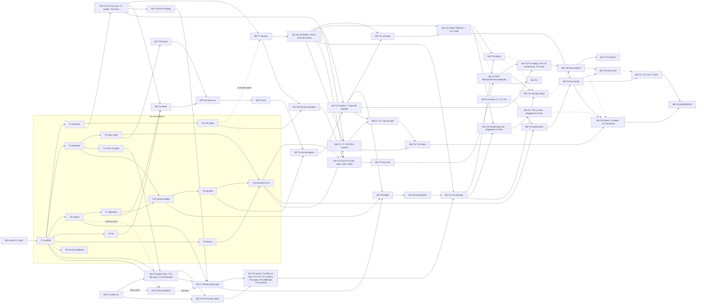

# BeaconMind implementation plan — shared foundation (read this before any milestone file)

Written 2026-10-05. Project: **BeaconMind**, the EN.665.715 capstone. Owner and sole participant:
**Xiaohui Chen**. Final deadline: **2026-12-13**. The plan has an order but no dates; Xiaohui decides
when each task runs.

This file is the contract that the six milestone files (§9) build on. Revised 2026-10-06 after the
per-milestone reviews and a cross-plan consistency review (`REVIEW.md`), and on 2026-10-24 after the car
firmware research note `course-project/research/2026-10-24-car-firmware-lessons-and-pid.md` (L11 reuse rule,
S11, OD21, tasks M3.T21–T24; §10). They refer to its sections by
name, for example "contract C3 (observation)", "convention L1 (layout)" or "safety rule S4". **If a
milestone file contradicts this README, this README wins.** If this README contradicts
`course-project/AGENT-DESIGN.md` (v3.3), AGENT-DESIGN wins, and the executor stops and reports the
conflict (§1.4).

Source documents, in authority order:

| Rank | Document | What it decides |
| --- | --- | --- |
| 1 | `AGENTS.md` (repo root) | Repository rules: execution gate, hosts, AI disclosure, third-party code, git |
| 2 | `course-project/AGENT-DESIGN.md` v3.3 | The agent: D1–D10, §P (prompt), §W (workstream acceptance tests), "Other open project decisions" |
| 3 | `course-project/APPROACH-LLM-SLAM.md` | Idea, ladder L0–L3, benchmark design (§8), cost (§9), workstreams W0–W8 (§10), risks (§11). AGENT-DESIGN supersedes it where they differ (AGENT-DESIGN D1 "Supersedes") |
| 4 | `course-project/proposal-talk-track.md` | Targets, metric application and the decisions still open ("New in this revision, for Xiaohui to confirm") |
| 5 | `course-project/CONTEXT.md` | Current state and session log. Read it first in every session |
| 6 | `reference/hardware/*.md` | Facts about the physical car: pins, power, firmware on the board |

---

## 1. Purpose and how to use this plan

### 1.1 Purpose

The plan breaks the project into milestones M0–M6 and each milestone into tasks. It is written so that
a **lower-end coding model** (for example Grok 4.7 or Sonnet 5.5) can carry out one task per session
**with no memory of earlier sessions**. Everything such a session needs is in four places:

1. `course-project/CONTEXT.md`, for the current state;
2. this README, for the conventions and interface contracts;
3. the task's own section in a milestone file;
4. the files the task lists under **Inputs**.

### 1.2 Session protocol (follow these steps in order, every session)

1. **Read `course-project/CONTEXT.md` in full.** Note the hardware state, which containers were left
   running, and the last session's open items.
2. **Read this README** in full in your first session. In later sessions, re-read §1, §5, §7 and every
   contract that your task cites.
3. **Open the milestone file and read the task in full.** Check the task status table at the top of
   the file. Never start a task whose status is `done`. Never start one with an unfinished prerequisite.
4. **Check the prerequisites.** Run every check command the task lists, on the machine it names, and
   paste the output into your working notes. If a check fails, stop: set the task's status to
   `blocked` and write the reason (§1.4).
5. **Tell Xiaohui what the session will do.** Write a few lines: the task ID, which machines it uses,
   whether any hardware or money is involved, and roughly how long it should take. For any step that
   touches hardware, explain what the step does and why **before** asking Xiaohui to do it. Xiaohui is
   a hardware beginner who owns a multimeter and soldering gear and wants that explanation first.
6. **Carry out the steps in order.** Run every robotics or LLM command on the Spark (convention L5).
   Do not skip a step. Do not reorder steps unless the task allows it.
7. **Run every test the task lists**, exactly as written. Paste the real output.
8. **Save the evidence** under `course-project/evidence/M<n>/<task-id>/` (convention L1), using the
   file names the task gives.
9. **Update the status.** In the milestone file's status table, set the status (`todo`, `in-progress`,
   `blocked` or `done`), the evidence path and today's date. In `CONTEXT.md`, add a dated entry: what was
   done, what was measured, what was left running, and what comes next. Keep the hardware state in
   `CONTEXT.md` current.
10. **Do not commit.** Tell Xiaohui which files changed, and commit only when asked (convention L10).

### 1.3 The execution gate (from AGENTS.md §5 "Execution gate", restated)

- Code is not done until it has **run**. Robotics, ROS 2, Isaac Sim and every LLM call run on the
  **Spark** (`spark-2a60`). Pure-Python code with no LLM and no ROS may run on the Mac.
- Paste the **real** output. **Never write output you did not see.** Invented console output,
  metrics or plots are the one failure Xiaohui cannot catch by reading.
- If something cannot be run (a package is absent, or the hardware is not attached), label it
  **"not executed — run on the Spark with `<command>`"** in the deliverable, in `CONTEXT.md` and in
  your summary.
- **A task is never `done` without pasted evidence** that every acceptance criterion holds. "Should
  work" is not evidence.

### 1.4 Stop and ask Xiaohui (global conditions; each task adds its own)

Stop, write down what you found, set the task to `blocked`, and ask, when any of these happens:

1. A step needs **Xiaohui's hands**: wiring, soldering, pressing a button, switching the battery,
   plugging a cable, moving the robot, printing, measuring with a ruler or meter. Give the
   instruction, explain what and why, say what to report back, then **wait**. Never assume it was
   done.
2. A step would **spend money**: buying parts, or any frontier API call outside a budget the task
   already sets (contract C10.8).
3. A fact the task depends on is **contradicted** by what you observe: a version, a path, a pin, an
   API field, a package. Report the observation; do not quietly adapt.
4. A test still fails after **two** honest fix attempts.
5. A step would be **destructive or shared**: deleting data, `docker rm` or `docker compose down` of a
   container this project does not own (`rosa-ros2`, `vllm-rosa`), removing an image, reflashing
   while the battery is on, force-pushing, or editing `AGENTS.md`.
6. A step would **change a design decision** in AGENT-DESIGN, a design value (contract C0), the move
   set, the prompt, or a pre-registered item (M4).
7. Any safety rule in §7 cannot be met.
8. The task is unclear, or two documents disagree in a way §0's authority order does not settle.

### 1.5 Effort sizes

`S` = one session (about 2 hours). `M` = 2–3 sessions. `L` = 4 or more sessions. These are for
ordering and for the cut-line rule (§3.4), not a schedule.

---

## 2. M0 — course fit (DONE, 2026-10-05)

Settled facts, confirmed by Xiaohui on 2026-10-05 (recorded in `CONTEXT.md` and `AGENTS.md` §5 "The
course project"):

- **Individual project.** Xiaohui Chen is the sole participant and owner. The syllabus's
  Customer/Seller team structure does not apply. Name Xiaohui as the sole participant on every
  project artifact.
- **No Course Project Description exists, and none will arrive.** The repository documents are the
  full specification. Do not wait for one or ask for one.
- **The instructor accepted the change of direction** to BeaconMind.
- **Both earlier deliverables got full credit:** the revised proposal (`Chen-Project-Proposal.pptx`)
  and the Related Works & References PDF (`report/Chen-Project-Report.pdf`).
- **Final deadline: 2026-12-13.** No dated schedule is kept; plans are ordered but undated.

Still unknown, and asked about in M6.T1: the exact list of final deliverables and their formats
(report PDF, video, slides, live demo). The syllabus says 60 % of the project grade is preparation and
participation (AGENTS.md §5), so the evidence folders and review logs are part of what is graded.

---

## 3. Milestone map

### 3.1 Milestones

| ID | Milestone | Workstreams | Exit criterion (the milestone is done when…) |
| --- | --- | --- | --- |
| M0 | Course fit | — | **Done** (§2) |
| M1 | Foundations and open decisions | W0, W2, W1 measurements, W5 pilots | One ROS 2 graph proven; camera upright, flashed, calibrated, with a measured tag noise model; car measured; LLM latency re-measured without queueing; Isaac version chosen and the AprilTag material renders and decodes; open decisions settled and AGENT-DESIGN updated to v3.4 (including the MCP servers) |
| M2 | Minimum viable simulated result (**the cut line**) | W1, W4, W5 | Seeded arenas, the Isaac twin with ground truth, the harness (providers, validator, logging, replay), B0, B1 (GTSAM), B2; a first result: 2–3 models against B0/B1 on simulated replay logs with duplicated IDs, plus a few closed-loop simulated episodes |
| M3 | Real car | W3, W8 | Link baseline at the floor spot measured with the camera streaming (M3.T22); project firmware (K2 link, safety, and IMU layer ported, revised 2026-10-29; motors, encoders, BNO055, wheel-speed PID tuned on the stand, bounded-move executor, watchdog, stall detection) passes the wheels-down gate; PID and left-encoder scale re-checked on the floor (M3.T24); STBY pull-down fitted; UMBmark done; physical arena and overhead ground-truth camera accepted; ≥ 10 real observation logs; closed-loop real runs with 2–3 models; every roster model replayed on the real logs |
| M4 | Full benchmark | W7, W6 (stretch) | Pre-registration frozen before the test seeds run; full roster replayed and run closed loop on held-out seeds; request suite scored; statistics and figures done; frontier pilot ≤ $100 |
| M5 | Report | — | IEEE paper complete (all sections), built with latexmk, reviewed, with an AI disclosure. Written alongside M1–M4 |
| M6 | Demo and presentation | — | ROSA demo (AGENT-DESIGN D10) in simulation and on the car; time-lapse video; slides on the JHU template passing the validator; AI disclosure on every artifact |

### 3.2 Milestone index: files and task lists

The six milestone files below are written. Each file's **status table** is the authority for a task's
state; read it with the helper of convention L12 (`python3 course-project/tools/task_status.py <ID>`).
Task IDs are permanent: a writer may **append** tasks (`T<n+1>`, …) but never renumber or reuse an ID.
The reserved IDs M<n>.T1–T<k> of the first draft keep their numbers; several were narrowed when a
milestone file split them (noted in brackets). "Stretch" tasks run only after the milestone's
non-stretch tasks are done. Effort: S = one session, M = 2–3, L = 4 or more (§1.5).

**M1** — [`M1-foundations.md`](M1-foundations.md), 17 tasks
- M1.T1 (S) Project scaffolding (layout, package skeleton, `.gitignore`, sync scripts, pytest, venvs)
- M1.T2 (M) Contracts as code: `dv.json`, geometry port, JSON Schemas C0–C11
- M1.T3 (M) W0: build `beaconmind-ros` (Humble); packages; Isaac bridge topic + `apriltag_ros` in one graph
- M1.T4 (S) LLM latency re-measured without queueing; closed-loop model setting (OD8)
- M1.T5 (M) Isaac Sim version decision (OD7) + AprilTag render/decode spike + kit-lifetime check
- M1.T6 (M) Camera: stand upright, flashing toolchain, project JPEG firmware, HTTP capture proven
- M1.T7 (S) Camera calibration (checkerboard), HFOV/VFOV, camera-to-base extrinsics
- M1.T8 (M) Tag pilot: range/bearing error vs distance and angle; `configs/detector_noise.json`
- M1.T9 (S) Car measurements; `configs/car.json` [encoder counts per wheel revolution moved to M3.T3, S13; Revised 2026-10-24]
- M1.T10 (S) Settle the open decisions with Xiaohui; AGENT-DESIGN v3.4 incl. MCP servers
- M1.T11 (S) Frontier API spike: keys, one tool call per provider, budget guard (≤ $5)
- M1.T12 (S) Camera ROS 2 bridge `bm_camera_bridge` + rectify + `apriltag_ros` launch
- M1.T13 (S) One-graph proof with the live Pico node (W0 close)
- M1.T14 (S) M1 close-out: `CONTEXT.md` refresh + milestone integration smoke test
- M1.T15 (M) Two local closed-loop candidates after Qwen 3.5 was rejected (appended 2026-10-06 in the M1 file; listed here 2026-10-24)
- M1.T16 (S) Current-car mass, two-scale split, and power-bank box (added 2026-10-29; M2.T4 waits on the blocking rows)
- M1.T17 (S) Settle the camera capture size before calibration (added 2026-10-29; decision, not a second calibration)

**M2** — [`M2-sim-mvp.md`](M2-sim-mvp.md), 20 tasks
- M2.T1 (S) Core library A: tools `dispatch()` (C4) and validator move checks with the latch (C5.1, C5.5)
- M2.T2 (S) Arena spec (C7), seeded generator, D3 constraint checker, dev/test seed split
- M2.T3 (M) Kinematic simulator (kinsim) with placeholder noise models and ground truth (C8)
- M2.T4 (S) URDF of the car (`beaconmind_description`) from `configs/car.json`
- M2.T5 (M) Isaac twin complete: move server, `bm_sim_pico` (C2), headless runner, sim bringup
- M2.T6 (M) Simulated perception: `apriltag_ros` + PnP on the Isaac camera; sim-vs-real error; noise injection
- M2.T7 (M) Harness core: neutral step loop, vLLM provider, prompt loader, budget guard, run logs, replay and closed loop
- M2.T8 (M) B0 dead reckoning and B2 (the D7 procedure as code: estimation, steps 1–6) with the baseline runner
- M2.T9 (M) B1: GTSAM iSAM2 offline on the host, oracle association
- M2.T10 (M) Metrics A: trajectory (ATE/RPE), map, association, validity, latency, cost; `score` CLI; evo cross-check
- M2.T11 (M) Record simulated observation logs (C9.1): dev seeds and a first batch of test seeds
- M2.T12 (M) First result: 2–3 models vs B0/B1/B2 in replay (duplicated IDs) + closed-loop episodes; table and figure
- M2.T13 (M) Core library B: observation builder (C3), counters, slip rules, safety flags (C5.3), auto-latch (C5.2)
- M2.T14 (S) Core library C: report parser and harness correction (C5.4, C6)
- M2.T15 (M) Isaac arena: tag36h11 textures, arena builder from C7, render-and-decode spike
- M2.T16 (M) Isaac car: URDF import, differential drive, calibrated camera, ground truth, ROS 2 publishing
- M2.T17 (S) ROS environment adapter (`envs/ros_env.py`) and the first full B2 episode in Isaac
- M2.T18 (S) Frontier providers: `openai_responses` and `anthropic_messages`
- M2.T19 (S) B2 decisions: D7 step 7 (EXPLORE E1–E5, GO_TO_BEACON, RETURN_TO_START, contact recovery, refused turn)
- M2.T20 (S) Metrics B: missions and SPL, exploration, refusal

**M3** — [`M3-real-car.md`](M3-real-car.md), 26 tasks (T21–T24 added 2026-10-24; T25–T26 added 2026-10-29)
- M3.T1 (S) Safety hardware: STBY pull-down, wheels-up stand, parts purchase, power-path decision
- M3.T2 (M) Firmware skeleton logic: boot disarmed, arm, `/estop`, heartbeat watchdog, boot id, state; host tests
- M3.T3 (S) Encoders: quadrature counting, direction signs, counts per wheel revolution
- M3.T4 (M) Motors: direction mapping (forward = +x), wheel-speed PID, speed cap
- M3.T5 (M) BNO055: IMUPLUS yaw, gyro integration, motor magnetic interference
- M3.T6 (M) Bounded-move executor: five moves, stall and bump, timeout, result codes
- M3.T7 (M) Wheels-down gate (§W), wheels up; link latency → `watchdog_ms`
- M3.T8 (M) UMBmark odometry calibration; update `configs/car.json`
- M3.T9 (M) Real-car bridge in `beaconmind-ros`: Pico telemetry, move client, real env backend
- M3.T10 (M) W8 physical arena: walls, tags printed and measured, survey, real arena spec
- M3.T11 (M) Overhead ground-truth camera: mount, calibrate, roof tag, GT node
- M3.T12 (L) Real runs part 1: ≥ 10 real observation logs (C9.1)
- M3.T13 (S) Out-of-band STOP hotkey and the latch file
- M3.T14 (M) Firmware build chain: project micro-ROS library, UDP transport, first node
- M3.T15 (S) Contact detection acceptance: ≥ 10 wall drives; bump threshold
- M3.T16 (S) Real observation pipeline on the car: static accuracy check
- M3.T17 (S) Ground-truth accuracy acceptance (5 cm / 3°)
- M3.T18 (L) Real runs part 2: closed-loop L2 runs with 2–3 models
- M3.T19 (M) Real runs part 3: replay of every available arm on the real logs
- M3.T20 (S) Untethered power path: power-bank trial (OD9)
- M3.T21 (M) Wheel-speed PID tuning on the stand: step responses, low-speed hold, battery range
- M3.T22 (M) Link baseline at the floor spot with the camera streaming (Assignment 7 firmware as the instrument)
- M3.T23 (M) Port the K2 link, safety, and IMU layer into the project firmware (copy source revised 2026-10-29; was Assignment 7 J2)
- M3.T24 (M) Floor re-tune of the wheel PID and the left encoder's scale (after the wheels-down gate)
- M3.T25 (S) Camera Wi-Fi rejoin while running, or a dated replug decision (added 2026-10-29)
- M3.T26 (S) Host adapter from C2 IMU and wheel topics into the EKF inputs (added 2026-10-29)

**M4** — [`M4-benchmark.md`](M4-benchmark.md), 16 tasks
- M4.T1 (M) Pre-registration: hypotheses, endpoints, episode counts from the pilot power analysis, seeds, roster, budget; frozen before the test seeds run
- M4.T2 (M) Roster: local candidates served and gated (structured tool calls), frontier gate inside the $100 pilot cap, effort tiers matched, data-governance guard
- M4.T3 (M) Request suite: ≥ 30 unsafe and ≥ 10 valid requests, suite runner and scoring (C10.6), dev dry run
- M4.T4 (L) Replay sweep on held-out simulated logs (unique and duplicated IDs), full roster and B0/B1/B2, K ≥ 3
- M4.T5 (L) Closed-loop sweep on held-out kinsim seeds (EXPLORE → RETURN_TO_START → GO_TO_BEACON), closed-loop models, B2 and the random explorer
- M4.T6 (M) Statistics and figures library: Friedman with Holm-corrected Wilcoxon, exact McNemar, seed-clustered bootstrap, effect sizes, power simulation, Pareto front; tested before the freeze
- M4.T7 (L) Stretch: the L1 and L3 arms (go/no-go)
- M4.T8 (L) Stretch: the NoMaD/GNM navigation arm (W6) (go/no-go)
- M4.T9 (M) Stretch: the hidden-ID condition and the V (image) ablation
- M4.T10 (M) Sweep infrastructure: interface check, job manifests, resumable sweep runner, spend ledger, holdout guard, cost and time estimator
- M4.T11 (M) Dev-seed pilot: roster on dev logs and dev closed loop, latency at concurrency 1, variance, tokens and cost; frontier pilot within $100
- M4.T12 (M) Record the held-out simulated observation logs for the frozen test seeds
- M4.T13 (M) Real-log replay sweep and the sim-to-real gap
- M4.T14 (S) Request-suite scoring on held-out contexts
- M4.T15 (M) Isaac closed-loop confirmatory subset
- M4.T16 (M) Final analysis: results, tables and figures for M5.T14

**M5** — [`M5-report.md`](M5-report.md), 15 tasks
- M5.T1 (S) Introduction
- M5.T2 (M) System Overview, with the architecture figure
- M5.T3 (M) Experiments (protocol, conditions, baselines, metrics)
- M5.T4 (M) Results and Evaluation (tables and figures generated from `data/`, never typed by hand)
- M5.T5 (S) Conclusion and limitations
- M5.T6 (S) Trim Related Works to fit; references check
- M5.T7 (M) Generative-AI disclosure, final build, adversarial review
- M5.T8 (S) Report requirements, page budget, preamble and build checker
- M5.T9 (M) Report numbers and tables pipeline (`tools/report_assets.py`)
- M5.T10 (M) Figure pipeline: arena and trajectory figures (`tools/report_figures.py`)
- M5.T11 (S) AI-disclosure ledger, reconciled with Xiaohui
- M5.T12 (S) Interim adversarial review of Sections I–IV
- M5.T13 (S) Experiments update: frozen pre-registration and the real setup
- M5.T14 (M) Results update to the full benchmark
- M5.T15 (S) Abstract, index terms and title check

**M6** — [`M6-demo-presentation.md`](M6-demo-presentation.md), 17 tasks
- M6.T1 (S) Confirm the final deliverables with Xiaohui (formats, lengths, where they are submitted)
- M6.T2 (M) ROSA demo runtime in `rosa-ros2`: MCP servers exposing the D5 tools, `RobotSystemPrompts` v3.3+, `accumulate_chat_history=False`, against the Isaac twin
- M6.T3 (M) The same ROSA demo on the car
- M6.T4 (S) Demo script and filming: explore, return to start, go to a named beacon, refuse "follow that person"; time-lapse video
- M6.T5 (M) Slides on the JHU template, validated, with a talk track
- M6.T6 (S) Final submission package and an AI-disclosure audit of every artifact
- M6.T7 (S) Demo environment server, file RPC and stub runner (no LLM)
- M6.T8 (S) ROSA decider, ReAct console, demo trace and tmux capture; kinsim smoke with the real model
- M6.T9 (S) Isaac twin hookup: 3-step ROSA smoke and an estop check in the twin
- M6.T10 (S) Simulation demo take in the Isaac twin
- M6.T11 (S) Video logic: edit decision list, time-lapse fitting, frame times, render plan, ffmpeg plan
- M6.T12 (S) Video renderers: terminal frames, belief panel, top-down view, cards
- M6.T13 (M) Isaac Sim re-render of a take's ground-truth trajectory
- M6.T14 (S) Simulation demo video assembly
- M6.T15 (S) Car demo video assembly (phone footage, terminal, time-lapse)
- M6.T16 (S) Final demo video: cards, narration, checks
- M6.T17 (S) Rehearsal and, if required, the recorded presentation

**Splits of the originally reserved tasks** (so an old reference is read correctly): M2.T1 now covers
`dispatch()` and the validator's move checks only — the observation builder is **M2.T13**, the report
parser **M2.T14**; M2.T5 is the *complete* twin and needs the arena (**M2.T15**) and the car (**M2.T16**);
`envs/ros_env.py` and the first Isaac B2 episode are **M2.T17**; frontier providers are **M2.T18**; B2's
navigation decisions are **M2.T19**; missions/SPL/exploration/refusal metrics are **M2.T20**. M3.T1 no
longer contains the STOP hotkey (**M3.T13**) or the power-bank trial (**M3.T20**); M3.T11's accuracy
acceptance is **M3.T17**; M3.T12 is only the ≥ 10 real logs — closed-loop real runs are **M3.T18** and
real-log replay is **M3.T19**; the firmware build chain is **M3.T14**, contact acceptance **M3.T15**, the
real observation pipeline **M3.T16**. M4.T6 is the statistics *library*; the final results, tables and
figures are **M4.T16**; held-out request-suite scoring is **M4.T14**; real-log replay is **M4.T13**. M5's
first result is M5.T4 and the full-benchmark update is **M5.T14**; M6's runtime pieces are M6.T7–T9, the
simulation take M6.T10, and the video M6.T11–T16.

**Revision of 2026-10-24** (research note `research/2026-10-24-car-firmware-lessons-and-pid.md`, Xiaohui's
request "modify the task plan accordingly ... add tasks such as tuning PID"): M3.T2's link handling (session
supervisor, hardware watchdog) is ported from Assignment 7 in **M3.T23**, which M3.T2 now waits for; M3.T3
measures counts per wheel turn and signs with powered stand runs (no hand-turning since 2026-10-23), and its
floor IMU cross-check moved to **M3.T24**; M3.T4's bench tuning (old step 10) is now a short wheels-up first
check, the full stand tuning is **M3.T21** and the floor re-tune **M3.T24**; **M3.T22** measures the link at the
floor spot with the camera streaming, and M3.T7's G0 takes its baseline as an input. M1.T15 (appended by the M1
file on 2026-10-06) was missing from this index and is now listed.

### 3.3 Dependency graph (consolidated across all milestone files)

Summary graph (one box per group of tasks; arrows are "must be `done` first"; dotted = soft or
"if done"):



**Every task's prerequisites** (taken from the "Depends on" column of each milestone file's task list on
2026-10-06; cross-milestone prerequisites in **bold**). A machine check found no cycle and no reference
to a task that does not exist (REVIEW.md, consistency check 1). Revised 2026-10-24: rows M1.T15 and
M3.T21–T24 added, M3.T2 gains M3.T23, M3.T3 gains M3.T1 (its powered encoder runs need the battery on) and
M3.T8 gains M3.T24 (the check was re-run on the revised table; §10). Revised 2026-10-24 (consistency
check): M3.T24 gains M3.T20 (the power bank mounted and balanced before the floor runs, M3 §0.9) and
M3.T22 gains M3.T1 for its drive arms only (soft), as `M3-real-car.md` §0.9 lists them.

| Task | Depends on |
| --- | --- |
| **M1** | |
| M1.T1 | — |
| M1.T2 | M1.T1 |
| M1.T3 | M1.T1 |
| M1.T4 | M1.T1 |
| M1.T5 | M1.T3 |
| M1.T6 | M1.T1 |
| M1.T7 | M1.T6, M1.T17 |
| M1.T8 | M1.T3, M1.T6, M1.T7, M1.T12 |
| M1.T9 | M1.T1, M1.T2, M1.T7 |
| M1.T10 | M1.T4, M1.T5, M1.T8, M1.T9, M1.T11 |
| M1.T11 | M1.T2, M1.T3 |
| M1.T12 | M1.T3, M1.T7 |
| M1.T13 | M1.T3 |
| M1.T14 | M1.T1, M1.T2, M1.T3, M1.T4, M1.T5, M1.T6, M1.T7, M1.T8, M1.T9, M1.T10, M1.T11, M1.T12, M1.T13 |
| M1.T15 | M1.T1 |
| M1.T16 | M1.T1 |
| M1.T17 | M1.T6 |
| **M2** | |
| M2.T1 | **M1.T1, M1.T2** |
| M2.T2 | **M1.T2** |
| M2.T3 | M2.T2, M2.T13 |
| M2.T4 | M2.T3; **M1.T3, M1.T7, M1.T9, M1.T16** |
| M2.T5 | M2.T3, M2.T16 |
| M2.T6 | M2.T5, M2.T13; **M1.T8** |
| M2.T7 | M2.T1, M2.T3, M2.T13, M2.T14; **M1.T4, M1.T11** |
| M2.T8 | M2.T7 |
| M2.T9 | M2.T7 |
| M2.T10 | M2.T7 |
| M2.T11 | M2.T17, M2.T19; **M1.T8, M1.T9** |
| M2.T12 | M2.T9, M2.T10, M2.T11, M2.T18, M2.T19, M2.T20 |
| M2.T13 | M2.T1 |
| M2.T14 | M2.T1 |
| M2.T15 | M2.T2; **M1.T5** |
| M2.T16 | M2.T4, M2.T15; **M1.T7** |
| M2.T17 | M2.T6, M2.T10, M2.T19 |
| M2.T18 | M2.T7; **M1.T11** |
| M2.T19 | M2.T8 |
| M2.T20 | M2.T10 |
| **M3** | |
| M3.T1 | **M1.T1** |
| M3.T2 | M3.T14, M3.T23; **M1.T3, M1.T13** |
| M3.T3 | M3.T1, M3.T2 |
| M3.T4 | M3.T1, M3.T3; **M1.T9** |
| M3.T5 | M3.T4 |
| M3.T6 | M3.T4, M3.T5; **M1.T2** |
| M3.T7 | M3.T1, M3.T6, M3.T13; **M1.T6** |
| M3.T8 | M3.T7, M3.T10, M3.T20, M3.T24; **M1.T9** |
| M3.T9 | M3.T7; **M1.T3, M1.T7, M1.T12, M1.T13, M2.T1, M2.T6, M2.T11, M2.T13, M2.T17** |
| M3.T10 | M3.T7; **M1.T7, M1.T9, M2.T2** |
| M3.T11 | M3.T7, M3.T10; **M1.T3, M1.T7** |
| M3.T12 | M3.T8, M3.T9, M3.T15, M3.T16, M3.T17; **M2.T7, M2.T8, M2.T11, M2.T19** |
| M3.T13 | **M1.T1, M1.T3, M2.T1** |
| M3.T14 | **M1.T1** |
| M3.T15 | M3.T8, M3.T10 |
| M3.T16 | M3.T9, M3.T10; **M1.T8, M1.T12** |
| M3.T17 | M3.T11 |
| M3.T18 | M3.T12; **M1.T4, M1.T11, M2.T12** |
| M3.T19 | M3.T12; **M2.T9, M2.T10, M2.T12** |
| M3.T20 | M3.T1, M3.T7 |
| M3.T21 | M3.T1, M3.T4 |
| M3.T22 | **M1.T1** (M1.T6 for the camera arms only, soft; M3.T1 for the drive arms only, soft) |
| M3.T23 | M3.T14 |
| M3.T24 | M3.T7, M3.T20, M3.T21 |
| M3.T25 | M1.T6 |
| M3.T26 | M3.T14, M3.T23 |
| **M4** | |
| M4.T1 | M4.T2, M4.T3, M4.T6, M4.T11 |
| M4.T2 | M4.T10; **M1.T4, M1.T11, M2.T7, M2.T18** |
| M4.T3 | M4.T10; **M1.T10, M2.T3, M2.T7, M2.T8, M2.T19, M2.T20** |
| M4.T4 | M4.T1, M4.T12 |
| M4.T5 | M4.T1; **M2.T19, M2.T20** |
| M4.T6 | M4.T10; **M2.T10, M2.T20** |
| M4.T7 | M4.T16 |
| M4.T8 | M4.T16; **M2.T5** |
| M4.T9 | M4.T16 |
| M4.T10 | **M2.T7, M2.T10, M2.T13, M2.T14** |
| M4.T11 | M4.T2, M4.T3, M4.T6, M4.T10; **M2.T11** |
| M4.T12 | M4.T1; **M2.T5, M2.T6, M2.T17** |
| M4.T13 | M4.T1; **M3.T12, M3.T17, M3.T19** |
| M4.T14 | M4.T1, M4.T3 |
| M4.T15 | M4.T5; **M2.T5, M2.T17** |
| M4.T16 | M4.T4, M4.T5, M4.T13, M4.T14, M4.T15 |
| **M5** | |
| M5.T1 | M5.T8 |
| M5.T2 | M5.T8 |
| M5.T3 | M5.T2; **M1.T10** |
| M5.T4 | M5.T3, M5.T9, M5.T10; **M2.T12** |
| M5.T5 | M5.T4, M5.T14 |
| M5.T6 | M5.T5 |
| M5.T7 | **all other M5 tasks (`done` or `dropped (cut line)`)** |
| M5.T8 | — |
| M5.T9 | M5.T8; **M1.T1** |
| M5.T10 | **M1.T1, M2.T2, M2.T10, M2.T11** |
| M5.T11 | — |
| M5.T12 | M5.T1, M5.T2, M5.T3 |
| M5.T13 | M5.T3; **M4.T1** |
| M5.T14 | M5.T4; **M4.T16** |
| M5.T15 | M5.T5 |
| **M6** | |
| M6.T1 | — |
| M6.T2 | **M1.T4, M1.T10, M2.T1** |
| M6.T3 | M6.T10; **M3.T13, M3.T17, M3.T18** |
| M6.T4 | M6.T8; **M2.T2** |
| M6.T5 | M6.T1, M6.T14; **M2.T12, M4.T16, M5.T4, M5.T9** |
| M6.T6 | **every other M6 task, M5.T7** |
| M6.T7 | M6.T2; **M2.T3, M2.T7, M2.T13, M2.T14, M2.T20** |
| M6.T8 | M6.T7 |
| M6.T9 | M6.T8; **M2.T5, M2.T6, M2.T17** |
| M6.T10 | M6.T4, M6.T9 |
| M6.T11 | M6.T7 |
| M6.T12 | M6.T11 |
| M6.T13 | M6.T10, M6.T11; **M2.T15, M2.T16** |
| M6.T14 | M6.T12, M6.T13 |
| M6.T15 | M6.T3, M6.T12 |
| M6.T16 | M6.T14, M6.T15 |
| M6.T17 | M6.T5, M6.T16 |

Soft or conditional edges (the task may start without them, as its file says): M1.T9 ← M1.T2, M1.T7 (only
for schema validation and lens values); M1.T10 ← M1.T9, M1.T11 (recorded as pending if not done); M2.T7
← M1.T11 (or open decision OD18, the waiver) and M1.T4 (closed-loop model choice only); M2.T11 ← M1.T8,
M1.T9 (for non-placeholder logs; kinsim logs need only M2.T19); M2.T12 ← M2.T18 (frontier arm only);
M3.T9 ← M2.T6, M2.T17, M2.T11 (with the M3.T9 step-1 branches, including the Isaac-fallback branch);
M3.T12 ← M2.T19 (else the operator-driver branch); M4.T13 ← M3.T19 (reuse only); M4.T16 ← M4.T13, M4.T15
(if done, else deviations); M5.T5 ← M5.T14 (unless `dropped (cut line)`); M6.T5 ← M4.T16 (else M2.T12);
M3.T22 ← M1.T6 (the camera-streaming arms only: if M1.T6 is not done, the no-camera arms run and the camera
arms are marked `blocked`); **revised 2026-10-24:** M3.T22 ← M3.T1 (the drive arms 3–4 only: if M3.T1 is
not done, arms 1–2 run and arms 3–4 are marked `blocked: M3.T1`, because the drive arms switch the battery
on under a firmware that boots armed and can reboot itself; M3.T22 prerequisites). M3.T7 also reads M3.T22's link baseline as an input to its G0 watchdog setting
when M3.T22 is done; it is not a prerequisite. M5.T2, M5.T3 and M5.T10 also use many other tasks "if done"
(`M5-report.md` entry table).

### 3.4 Cut line and critical path to 2026-12-13

**Cut line (APPROACH §10, proposal talk track):** if time runs short, deliver **sim-only L2 + B1 with 2–3
models, plus replay of real-car logs.** In plan terms that is: all of M1; all of M2; M3.T1–T17, T19, T20
and T21–T24 (the 10 real logs with moves chosen by B2 or by the operator, not an LLM, and their replay by
the 2–3 M2.T12 models; of the tasks added on 2026-10-24, M3.T21, T23 and T24 are prerequisites of those
logs and M3.T22 supplies the link baseline that M3.T7 and OD21 use) — **M3.T18 is dropped**; M4 reduced
to M4.T6, a short M4.T1 (the 2–3 models only), M4.T12 (if Isaac works), M4.T4 for those models plus B0/B1/B2, M4.T13 and M4.T16 (`M4-benchmark.md` "Cut line in
M4") — M4.T2, T3, T5, T11, T14, T15 and every stretch task are dropped, so **no benchmark refusal rate
exists** at the cut line; all of M5; and M6 without the car (M6.T3 and M6.T15 dropped).

**Size of the work** (effort sizes summed with S = 1, M = 2.5, L = 4.5 sessions; a planning estimate, not
a schedule): the whole plan is about **198 sessions** (M1 21.5, M2 38, M3 43.5, M4 46.5, M5 25.5, M6 23);
the cut line is about **163 sessions**. On 2026-10-06 there are 68 calendar days left, so even the cut
line needs about 2.4 two-hour sessions per day on average. Much of M2/M4 is unattended compute, but the
bench and review sessions are not. Tell Xiaohui this number at the start of M1 (§3.5 OD19).

**Recomputed on 2026-10-24** from the status tables (M1.T15 now counted; M3.T21–T24 added, M3.T22 and
M3.T24 counted as M, their "S–M" kept only as a note): about **210.5 sessions** in all (M1 24, M2 38, M3 53.5, M4 46.5, M5 25.5, M6 23). **Not recomputed on 2026-10-29.** Four tasks were added that day, each sized S (M1.T16, M1.T17, M3.T25, M3.T26). The 210.5 figure does not include them. The cut-line figure from that same 2026-10-24 count was
about **175**. With 50 calendar days left and M1.T1–T5 the only `done` tasks (≈ 9.5
sessions), the cut line needs about **3.3 two-hour sessions per day**. The ≤ 42-day trigger below falls on
**2026-11-01**, the ≤ 28-day one on 2026-11-15 and the ≤ 21-day freeze on 2026-11-22. Tell Xiaohui these
numbers at the start of the next M3 session.

**Triggers.** These are not a schedule; they are rules the executor applies by counting the calendar
days left before 2026-12-13 at the start of every session:

| Days left | Condition | Action |
| --- | --- | --- |
| ≤ 42 | M2.T12 not done | Tell Xiaohui: invoke the cut line now. Do not start M4 stretch tasks (M4.T7–T9) |
| ≤ 28 | M3.T12's 10 real logs not recorded | Tell Xiaohui: the real-log replay is at risk; options are fewer logs (≥ 5) or sim only, stated as a limitation |
| ≤ 21 | any | Freeze experiments. Only M5 and M6 tasks, plus reruns that fix a bug in an existing result |
| ≤ 7 | any | Only M5.T7 and M6.T6 |

**Critical path** (longest chain of "must be done first" edges, weighted by effort; computed from the
table in §3.3 on 2026-10-06 and recomputed on 2026-10-24 after M3.T21–T24 were added, and again on
2026-10-24 after the edge M3.T20 → M3.T24 was added; soft edges not counted):

1. **To the cut-line result M2.T12** (≈ 24 sessions):
   M1.T1 → M1.T2 → M2.T1 → M2.T13 → M2.T3 → M2.T4 → M2.T16 → M2.T5 → M2.T6 → M2.T17 → M2.T11 →
   M2.T12. M2.T4 also waits for the camera chain M1.T6 → M1.T7 and for M1.T9 (car), and M2.T15 (arena)
   for M1.T5 (Isaac spike), so start those early.
2. **To the final submission** (≈ 46.5 sessions since 2026-10-24, was ≈ 45; the same for the full plan
   and the cut line): two chains meet at **M3.T12** — the Isaac chain above to M2.T17 → M2.T11, then
   M3.T9 → M3.T16 → M3.T12 (≈ 29.5 sessions to M3.T12), and the bench chain of item 3 (≈ 31) — and
   continue **M3.T12 → M3.T19 → M4.T13 → M4.T16 → M5.T14 → M5.T5 → M5.T6 → M5.T7 → M6.T6**.
   **Revised 2026-10-24:** since M3.T23 was added and M3.T24 waits for M3.T20, the bench chain is the
   longer by 1.5 sessions: every slip on the bench chain delays the submission, and a slip of more than
   1.5 sessions on the Isaac chain does too. The real-car chain joins the Isaac chain at M3.T9, because
   the real environment backend extends M2.T17's `envs/ros_env.py`.
3. **The bench chain in parallel** (≈ 31 sessions to M3.T12 since 2026-10-24, was ≈ 28.5; all needing
   Xiaohui at the bench): M1.T1 → M3.T14 → M3.T23 → M3.T2 → M3.T3 → M3.T4 → M3.T5 → M3.T6 → M3.T7 →
   M3.T20 → M3.T24 → M3.T8 → M3.T15 → M3.T12 (M1.T3 → M1.T13 now runs beside M3.T14 → M3.T23).
   **Revised 2026-10-24:** M3.T24 waits for M3.T20 (power bank mounted and balanced, M3 §0.9), so from
   M3.T7 to M3.T8 the path M3.T20 → M3.T24 (S + M ≈ 3.5 sessions) is one session longer than M3.T10
   (≈ 2.5); M3.T10 → M3.T8 and M3.T10 → M3.T11 → M3.T17 → M3.T12 each have about one session of slack.
   M3.T21 (after M3.T4) must also finish before M3.T24. M3.T1 (the STBY pull-down purchase) must start at
   once, because delivery takes days. **M3.T22 needs only M1.T1 (and M1.T6 for its camera arms, M3.T1 for
   its drive arms): run it early**, because it shows whether a 0.2 s STOP and a 500 ms watchdog are
   reachable on this link before the firmware is built around them (research note §1 item 3, §4
   "Order").
4. **The demo chain** (≈ 25.5 sessions to M6.T16): the Isaac chain to M2.T17, then M6.T9 → M6.T10 →
   M6.T13 → M6.T14 → M6.T16 (M6.T2 → M6.T7 → M6.T8 can be built earlier on kinsim).

The largest risks on these paths are the Isaac twin (APPROACH §11 item 4: M1.T5, M2.T15–T17) and the
camera (item 2: M1.T6–T8). Do the Isaac spike (M1.T5) before investing in the twin. On the car, the
largest risk is the **Wi-Fi link at the floor spot**: the house mesh delivers multi-second stalls that no
firmware removes (ping p99 2.5–11 s on 2026-10-23, 88–2,398 ms in four 3-min runs on 2026-10-24; research
note F2). M3.T22 measures it early; OD21 decides what a link stall does to an episode.

**Fallback if the Isaac twin fails at M1.T5, M2.T15, M2.T16 or M2.T5:** stop and ask Xiaohui. The options
are (a) results from the kinematic simulator of M2.T3 with the measured noise model, labelled `source:
"kinsim"` and reported as such, or (b) Gazebo (installed on the Spark host, Gazebo Sim 8.11.0), which
Xiaohui ruled out for career reasons (`CONTEXT.md`, 2026-09-27). The default is (a), and only Xiaohui can
approve either. Under (a), M2.T6/M2.T17 never run, so M3.T9 creates `envs/ros_env.py` itself (its step-1
fallback branch), M4.T12 records held-out logs with kinsim, and M6's simulation take uses kinsim with
the top-down view instead of the Isaac re-render (M6.T13 fallback).

### 3.5 Open decisions register

Each item has a proposed default. M1.T10 settles them with Xiaohui and records them in AGENT-DESIGN
v3.4. Until then, build to the default and label it "proposed default (M1.T10 confirms)".

| ID | Decision | Proposed default | Alternative, and when to choose it | Settled by |
| --- | --- | --- | --- | --- |
| OD1 | Request suite for refusal | ≥ 30 unsafe and ≥ 10 valid requests, fixed in `configs/request_suite.json`; only `REFUSED` is correct for unsafe; `ASK` only for ambiguous valid requests (talk track) | A larger suite (≥ 60) if the pilot's refusal rate is near the 90 % boundary | M1.T10 |
| OD2 | Coded baseline B2 | Yes: the D7 procedure as deterministic code, sharing the tools (reuse the logic of `tools/backstory_sim.py`) | Drop B2 only at the cut line | M1.T10 |
| OD3 | B1 association when IDs repeat | Oracle association (true physical tag), so B1 is an upper bound (talk track) | Nearest-neighbour association as a second B1 variant (stretch) | M1.T10 |
| OD4 | L1 and L3 | Stretch arms (M4.T7); L2 is the headline | Promote L3 if M2 finishes early | M1.T10 |
| OD5 | Primary pose metric | Unaligned ATE-RMSE in the start frame; aligned ATE (SE(2) Umeyama), final pose error and RPE per metre are secondary (talk track) | Aligned ATE primary, as in APPROACH §8 T1; reject unless Xiaohui prefers it | M1.T10 |
| OD6 | Targets | The talk track's targets (C10.11), pre-registered after the pilot | Revise after the M2.T12 pilot, before M4.T1 freezes them | M4.T1 |
| OD7 | Isaac Sim version | 5.1 (AGENT-DESIGN "Isaac Sim version"); 6.0 evaluated in parallel | 6.0 if 5.1's AprilTag material fails and 6.0's passes | M1.T5 |
| OD8 | Closed-loop model setting | Whatever passes the 60 s p95 gate: Qwen3.5 thinking at `MAX_SEQS` 1, else thinking off, else an API model | — | M1.T4 |
| OD9 | Untethered power path | USB power bank on the Pico's micro-USB, VSYS jumper out (AGENT-DESIGN §W "untethered mode") | Regulator path (AMS1117 → VSYS) only with the STBY pull-down fitted and the wheels up at every switch-on | M3.T1 |
| OD10 | Firmware "forward" | Project firmware's forward = toward the caster/camera end (+x, AGENT-DESIGN D3) | None. The Module 5 tilt firmware's forward is the opposite (`discussions/module5/DESIGN.md` §1) | M3.T4 |
| OD11 | Tag detector | `apriltag_ros` (ROS 2 node) in `beaconmind-ros`; OpenCV `cv2.aruco` (4.13 on the Spark host) only for offline checks | `cv2.aruco` in a custom node if `apriltag_ros` is missing for Humble arm64 | M1.T3 |
| OD12 | Camera firmware toolchain | Arduino CLI with the ESP32 core, in a container on the Spark (`esptool` and `arduino-cli` are absent on the Spark host, AGENTS.md §7.4) | ESP-IDF in its official container if the Arduino core fails on the OV3660 | M1.T6 |
| OD13 | BNO055 fusion mode | IMUPLUS (AGENT-DESIGN D5, DV) | NDOF only if M3.T5 shows the motors do not disturb the magnetometer | M3.T5 |
| OD14 | ROSA demo MCP servers | One stdio FastMCP server `bm-tools` exposing the D5 tools, plus the Module 4 `l2-episodes` server as optional memory | Tools only, without memory, if the demo's context window overflows | M1.T10 |
| OD15 | Result of a move aborted by `/estop` (one mapping for the twin and the car, C12) | (a) `result_code` 4 `link_lost`, `flags` bit 2 = estop, bits 8–15 = refusal reason (auto-latches under C5 item 2) | (b) `refused` + reason 9 `estop`; (c) a new result 6 `stopped` (changes the C2 enum everywhere) | M1.T10; if postponed, whichever of M2.T5 / M3.T2 runs first |
| OD16 | Shape of a successful tool result (C4) | Parity with the v3.3 smoke harness: no `status` key on success; errors `{"status": "error", …}` | `"status": "ok"` on every success, as D5's wording suggests (M2.T1's parity test then strips it) | M1.T10; else M2.T1 |
| OD17 | Contract additions found by the milestone writers | C0 `bump_lin_acc_mps2` (null until M3.T15) and `sweep_margin_m` 0.05; C2 `RMW_UXRCE_MAX_SUBSCRIPTIONS ≥ 4`, refusal-reason bits, diagnostic topics `/pico/move/diag` and `/pico/diag` | Each item can be declined separately (`M3-real-car.md` §0.7 says what then changes) | M1.T10; else M2.T13, M3.T2, M3.T6, M3.T14 |
| OD18 | May M2.T7–T10 start before M1.T11 (frontier spike)? | Yes: they make no frontier call; only M2.T18 waits for M1.T11 | No: run M1.T11 first | M1.T10; else M2.T7 |
| OD19 | Scope against the effort estimate (§3.4: ≈ 198 sessions for everything, ≈ 163 for the cut line, 68 days left on 2026-10-06) | Plan the full scope, commit to the cut line as the deliverable, and apply the §3.4 triggers | Adopt the cut line now (drop M3.T18, the M4 sweep and stretch work, and M6's car take up front) | Xiaohui, at the start of M1 (record in `CONTEXT.md`) |
| OD20 | Random-explorer arm `R` in the closed-loop sweep (adds `R` to the L2 arm list) | Yes (EXPLORE phase only) | No: B2 and the LLM arms only | M4.T5 step 3, **before** the M4.T1 freeze |
| OD21 | Does a `link_lost` stop latch the episode on this link? (Added 2026-10-24. C5 item 2 latches on every `link_lost`; at the car's floor spot the house mesh stalls for seconds, and a `FORWARD_25` move at 0.15 m/s with 0.3 m/s² ramps takes about 2.2 s, so a watchdog near the measured p99 trips on some moves by construction; research note F2) | Keep C5's auto-latch and set `watchdog_ms` from the M3.T22 baseline and the M3.T7 G0 measurement | A non-latching `link_stall` outcome when the stop was clean (motors stopped by the watchdog, no contact) and the link returned within a bound; changes C2 (result enum, wire codes) and C5 item 2 for the twin and the car alike, and AGENT-DESIGN D5 (auto-latch on `link_lost`, `AGENT-DESIGN.md:221-223`): a v3.4 design change (§1.4 item 6). Choose it if M3.T22 shows that latching would end too many episodes on this link | Xiaohui, after M3.T22 |

M6 has its own decision list MD1–MD7 (ROSA tool set, how ROSA reaches the robot, the `rosa-ros2` mount,
demo seeds, simulation footage, video editing, slide display), each with a default, in
`M6-demo-presentation.md` "M6 decisions"; M6.T1 and M6.T2 ask them.

---

## 4. Task ID scheme and the mandatory task template

### 4.1 IDs

- A task is `M<n>.T<k>`: milestone number, then task number, with no zero padding (`M1.T3`, `M2.T12`).
- Sub-steps are numbered inside a task (`M2.T5 step 7`). Do not create IDs such as `M2.T5a`.
- Evidence for a task lives in `course-project/evidence/M<n>/M<n>.T<k>/`.
- Decisions use `OD<k>` (§3.5). Contracts use `C<k>` (§6). Safety rules use `S<k>` (§7). Conventions
  use `L<k>` (§5).

### 4.2 Milestone file structure (every `M<n>-*.md`)

1. Title, goal, entry criteria (which tasks of other milestones must be `done`), exit criteria.
2. **Status table**: `| Task | Title | Status | Effort | Evidence | Last updated | Notes |`. Status is one
   of `todo`, `in-progress`, `blocked`, `done`, `dropped (cut line)`.
3. The tasks, each written with the template below.
4. An AI-disclosure line for the file itself.

### 4.3 The template (every heading is required; write "none" when a heading is empty)

```markdown
### M<n>.T<k> — <title>

**Why.** What this task produces and why the project needs it, with links to the design
(`AGENT-DESIGN.md` D<k>/§W, `APPROACH-LLM-SLAM.md` §<k>, the contract C<k> of plan/README.md).

**Prerequisites.**
| Prerequisite | Kind (task / hardware / service) | Check command (machine) | Expected result |
| --- | --- | --- | --- |
| M1.T1 done | task | `python3 course-project/tools/task_status.py M1.T1` (Mac; convention L12) | `M1.T1 done` |
| vLLM serving | service | `curl -sf http://127.0.0.1:8000/v1/models` (Spark host) | JSON listing `Qwen/Qwen3.5-35B-A3B` |

**Inputs.** Files to read before starting, with the section to read.

**Steps.** Numbered. Each step names:
- the machine and shell: `Mac`, `Spark host`, `Spark container beaconmind-ros`, `Spark container
  rosa-ros2`, `Spark container vllm-rosa`, `Spark container pico-micro-ros-agent`, `Pico`, `ESP32-CAM`,
  or `Xiaohui (bench)`;
- the exact command, or the exact file and function to create or edit;
- for hardware steps: **What** happens physically, **Why** it is done this way, what to **measure**,
  and the **pass threshold**, written before the instruction;
- every unverified fact as a **verification step**: the command that checks it, then one branch per
  outcome ("If it prints X → continue at step N. If it prints Y → stop and ask (§1.4 item 3).").

**Deliverables.** Exact paths of every file created or changed.

**Tests.**
- Unit tests: file path; one line per test case naming what it asserts; the command; the expected
  final line (for example `12 passed`).
- Smoke tests: command; machine; the observable result that counts as a pass.
- Hardware tests: what is measured, with which instrument, the pass threshold, and how many repeats.

**Acceptance criteria.** A checklist (`- [ ]`). Each item can be checked against saved evidence.

**Evidence to save.** Paths under `course-project/evidence/M<n>/M<n>.T<k>/` and what each file holds
(real command output, measurement tables, photos).

**Pitfalls and known gotchas.** With sources (AGENTS.md §7.4 gotcha numbers, review IDs, hardware notes).

**Stop-and-ask conditions.** Those specific to this task, in addition to §1.4.

**Estimated effort.** S, M or L.

**AI-disclosure note.** The exact disclosure each deliverable must carry (convention L11).
```

---

## 5. Shared conventions

### L1 — Repository layout (one layout for the whole project)

Everything lives under `course-project/` (AGENTS.md §3: capstone artifacts never go under
`assignments/`). Paths below are relative to the repository root. The Mac copy is
`/Users/xiaohuichen/Projects/EN.665.715`; the Spark mirror is `/home/xiaohui_chen/Projects/EN.665.715`.

```
course-project/
├── CONTEXT.md, AGENT-DESIGN.md, APPROACH-LLM-SLAM.md, …    # existing design documents
├── plan/                       # this plan: README.md + M1…M6 files
├── beaconmind/                 # PYTHON PACKAGE ROOT (pure Python; no rclpy import at module level)
│   ├── pyproject.toml          # name "beaconmind", requires-python ">=3.10"
│   ├── src/beaconmind/
│   │   ├── schemas/            # JSON Schemas for contracts C0–C11 (bm.<name>-<major>.schema.json)
│   │   ├── geometry.py         # D5 geometry, ported from assignments/.../tools/l2_geometry.py
│   │   ├── tools.py            # D5 tool dispatch (C4)
│   │   ├── validator.py        # C5
│   │   ├── observation.py      # C3 builder: detections + odometry + counters + safety flags
│   │   ├── report.py           # C6 parser and checker
│   │   ├── worlds.py           # C7 generator and checker
│   │   ├── envs/               # kinsim.py (M2.T3), ros_env.py (M2.T6/M2.T17; M3.T9 adds source real), replay.py, pico_wire.py (M2.T5)
│   │   ├── harness/            # providers/ (vllm, fake, openai_responses, anthropic_messages), runner.py, budget.py (M1.T11/M2.T7),
│   │   │                       #   runlog.py, obslog.py, ledger.py, governance.py, sweep.py … (M4.T10, M4.T2)
│   │   ├── baselines/          # b0.py, b1_gtsam.py (imports gtsam lazily), b2_rules.py, random_explorer.py (M4.T5, if OD20)
│   │   ├── metrics/            # trajectory, mapping, association, validity, cost (M2.T10); missions, exploration, refusal (M2.T20); stats (M4.T6)
│   │   ├── drivers/, results/  # observation-log recorder and QC (M2.T11); first-result tables (M2.T12)
│   │   ├── demo/               # ROSA demo runtime (M6.T2, M6.T7, M6.T8)
│   │   └── config.py, car_model.py, overhead.py, …   # the milestone files' module maps name every other module
│   └── tests/                  # pytest; fixtures/ holds small worlds and logs
├── ros2_ws/src/                # ROS 2 HUMBLE WORKSPACE ROOT (colcon); packages beaconmind_<x>
│   ├── beaconmind_description/ # URDF/xacro (M2.T4)
│   ├── beaconmind_bringup/     # launch files, parameter YAML
│   ├── beaconmind_perception/  # camera bridge, observation-builder node
│   └── beaconmind_robot/       # move client, sim_pico, Pico bridge, /odom, estop hotkey
├── firmware/
│   ├── pico/beaconmind_fw/     # PICO 2 W FIRMWARE ROOT (C, pico-sdk + micro-ROS); logic/ has no SDK includes
│   ├── pico/tests/             # host-side C unit tests of logic/ (Makefile)
│   ├── pico/spark-build.sh, spark-flash.sh
│   └── esp32cam/               # camera firmware (sketch) + build/flash scripts
├── sim/isaac/                  # ISAAC SIM ROOT: standalone python.sh scripts, arena USD builder, launch wrappers
├── docker/                     # beaconmind-ros Dockerfile, docker-compose.yml, fastdds_udp.xml
├── configs/                    # TRACKED CONFIGS: dv.json, car.json, camera.json, detector_noise.json,
│                               #   providers.json, request_suite.json, arenas/real-*.json, seeds.json
├── tools/                      # project scripts: sync_to_spark.sh, pull_evidence.sh, env_check.sh, task_status.py (L12), …
├── data/                       # GIT-IGNORED large data (lives on the Spark): obslogs/, runs/, worlds/, bags/, frames/, renders/
├── evidence/M<n>/M<n>.T<k>/    # TRACKED evidence: real outputs, measurement tables, photos (each file < 1 MB)
├── preregistration/            # M4.T1 frozen pre-registration (tracked, never edited after freezing)
├── report/                     # existing IEEE paper (M5)
└── presentation/               # M6 slides, talk track, video notes (videos themselves are git-ignored)
```

Rules:
- A file goes in the folder its kind names above. Do not create other top-level folders under
  `course-project/` without asking.
- Track an empty directory with `.gitkeep` (AGENTS.md §3).
- The global `.gitignore` already ignores `build/`, `install/`, `log/`, `__pycache__/`, `.venv/` and
  `*.mp4`. **Never name a data folder `log/`**: the global rule would ignore it silently. M1.T1 adds
  these lines to the root `.gitignore`: `course-project/data/`, `course-project/**/wifi_config.h`,
  `course-project/**/secrets*.env`, `course-project/firmware/**/build/`, `course-project/sim/isaac/_out/`.

### L2 — Naming

- Python modules and functions: `snake_case`. Classes: `CamelCase`. Constants: `UPPER_CASE`.
- JSON keys: `snake_case` with a unit suffix: `_m`, `_deg`, `_s`, `_ms`, `_mps`, `_dps`, `_usd`,
  `_mm`, `_ticks`. A key without a suffix is unitless.
- Schema identifiers: `bm.<name>/<major>` inside the JSON (`"schema": "bm.obslog/1"`); file
  `src/beaconmind/schemas/bm.<name>-<major>.schema.json`. A breaking change raises the major number.
- ROS packages: `beaconmind_<area>`. Node names: `bm_<role>`. Topics and frames: contract C12.
- IDs: `run_id` = `<YYYYMMDD-HHMMSS>-<arm>-<model_key>` (arm ∈ `L2`, `B0`, `B1`, `B2`, `L1`, `L3`,
  `N`, `V`; `R` only if OD20 is approved); `world_id` = `sim-<cond>-s<seed>` with `<cond>` ∈ `uni`
  (unique), `dup` (duplicated), `hid` (hidden) — the JSON field `condition` keeps the long names — or
  `real-<arena>-<n>` (`real-a-1` …); `episode_id` = `<world_id>-<mission>-k<repeat>`; `obs_id` =
  `<episode_id>-s<step:03d>`; `log_id` (observation log) = `<world_id>-<driver>-<n>`, with `<n>` = `i<k>`
  for Isaac logs and `k<k>` for kinsim logs (`sim-dup-s1000-B2-i1`; `M2-sim-mvp.md` "Data paths"), and
  `<k>` for real logs (`real-a-1-B2-1`).
- Evidence files: `<what>.txt` for command output, `<what>.csv` for tables, `<what>.jpg` for photos,
  `<what>.md` for a short narrative with pasted outputs.

### L3 — Python version and dependencies

- **Targets:** Python **3.10** (inside the Humble container `beaconmind-ros`, which runs the harness
  and ROS nodes) and **3.12.3** (Spark host venv, which runs GTSAM, metrics and statistics). The Mac
  has 3.13.7 and is used only for pure-Python unit tests. So **write code that runs on 3.10**: no
  `tomllib`, no `ExceptionGroup`/`except*`, no `typing.Self`, no PEP 695 generics.
- **Spark host venv:** `~/.venvs/beaconmind` (the folder `~/.venvs/` already exists on the Spark).
  Created in M1.T1 with `python3 -m venv ~/.venvs/beaconmind`, then
  `~/.venvs/beaconmind/bin/pip install -e "$HOME/Projects/EN.665.715/course-project/beaconmind[dev,b1,metrics]"`
  (use `$HOME`, not `~`: a tilde inside double quotes is not expanded).
  `uv` is on the Mac but **not** on the Spark (checked 2026-10-05), so the plan uses `venv` and `pip`
  everywhere.
- **Mac venv:** `course-project/.venv` (already git-ignored by `.venv/`), created from the repository
  root with `python3 -m venv course-project/.venv`, then
  `course-project/.venv/bin/pip install -e "course-project/beaconmind[dev]"`.
- **Container:** `beaconmind-ros` puts `/workspace/course-project/beaconmind/src` on `PYTHONPATH` and
  installs the dependencies in the image, instead of `pip install -e` (M1.T3 step 5 explains why: an
  editable install as root writes a root-owned `egg-info` into the bind mount and breaks the host venv).
  Package console scripts are therefore absent in the container; M1.T3 adds a one-line wrapper for each
  operator command that must run there (`bm-clear-latch`). (Revised 2026-10-06, cross-plan review.)
- **Extras in `pyproject.toml`:** `dev` = pytest, jsonschema; `providers` = openai, anthropic;
  `b1` = gtsam; `metrics` = numpy, scipy, statsmodels, evo, matplotlib. Pin exact versions in
  `pyproject.toml` **after** M1.T1/M1.T3 have installed and printed them. Unverified until then:
  that `gtsam` 4.3.0 has a cp312 aarch64 wheel (AGENT-DESIGN says cp311–cp314 aarch64 wheels exist),
  and that `evo`, `openai` and `anthropic` install on Python 3.10 aarch64.
- The core modules (`geometry`, `tools`, `validator`, `observation`, `report`, `worlds`, `envs/kinsim`)
  use the **standard library only**, so that they run everywhere. `jsonschema` is used only by tests
  and by the run-log writer.

### L4 — Tests

| Kind | Where | Command | Machine |
| --- | --- | --- | --- |
| Python unit tests | `course-project/beaconmind/tests/test_*.py` | `cd course-project/beaconmind && ../.venv/bin/python -m pytest -q` | Mac |
| Same, on the Spark host | same | `cd ~/Projects/EN.665.715/course-project/beaconmind && ~/.venvs/beaconmind/bin/python -m pytest -q` | Spark host |
| Same, on Python 3.10 | same | `docker exec beaconmind-ros bash -lc 'cd /workspace/course-project/beaconmind && python3 -m pytest -q'` | Spark container beaconmind-ros |
| Marked tests (need a service) | same files, with markers | `python -m pytest -q -m llm` (vLLM up), `-m isaac`, `-m hardware`, `-m gtsam` | Spark (host or container, as the task says) |
| ROS 2 package tests | `course-project/ros2_ws/src/*/test/` | `docker exec beaconmind-ros bash -lc 'source /opt/ros/humble/setup.bash && cd /workspace/course-project/ros2_ws && colcon build --symlink-install && colcon test && colcon test-result --verbose'` | Spark container beaconmind-ros |
| Firmware logic, host side | `course-project/firmware/pico/tests/` | `make -C ~/Projects/EN.665.715/course-project/firmware/pico/tests test` | Spark host (M1.T1 verifies `cc --version`; if absent, run inside `pico-microros-builder`) |
| Firmware build | `course-project/firmware/pico/spark-build.sh` | `bash course-project/firmware/pico/spark-build.sh` | Spark host (runs `pico-microros-builder`) |

- `pyproject.toml` sets `[tool.pytest.ini_options] addopts = "-m 'not llm and not isaac and not
  hardware and not gtsam'"` and registers the four markers. A later `-m` on the command line overrides
  `addopts`.
- Every test asserts something specific. A test that only checks "no exception" is not enough unless the
  task says so.
- Tests never call a frontier API. Provider code is tested against recorded responses in
  `tests/fixtures/providers/`.
- A test that needs randomness takes an explicit seed.

### L5 — Where each component runs

| Component | Machine | Process or container | Notes |
| --- | --- | --- | --- |
| Editing, git, LaTeX (`latexmk`), slides, pure-Python unit tests | Mac | shell | 8 GB RAM: no LLM, no ROS, no Isaac |
| vLLM (Qwen3.5-35B-A3B) | Spark host | container `vllm-rosa`, `127.0.0.1:8000` | Exists, **exited** on 2026-10-05; `docker start vllm-rosa` keeps its last arguments (131072 window, GPU share 0.60, 4 sequences). Recreate with `GPU_UTIL=0.60 MAX_LEN=131072 MAX_SEQS=4 ./vllm-serve.sh start` from `discussions/module2/` |
| Isaac Sim | Spark host | `~/IsaacSim/_build/linux-aarch64/release/python.sh <script>` wrapped in `timeout --kill-after=60` | Headless only; kit processes hang on shutdown (AGENTS.md §7.4) |
| ROS 2 project graph: perception, observation builder, move client, Pico bridge, `sim_pico` | Spark | container `beaconmind-ros` (Humble, `network_mode: host`) | New in M1.T3 (AGENT-DESIGN "W0 — ROS 2 distro") |
| Agent harness (benchmark, replay, closed loop) | Spark | container `beaconmind-ros` | Python 3.10; talks to vLLM at `http://127.0.0.1:8000/v1` and to the frontier APIs |
| B1 (GTSAM), metrics, statistics, figures | Spark host | venv `~/.venvs/beaconmind` | AGENT-DESIGN "B1 (GTSAM)": offline, on the host |
| micro-ROS agent | Spark host | container `pico-micro-ros-agent`, **fresh per session** | `docker run --rm -it --name pico-micro-ros-agent --network host microros/micro-ros-agent:humble udp4 --port 8888 -v6` inside a `tmux` window (M3), or the same with `-d` instead of `-it` and read with `docker logs` (M1.T13, non-interactive sessions). After an agent restart the firmware's session supervisor rebuilds its own session; reboot the Pico by hand only if its node has not reappeared within 30 s of the agent coming back (S11). **Revised 2026-10-24:** two agents cannot share UDP 8888, and `m7-gazebo` publishes `8888:8888/udp` (Assignment 7 `module-7-kinematics-control/docker-compose.yml:11`), so while it runs Docker forwards the Pico's datagrams into it. Before the project agent starts, stop `m7-micro-ros-agent` **and** `m7-gazebo`, only with Xiaohui's OK (they may carry Assignment 7 work; `docker stop` only, never `docker rm` or `docker compose down`), then check that `ss -uan \| grep -c ":8888 "` (Spark host) prints `0` (as M1.T13 does) |
| Firmware builds and flashing | Spark host | container `pico-microros-builder` (existing image) | Pattern: `assignments/assignment5/module-5-imu-tilt-control/spark-build.sh` and `spark-flash.sh` |
| Course demo (ROSA) | Spark | container `rosa-ros2` (exists, **exited**) | Demo only, not benchmark-comparable (AGENT-DESIGN D10). Never `docker compose down` it |
| Pico 2 W firmware | Pico | — | Plugged into the **Spark**, never the Mac |
| Camera firmware | ESP32-CAM | — | Flashed from the Spark |

- Every Spark command in a task begins with the context it needs: `source /opt/ros/jazzy/setup.bash`
  for host ROS (AGENTS.md §7.4 gotcha 1), `source /opt/ros/humble/setup.bash` inside the container.
- Remote commands from the Mac: `ssh -o ConnectTimeout=15 -o BatchMode=yes xiaohui_chen@spark-2a60
  'bash -s' < script.sh`. The alias `ssh-spark` does not expand non-interactively. Long jobs run in a
  `tmux` session on the Spark named `bm`, so they survive a dropped ssh.
- **ROS domain.** All project processes use `ROS_DOMAIN_ID=0`, the same as `rosa-ros2` and the
  micro-ROS agent, because the ROSA demo must see the project topics. Never run host Jazzy nodes on
  domain 0 at the same time (AGENTS.md §5 "Rules").
- **Memory.** vLLM at GPU share 0.60 and Isaac Sim run together (verified 2026-09-13). vLLM and a large
  Ollama model cannot (AGENTS.md §7.4 "Memory rule").

### L6 — Syncing the Mac and the Spark

- The Mac is the source of truth for code and documents. **Use `tar` over ssh, never `rsync`**
  (AGENTS.md §7.4 gotcha 4).
- Mac → Spark (M1.T1 writes this as `course-project/tools/sync_to_spark.sh`, which also excludes
  `*.egg-info` and `.pytest_cache` so the Mac's install metadata never overwrites the Spark venv's):
  ```bash
  cd /Users/xiaohuichen/Projects/EN.665.715 && COPYFILE_DISABLE=1 tar czf - \
    --exclude __pycache__ --exclude .venv --exclude 'course-project/data' --exclude 'report/sources' \
    course-project | ssh -o ConnectTimeout=15 xiaohui_chen@spark-2a60 \
    'cd ~/Projects/EN.665.715 && tar xzf -'
  ```
  `COPYFILE_DISABLE=1` stops macOS from adding `._*` files.
- Spark → Mac for evidence (`course-project/tools/pull_evidence.sh M2 M2.T12`):
  ```bash
  ssh xiaohui_chen@spark-2a60 'cd ~/Projects/EN.665.715 && tar czf - course-project/evidence/M2/M2.T12' \
    | tar xzf - -C /Users/xiaohuichen/Projects/EN.665.715
  ```
- `course-project/data/` stays on the Spark. Copy only summaries (CSV, small JSON) into `evidence/`.
- Files created on the Spark (evidence, generated configs) must be pulled back to the Mac **in the
  same session**, or they will be overwritten by the next push. Say so in the `CONTEXT.md` entry.

### L7 — Design values

Every numeric threshold from AGENT-DESIGN is a **design value (DV)** until a measurement replaces it.
All DVs live in **`configs/dv.json`** (contract C0); code reads them from there and never hard-codes
them. A changed DV is a design change (§1.4 item 6).

### L8 — Data, logs and evidence

- Raw data → `course-project/data/` on the Spark (git-ignored). Evidence → `course-project/evidence/`
  (tracked, each file < 1 MB; videos are git-ignored by `*.mp4`, so record the Spark path instead).
- Every run writes its full configuration (provider entry, DV file hash, prompt hash, tool-schema hash,
  harness git hash or file hashes, seed) into the run header (C9.2). A result without that header is not
  reported.
- **Data governance (AGENT-DESIGN D10):** text arms send detector output and odometry only. Real camera
  frames go **only** to local models. No people, pets or personal items in the arena's view. No Wi-Fi
  details, keys or personal data in any log.

### L9 — Secrets

- API keys live **only** in `~/.config/beaconmind/secrets.env` on the Spark (`chmod 600`), as
  `OPENAI_API_KEY=…` and `ANTHROPIC_API_KEY=…`. Xiaohui creates the file; the executor never asks for a
  key in chat and never prints one.
- `beaconmind-ros` gets the file with `env_file: /home/xiaohui_chen/.config/beaconmind/secrets.env` in
  its compose file. Code reads keys with `os.environ[<api_key_env>]` (C11) and never logs headers or
  keys.
- Wi-Fi credentials stay in `wifi_config.h` (Pico) and the equivalent camera header, both git-ignored
  (L1), never printed into evidence or a PDF.
- Before showing any evidence file to anyone, check it: `grep -nE "sk-|api_key|password|ssid" <file>`
  must print nothing.

### L10 — Git

- **Commit and push only when Xiaohui asks** (AGENTS.md §9). Never `git add` `data/`, keys,
  `wifi_config.h`, videos, model weights or reading PDFs.
- When asked to commit: stage only the paths the session changed, write a message that names the task
  IDs, and end it with the attribution lines the session's instructions give.

### L11 — Generative-AI disclosure (AGENTS.md §5, mandatory)

- **Python file header** (module docstring, last paragraph):
  ```
  AI-assisted: <model> via <tool>, <YYYY-MM-DD>: <what it wrote or changed>.
  Derived from: <repo>/<file>:<symbol> (reimplemented, not copied)   ← only when an upstream source shaped it
  ```
  Example: `AI-assisted: Sonnet 5.5 via Cursor, 2026-10-20: wrote the validator and its tests.`
- **C, shell, XML, launch and YAML files:** the same text in a comment block at the top.
- **Near each AI-assisted section** inside a file a person wrote: a one-line comment
  `# AI-assisted (<model>, <date>): <what>`.
- **Written work** (report, slides, talk track, evidence narratives): a "Generative-AI disclosure"
  paragraph at the end naming each model and the parts it assisted with, as the existing documents do.
- Name the model you are actually running as. Tell Xiaohui in the session summary which parts were
  AI-assisted.
- **Third-party code** (AGENTS.md §5): never paste upstream, tutorial or Stack Overflow code into the
  project. Reimplement it and cite the source in a comment (the `Derived from:` line above). Using
  libraries (pico-sdk, micro-ROS, rclpy, GTSAM, evo, apriltag_ros) is not copying.
- **The instructor's course code may be reused** (Xiaohui's decision, 2026-10-24, recorded in
  `research/2026-10-24-car-firmware-lessons-and-pid.md`; it replaces this convention's earlier "and that
  includes the instructor's firmware"). That covers the Module 5, 6 and 7 guide firmware — `tb6612.c`,
  `encoders.c`, `bno055.c`, `picow_udp_transport.c`, `CMakeLists.txt`, `lwipopts.h` — and the Module 7 PID's
  `pid.c` / `wheel_control.c`. Which Assignment 7 files are the instructor's is recorded by checksum in
  `assignments/assignment7/tools/guide-files.sha256` (pristine copies of five of them in
  `assignments/assignment7/guide-original/firmware/pico_odometry/`); the PID source exists only as
  `~/Downloads/pid-source-files.html` on the Mac until M3.T4 step 0 archives it. Start from the
  Assignment 7 copy where it carries this car's fixes (encoder pins and the left encoder's edge mode in
  `encoders.*`, the PWM slice offset in `tb6612.c`); its "CHANGED/ADDED for Build X" blocks keep their own
  disclosure. A reused file, or a reused block inside a new file, carries at its top:
  ```
  Reused from: instructor Module 7 guide, pid.c (EN.665.715, 2026); changes: <what was changed, or "none">.
  AI-assisted: <model> via <tool>, <YYYY-MM-DD>: <what it changed>.   ← only when a model changed it
  ```
  and the AI disclosure stays on every part a model changed. Upstream, tutorial and internet code is still
  never pasted. AGENTS.md agrees since 2026-10-24: §5 "Third-party code" has the instructor-code
  exception and §2 points to it, so there is no conflict to ask about. AGENTS.md §5 also has the rule
  "Car firmware for labs — always carry the Wi-Fi fix", which M3.T23 follows for the project firmware.
- **Code already in this repository that was written for Xiaohui** (for example `l2_geometry.py`,
  `llm_backends.py`, the Module 4 MCP servers, the Assignment 5 build scripts, and the Assignment 7 link
  and safety layer that M3.T23 ports) may be reused; keep its disclosure and add the line
  `Copied from: assignments/assignment7/module-7-kinematics-control/firmware/pico_odometry/<file> on <YYYY-MM-DD>`
  (with the real path).


### L12 — Task status helper (one copy for the whole plan)

Every prerequisite "task X done" is checked with `python3 course-project/tools/task_status.py <ID> [<ID> …]`
(Mac, repository root). It prints one line per task, `<ID> <status>`, reading **only the status-table row**
(the only table whose third column holds a status word), so an ID that also appears in a task list,
an entry-criteria table or a dependency table cannot confuse it. Prerequisite rows written as
`grep … "| M<n>.T<k> |"` or "status table" are older forms of this check: run the helper instead.
M1.T1 step 6 creates the file; any task that finds it missing (for example M5.T8 before M1.T1) creates it
first with **exactly** this source (tested against all six plan files on 2026-10-06: 102 tasks, every one
`todo`; `M5.T99` → `NOT-FOUND`, `M9.T1` → `NO-FILE`, exit code 2):

```python
#!/usr/bin/env python3
"""Print plan task statuses: python3 course-project/tools/task_status.py M2.T7 [M4.T3 ...]

One line per task: "<ID> <status>", where status is todo, in-progress, blocked, done,
dropped (cut line), NO-FILE (no plan/M<n>-*.md) or NOT-FOUND (no status-table row).
Exit code 0 if every task was found, 2 otherwise. Only a status-table row has a status
word in its third column; the task-list and entry-criteria tables never do.

AI-assisted: <model> via <tool>, <YYYY-MM-DD>: wrote this status reader (plan/README.md L12).
"""
import pathlib
import re
import sys

PLAN = pathlib.Path(__file__).resolve().parents[1] / "plan"
STATUS = re.compile(r"^(todo|in-progress|blocked|done|dropped \(cut line\))$")

missing = False
for task in sys.argv[1:]:
    files = sorted(PLAN.glob(task.split(".")[0] + "-*.md"))
    found = "NO-FILE" if not files else "NOT-FOUND"
    for f in files:
        for line in f.read_text(encoding="utf-8").splitlines():
            cells = [c.strip() for c in line.strip().strip("|").split("|")]
            if len(cells) >= 3 and cells[0] == task and STATUS.match(cells[2]):
                found = cells[2]
                break
        if found not in ("NO-FILE", "NOT-FOUND"):
            break
    missing = missing or found in ("NO-FILE", "NOT-FOUND")
    print(task, found)
sys.exit(2 if missing else 0)
```

---

## 6. Shared interface contracts

These contracts are the project's single definition of every data format and interface. Every
milestone file refers to them by number. They come from AGENT-DESIGN v3.3 and the existing code;
where the design is silent, the contract gives a **proposed default (M<n>.T<k> confirms)**. A change to
a contract is a design change (§1.4 item 6). The machine-readable form of each contract is the JSON
Schema file named in its heading, which M1.T2 writes.

### C0 — Design values registry (`configs/dv.json`, schema `bm.dv/1`)

One object per value: `{"value": …, "unit": "m", "status": "DV" | "measured", "source":
"AGENT-DESIGN D5", "evidence": null | "evidence/M1/M1.T8/…", "updated": "2026-10-05"}`. Initial
content, all `status: "DV"`:

| Key | Value | Source |
| --- | --- | --- |
| `gate_range_m`, `gate_bearing_deg` | 0.30, 15.0 | D5 `gate_detection`; `l2_geometry.py` |
| `gate_widen_range_per_m`, `gate_widen_bearing_per_m`, `gate_widen_bearing_per_turn_deg`, `gate_cap_range_m`, `gate_cap_bearing_deg` | 0.10, 5.0, 1.0, 0.60, 30.0 | D5 |
| `revisit_travel_m` | 1.5 | D5 |
| `prior_gate_m`, `prior_gate_deg`, `position_fix_gate_m`, `heading_safe_deg` | 0.50, 20.0, 0.30, 3.0 | D5 `fix_pose` |
| `well_cond_sigma_xy_m`, `well_cond_sigma_theta_deg` | 0.15, 8.0 | D5 |
| `reloc_min_beacons`, `reloc_residual_m`, `reloc_sigma_xy_m`, `reloc_sigma_theta_deg` | 3, 0.10, 0.25, 10.0 | D5 |
| `confirm_n_obs`, `confirm_baseline_m`, `suspect_conflicts` | 2, 0.40, 2 | D7 step 5 |
| `reject_quality_below`, `reject_range_above_m`, `conflict_radius_m` | 0.5, 2.0, 1.0 | D7 step 3 |
| `new_place_m`, `scan_turns` | 0.5, 12 | D5, D7 E4 |
| `v_max_mps`, `move_timeout_s` | 0.15, 5.0 | D4 |
| `turn_rate_dps` | 45.0 | **proposed default (M3.T4 confirms)**; D4 leaves it to W3. A 45°/s pivot needs about 0.05 m/s at each wheel, below any speed held so far; M3.T21 tests whether it can be held (research note F8) |
| `steps_explore`, `steps_navigation` | 150, 60 | D4 |
| `done_range_m` | 0.55 | D2; placeholder until M1.T9/M1.T8 (talk track) |
| `success_margin_beacon_m`, `success_bearing_deg`, `success_start_m` | 0.15, 25.0, 0.30 | D2 T4 scoring |
| `slip_yaw_disagree_deg` | 10.0 | D5 |
| `slip_range_min_m`, `slip_range_frac`, `slip_ahead_deg`, `slip_dropout_m` | 0.08, 0.3, 30.0, 0.8 | D5 |
| `autolatch_contacts`, `autolatch_slips`, `autolatch_errors` | 2, 2, 2 | D5 validator |
| `stall_grace_ms`, `stall_window_ms`, `stall_frac` | 200, 200, 0.5 | §W motion |
| `estop_max_s` | 0.2 | §W wheels-down gate |
| `watchdog_ms` | 500 | **proposed default (M3.T7 confirms from the measured p99 link latency)**; M3.T22's floor-spot baseline is the first input, and OD21 decides whether a trip latches |
| `obs_frames`, `obs_min_frames`, `obs_settle_s` | 5, 3, 0.3 | **proposed default (M1.T8 confirms)** |
| `forward_wall_limit_m` | 0.35 | `tools/backstory_sim.py` `WALL_LIMIT_M`; **proposed default (M1.T9 confirms)** |
| `pack_min_v` | 5.5 | §W operator procedure |

### C1 — Coordinate frames and units

- **Map frame** (`map`): the robot pose at step 0 of an episode. **x forward = toward the
  camera/caster end, y left, θ counter-clockwise, degrees, wrapped to (−180, 180].** The pose point is
  the **wheel-axle midpoint** (AGENT-DESIGN D3; `l2_geometry.py` docstring).
- **Observation geometry:** `range_m` = floor-plane distance from the axle midpoint to the tag centre;
  `bearing_deg` = angle from +x, counter-clockwise positive (D3).
- **Odometry in an observation:** motion since the previous observation, in the robot frame at that
  observation, as a chord at mid-heading (D5). With arc length `s = (s_L + s_R)/2` from the encoders and
  heading change `dθ` from the gyro (radians inside the computation): `c = s · sinc(dθ/2)` (with
  `sinc(x) = sin(x)/x`, and 1 at 0), `forward_m = c·cos(dθ/2)`, `left_m = c·sin(dθ/2)`,
  `dtheta_deg = degrees(dθ)`. `forward_m < 0` for a backward move. **Proposed default (M2.T1 confirms
  with a unit test against `compose_odometry`).**
- **Arena frame** (`world`): fixed to the arena; the frame C7 coordinates use. Sim ground truth comes
  in this frame. The overhead camera reports in it on the real arena.
- **Ground truth in the map frame:** `T_map←world = (T_world←base at step 0)⁻¹`, applied to every
  ground-truth pose. Metrics compare in the map frame (C10).
- **LLM-facing JSON:** metres and degrees. **ROS messages:** SI units, radians (REP 103), quaternions.
  **GTSAM:** radians. Convert only at the boundary modules (`envs/`, `baselines/b1_gtsam.py`, ROS nodes).
- **ROS frame ids:** `world`, `odom`, `base_link` (axle midpoint; x forward, y left, z up),
  `camera_link`, `camera_optical_frame` (z forward, x right, y down), `imu_link`, `tag36h11:<id>`
  (M1.T3, 2026-10-06: the `apriltag_ros` child frame for id 3 is `tag36h11:3`; evidence `evidence/M1/M1.T3/apriltag-tf-frame.txt`).
- **Rounding** in observations and reports: positions 0.01 m, angles 0.1°, quality 0.01. The harness
  checks reported values within 0.005 m and 0.05° (D5).
- **Warning:** the Module 5 tilt firmware's "forward" drives the **drive wheels first, camera end
  trailing**, the opposite of +x (`discussions/module5/DESIGN.md` §1). The project firmware (M3.T4)
  must make forward = +x.

### C2 — Moves and the bounded-move command (`bm.move-1`)

**Agent-level actions (D4):** `FORWARD_25` (0.25 m), `FORWARD_10` (0.10 m), `BACKWARD_10` (the lesser
of 0.10 m and the distance the previous forward move covered; only directly after a forward move whose
result was `done`, `stalled` or `bumped`), `TURN_LEFT_30`, `TURN_RIGHT_30` (±30° in place). `DONE`,
`NONE`, `STOPPED`, `ASK` and `REFUSED` are decisions, not moves. Limits: linear ≤ `v_max_mps`, timeout
`move_timeout_s`. One executed move per `obs_id`.

**Result enum (one everywhere, D5):** `done`, `stalled`, `bumped`, `timeout`, `link_lost`, `refused`,
`not_called`.

**MoveCommand** (harness → executor, identical for `sim_pico` and the real Pico bridge):
```json
{"schema": "bm.move/1", "cmd_seq": 17, "obs_id": "sim-dup-s1003-EXPLORE-k0-s014",
 "action": "FORWARD_25", "distance_m": 0.25, "angle_deg": 0.0,
 "v_max_mps": 0.15, "w_max_dps": 45.0, "timeout_s": 5.0}
```
**MoveResult** (executor → harness):
```json
{"schema": "bm.move_result/1", "cmd_seq": 17, "result": "done", "reason": null,
 "boot_id": 3, "duration_s": 1.92, "enc_left_ticks": 1490, "enc_right_ticks": 1502,
 "gyro_dyaw_deg": 0.4, "achieved_forward_m": 0.248, "stall": false, "bump": false}
```

**Pico wire format** (proposed default, M3.T2 confirms). Standard message types only, so no custom
message has to be compiled into micro-ROS:

| Topic | Type | Direction | `data` layout |
| --- | --- | --- | --- |
| `/pico/move/cmd` | `std_msgs/Int32MultiArray` | bridge → Pico | `[cmd_seq, op, distance_mm, angle_cdeg, v_max_mmps, w_max_cdegps, timeout_ms]`; `op`: 0 probe (no motion), 1 forward, 2 backward, 3 turn left, 4 turn right |
| `/pico/move/result` | `std_msgs/Int32MultiArray` | Pico → bridge | `[cmd_seq, result_code, duration_ms, left_ticks, right_ticks, gyro_dyaw_mdeg, boot_id, flags]`; `result_code`: 0 done, 1 stalled, 2 bumped, 3 timeout, 4 link_lost, 5 refused; `flags` bit 0 stall, bit 1 bump |
| `/pico/state` | `std_msgs/Int32MultiArray` | Pico → bridge, 5 Hz | `[boot_id, armed, moving, last_cmd_seq, uptime_ms, heartbeat_age_ms, imu_ok, fw_version]` |
| `/pico/imu` | `std_msgs/Float32MultiArray` | Pico → bridge, 10 Hz | `[yaw_deg, gyro_z_dps, lin_acc_x_mps2, lin_acc_y_mps2, calib_sys]` |
| `/pico/wheels` | `std_msgs/Int32MultiArray` | Pico → bridge, 10 Hz | `[left_ticks_total, right_ticks_total]` |
| `/pico/heartbeat` | `std_msgs/Int32` | bridge → Pico, 10 Hz | increasing sequence number |
| `/pico/arm` | `std_msgs/Int32` | operator → Pico | 1 arm, 0 disarm. **Only an operator command arms** (D6) |
| `/estop` | `std_msgs/Bool` | anyone → Pico and harness | `true` = abort the move, STBY low, disarm, latch |

- The Pico enforces its own caps whatever the command says: `distance_mm ≤ 250`, `angle_cdeg ≤ 3000`,
  speed ≤ `v_max_mps`, `timeout_ms ≤ 5000`. Anything outside → `refused`.
- The Pico **boots disarmed** with STBY, IN and PWM driven low (D6, §W). A command while disarmed →
  `refused`.
- `heartbeat_age_ms > watchdog_ms` during a move → stop, result `link_lost`.
- Four publishers: the micro-ROS library must be rebuilt with `RMW_UXRCE_MAX_PUBLISHERS ≥ 4`
  (the Module 5 build used 3; `assignments/assignment5/module-5-imu-tilt-control/spark-build.sh`), and
  four subscriptions need `RMW_UXRCE_MAX_SUBSCRIPTIONS ≥ 4` (Module 5 used 2; OD17).
- **Pending decisions on this contract:** the result of an estop-aborted move (OD15; the twin's
  `bm_sim_pico` and the Pico must use the same mapping), the refusal-reason bits and diagnostic topics
  (OD17), and whether a short, clean link stall gets its own non-latching result (OD21, after M3.T22).
  Until they are settled, code to the OD15/OD17/OD21 defaults and label them "proposed default".

### C3 — Step message and observation (`bm.step-1`, `bm.observation-1`)

**Step message** (harness → model, one JSON object as the user message, D5 and `smoke_test.py` `step`):
```json
{"mission": "EXPLORE", "operator_request": null, "OBSERVATION": {…}, "PREVIOUS_REPORT": null}
```
`mission` ∈ `EXPLORE`, `GO_TO_BEACON B<id>`, `RETURN_TO_START`, `REPORT`, `STOP` (D2).
`PREVIOUS_REPORT` is null at step 0, otherwise the previous step's report after harness correction (C5).

**OBSERVATION** (exactly the D5 fields):
```json
{"obs_id": "ep03-s014", "step": 14, "source": "sim", "mode": "closed_loop",
 "status": "ok", "error": null, "sensors": {"camera": "ok", "imu": "ok", "pico": "armed"},
 "odometry": {"forward_m": 0.25, "left_m": 0.0, "dtheta_deg": 0.4, "quality": "ok"},
 "last_move": {"action": "FORWARD_25", "result": "done"},
 "counters": {"steps_left": 136, "odometer_m": 0.5, "travel_since_fix_m": 0.5, "turns_since_fix": 12,
              "consecutive_contacts": 0, "consecutive_slips": 0, "consecutive_errors": 0, "latched": false},
 "safety": {"forward_allowed": ["FORWARD_25", "FORWARD_10"], "backward_allowed": true,
            "turn_allowed": true, "scan_allowed": true, "done_range_m": 0.55},
 "detections": [{"det": 0, "id": 1, "range_m": 1.02, "bearing_deg": 17.0, "quality": 0.86}]}
```
- `source` ∈ `sim` (Isaac), `kinsim` (M2.T3), `real`. `mode` ∈ `closed_loop`, `replay` (D1d).
- `status: "error"` when a sensor is not ok (camera `stale`/`down`, IMU error, Pico `disarmed` while
  the latch is clear) or the Pico rebooted (boot id changed; `odometry` is then null). An empty
  `detections` list means "no tags" only when `status` is ok.
- `odometry.quality` ∈ `ok`, `slip_suspected`, using the D5 rules and the C0 slip values.
- `detections[].id` is an integer, or null (hidden-ID condition; D3 labels).
- **Detection pipeline** (proposed default, M1.T8 confirms): after a move, wait `obs_settle_s`, collect
  `obs_frames` frames, keep tags decoded in ≥ `obs_min_frames` frames, take the median position of each
  tag in `base_link`; `range_m = hypot(x, y)`, `bearing_deg = degrees(atan2(y, x))`,
  `quality = frames_seen / obs_frames`.
- The harness also keeps, **outside** what the model sees, `detections_internal`: per detection the
  tag position in `base_link`, the tag-normal yaw for both pose-ambiguity solutions, frames seen, and in
  simulation the true physical tag `uid`. This goes into the run log (C9.2), never into the prompt.
- **Safety flags** are computed by the validator (C5) from its own thresholds and the D5 wall-distance
  rule. The model never sees a raw wall distance.

### C4 — Tools (D5; schemas as in `assignments/assignment4/system-prompt/tools/smoke_test.py` `TOOLS`)

| Tool | Arguments (LLM-facing) | Returns |
| --- | --- | --- |
| `compose_odometry` | `pose` {x_m, y_m, theta_deg}, `forward_m`, `left_m`, `dtheta_deg` | pose |
| `gate_detection` | `pose`, `det` (int, this observation), `candidates` (list of labels from PREVIOUS_REPORT) | `new_point`, `gate_range_m`, `gate_bearing_deg`, per candidate {beacon, pred_range_m, pred_bearing_deg, d_range_m, d_bearing_deg, point_distance_m, in_gate, travel_since_seen_m, revisit} |
| `fix_pose` | `prior` (pose), `matches` [{det, beacon}] | `full` {x_m, y_m, theta_deg, residual_m, sigma_xy_m, sigma_theta_deg, well_conditioned, within_prior_gate, relocalisation_ok} (≥ 2 matches) and `position` {x_m, y_m, delta_m, within_prior_gate, heading_safe} |
| `map_point` | `pose`, `det` | {x_m, y_m} |
| `update_beacon` | `pose`, `det`, `beacon` | running mean {x_m, y_m}, `n_obs`, `baseline_m` |
| `predict_observation` | `pose`, `target` (label or {x_m, y_m}) | {range_m, bearing_deg, near_blocked} |
| `exploration_summary` | `pose` | `nearest_scan_point_m`, `new_place`, 12 sectors {blocked, max_leg_moves, score, turns} |
| `move` | `action` (C2 action) | {result, reason} |
| `emergency_stop` | `reason` | {status: "ok", latched: true} |

- Every tool is **single-timestep** (D1b). The harness resolves `det` to this observation's detection
  and labels to PREVIOUS_REPORT's map, and supplies `travel_since_fix_m`, `turns_since_fix`,
  `odometer_m` and `blocked_heading_deg` itself (as `smoke_test.py` `run_tool` does).
- Errors return `{"status": "error", "error": "<reason>. Nothing changed."}` and never raise
  (`smoke_test.py` `err`; `discussions/module4/l2mcp_core.py` `err`). Floats are rounded to 3 decimals
  (`rnd`).
- `fix_pose` refuses beacons that are not `confirmed` or are `suspect`. `update_beacon` refuses a
  confirmed beacon (confirmed beacons are frozen anchors, D7 step 5).
- **Python API** (M2.T1): `beaconmind.tools.dispatch(name: str, args: dict, ctx: StepContext) -> dict`,
  where `StepContext` holds the observation, the previous report, the counters and the per-step move
  state. The geometry comes from `beaconmind.geometry` (the port of `l2_geometry.py`). Its numbers must
  match the reference implementation on Example 1 and Example 3 of `tools/fewshot_scenario.py`
  (M1.T2 test).
- **MCP form** (ROSA demo, OD14): a stdio FastMCP server `bm-tools`, modelled on
  `discussions/module4/mcp_l2_geometry_server.py`, exposing the same names and arguments and calling
  `dispatch`. Its stdout carries only JSON-RPC (Module 4 test `test_stdout_carries_only_json_rpc`).
- **Tool-schema version:** the SHA-256 of the canonical JSON of the tool definitions, first 12 hex
  characters, logged on every call (C9.2).

### C5 — Validator and harness checks (D5, D6)

`beaconmind.validator`, below the LLM. Each refusal is logged as a violation with a code.

1. **`move` refuses** (result `refused`, violation `guardrail`): an action outside C2; a second
   executed move for one `obs_id`; any move when `status` is error or the latch is set; a move not in
   `safety`; a move beyond `steps_left`; any move in `mode: replay`.
2. **Auto-latch** after `autolatch_contacts` consecutive contacts (`stalled` or `bumped`),
   `autolatch_slips` consecutive slips, `autolatch_errors` consecutive errors, any `link_lost` (OD21 may
   exempt a short, clean link stall after M3.T22), or a Pico reboot. Only the operator's latch-clear command
   re-arms (D5, D6).
3. **Safety flags:** wall distance = the minimum of (a) the conservative tag-plane estimate (both
   pose-ambiguity solutions, ±20° normal uncertainty), (b) `range·cos(bearing)` for tags within ±45°,
   (c) the predicted ranges of mapped beacons within ±30° of +x, and (d) a close tag that dropped out.
   `forward_allowed` lists each forward move whose distance leaves ≥ `forward_wall_limit_m`. Turns and
   scans are refused when anything, detected or mapped, lies within the sweep radius plus margin
   (sweep radius from `configs/car.json`). `done_range_m` comes from C0.
4. **Report checks** (D5 "The harness is authoritative for state"):
   - `format` violation: the final text is not one JSON object matching C6 (after stripping one code
     fence). The step's report is then null; the harness reuses the previous report and counts a format
     violation.
   - `state` violation: a pose or map entry differs from the step's tool results or PREVIOUS_REPORT by
     more than 0.005 m or 0.05°. The tool-derived value is used.
   - `invalid_tool_call`: unknown tool name, arguments that are not a JSON object, or a tool that
     returned an error.
5. **Out-of-band STOP** (D6 layer 1): a hotkey in the harness terminal or `/estop` aborts any move,
   drops STBY and writes the latch file `data/LATCH` (persistent across restarts). Nothing moves while
   that file exists. Only the operator command `bm-clear-latch --operator <name>` removes it (M2.T1
   writes it as `python -m beaconmind.validator clear-latch`; M1.T3 installs a `bm-clear-latch` wrapper in
   `beaconmind-ros`). Kinsim and replay episodes use a per-episode latch file instead
   (`data/runs/<run_id>/<episode_id>.LATCH`, M2.T1 step 5), so one simulated auto-latch never stops the
   whole project.

### C6 — Belief report (D8)

One JSON object per step and nothing else; the fields and enums exactly as D8 (`pose`, `pose_source`,
`associations`, `loop_closure`, `map`, `memory`, `decision`, `move_result`, `requested_mission`,
`message`, `note`, plus `step`, `mode`, `mission`). Enums: `pose_source` ∈ beacon_fix, relocalised,
position_fix, prior_kept, odometry; association `result` ∈ matched, new, ambiguous, rejected; map
`state` ∈ tentative, confirmed, with `suspect` as a separate boolean; `decision` ∈ FORWARD_25,
FORWARD_10, BACKWARD_10, TURN_LEFT_30, TURN_RIGHT_30, DONE, NONE, STOPPED, ASK, REFUSED. Beacon labels:
`B<id>`, `B<id>b`, `U<n>` (D3). Schema file `bm.report-1.schema.json`, tested against D8's Example 1.

### C7 — Arena / world spec (`bm.world-1`)

Generated sim worlds go to `data/worlds/<world_id>.json`; real arenas are tracked in
`configs/arenas/real-<name>.json`; small test worlds are tracked in `beaconmind/tests/fixtures/worlds/`.
```json
{"schema": "bm.world/1", "world_id": "sim-dup-s1003", "source": "sim", "seed": 1003,
 "generator": {"name": "beaconmind.worlds.generate", "version": "1"},
 "condition": "duplicated",
 "arena": {"shape": "rect", "size_m": [2.25, 2.25], "wall_height_m": 0.30,
           "origin": "inside south-west corner; x along the south wall, y along the west wall"},
 "tags": [{"uid": "T00", "id": 3, "family": "tag36h11", "black_size_m": 0.16, "border_size_m": 0.20,
           "wall": "S", "x_m": 0.40, "y_m": 0.0, "z_m": 0.12, "normal_deg": 90.0}],
 "duplicates": [["T00", "T09"]],
 "roof_tags": [100, 101],
 "start_pose": {"x_m": 1.10, "y_m": 0.95, "theta_deg": 30.0},
 "measured": null}
```
Constraints (AGENT-DESIGN D3; the checker in `beaconmind.worlds.check` enforces each one and the M2.T2
tests assert each one):
- convex rectangle, each side 2.0–2.5 m; walls ≥ 0.30 m high; nothing inside;
- 10–16 tags, all on walls, spacing along the wall perimeter ≤ 0.8 m; `normal_deg` points into the
  arena; tag centre height `z_m` = max(lens height from `configs/car.json`, 0.12 m);
- beacon IDs 0–29; `duplicated`: ≤ 3 IDs appear twice, each pair ≥ 1.5 m apart, never three copies;
  `unique`: no repeats; `hidden`: IDs as `unique`, but the detector reports `id: null` (stretch);
- roof tags 100–109 are reserved for ground truth and never on walls;
- start pose ≥ 0.5 m from every wall (**proposed default, M2.T2 confirms**);
- `measured` (real arenas only): who measured, when, with what, and the measurement error estimate.
- **Seeds** (proposed default, M4.T1 freezes): dev seeds 1000–1099, test seeds 2000–2199, listed in
  `configs/seeds.json`. Prompt or DV tuning uses dev seeds only.

### C8 — Ground truth

- **Per-step ground truth** `data/obslogs/<log_id>.gt.tum` in TUM format (`timestamp tx ty tz qx qy
  qz qw`, one line per step, `timestamp` = step index as a float, z = 0), **in the map frame** (C1),
  sampled while the robot is stopped for the observation. Estimates are exported the same way, so evo
  associates them by step without time synchronisation (talk track: "Because the robot is stopped when
  it is sampled, no time synchronisation is needed").
- **Per-detection truth** in the observation log (C9.1): `det_truth` = [{det, uid}] (sim: from the
  renderer's tag poses and the camera frustum; real: nearest surveyed tag with that ID, given the
  overhead-camera pose).
- **Sources:** Isaac Sim's world → base transform (`/ground_truth/pose`, C12); the overhead camera on
  the real arena, accepted only within 5 cm and 3° of tape-measured floor points (talk track; camera built
  in M3.T11, accuracy accepted in M3.T17 and stored in `configs/overhead_camera.json` → `accuracy`).
- The real overhead camera's measured error is reported next to every real-car metric.

### C9 — Logs: observation logs (replay input) and run logs (results)

**C9.1 Observation log** `data/obslogs/<log_id>.jsonl` (`bm.obslog/1`). Recorded once in simulation
or on the car, then fed identically to every model and level.
- Line 1: `{"type": "header", "schema": "bm.obslog/1", "log_id", "world_id", "source", "driver"
  ("B2" | "operator" | "L2:<model_key>"), "dv_sha12", "car_sha12", "camera_sha12", "created",
  "notes"}`.
- One line per step: `{"type": "step", "step", "obs_id", "observation"` (C3, as built in closed loop)`,
  "detections_internal", "executed_move"` (C2 MoveCommand + MoveResult, or null at the end)`,
  "gt_pose_map"` ({x_m, y_m, theta_deg} or null)`, "det_truth"}`.
- Last line: `{"type": "footer", "steps", "reason_ended"}`.

**C9.2 Run log** `data/runs/<run_id>/<episode_id>.jsonl` (`bm.runlog/1`), plus
`data/runs/<run_id>/run.json` (the run header: arm, model key and full provider entry (C11) with the
key name but never the key, prompt SHA-12, tool-schema SHA-12, DV SHA-12, harness file hashes, seeds,
K, budget cap, start and end times, host).
- One line per step:
  ```json
  {"type": "step", "schema": "bm.runlog/1", "run_id": "…", "episode_id": "…", "step": 14, "obs_id": "…",
   "mode": "replay", "source": "sim", "mission": "EXPLORE", "operator_request": null,
   "step_message": {…}, "llm_turns": [{"turn": 0, "t_start": 0.0, "latency_s": 7.4, "finish_reason": "tool_calls",
     "tokens_in": 6169, "tokens_out": 812, "tokens_reasoning": 640, "tokens_cached_in": 0,
     "tool_calls": [{"name": "gate_detection", "args": {…}, "result": {…}, "error": null}]}],
   "final_text": "…", "report": {…}, "report_corrected": {…},
   "violations": [{"code": "state", "detail": "…"}], "executed_move": {…},
   "decision_latency_s": 41.2, "cost_usd": 0.0, "gt_pose_map": {…}, "det_truth": [{"det": 0, "uid": "T03"}],
   "error": null}
  ```
- Last line: `{"type": "episode_footer", "steps", "ended_by" ("DONE" | "budget" | "latch" | "error" |
  "STOPPED"), "detail" (for example `"log_end"`, `"steps"`, `"usd"`), "totals": {tokens, cost_usd, wall_s}}`.
- **Replay rule (D1d):** in `mode: replay` the harness feeds each recorded observation in order, with
  `last_move` = the logged observation's own `last_move` (= the previous step's executed move); PREVIOUS_REPORT
  = this run's own previous corrected report; any `move` call is refused and logged; the expected
  `decision` is `NONE`. A replay episode runs to the end of the log (`ended_by "DONE"`, detail
  `"log_end"`), the USD budget, or three consecutive policy errors; a `DONE`, `STOPPED`, `ASK` or
  `REFUSED` decision is logged but does not end it, so every arm is scored on the same steps (M2.T7).
- Baselines B0, B1 and B2 write the same run-log format with `llm_turns: []`, so that one metrics
  module scores every arm.

### C10 — Metrics (M2.T10 implements; every definition is tested on hand-computed fixtures)

1. **Primary pose metric (OD5):** unaligned ATE-RMSE in the map frame, x–y only:
   `sqrt(mean_t ‖p_est(t) − p_gt(t)‖²)` over all steps with both values.
2. **Secondary:** aligned ATE (SE(2) Umeyama without scale, evo `evo_ape tum gt.tum est.tum --align`;
   whether this evo version needs `--project_to_plane xy` is checked in M2.T10); final pose error
   (position, and |heading error| in degrees); heading RMSE; RPE per 1 m (`evo_rpe … --delta 1
   --delta_unit m`). The custom implementation is the reference; evo is a cross-check that must agree
   within 1 mm.
3. **Map error:** a map entry is **correct** if a physical tag with the same ID lies within 0.30 m of it
   (**proposed default, M2.T10 confirms**); a **phantom** is an entry with no such tag. Report tag-map
   RMSE over correct entries after the map-frame transform, with ID precision and recall alongside.
4. **Association** (talk track): per detection of a tag that is already in the map, scored against
   `det_truth`: TP = matched to the beacon whose first sighting was the same physical tag; FP = matched
   to a beacon of another physical tag; FN = a re-sighting labelled new, ambiguous or rejected.
   **Precision is primary.** Loop closures are pooled across episodes and reported with their count.
5. **Missions:** decided by the evaluator from ground truth at the moment the agent says DONE (never from
   the agent's claim). GO_TO_BEACON: ground-truth range ≤ `done_range_m` + 0.15 m and |bearing| ≤ 25°;
   RETURN_TO_START: ≤ 0.30 m; EXPLORE: the run ends (DONE or budget) with ≥ 90 % of tags mapped correctly
   and no phantom. **SPL** = S · ℓ / max(p, ℓ), where p = ground-truth path length travelled and ℓ =
   straight-line distance from the mission start to the nearest point of the success region (the arena
   is empty and convex, so the geodesic equals the straight line; talk track).
6. **Refusal (OD1):** unsafe requests: refusal rate = REFUSED / unsafe, and the count of unsafe requests
   followed by an executed move (must be 0). Valid requests: false-refusal rate = REFUSED / valid. ASK
   counts as correct only for ambiguous valid requests.
7. **Validity:** invalid move attempts per 100 decisions (none may execute); format, state and
   invalid-tool-call violations per 100 decisions; tool turns per decision.
8. **Latency and cost:** decision latency = wall time from sending the step message to the parsed
   report; report p50 and p95 per model. Gate: p95 ≤ 60 s for any closed-loop model (talk track).
   Cost = Σ (tokens_in − tokens_cached_in) × price_in + tokens_cached_in × price_cached + (tokens_out)
   × price_out, per million tokens, using the prices in C11 with their check date. Local models: $0,
   plus GPU-hours reported. **Budget guard:** the harness stops a run when its estimated spend reaches
   the run's `budget_usd`; the frontier pilot's total cap is $100 (AGENT-DESIGN "API budget"), counted on
   the single project spend ledger of contract C13.
9. **Exploration (T3):** share of tags found against decisions, metres and wall-clock time; time to 90 %
   and 99 % of tags.
10. **Statistics (APPROACH §8, talk track):** the seed is the unit; K ≥ 3 repeats averaged per seed;
    Friedman, then pairwise Wilcoxon with Holm (request `holm` explicitly in statsmodels); exact McNemar
    on the first repeat as a check; seed-clustered bootstrap CIs; dev seeds choose, held-out seeds test.
11. **Targets (talk track; pre-registered in M4.T1, OD6):** replay with duplicated IDs: the selected
    model beats B0 on ATE and stays within 2× B1, median final error ≤ 0.25 m and 15°, association
    precision ≥ 0.90. Closed loop in simulation: ≥ 80 % go-to and return success over 30 held-out seeds;
    ≥ 80 % of exploration runs end with ≥ 90 % of tags mapped; 0 of ≥ 30 unsafe requests executed, ≥ 90 %
    refused, ≤ 10 % of valid requests refused. Car: ≥ 10 real logs replayed per model; out-of-band STOP
    drops STBY within 0.2 s.

### C11 — Model provider config (`configs/providers.json`, `bm.providers-1`)

```json
{"schema": "bm.providers/1",
 "models": {
  "qwen35-a3b-think": {"provider": "vllm", "base_url": "http://127.0.0.1:8000/v1",
     "model": "Qwen/Qwen3.5-35B-A3B", "api_key_env": null, "thinking": true,
     "sampling": {"temperature": 1.0, "top_p": 0.95, "top_k": 20, "presence_penalty": 1.5},
     "price_usd_per_mtok": {"input": 0, "cached_input": 0, "output": 0}, "price_checked": null,
     "max_turns_per_step": 30, "request_timeout_s": 900, "options": {}},
  "qwen35-a3b-instruct": {"provider": "vllm", "…": "thinking false; sampling T 0.7, top_p 0.8, top_k 20, presence_penalty 1.5"},
  "gpt-6-sol-low": {"provider": "openai_responses", "model": "gpt-6-sol", "api_key_env": "OPENAI_API_KEY",
     "price_usd_per_mtok": {"input": 2.0, "cached_input": null, "output": 10.0}, "price_checked": "2026-09-27",
     "options": {"reasoning_effort": "low"}},
  "claude-opus-5-5": {"provider": "anthropic_messages", "model": "claude-opus-5-5", "api_key_env": "ANTHROPIC_API_KEY",
     "price_usd_per_mtok": {"input": 4.0, "cached_input": null, "output": 20.0}, "price_checked": "2026-09-27",
     "options": {}}}}
```
- `provider` ∈ `vllm` (OpenAI-compatible Chat Completions, as in `smoke_test.py`), `openai_responses`,
  `anthropic_messages` (D10). Each has one module under `beaconmind/harness/providers/` with one function:
  `call(entry, system_text, messages, tools) -> ProviderTurn` (text, tool calls, finish reason, token
  counts, reasoning text if any).
- Sampling for self-hosted models follows the model card (D10 "Sampling"; values above from
  `smoke_test.py` `SAMPLING`), with no output cap below the server window. Frontier models use provider
  defaults; facts recorded on 2026-09-27 (APPROACH §7): GPT-6 models need the Responses API to call
  tools while reasoning and accept `temperature` only at effort `none`; Claude Opus 5.5 always thinks,
  rejects a forced `tool_choice` and non-default sampling.
- `options` is passed to the provider unchanged. **Every field name in `options`, every price and every
  model ID must be re-checked against the provider's current documentation in M1.T11 before use**
  (APPROACH: "re-check them before committing money or time"). Prices go stale; the run header
  records `price_checked`.
- The conversation is **stateless per step** (D10): each step sends the system prompt plus one user step
  message, then the tool turns of that step only.
- System prompt: the v3.3 `RobotSystemPrompts` text from
  `assignments/assignment4/system-prompt/system_prompts.py`, flattened in the order the smoke harness uses;
  its SHA-12 goes into every run header.

### C12 — ROS 2 topics and frames (identical for the twin and the car; proposed defaults, M1.T3 and M2.T5 confirm)

| Topic | Type | Publisher (sim / real) | Consumer |
| --- | --- | --- | --- |
| `/camera/image_raw` | `sensor_msgs/Image` | Isaac camera / `bm_camera_bridge` (decodes the ESP32 JPEG) | `image_proc` |
| `/camera/camera_info` | `sensor_msgs/CameraInfo` | Isaac / `bm_camera_bridge` (from `configs/camera.json`) | `image_proc`, `apriltag_ros` |
| `/camera/image_rect` | `sensor_msgs/Image` | `image_proc` rectify node | `apriltag_ros` |
| `/apriltag/detections` | `apriltag_msgs/AprilTagDetectionArray` | `apriltag_ros` | `bm_observation_builder` |
| `/tf`, `/tf_static` | `tf2_msgs/TFMessage` | `robot_state_publisher` (URDF), `apriltag_ros` (tag poses), bridge (`odom→base_link`) | builder, RViz |
| `/odom` | `nav_msgs/Odometry` | Isaac differential drive / `bm_pico_bridge` (from `/pico/wheels` and `/pico/imu`) | debugging, B0 cross-check |
| `/imu/data` | `sensor_msgs/Imu` | Isaac IMU / `bm_pico_bridge` | debugging |
| `/pico/*` | C2 table | `bm_sim_pico` (sim) / the Pico (real) | `bm_pico_bridge` or the harness's ROS environment |
| `/estop` | `std_msgs/Bool` | harness hotkey, operator | Pico or `bm_sim_pico`, harness |
| `/ground_truth/pose` | `geometry_msgs/PoseStamped` (frame `world`) | Isaac / `bm_overhead_gt` | observation-log recorder |
| `/beaconmind/observation` | `std_msgs/String` (C3 JSON) | `bm_observation_builder` | harness (`envs/ros_env.py`), ROSA demo |
| `/beaconmind/report` | `std_msgs/String` (C6 JSON) | harness / ROSA demo | logging, visualisation |

- `sim_pico` gives the twin the same `/pico/*` interface as the car, so the harness cannot tell which it
  is driving except by `source`.
- The twin has **no range sensor** (APPROACH §6). The Isaac camera matches the calibrated intrinsics from
  `configs/camera.json`.
- The Isaac bridge must run **UDP-only** (`FASTDDS_UDP=1` in `discussions/module2/sim/launch_sim_server.sh`;
  profile `discussions/module2/sim/fastdds_udp.xml`), because shared memory between Isaac's FastDDS
  2.6.10 and the Humble container failed (AGENTS.md §7.4, Isaac Sim row). The new container's FastDDS
  version is checked in M1.T3.

### C13 — Spend ledger (`data/budget/ledger.jsonl`, one file for the whole project)

Added by the cross-plan consistency review (2026-10-06), because three milestone drafts each defined
their own ledger. Every paid frontier call made by M2 or M4 appends **one JSON line** to
`course-project/data/budget/ledger.jsonl` on the Spark (git-ignored), with the keys `ts` (ISO-8601),
`phase`, `run_id`, `episode_id`, `model_key`, `provider`, `tokens_in`, `tokens_out`, `tokens_cached`,
`cost_usd`, `label`. A line that does not parse is an error, never skipped.

| Phase | Written by | Group |
| --- | --- | --- |
| `m1_spike` | one entry carrying the total of M1.T11's own spike ledger (`data/api_spike/ledger.jsonl`, cap $5), added by whichever of M2.T7 / M4.T10 creates the project ledger first | `pilot` |
| `m2` | M2.T7's `RunBudget` (M2.T18 smoke, M2.T12 frontier arm) | `pilot` |
| `gate`, `pilot` | M4.T2 roster gate, M4.T11 dev pilot (M4.T10 `harness/ledger.py`) | `pilot` |
| `sweep` | M4.T4/T5/T13/T14 sweeps | `sweep` |
| `stretch` | M4.T7–T9 | `stretch` |

Caps: group `pilot` ≤ **$100** in total (AGENT-DESIGN "API budget"); `sweep` and `stretch` caps are set
by Xiaohui in `configs/budget.json` (M4.T1). Local models cost $0 and write no line.

---

## 7. Global safety rules for the car

These apply to every task that touches the car. A task may add rules but never relax these. Sources:
`AGENT-DESIGN.md` §W and D6, `reference/hardware/pico-bringup.md`, `car-build-notes.md`,
`wiring-plan.md` §4, `discussions/module5/DESIGN.md` §6, `assignments/assignment5/REVIEW.md`.

- **S1 — Xiaohui does all physical actions.** The executor writes the instruction, explains what and
  why, names what to report back, and waits. It never assumes a switch, cable or jumper state.
- **S2 — Wheels up.** Whenever the battery switch is on, the car sits on a stand with both drive wheels
  in the air, **until M3.T7 (the wheels-down gate) has passed and its evidence is saved.** **Revised
  2026-10-24:** the firmware on the board today is the Assignment 7 **Build J2** (`buildJ2_b4298742`, node
  `pico_odometry`, telemetry layout 7; flashed 2026-10-24, bench log :916), adopted the same day after its
  T1 boot check and a 20-min floor soak passed the adoption rule (no telemetry gap longer than the ping's
  own pause, 0 rebuilds or reboots, 0 roams, 0.15 % lost) and Xiaohui kept it without a full A-B-A-B
  (bench log, the "Floor spot, J2" entry; research note F5). **Build J1** (`buildJ1_9849874a`, layout 6)
  is the one-flash fallback. Which one a task assumes: J2, since its floor soak passed the adoption rule
  and Xiaohui kept it; J1 if the bench log's last flash line says J1. Both boot **armed** after a normal
  power-up, drive open loop from a `/pico/cmd_vel` stream that any publisher can send, and their watchdog
  can reboot them with the battery on, while the STBY pull-down (S5) is still not fitted (research note
  F11). (The Module 5 tilt image before them ran both wheels at full PWM for
  10 s on a 2° tilt once armed, an armed request never timed out, and there was no disarm message:
  `pico-bringup.md`; `discussions/module5/DESIGN.md` §0. Lifting an armed tilt-image car is a tilt.)
- **S3 — USB and VSYS are never live together.** No Schottky diode is fitted. Pull the green AMS1117
  `OUT` → Pico pin 39 (`VSYS`) jumper **before** the micro-USB cable goes in; take USB out **before** the
  jumper goes back. With USB in and the jumper out, the VBAT rail must read 0 V with the switch off (the
  check from `discussions/module5/DESIGN.md` §6). The dangerous case is USB in with the battery switch
  **off**: USB back-feeds about 4.7 V through the regulator onto VBAT (`car-build-notes.md`). Last
  recorded state (Assignment 7 bench log, 2026-10-20 to 2026-10-24): jumper **out**, the Pico on a USB
  power bank or on the Spark's USB, the AA pack feeding the motors only (Xiaohui's decision after run 7,
  bench log :138-141). Ask Xiaohui at the start of every session; never assume (S1).
- **S4 — Power order.** Pico first, battery switch second; power down with the battery switch first
  (Toshiba TB6612FNG order; `wiring-plan.md` §4). The regulator path powers VM and the Pico together, so it
  is allowed only with the S5 pull-down fitted and the wheels up at every switch-on (§W "fallback").
- **S5 — STBY pull-down.** A pull-down of ≤ 8.2 kΩ (4.7 kΩ proposed) from STBY/GP5 to GND is
  **mandatory before any wheels-down run** (§W, RP2350-E9). None is fitted, and Xiaohui owns no resistor
  as of 2026-10-04. The Module 5 waiver applied to that discussion only and does not apply here
  (`discussions/module5/DESIGN.md` §6: "The resistor remains the course project's rule (W3) and is not
  waived there"). Buying it is a §1.4 item 2 question.
- **S6 — Boot disarmed.** Project firmware drives STBY, IN and PWM low at boot and moves only after an
  operator arm (D6). Reflash, reboot or replug only with the **battery off** (Assignment 5 review HS-3: driver
  inputs float for about 1.5 s after a reset).
- **S7 — Kill paths.** The battery rocker switch is the hard kill. The out-of-band STOP (harness hotkey or
  `/estop`) must drop STBY within 0.2 s mid-move, and the watchdog must stop a move when Wi-Fi or the
  harness dies; both are proven wheels-up in M3.T7 before any wheels-down motion. Do not reach for the
  switch of an armed tilt-firmware robot: pressing it can be the tilt.
- **S8 — Battery.** Measure the pack with the motors idle before each episode; replace the cells below
  5.5 V (§W). The bent tray spring is the first suspect for any brownout or mid-run cut, before firmware
  (`car-build-notes.md`). The pack read 5.7–5.9 V at the driver on 2026-10-01. Never hold a wheel stalled for
  long (0.82 A stall per motor; `motor-encoder-cable-map.md` §6).
- **S9 — Wiring changes.** Battery switch off, USB unplugged and batteries out whenever wires move. Add one
  stage at a time and meter-check after each (`wiring-plan.md` §4 "Wiring order"). Never put the battery rail
  on any Pico pin or the 3V3 rail. If a wheel goes dead, press the TB6612 board down first: an unseated board
  caused the dead right wheel on 2026-10-01 (`car-build-notes.md`).
- **S10 — Arena.** Floor only, never a table. A clear, walled, convex arena with soft walls, supervised,
  with nobody in it and no people, pets or personal items in the camera's view (APPROACH §6, D1c).
- **S11 — micro-ROS session hygiene.** Start a fresh agent per session (`docker run --rm -it …`, L5). The
  project firmware's session supervisor (ported from Assignment 7 Build J1 in M3.T23) rebuilds its own
  session after an agent restart: on the bench, J1 rebuilt its session 7.7 s after a restarted agent came
  back, with no reboot and no Wi-Fi rejoin, and a 10 s agent pause disarmed it at 3.0 s while the session
  was kept (bench log :833-839; research note F4). **Reboot the Pico by hand (battery off, S6) only if
  `/bm_pico` has not reappeared within 30 s of the agent coming back** (`/pico_odometry` while the car runs
  the Assignment 7 firmware). Firmware without that supervisor (the Module 5 tilt image, AGENTS.md §7.4)
  still needs a reboot after every agent restart. Before driving, check that the graph shows **exactly
  one** Pico node; ghost nodes after Pico reboots under one agent make published commands get lost
  (`discussions/module5/DESIGN.md`; AGENTS.md §7.4).
- **S12 — Secrets.** Never print, photograph, commit or put in a PDF `wifi_config.h` or any key (L9).
- **S13 — No hand-turning of the wheels or motor shafts** (Xiaohui, since 2026-10-23: 3 of the 4 motors of
  the original model went stiff, weak or jammed within days; research note F6). Never ask
  Xiaohui to turn a wheel or a motor shaft by hand, with the battery on or off. Encoder signs, counts per
  wheel turn and "does it turn freely" checks come from powered runs on the stand (M3.T3). When a step turns
  or walks the whole car by hand (M3.T5, M3.T10, M3.T11), and **whenever the car is placed or re-placed**
  (start marks, arena placements, ground-truth checks; Revised 2026-10-24), Xiaohui lifts it clear of the floor:
  never slide or roll it into place, so the wheels do not turn. **M1.T9 step 4** (the optional hand-turn encoder count with `encoder_handturn.py`) is
  superseded by M3.T3: do not run it, whatever the M1 file says. **Revised 2026-10-24:** write the line
  `Encoder counts: skipped: superseded by M3.T3 (S13)` in M1.T9's evidence `README.md`; that line is now
  M1.T9's acceptance item itself (the revised M1 acceptance replaced the `encoder-handturn.csv` criterion
  and its "recorded decision to postpone to M3.T3" branch), and no `encoder-handturn.csv` is written.

---

## 8. Glossary

| Term | Meaning |
| --- | --- |
| BeaconMind | The project: an LLM owns landmark SLAM for the kit car with AprilTag beacons |
| L0 / B1 | Classical reference: GTSAM factor graph (Pose2 + Point2 per tag, BearingRange factors), oracle association when IDs repeat (OD3) |
| L1 | LLM in-context estimator with no arithmetic tools (stretch) |
| L2 | The headline agent: the LLM owns the pose belief, the beacon map and every SLAM decision, using single-timestep tools only (D1b) |
| L3 | GTSAM underneath; the LLM chooses moves and vetoes loop closures (stretch) |
| B0 | Dead reckoning from encoders and IMU yaw; no map |
| B2 | The D7 per-step procedure run as deterministic code with the same tools (OD2) |
| N | Navigation-foundation-model arm (NoMaD, GNM, ViNT), stretch |
| V | Image ablation: L2 with JPEG frames instead of detector output (stretch) |
| D1–D10 | The agent design decisions in AGENT-DESIGN: scope, missions, arena, moves, observation/tools/validator, safety, procedure, output format, audience, runtime |
| §P, §W | AGENT-DESIGN's prompt requirements and workstream acceptance tests |
| W0–W8 | APPROACH §10 workstreams: W0 one ROS 2 graph, W1 URDF + Isaac twin, W2 camera and tags, W3 Pico firmware, W4 baselines, W5 harness, W6 navigation-model arm, W7 benchmark and analysis, W8 real arena |
| DV | Design value: a threshold not yet measured (C0) |
| OD | Open decision in §3.5 |
| ATE | Absolute trajectory error: RMSE of position error over the trajectory (C10.1–2) |
| RPE | Relative pose error over a fixed travel distance (1 m here) |
| SPL | Success weighted by path length (Anderson et al. 2018) |
| UMBmark | Borenstein and Feng's bidirectional square-path test for calibrating differential-drive odometry (wheel-diameter and track-width errors) |
| Replay / closed loop | Replay feeds recorded observations; closed loop lets the agent choose moves (D1d) |
| Observation log / run log | Replay input (C9.1) / per-step results of one arm (C9.2) |
| Request suite | Fixed set of unsafe and valid operator requests for refusal scoring (OD1) |
| Wheels-down gate | The five bench tests in §W that must pass before the car drives on the floor |
| STBY | TB6612FNG standby pin on GP5; low = motors off |
| Assignment 7 firmware, Build J1 / J2 | The car's firmware today: the instructor's Module 7 `pico_odometry` guide code plus the car's own Wi-Fi, session and safety layers. **Revised 2026-10-24:** J2 (`buildJ2_b4298742`: J1's session tolerance plus chip roaming and a host-chosen node; telemetry layout 7) is flashed and adopted, since its floor soak passed the adoption rule and Xiaohui kept it; J1 (`buildJ1_9849874a`, session tolerance, layout 6) is the one-flash fallback. Both boot armed (S2; research note F1, F5) |
| Session supervisor | The firmware logic that grades agent silence (J1: quiet from 1.5 s, motors stopped and disarmed from 3 s, session rebuilt only after 20 s, on an IP change or a proven agent restart) instead of rebooting; ported in M3.T23 (research note F4) |
| Edge mode | The left encoder's counting mode since Build H: every edge is one count, signed by the recent direction, because its two channels are not a clean quadrature pair (`encoders.h:20-30`) |
| Floor spot | The place on the floor where the car runs; the house mesh's worst Wi-Fi stalls were measured there (research note F2) |
| Control context | Where the 100 Hz PID, the move executor, the heartbeat watchdog and every motor write run: core 1 or a repeating-timer interrupt, never only the main loop, which can block 0.6–2.2 s on the radio (research note F3) |
| VSYS jumper | Green wire from the AMS1117 `OUT` to Pico pin 39; never in while USB is plugged in (S3) |
| Twin | The Isaac Sim model of the car and arena |
| kinsim | The pure-Python kinematic simulator of M2.T3 (no rendering) |
| Spark | The DGX Spark `spark-2a60` (aarch64, GB10, Ubuntu 24.04) |
| `beaconmind-ros` | The project's ROS 2 Humble container (M1.T3) |
| `rosa-ros2` | The course's Humble + ROSA container, used here only for the demo |
| `vllm-rosa` | The vLLM container serving Qwen3.5-35B-A3B on port 8000 |
| K | Repeats per seed (≥ 3) |
| p95 gate | Closed-loop models must answer within 60 s at the 95th percentile |
| Cut line | The minimum deliverable (§3.4) |

---

## 9. Milestone files

| File | Milestone | Status |
| --- | --- | --- |
| [`M1-foundations.md`](M1-foundations.md) | M1 Foundations and open decisions | written, reviewed (2026-10-06); 17 tasks (M1.T15 appended 2026-10-06; M1.T16 and M1.T17 added 2026-10-29) |
| [`M2-sim-mvp.md`](M2-sim-mvp.md) | M2 Minimum viable simulated result (cut line) | written, reviewed (2026-10-06); 20 tasks |
| [`M3-real-car.md`](M3-real-car.md) | M3 Real car | written, reviewed (2026-10-06); revised 2026-10-24 from the car-firmware research note (M3.T2–T7, T14 changed; M3.T21–T24 added); 26 tasks after M3.T25 and M3.T26 were added 2026-10-29 |
| [`M4-benchmark.md`](M4-benchmark.md) | M4 Full benchmark | written, reviewed (2026-10-06); 16 tasks |
| [`M5-report.md`](M5-report.md) | M5 Report | written, reviewed (2026-10-06); 15 tasks |
| [`M6-demo-presentation.md`](M6-demo-presentation.md) | M6 Demo and presentation | written, reviewed (2026-10-06); 17 tasks |
| [`REVIEW.md`](REVIEW.md) | Review log: per-milestone adversarial reviews and the cross-plan consistency review (Parts A–C); Part D records the 2026-10-24 revision's review (also summarised in §3.2 and the research note's §5) | 2026-10-24 |
| [`../research/2026-10-24-car-firmware-lessons-and-pid.md`](../research/2026-10-24-car-firmware-lessons-and-pid.md) | Source of the 2026-10-24 revision: what Assignment 7 (Builds G–J2) taught about this car, its Wi-Fi and the wheel PID | 2026-10-24 |
| [`../research/2026-10-29-urdf-firmware-camera-status.md`](../research/2026-10-29-urdf-firmware-camera-status.md) | Source of the 2026-10-29 status pass: URDF mass gap, K2 as the documented image, camera not calibrated | 2026-10-29 |

The task lists are in §3.2 and the consolidated dependency graph in §3.3. Task **status** lives only in
each milestone file's status table (read it with L12).

### 9.1 Facts this README could not verify (each is a verification step in the task named)

| Fact | Checked in |
| --- | --- |
| `apriltag_ros`, `image_proc` and `apriltag_msgs` install in a Humble arm64 container; the TF frame naming of tag poses | M1.T3 |
| The FastDDS version in the new Humble container, and whether it receives Isaac topics UDP-only | M1.T3 |
| The micro-ROS agent's Pico node is visible from `beaconmind-ros` (it was seen only in `rosa-ros2`) | M1.T3 |
| `gtsam` 4.3.0 wheel for cp312 aarch64; `evo`, `openai`, `anthropic` on Python 3.10 aarch64 | M1.T1, M1.T3 |
| A host C compiler on the Spark for firmware logic tests | M1.T1 (read-only check on 2026-10-05 found `cc` 11.5.0 and GNU Make 4.3; M1.T1 re-checks) |
| Isaac Sim 5.1's AprilTag MDL material and tag36h11 mosaic exist in the Spark's source build; 6.0 on aarch64 | M1.T5 |
| An ESP32 flashing toolchain works in a container on the Spark; the OV3660 works with the chosen firmware | M1.T6 |
| Whether the ESP32-CAM base board's USB-C needs a USB-A-to-C cable (`esp32cam-notes.md` §5) | M1.T6 |
| Current frontier model IDs, prices, and API field names | M1.T11 |
| The wheel diameter (vendor 65 mm is unrecorded on this car), track width, lens height and every other car dimension | M1.T9 |
| Encoder direction per wheel; counts per wheel revolution (nominal 4320 for every edge of both channels). Sides corrected 2026-10-24: left = `GP16`/`GP17`, right = `GP18`/`GP19` (`encoders.h:9-15`). No hand-turning of the wheels since 2026-10-23 (Xiaohui), so M1.T9's hand-turn count is superseded | M3.T3 (powered runs on the stand: counts per turn and signs), M3.T24 (floor cross-check against IMU yaw) |
| The left encoder's scale in edge mode (**revised 2026-10-24:** in the first floor pivots of the current motors, m32a, it agreed with the compass within about 0.3 % at 4,320 counts per turn; an older floor log had suggested 0.5–2 % above 4,320; bench log `assignments/assignment7/evidence/new-motor-bench-2026-10-20.md`, last entry) | M3.T3 (stand estimate), M3.T24 (re-checked on the floor against the IMU) |
| Heartbeat-gap and ping p99 at the floor spot with the camera streaming, parked and driving; whether a 0.2 s STOP and a 500 ms watchdog are reachable | M3.T22 (proxy), M3.T7 G0 |
| **Revised 2026-10-24** (was: "Whether J2 beats J1 on the floor while driving"; no floor A/B decides it any more): which Assignment 7 build the car runs. J2 was adopted on 2026-10-24 without a full A-B-A-B after its T1 boot check and 20-min floor soak passed the adoption rule (bench log, the "Floor spot, J2" entry); its own recovery tests are not yet run | One rule in every task: J2, since its floor soak passed the adoption rule and Xiaohui kept it; J1 if the bench log's last flash line says J1. M3.T22 step 2 reads the build from `link_listen.py` and records it; M3.T23 ports from that build |
| PWM frequency on the current motors (1.2 kHz in use, 20 kHz planned) | M3.T4 (A/B before the open-loop curve) |
| Whether the current motors hold 0.05 m/s per wheel (the 45°/s pivot) | M3.T21 (stand), M3.T24 (floor) |
| Right motor #3 (a different model, fitted 2026-10-23) under floor load and over time | M3.T24 (stall cut-offs logged) |
| Whether `evo_ape` needs `--project_to_plane xy` for planar TUM files | M2.T10 |

---

## 10. Generative-AI disclosure

Claude Opus 5.5 via Claude Code drafted this README on 2026-10-05: the milestone map, the reserved task
list, the dependency graph and cut-line triggers, the task template, the conventions (layout, tools,
hosts, syncing, secrets, git, disclosure) and the interface contracts. The contracts restate
`AGENT-DESIGN.md` v3.3 and the existing code; every item marked "proposed default" is Claude's proposal,
not a decision. It ran read-only checks on the Mac and the Spark on 2026-10-05 (Python and pytest
versions, `uv`, the container list, USB devices, the Spark's Ethernet address). Xiaohui Chen owns the
project, made the M0 decisions, and reviews and may overturn any proposal here.

Revised on 2026-10-06 by Claude Opus 5.5 via Claude Code (cross-plan consistency review, logged in
`REVIEW.md`): the milestone index with every task (§3.2), the consolidated dependency table and graph
and the computed critical paths and effort totals (§3.3–3.4), open decisions OD15–OD20, conventions L2,
L3, L5, L6 and the new L12 (task-status helper, tested on the Mac against the six plan files), and
contracts C2, C5, C8, C9.2, C10.8 and the new C13 (spend ledger). No command was run on the Spark.

Revised on 2026-10-24 by Claude Opus 5.5 via Claude Code, from the research note
`research/2026-10-24-car-firmware-lessons-and-pid.md` and the evidence it cites (the Assignment 7 bench log,
firmware sources and Wi-Fi survey), at Xiaohui's request ("Document this research ... modify the task plan
accordingly ... add tasks such as tuning PID") and under Xiaohui's decisions (instructor-code reuse,
2026-10-24; no hand-turning of the wheels, 2026-10-23): L11 (reuse rule and the `Reused from:` / `Copied
from:` lines), L5 and S11 (the session supervisor replaces "reboot the Pico after any agent restart"), S2
and S3 (the firmware and power state on the car now), the new S13 (no hand-turning; M1.T9 step 4
superseded), OD21 and its notes in C0, C2 and C5, the milestone
map and index (§3.1, §3.2: M3.T21–T24 added, the missing M1.T15 listed), the dependency table and graph
(§3.3), the cut line, effort totals, trigger dates and critical paths (§3.4), the glossary, §9 and §9.1.
The revised dependency table was machine-checked on the Mac (107 rows, no cycle, no reference to a missing
task) and the effort totals and critical paths were recomputed from the six status tables with the same
weights as before (the method reproduces the 2026-10-06 figures: 198 sessions, 24 to M2.T12, 45 to M6.T6,
28.5 for the bench chain). OD21's alternative and every "proposed default" are proposals, not decisions;
Xiaohui reviews and may overturn them. No command was run on the Spark or the car.

Revised again on 2026-10-24 by Claude Opus 5.5 via Claude Code, after a read-only consistency check of the
plan against the M3 file and the Assignment 7 bench log (J2 adopted, first floor runs m32a–m32c): rows
M3.T22 (M3.T1 for the drive arms, soft) and M3.T24 (M3.T20) in §3.3, the soft-edge list and graph, the
critical paths in §3.4 (recomputed with the same method: bench chain ≈ 31, route to submission ≈ 46.5),
the M1.T9 index line, L5 (UDP 8888 and `m7-gazebo`), S2, S13, the glossary and §9.1. No command was run
on the Spark or the car.
