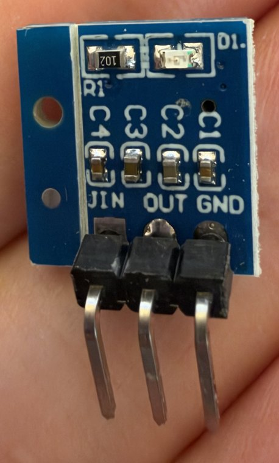
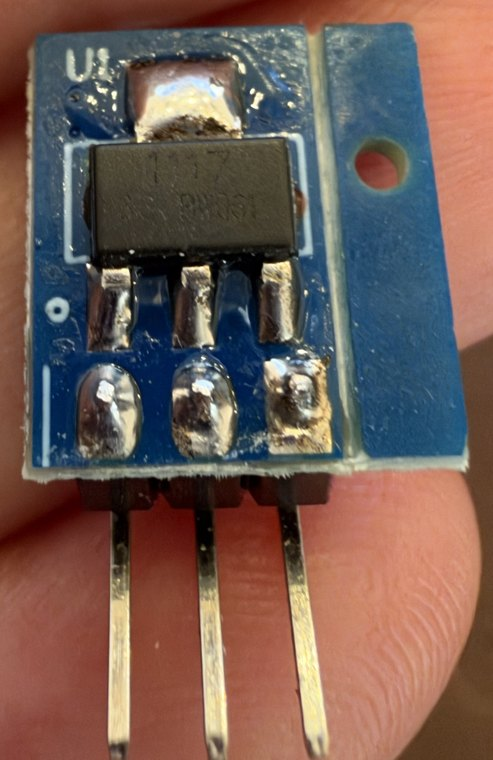

> Public copy for BeaconMind, 2026-10-29; the private course repo holds the unredacted original.

# AMS1117-3.3 regulator module — pin map of my actual board

**Provenance.** Labels read from photos of my own board, both sides (`ams1117-label-side.jpg`,
`ams1117-chip-side.jpg`, 2026-09-19). Electrical behaviour from the Advanced Monolithic Systems
**AMS1117 datasheet**; Pico power facts from the official Pico 2 W datasheet. Checked 2026-09-19.

**My board.** Tiny blue module from a 10-pack (Amazon B0DSZKT8R7 — my substitute for the course's
B07CP4P5XJ; the two are the same design). One side carries the labels, four small capacitors
`C1`–`C4`, a resistor `R1` marked `102` (1 kΩ) and an LED `D1`. The other side carries the
regulator chip at `U1`. A **3-pin right-angle header is already soldered**. A blank break-off tab
with a mounting hole is attached along one edge.

> **Chip marking: the top line reads `1117`; the second line — where the output-voltage code would
> be — is not legible in my photo.** "1117" regulators are made in 1.5 / 1.8 / 2.5 / 2.85 / 3.3 /
> 5.0 V and adjustable versions, so the photo confirms the chip *family*, not that mine is the
> 3.3 V part. The listing says 3.3 V. **Confirm it with the multimeter (§5) before anything is
> connected to `OUT`.**

| Label side | Chip side |
| --- | --- |
|  |  |

---

## 1. What this part is for

It takes a higher voltage and outputs a **fixed 3.3 V**. It is a **linear regulator** — despite the
course parts list calling it a "buck converter", there is no inductor on the board and the chip's
own datasheet is titled *"1A Low Dropout Voltage Regulator"*.

How a linear regulator works: it behaves like an automatically adjusted resistor in series with the
load, continuously burning off exactly enough voltage to leave 3.3 V. Everything it drops becomes
**heat**:

> heat (W) = (V_in − 3.3 V) × current   → e.g. (6.0 − 3.3) × 0.1 A = 0.27 W

Compared with the 5 V buck module: **simpler, electrically quieter, no adjustment needed — but
wasteful, and it needs "headroom".** The chip can only hold 3.3 V while its input is at least the
*dropout voltage* above that: 1.3 V guaranteed (at 0.8 A; about 1.0–1.1 V at light load). So:

| Input | Result |
| --- | --- |
| ≥ 4.6 V | Regulates 3.3 V — guaranteed |
| ≈ 4.3–4.6 V | Usually still regulates at light load — not guaranteed |
| lower | Output sags below 3.3 V |
| > 12 V | Beyond the seller's rating (chip absolute maximum 15 V) and far too hot |

A 4 × alkaline pack (≈ 6 V) is comfortable. A 4 × NiMH pack (≈ 4.8 V nominal) has only about 0.2 V
of guaranteed margin.

---

## 2. The three pins

**Label side facing you, pins pointing down — left → right:**

```
   [ R1 ]  [ D1 LED ]
    C4   C3   C2   C1
   VIN   OUT   GND          ← silkscreen (the "V" of VIN is clipped and prints like "JIN")
    │     │     │
```

| Pin | Kind | Purpose |
| --- | --- | --- |
| **VIN** | power in | Unregulated input, **4.75–12 V** per the seller. |
| **OUT** | power out | Regulated **3.3 V**. The **middle** pin. The chip's exposed metal tab is also `OUT`. |
| **GND** | ground | Shared by input and output. An **outer** pin. |

**Two traps, both from the pin order:**
- **The middle pin is `OUT`, not ground.** The instructor's sticky note about regulator pin order
  ("input, ground, output") is about the *5 V* regulator and does not apply here. Wiring this middle
  pin to ground shorts the 3.3 V output.
- **Mirror image.** From the *chip* side the order reads `GND OUT VIN`. Turning the module 180°
  swaps `VIN` and `GND` — and the seller warns there is **no reverse-polarity protection**. Read the
  silkscreen every time.

Unlike my other boards, this one's labels **stay visible** once installed, because it stands
upright (§4) — as long as the label side faces outward.

---

## 3. Where the pins go

Two pins are certain; the third depends on a decision that is still open.

| Pin | Goes to | Status |
| --- | --- | --- |
| **VIN** | **VBAT** — switched battery `+` (right `+` rail) | ✔ |
| **GND** | Common ground | ✔ |
| **OUT** | **Depends — see below** | ◻ open decision |

### What is `OUT` for in this robot?

The 3.3 V parts (BNO055, TB6612FNG logic, encoders) are already fed from the **Pico's own 3.3 V
output, pin 36** — that is what the instructor's drawing shows, and in that drawing this module's
`OUT` wire connects to nothing visible. So the module is not needed for the sensors.

Its genuinely useful job is a different one: **letting the Pico run from the AA pack, untethered.**

| Option | `OUT` → | Verdict |
| --- | --- | --- |
| **A. Not used (first build)** | nothing — leave the module off the board | **My recommendation for now.** Pico powered over USB (cable or a USB power bank), exactly as the instructor's drawing implies. Fewest ways to go wrong. |
| **B. Untethered Pico** | **Pico `VSYS`, pin 39** | **Valid and documented:** `VSYS` accepts 1.8–5.5 V, so 3.3 V is fine, whereas a fresh alkaline pack (≈ 6–6.4 V) wired straight to `VSYS` would exceed its 5.5 V limit. The regulator is what makes battery power safe for the Pico. ⚠ **Do not have this connected while USB is also plugged in** — two supplies on one node. Raspberry Pi's documented fix is a Schottky diode in series, which is not in the kit; the no-parts fix is to pull the `OUT`→pin 39 jumper whenever the USB cable goes in. |
| C. Sensor rail | the 3V3 rail, *instead of* Pico pin 36 | Not recommended. With the Pico on USB and the battery switched off, the TB6612FNG's `VCC` would sit at 0 V while the Pico drives its inputs — outside the driver's input rating. |
| ✘ | **Pico pin 36 (`3V3`)** | **Never.** Pin 36 is the *output* of the Pico's own regulator: two regulators fighting over one node. |

Expected load in option B is small (Pico plus about 40 mA of sensors), so heat is modest — roughly
(6.0 − 3.3) V × 0.15 A ≈ 0.4 W as an upper-end guess. *The Pico 2 W's real current with WiFi active
is not published, so this is an estimate.*

---

## 4. Physical / breadboard facts

- **No soldering needed** — the header is already fitted.
- It is a **right-angle** header: the pins run parallel to the board. Pushed into a breadboard, the
  module **stands upright on its edge** across **three neighbouring rows of one column**.
- The chip's metal tab (the big soldered pad above the chip) is connected to `OUT`. Standing
  upright it is exposed: keep jumper wires and neighbouring parts from leaning on it.
- The blank tab with the hole is a mounting/break-off tab with no electrical function.
- The LED `D1` (through `R1`, 1 kΩ) is a power-on indicator. Which side of the regulator it sits on
  is not determinable from my photos.
- This regulator is for **logic only**. Motor current must never pass through it.

---

## 5. Bench test before first use (confirms the 3.3 V version)

1. Nothing connected to `OUT`.
2. `VIN` and `GND` to the battery pack (≥ 4.6 V), observing polarity — check the silkscreen.
3. Measure `OUT` against `GND`. **Expect 3.20–3.40 V.**
4. Any other reading (1.8 V, 2.5 V, 5.0 V, or roughly the input voltage) means it is not a working
   3.3 V part — set that one aside; there are nine more.
