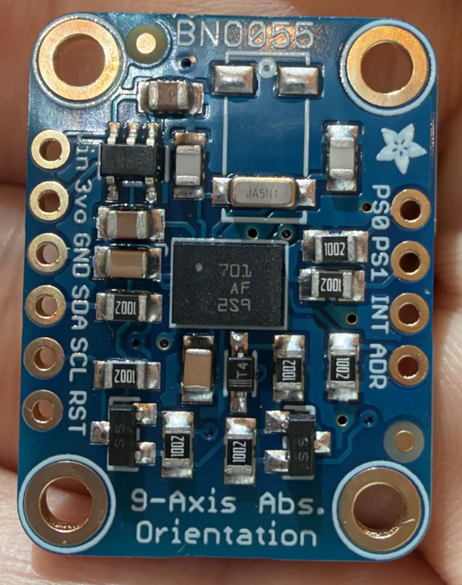

> Public copy for BeaconMind, 2026-10-29; the private course repo holds the unredacted original.

# Adafruit BNO055 IMU breakout — pin map of my actual board

**Provenance.** Labels read from photos of my own board (`bno055-top.jpg`, 2026-09-19). Pin
functions and limits from Adafruit's BNO055 learn guide ("Pinouts"), Adafruit's Rev C board
schematic, and the Bosch Sensortec BNO055 datasheet (BST-BNO055-DS000), all checked 2026-09-19.

**My board.** Adafruit product **2472** — the *original* header-only layout: blue PCB,
silkscreen `BNO055` / `9-Axis Abs. Orientation`, Adafruit flower logo, **no** STEMMA QT/JST
sockets. Arrived in an anti-static bag with **one loose 10-pin header strip** (must be snapped into
6 + 4 and soldered). Bought as Amazon B017PEIGIG.

---

## 1. What this part is for

The **BNO055 chip** (the black square in the middle, marked `701 AF 2S9`) is a *System in Package*:
four things in one chip (Bosch datasheet p. 1):

| Inside the chip | Measures |
| --- | --- |
| 3-axis **accelerometer** (14-bit) | acceleration, including gravity → which way is "down" |
| 3-axis **gyroscope** (16-bit, ±2000 °/s) | how fast the board is rotating |
| 3-axis **magnetometer** | Earth's magnetic field → which way is north |
| 32-bit **Cortex-M0+ microcontroller** running Bosch's fusion firmware | combines the three into one orientation answer |

Each sensor alone is flawed: the gyroscope drifts over time, the accelerometer is noisy and is
fooled by motion, the magnetometer is disturbed by nearby magnets and steel. **Sensor fusion**
plays them against each other. The point of this particular chip is that the fusion runs **on the
chip**, so the Pico does not do any of that math — it simply reads the finished answer
(heading / roll / pitch, or a quaternion) over I2C, up to **100 times per second**.

**Why the robot needs it.** Wheel encoders measure how far each wheel turned, but wheels slip, and
heading error from slip accumulates fastest while turning. The IMU gives an independent measurement
of which way the robot is facing, which the course later fuses with wheel odometry.

**The rest of the board** exists to make the bare 3.3 V chip easy to use: a 3.3 V regulator
(5-pin part, upper left), a 32.768 kHz crystal (silver can marked `JA5N4`, top), I2C level
shifters (the two 3-pin parts marked `SS` at the bottom — consistent with the BSS138 MOSFETs in
Adafruit's schematic), a diode on the reset line (marked `T4`), and eight 10 kΩ resistors (marked
`1002`) used as pull-ups and pull-downs.

---

## 2. The ten holes

Orientation: component side up, `BNO055` text at the top — exactly as in the photo.

**Left row — 6 holes, top → bottom. These are the ones you wire.**

| # | Label | Direction | What it is | Connect to |
| ---: | --- | --- | --- | --- |
| 1 | **Vin** | power **in** | Board supply, **3.3–5.0 V**. Feeds the on-board 3.3 V regulator. **Also sets the I2C voltage**: the SDA/SCL pull-up resistors are tied to this pin. | **Pico pin 36 (3V3 OUT)** |
| 2 | **3vo** | power **out** | 3.3 V *output* of the on-board regulator, about 50 mA available. Not a second power input. | **Leave unconnected** |
| 3 | **GND** | ground | 0 V reference. | Common ground (`−` rail) |
| 4 | **SDA** | I2C data, both ways | Level-shifted; 10 kΩ pull-up to Vin. | A Pico **I2C SDA** pin |
| 5 | **SCL** | I2C clock | Level-shifted; 10 kΩ pull-up to Vin. | The matching Pico **I2C SCL** pin |
| 6 | **RST** | input, active-low | Pull to GND to reset the chip. Has its own pull-up and a series diode, so a host can only pull it low. | **Leave unconnected** (optional: a Pico GPIO) |

**Right row — 4 holes, top → bottom. Leave all four unconnected.**

| # | Label | Direction | What it is | Why leave it alone |
| ---: | --- | --- | --- | --- |
| 1 | **PS0** | input | Protocol select, bit 0. | On-board 10 kΩ pull-downs already select **I2C** (PS1 = 0, PS0 = 0). |
| 2 | **PS1** | input | Protocol select, bit 1. | **PS1 high switches the chip to UART mode and it disappears from the I2C bus.** |
| 3 | **INT** | output | Interrupt signal from the chip (3 V level). | Not needed for reading orientation. |
| 4 | **ADR** | input | I2C address select. | On-board 10 kΩ pull-down gives address **`0x28`**. Tying ADR to `3vo` would give `0x29`. |

> **The four right-hand holes go straight to the Bosch chip with no level shifter.** The chip's
> absolute maximum on a logic pin is 3.6 V. **Never put 5 V on PS0, PS1, INT or ADR.**

**So the IMU needs exactly four wires:** `Vin`, `GND`, `SDA`, `SCL`.

---

## 3. Why `Vin` must be fed from 3.3 V, not 5 V

Adafruit's schematic ties the header-side SDA/SCL pull-ups (10 kΩ) to the **Vin** net. So the two
signal wires going to the Pico idle at *whatever voltage is on Vin*:

- Vin = 3.3 V → SDA/SCL are 3.3 V signals → safe on any Pico pin, in any power state.
- Vin = 5 V → SDA/SCL idle at 5 V. The RP2350 tolerates that only on GP0–GP22 and only while the
  Pico is powered; with the Pico off the limit is 3.63 V.

Feeding Vin from the Pico's own 3.3 V output (pin 36) removes the question, and the chip draws at
most 12.3 mA against that pin's 300 mA guidance. Adafruit's own wiring examples for 3.3 V hosts do
the same. **Never connect Vin to the raw battery rail.**

---

## 4. ⚠ Trap: the course Fritzing part is a *different revision* of this board

The instructor's drawing uses the newer STEMMA QT revision (Adafruit 4646), whose left row reads
`VIN 3V GND SCL SDA RST` — **SCL and SDA are in swapped positions** compared with my board
(`Vin 3vo GND SDA SCL RST`). Its right row is also reordered (`INT ADR PS0 PS1`).

Copying wire *positions* from the drawing would cross SDA and SCL: nothing is damaged, but the IMU
never answers. **Wire by the label printed next to each hole.**

---

## 5. Physical / breadboard facts

- Board is 20 × 27 mm. The two header rows measure about **17.5 mm apart in my photo — consistent
  with 0.7 inch, the same spacing as the Pico** — so with both rows soldered the board straddles the
  breadboard's centre gap. *Estimate from a photo: test-fit the loose header strips in the
  breadboard before soldering.*
- The 4 right-hand holes line up with left-hand holes 2–5 (`3vo`, `GND`, `SDA`, `SCL`).
- **Solder both rows (my recommendation).** Electrically only the left row is needed, but an IMU
  measures the orientation *of its own board*: supported on one row it would sit tilted and rock on
  a moving car. With both rows in, it sits flat, level and rigid. The cost: the four breadboard
  rows holding `PS0 PS1 INT ADR` on that side must be kept **empty**.
- Solder with the pins pushed into the breadboard (long end down) and the board resting on top —
  the breadboard holds the pins square.
- **Placement:** mount flat and level, **away from the motors** — they contain permanent magnets,
  and Bosch states the magnetometer is disturbed by nearby magnetic fields. On my car that means the
  **row-1 end** of the breadboard. Adafruit also reports the board misbehaving when fast
  (> 2 MHz) signal wires run right beside it.
- Mounting orientation does not have to match the axes printed in any diagram: the chip's axis
  mapping can be changed in software.

---

## 6. What to expect at bring-up (not faults)

- After power-on the chip sits in **CONFIG mode** and outputs nothing until firmware selects a
  fusion mode (start-up about 400 ms; 650 ms after a reset).
- First check is an I2C scan: the board should answer at **`0x28`**.
- Absolute heading is only trustworthy after the magnetometer self-calibrates, which needs the
  board to be moved around after every power-on.
- If I2C reads are flaky, Adafruit's documented fix is stronger pull-ups (2.2 kΩ on SDA, 3.3 kΩ on
  SCL, to the same voltage as Vin) — not a higher voltage.
- Bosch designed the fusion for human motion; long vibration or sustained acceleration can make
  pitch/roll drift. Expect some of that on a small car.

**Not verified:** how well the BNO055's I2C clock-stretching behaves with the RP2350. Adafruit lists
the older RP2040 among the "more reliable" hosts and names ESP32 as problematic; nothing I found
mentions the RP2350.
