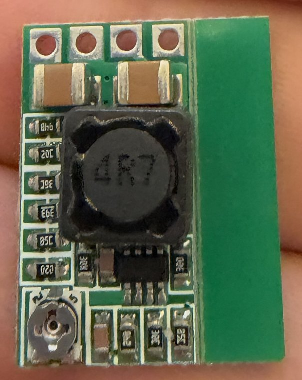
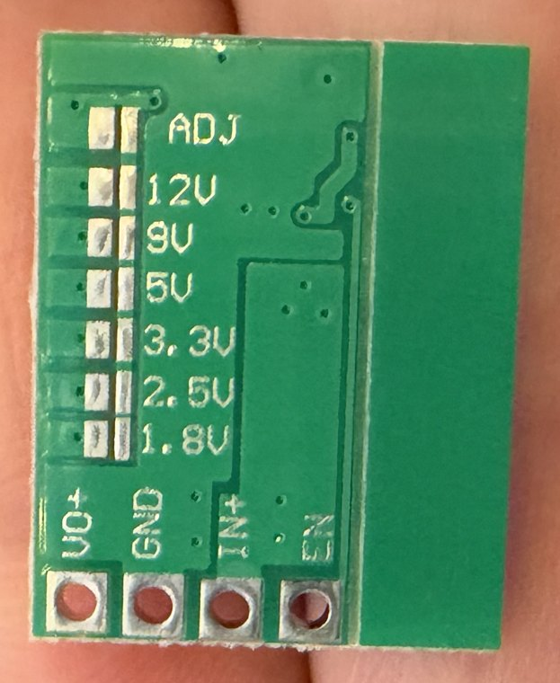

> Public copy for BeaconMind, 2026-10-29; the private course repo holds the unredacted original.

# 5 V buck converter module — pin map of my actual board

**Provenance.** Labels read from photos of my own board, front and back (`buck5v-front.jpg`,
`buck5v-back.jpg`, 2026-09-19). Behaviour and ratings from the seller's listing (DKARDU, Amazon
B0C13JW4SH) and from DROK's manual and product page for the same board design (the course's
original pick, B0758ZTS61), checked 2026-09-19.

**My board.** Small green board, 10-pack. Front: four solder holes, two large ceramic capacitors,
an inductor marked **`4R7`** (4.7 µH — the `R` is the decimal point), an 8-pin controller chip
(marking **not legible** in my photo), a row of tiny resistors, and a screw **trimmer** in one
corner. Back: all the labels. A **blank green strip** with no copper is attached along one long
edge, separated by a score line — it appears to be manufacturing break-off material and has no
electrical function.

> My board is **not identical to its listing photos**, which showed an inductor marked `100`
> (10 µH). Because the controller chip is unidentified, every number below that comes from a chip
> datasheet is off the table; only the seller's own figures are used.

| Front (component side) — **no labels** | Back — **all labels** |
| --- | --- |
|  |  |

---

## 1. What this part is for

It turns the battery's varying voltage into a **steady 5 V** for the ESP32-CAM, which requires
4.75–5.25 V. Battery voltage is not steady: it falls as the cells drain and dips whenever the motors
pull current.

It is a **buck (switching step-down) converter**. Instead of burning off the excess voltage as heat
(what the AMS1117 linear regulator does), it switches the input on and off about 500,000 times per
second and smooths the result with the **inductor** (the big black block) and the output capacitor.
The on/off ratio sets the output voltage. Because almost nothing is burned as heat it is very
efficient — the seller quotes 97.5 % at 6.5 V → 5 V, 0.7 A.

Software analogy: a linear regulator is a rate limiter that *drops* the excess; a buck converter is
one that *repackages* it — nearly all the input energy still reaches the output, just at a lower
voltage and a higher current.

**Two consequences worth understanding:**
- A buck converter can only step **down**. Output is always below input. With 4 × NiMH (≈ 4.8 V) it
  **cannot** produce 5 V; with 4 × alkaline (≈ 6 V) it can, at light load.
- This module is **adjustable**, and it ships that way. See §3.

---

## 2. The four holes

### As labelled on the BACK (holes at the bottom)

```
        BACK VIEW
   ADJ  12V  9V  5V  3.3V  2.5V  1.8V     ← voltage-select solder pads
   VO+    GND    IN+    EN                ← the four holes, left → right
```

### As seen from the FRONT — the view once it is installed ⚠

Installed component-side up (so the trimmer stays reachable), the labels are hidden. With the
**holes at the top**:

```
        FRONT VIEW (holes at top)
    VO+    GND    IN+    EN │ blank
   ┌─────────────────────┐  │ strip
   │ [cap]      [cap]    │  │
   │ resistors [ 4R7 ]   │  │
   │ trimmer   [chip]    │  │
   └─────────────────────┘  │
```

**`EN` is the hole next to the blank strip. `VO+` is at the far end, on the trimmer's side of the
board.** (Both photos agree: the hole beside the blank strip is `EN` in each. This also matches the
front-view order DROK documents for the same design.)

If the blank strip is ever snapped off, that landmark is gone — put a marker dot beside `VO+` first.

| Hole | Kind | Purpose | Connect to |
| --- | --- | --- | --- |
| **IN+** | power in | Input, **DC 4.5–24 V**. | **VBAT** — switched battery `+` (right `+` rail) |
| **GND** | ground | Shared by input and output — the module has only one ground. | Common ground |
| **VO+** | power out | The regulated output. **Only after it has been set and measured.** | **5V** rail (**left** `+` rail — see [`wiring-plan.md`](wiring-plan.md) §4) → ESP32-CAM `5V` pin |
| **EN** | logic in | Enable. The module is **on by default**; pulling `EN` low switches it off. Seller: high = 2–5 V. | **Leave unconnected.** Never tie it to the battery rail. |

**Swapping `IN+` and `VO+` puts raw battery voltage on the 5 V rail.** There is no
reverse-polarity protection and no output over-voltage protection (seller's own spec list).

### The seven pads on the back — how the output voltage is chosen

Each label sits beside a **split pad** (two halves with a gap). Bridging the two halves of one pad
with solder selects that fixed voltage — each pad switches a different resistor into the circuit
that tells the chip what output to aim for (the row of tiny resistors on the front).

| Pad | State on my board | Meaning |
| --- | --- | --- |
| **ADJ** | **Joined, as far as my photo shows** — by a thin trace under the green coating that loops over the top of the pad to a small via. This is the link the seller's instructions say to cut. | **Adjustable mode (factory default).** Output = whatever the trimmer is set to, 0.8–17 V. |
| 12V, 9V, **5V**, 3.3V, 2.5V, 1.8V | All **open** (gap visible between the halves) | Unused presets. |

---

## 3. ⚠ It does not output 5 V out of the box

As shipped, the output is **whatever the trimmer happens to be set to** — unknown until measured.
Connecting the camera before setting it could put well over 5 V on it.

Two ways to get 5 V:

| Method | How | Trade-off |
| --- | --- | --- |
| **Trimmer + multimeter** | Power `IN+`/`GND`, measure `VO+` against `GND`, turn the screw to 5.0 V. | No fine soldering. **But the input must be comfortably above 5 V while you do it** — roughly 5.6 V or more (*estimate; depends on the unidentified chip*). From a 4.8 V NiMH pack the output just saturates a little below the input wherever the screw is, so a wrongly-set trimmer stays invisible until a higher-voltage pack is fitted. A trimmer can also be bumped later. |
| **Fixed 5 V pad** | Cut the thin ADJ trace with a knife, then bridge the two halves of the **5V** pad with solder. | Permanent and immune to bumps. Fiddly: a hair-thin trace next to a via, and a ~1 mm pad. Never power it with ADJ cut and no pad bridged. |

**My decision (2026-09-19): the trimmer method.** A mis-set screw can be turned back; a slipped knife
or a solder blob on the neighbouring pad cannot. Running from a 4 × AA pack also bounds the worst
case, because the output can never exceed the input.

What keeps it safe:
- Set it with **≳ 5.6 V on `IN+`** (fresh alkalines or a 9 V battery) and **nothing on `VO+`**.
- The trimmer looks like a single-turn part (*judged from the photo*): the whole 0.8–17 V range
  fits in under one rotation, so the 4.75–5.25 V window is only a few degrees wide. Tiny turns,
  eyes on the meter; the first nudge shows which direction raises the voltage.
- **Re-measure** before the camera is first connected, after the board has been handled, and
  whenever the battery type changes. Optional: a dab of nail varnish on the screw once set.

---

## 4. Ratings (seller's figures)

| | |
| --- | --- |
| Input | DC 4.5–24 V |
| Output | adjustable 0.8–17 V, or fixed 1.8 / 2.5 / 3.3 / 5 / 9 / 12 V |
| Current | 3 A maximum; seller recommends **2 A** for long running, and quotes 1.5 A (12 V in) with no extra cooling |
| Switching frequency / ripple | 500 kHz / 20 mV (12 V → 5 V, 3 A) |
| Quiescent current | 0.85 mA |
| Protection | Output short-circuit: yes (not indefinitely). Output over-voltage: **no**. Reverse connection: **no**. |
| Size | 20 × 11 × 5 mm; hole spacing 2.54 mm |

The camera draws about 0.18 A on average (0.31 A with its flash LED), with brief WiFi bursts on top,
so current is not the constraint. **Input voltage headroom is.**

---

## 5. Physical / breadboard facts

- **Bare holes — soldering required.** No pins or wires are attached. Solder a **4-pin header**
  (cut from a spare strip in the TB6612FNG pack; same 2.54 mm spacing), long ends pointing away
  from the component side. The pack also includes loose red and black wire as an alternative.
- The four pins occupy **four neighbouring breadboard rows in one column**; the board lies flat
  above the holes beside them. Keep those covered holes unused.
- After soldering, check with the continuity beep that no two neighbouring holes are bridged —
  they are battery, ground and output, side by side.

---

## 6. Where it sits in the build

**Last.** Slide 17 marks the camera's power as "not needed now", nothing else in the robot needs a
5 V rail, and this is the one part that can output a harmful voltage when mis-set. Wire it only
after everything else works — and the battery choice decides whether it can do its job at all
(see `wiring-plan.md`, open decisions).
