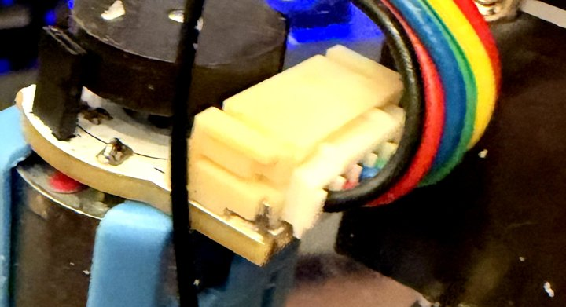
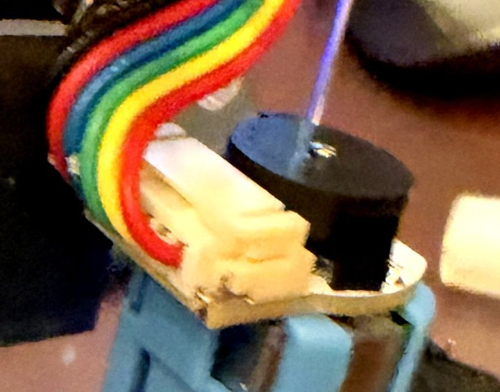
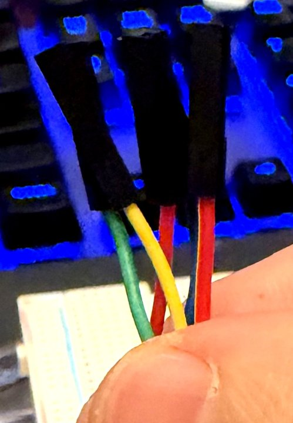

> Public copy for BeaconMind, 2026-10-29; the private course repo holds the unredacted original.

# Hall-encoder motors — what the six wires are and where they go

**Provenance.** Wire colours read from photos of my own two motors and their cables
(`motor-plug-a.jpg`, `motor-plug-b.jpg`, `motor-cable-ends.jpg`, 2026-09-19). Pin functions from the
vendor's documentation for this motor (GitHub `nulllaborg/tt-encoder-motor`: schematic, README,
labelled product photos), the HX3144 Hall-switch datasheet, and the course's Module 3 slide 12.
The colour → function mapping was derived **independently three times by different methods**
(tracing my cable; matching the vendor's labelled photos; solving from scratch), reconciled by a
fourth pass, and attacked by a fifth that re-derived it on its own. **All five agree.**

**Update 2026-09-19: the map has since been confirmed by measurement on one cable** — resistance
pattern, diode-test polarity, and a powered 3.3 V test with the encoder LED lit (§5 log). What follows
records how it was derived.

**At the time of mapping: no pin label was ever read off my own boards.** The vendor prints the legend on the
side of the board that faces the motor, which no photo shows. So part of this map is an inference —
§3 says exactly which part, and §5 is a multimeter check that settles it.

| Plug at motor A | Plug at motor B | The loose ends |
| --- | --- | --- |
|  |  |  |

---

## 1. What each motor unit is

Two devices sharing one 6-pin plug:

- **A DC gear motor** — two wires. Battery power, switched by the TB6612FNG driver. Reverse the
  polarity and it spins the other way. This is the high-current, electrically noisy part.
- **A Hall quadrature encoder** — four wires. A small magnet disc on the motor's rear shaft spins
  past two Hall-effect switches, producing two on/off pulse trains, `A` and `B`, a quarter-cycle
  apart. Counting pulses gives distance; which one leads gives direction. This is a delicate 3.3 V
  signal circuit feeding the Pico.

The vendor's schematic shows the motor's two terminals wired **straight** to the two end pins of the
plug, with **no connection** between the motor circuit and the encoder circuit.

## 2. The six labels (from the slide's connector photo, in physical order)

| Label | Meaning | Belongs to |
| --- | --- | --- |
| `−` | Motor power, negative side | motor |
| `5V` | **Supply for the encoder's sensors** — named "5V" but rated **3.3–5 V** | encoder |
| `B` | Pulse signal B | encoder |
| `A` | Pulse signal A | encoder |
| `GND` | Ground for the encoder | encoder |
| `+` | Motor power, positive side | motor |

**Outer two = motor. Inner four = encoder.**

**Feed `5V` with 3.3 V.** The schematic pulls `A` and `B` up to whatever is on that pin (4.7 kΩ
each), so a 5 V supply would send 5 V signals into the 3.3 V Pico. Slide 19 agrees: "check encoder
VCC (3.3V)". *Caveat:* each Hall switch needs at least 3.0 V and sits behind a 50 Ω resistor, so at
3.3 V it runs near the bottom of its range (about 3.05–3.2 V at the chip). The vendor rates this as
fine; but if encoder counts ever go missing, a sagging 3.3 V supply is the first suspect.

---

## 3. My cables: colour → function → destination

Both ribbons read, across the plug: **black · red · blue · green · yellow · red.**
**There are two red wires** — see the warning below.

| Wire | Function | Goes to | Confidence |
| --- | --- | --- | --- |
| **black** (ribbon edge; the one peeled off from the other five) | Motor `−` | TB6612FNG motor output (`AO2` or `BO2`) | **High** that it is a motor wire |
| **red — the one bonded next to black** | Encoder supply (`5V` label) | **3V3 rail** ← Pico pin 36 | **Measured** (2026-09-19) |
| **blue** | Encoder `B` | a Pico GPIO input | Signal wire: **measured**. `B` vs `A`: by vendor order, harmless |
| **green** | Encoder `A` | a Pico GPIO input | Signal wire: **measured**. `A` vs `B`: by vendor order, harmless |
| **yellow** | Encoder `GND` | Common ground (`−` rail) | **Measured** (2026-09-19) |
| **red — the one bonded next to yellow** (the other ribbon edge) | Motor `+` | TB6612FNG motor output (`AO1` or `BO1`) | **High** that it is a motor wire |

**What is certain and what is inferred**

- **High confidence — the safety-critical part:** the two **edge** wires (black, and the red beside
  yellow) are the motor pair. This holds *whichever way round* the plug's labels run, because the
  motor pins are the two end pins either way. These two wires carry battery voltage and **must never
  reach a Pico pin.**
- **Medium confidence:** which inner wire is supply and which is ground (inner red vs yellow), and
  `A` vs `B`. This depends on which physical end of the socket is `+`. The evidence — the vendor's
  photo of the printed legend, the vendor's labelled render, and the positions of the Hall sensors
  and solder blobs on both of my boards — all points the same way. But it assumes my boards match
  the vendor's documented one. **§5 step 4 settles supply vs ground with a meter, no power needed.**
- **Cannot be verified by meter, and harmless:** `A` vs `B` (if the count runs backwards, swap them
  in software), and motor `+` vs `−` (only sets spin direction).

> ⚠ **Two red wires.** One is the 3.3 V encoder supply; the other carries battery voltage to the
> motor. At the loose ends they look identical. Tell them apart by **position in the ribbon** (the
> motor red is on the ribbon's *edge*, next to yellow; the supply red is *second*, next to black) —
> or better, **by meter** (§5 step 1) — and **put a tape flag on the motor red's connector.**

**The two motors are mirror-mounted.** Both plugs are keyed and wired identically, but one motor is
rotated relative to the other, so for the same polarity they turn the wheels in opposite senses
relative to the robot. One side will need its direction inverted — in firmware, or by swapping that
motor's two wires at the driver. Expect it; it is not a fault. Likewise one encoder will count
"backwards" until its sign is flipped in software.

**The loose ends are female sockets** — they do not go into breadboard holes. Use a male-to-male
jumper wire as an adapter for each.

---

## 4. How the motors connect — the whole picture

```
                        TB6612FNG                          Pico 2 W
 Motor L  black ───────► AO2                    pin 36 3V3 ──► 3V3 rail ──► inner red  (both motors)
          edge red ────► AO1                    GND ─────────► − rail  ───► yellow     (both motors)
 Motor R  black ───────► BO2                    GPIO ◄──────── green (A), blue (B)     motor L
          edge red ────► BO1                    GPIO ◄──────── green (A), blue (B)     motor R
                         VM  ◄── battery +
                         VCC ◄── 3V3 rail        (GPIO numbers: from the instructor's .fzz)
```

Which motor is "L" and which is "R" is decided with the **caster end as the front** of the robot
(the camera defines it). Which driver channel each motor uses, and the four encoder GPIO numbers,
wait for the `.fzz`; all of it is re-assignable in software.

---

## 5. Bench check — confirm the map before anything is wired

Needs only the multimeter. **Batteries out, motor driver not connected, the plug left seated in the
motor, one cable at a time.** No step assumes the map above is right.

**Preparation.** The ends are female sockets, which meter probes do not fit: push a male-to-male
jumper into each and probe the free pin. Keep the six pins apart. Do not touch the metal probe tips
during resistance readings — skin gives false numbers.

| # | Do | Confirms | If not |
| ---: | --- | --- | --- |
| **1** | **Find the motor red.** Resistance (lowest range) or the continuity beep: black ↔ each red in turn. | **One** red reads low against black (a few ohms to a few tens — *estimate*); the reading jitters if the wheel is nudged. **That red is the motor wire: tape-flag its connector now.** The other red does not read low. | No low pair (plug unseated, broken wire), or a low reading to an inner wire: stop. |
| **2** | **Generator check.** DC volts across black and the flagged red; turn that wheel by hand, both ways. | A small voltage appears and its **sign flips** with direction. A motor is a generator — these two are the motor. | Nothing, or a voltage on some other pair: stop. |
| **3** | **Isolation.** Highest resistance range: black → each of the four inner wires; flagged red → each of the four. | All eight read open / very high. The motor circuit cannot leak battery voltage into the encoder wires. | **Anything below about 1 MΩ:** a solder bridge or a different board. Do not connect this cable to the Pico. |
| **4** | **Supply vs ground, no power.** 20 kΩ range, all six pairs among the four inner wires. Look for the pattern **X, X, 2X**: two wires each read the same value **X** to one *common* wire, and about **2X** to each other; the numbers do not change when the probes are swapped. | Expected X ≈ 4.7 kΩ. **The common wire is the encoder supply; those two wires are `A` and `B`; the leftover wire is ground** (its readings are high, drifting, or differ when probes are swapped). Expected result: common = **inner red**, pair = **green + blue**, leftover = **yellow**. | **Yellow is the common wire:** the map is reversed — yellow = supply, inner red = ground; use that and note it here. **Blue or green is common, or no pattern:** the board is not the documented one — stop. |
| **5** | **Powered check, 3.3 V only.** Only after step 4. Pico on USB, batteries still out; black and the flagged red taped apart and connected to nothing. Pico pin 36 → the supply wire; a Pico GND → the ground wire. `A`/`B` wires connected to nothing. Meter on DC volts, black probe on ground. First read the supply wire — call it **V** (about 3.3 V). Then, for each of the two signal wires: turn the wheel a little, **stop**, read; repeat at several stops. | At every stop each signal wire reads **either near 0 V or near V**, and **both states show up** over several stops. It never exceeds V. | A wire stuck at one level at every stop, or anything above V: stop; do not connect it to a GPIO. *(Readings in between, or flickering digits, **while the wheel is moving** are normal — the pulses are far too fast for a meter. Only stopped readings count.)* |
| **6** | Repeat 1–5 on the other cable. | Same results. Both motor reds are flagged. | Wire each cable by its own measurements and note the difference here. |

Final check before batteries ever go in: **neither black nor a flagged red lands on a Pico pin.**

### Bench-check log

| Date | Step | Result |
| --- | --- | --- |
| 2026-09-19 | 1 — find the motor red | ✔ **The red beside yellow is the motor red** (continuity only between black and that red) — matches the map. **Done on ONE cable only**; the other is assumed identical (same part, keyed plug, same ribbon order in the photos). |
| 2026-09-19 | 2 — generator check | ✔ passed |
| 2026-09-19 | 3 — isolation | ✔ passed — every other combination open circuit |
| 2026-09-19 | 4 — supply vs ground (X, X, 2X) | ✔ **X, X, 2X found with inner red as the common wire → inner red = encoder supply, yellow = ground, green + blue = the two signals.** Readings below. One cable only. |
| 2026-09-19 | **4b — polarity by diode test (added after the cross-check)** | ✔ **PASSED — yellow is ground, measured directly.** Green and blue both conduct through one junction (0.712 V) only with the positive probe on yellow; 2.968 / 2.964 V the other way. "Mirror board" excluded. One cable only. |
| 2026-09-19 | 5 — powered check at 3.3 V | ✔ **PASSED.** V₀ = **3.32 V**. Signal reads **3.32 V** (high state; never above V₀ → safe for Pico inputs) and **1.67 V while the wheel turns** — exactly half of V₀, i.e. the meter averaging a square wave between ≈ 0 V and 3.32 V at **≈ 50 % duty**. **The red LED on the encoder board lit** — an LED conducts one way only, so this is a third independent confirmation that inner red = supply and yellow = ground. The Hall sensors switch fine at 3.3 V. *Reported as "it": whether both green and blue were read is to be confirmed. One cable only.* |

#### Step 4 readings (one cable, unpowered, wheel still, probe polarity not recorded)

| Pair | Reading | Predicted | |
| --- | ---: | --- | --- |
| inner red ↔ green | **4.7 kΩ** | ≈ 4.7 kΩ | ✔ pull-up R1 |
| inner red ↔ blue | **4.7 kΩ** | ≈ 4.7 kΩ | ✔ pull-up R2 |
| green ↔ blue | **9.38 kΩ** | ≈ 9.4 kΩ | ✔ R1 + R2 in series (2 × 4.7 = 9.4; 0.2 % off) |
| inner red ↔ yellow | **4.9 kΩ** | high / open / polarity-dependent | ⚠ not as predicted — see below |
| green ↔ yellow | **4.9 kΩ** | high / open / polarity-dependent | ⚠ not as predicted — see below |
| blue ↔ yellow | **0.495–2 MΩ, wandering** | high / open | ✔ effectively open (a wandering megohm value is what an open circuit reads with fingers near the probes) |

**What the readings establish.**
1. **Inner red is the encoder supply.** It is the one wire with an equal resistor to each of two
   others, and those two read exactly double to each other. On the vendor schematic only the supply
   node has that shape (two 4.7 kΩ pull-ups). Green and blue are therefore the two signal outputs,
   and **yellow is ground by elimination.**
2. **The plug orientation is now confirmed by measurement**, not only by photo-matching: the supply
   sits next to black, exactly as in the vendor's order `(−)(5V)(B)(A)(GND)(+)`. So black = motor
   `−`, edge red = motor `+`, blue = `B`, green = `A` (the last two harmless if swapped).
3. **The pull-ups are 4.7 kΩ, as in the vendor schematic** — my board matches the documented one in
   the respect that matters.

**The two 4.9 kΩ readings — not what was predicted, and why they do not overturn the result.**
The prediction was that every pair involving ground would read high or messy. Two of them read a
clean, identical 4.9 kΩ. But these cannot be ordinary resistors: if inner red ↔ yellow were a real
4.9 kΩ resistance, then blue ↔ yellow could read no more than 4.7 + 4.9 = 9.6 kΩ (blue reaches inner
red through its 4.7 kΩ pull-up) — yet it reads open. **No network of plain resistors produces these
six numbers**, so yellow's connections run through semiconductors (the Hall chips, the LED) — which
is precisely the signature of the ground wire. *Likely explanation (interpretation, not verified):*
a multimeter displays voltage ÷ its own test current, so a chip's internal junction shows up as a
fake "resistance"; two similar junctions give the same number, hence two identical 4.9 kΩ; and the
blue reading was probably taken with the probes the other way round (junction blocked → open).
**Discriminating test:** repeat the three yellow pairs with the probes swapped. A real resistor
reads the same both ways; a junction reads very differently.

#### Independent cross-check of the step-4 readings (2026-09-19, three analysts)

- **The assignment holds.** All 24 ways of assigning supply / ground / two signals to the four wires
  were tested against the vendor schematic: **exactly one survives** — inner red = supply, yellow =
  ground, green + blue = signals — at any tolerance from ±2 % to ±45 %, and without using the 4.9 kΩ
  values at all. Which of green/blue is `A` cannot be told from resistance readings (harmless).
- **Not ordinary resistance.** Two-terminal resistance in any resistor network obeys a triangle
  rule: blue ↔ yellow could be at most 4.7 + 4.9 = 9.6 kΩ. It read ≥ 495 kΩ. A numerical fit of a
  general resistor network fails. So every yellow pair runs through semiconductors — what ground
  should look like on this board.
- **The 4.9 kΩ values (rated likely by both other analysts):** forward-biased junctions inside the
  Hall chips, measured with the meter's positive probe on yellow; the meter shows junction voltage ÷
  its own test current, and similar junctions give the same number. The blue reading was taken the
  other way round, or with a poor contact. Rejected: an LED path, a real resistor, leakage, the
  meter powering the chips.
- **One alternative the six readings cannot exclude** — a "mirror" board (4.7 kΩ pull-*downs*, yellow
  = supply). Unlikely: it contradicts the vendor schematic, the vendor's pin order, and the
  open-collector HX3144. **Step 4b settles it.**

#### Step 4b — polarity by diode test (do before step 5)

Nothing powered, nothing else connected. Meter in **diode-test mode** (the red probe is positive on
essentially all meters). Test yellow against inner red, green and blue, **in both directions**, noting
which probe is on yellow; fingers off the metal tips.

| Result | Meaning |
| --- | --- |
| Conducts (≈ 0.45–0.7 V; green and blue nearly identical) **only with RED on yellow**; open with black on yellow | **Yellow is ground. Proceed to step 5.** |
| Conducts **only with BLACK on yellow** | Yellow is the positive side on this board. **Do not put 3.3 V on inner red.** Stop and re-map. |
| Same reading both ways | A real resistor is present — the board differs from the schematic. Stop. |

| Pair | RED probe on yellow | BLACK probe on yellow |
| --- | --- | --- |
| yellow ↔ inner red | **2.163 V** | **1.451 V** |
| yellow ↔ green | **0.712 V** | **2.968 V** |
| yellow ↔ blue | **0.712 V** | **2.964 V** |

**2026-09-19 — first row in, and it is NOT what was predicted** (predicted: ≈ 0.45–0.7 V one way, open
the other). Both directions conduct, at 1.45 V and 2.16 V. This is not a fault: between the two
*power* wires there is a path each way — one through the LED and the chips' supply circuitry, the
other through the chips' output junctions **plus both 4.7 kΩ pull-ups** — and each shows up as a volt
or two. **This row alone does not decide polarity:** with the meter's diode-test current unknown,
either hypothesis can produce these two numbers. *It does show the chips' supply pins do not conduct
backwards at ~0.6 V, which revises part of the earlier explanation of the 4.9 kΩ reading between
inner red and yellow.* **The green and blue rows decide it:** there the junction is direct (no 4.7 kΩ
in series), so exactly one direction should read ≈ 0.5–0.7 V and the other open/high. **Red on yellow
for that reading → yellow is ground → proceed. Black on yellow → stop.** Do not power until then.

**2026-09-19 — green row in: PASS. Yellow is ground.** Red probe on yellow reads 0.712 V — one silicon
junction (plus a little across the 50 Ω in series); the other way reads 2.968 V, essentially the
meter's open-circuit limit. The junction conducts with the *positive* probe on yellow, so yellow is
the side the chips' internal junctions point away from: ground. **The "mirror board" alternative is
excluded** (it would have conducted with the black probe on yellow). This also explains row 1: its
2.163 V was current through the output junctions and the two pull-ups, which means the chips' supply
pins did **not** conduct backwards in the test — consistent with the datasheet's reverse-supply
protection, and it shrinks the worst case of a reversed powered test from ~0.1 A to roughly a
milliamp (*likely*; the meter only tested to about 2.2 V).

**2026-09-19 — blue row in: 0.712 V / 2.964 V, matching green to within 4 mV. Step 4b PASSED.** The two
channels are identical, so channel B is intact — the earlier wandering megohm blue ↔ yellow
resistance reading was probe direction or a poor contact, not a fault. **The colour map for this
cable is now confirmed by measurement** (only `A` vs `B` between green and blue remains unverifiable,
and harmless). **Cleared for step 5, the 3.3 V powered test.**

#### Second cable — decision (2026-09-19)

**Not bench-checked separately, by my decision:** same part, keyed plug, and the photos show the same
colour order entering the same end of the plug on both motors. The residual risk is a mis-crimped
cable. **The wiring order covers it:** this motor's four encoder wires are connected and powered at
3.3 V from USB *before* its two motor wires go anywhere near the driver or the battery (plan stage 4b
before stages 6–7). A good cable shows the encoder LED lit and each signal dropping from 3.32 V to
≈ 1.67 V while the wheel turns; a bad one shows a dark LED or stuck signals — at 3.3 V, with no
battery involved. **Still do: tape-flag this cable's motor red (ribbon edge, next to yellow) before
wiring it.**

**Notes for steps 4 and 5 (from the vendor schematic).** Between supply and `A` there is one 4.7 kΩ
pull-up (R1); supply to `B` another (R2); so `A`↔`B` reads both in series, 9.4 kΩ — and all three
read the same with the probes swapped, being pure resistors. Every pair involving **ground** goes
through the Hall chips, the LED (+2 kΩ) and small capacitors, so it reads high / open / drifting or
changes with probe direction. Step 5 refinements: **confirm the breadboard rail reads ≈ 3.3 V, not
≈ 5 V, before the encoder touches it** (≈ 5 V means the jumper is on Pico pin 39/40 instead of 36);
and judge the signals by **turning the wheel steadily — the reading should sit between 0 V and the
supply voltage** (the meter averages the fast square wave), snapping to one extreme when stopped. A
motor tends to settle at the same rest positions, so seeing the same state at every stop is not by
itself a failure.

### Step 5 in detail — the 3.3 V powered test

Pico needs no firmware. Batteries out throughout.

**A. Prepare, no power.** USB unplugged. Make the motor wires safe: pull the adapter pins out of black
and the flagged red, tape the two insulated sockets away from the breadboard. Seat the Pico across
the centre gap, USB at a board edge. Count from the USB end on the side whose headers run red, red,
black, yellow, red: **40, 39, 38 (black = GND), 37 (yellow = leave alone), 36 (red = 3.3 V out).**
Jumper pin 36's row → a `+` rail (label it 3V3); pin 38's row → the `−` rail of the same strip.
*(These are Pico pin numbers, not breadboard rows. With the Pico's USB-end pins in breadboard row 1:
`GND` pin 38 = **row 3** and `3V3` pin 36 = **row 5**, both on the power side. See
[`pico2w-pin-map.md`](pico2w-pin-map.md) §1.)*

**B. Tripwire 1 — check the rail before the encoder touches it.** Meter on DC volts, 20 V range,
leads in **COM and VΩ** (a lead left in the mA/10A jack makes a voltage measurement a short
circuit). Use a spare jumper in each rail as a test point; the rail holes are too close to probe
directly. Plug in USB: **≈ 3.3 V → note it as V₀.** ≈ 4.7–5 V → the jumper is on pin 39/40: fix it.
≈ 0 V → it is on pin 37, or no power. Unplug USB.

**C. Connect the encoder, no power.** Inner red → `+` (3V3) rail. Yellow → `−` rail. Green and blue
each into its own empty row, touching nothing.

**D. Power up.** Plug in USB and re-measure the rail: it should equal V₀ within about 0.05 V. A drop
of more than ~0.1 V, or anything warm → unplug at once. **This catches a short circuit or a wrong
Pico pin — it does NOT catch reversed supply and ground** (corrected 2026-09-19): a reversed encoder
draws at most about 0.1 A, which the Pico's 3.3 V output supplies without any visible sag. Protection
against reversal is **step 4b beforehand**, and these tell-tales now: the signals **do not change**
while the wheel turns, the encoder board gets **warm**, no red glow. Any of those → unplug. Worst
case if slow: the two tiny 50 Ω resistors feeding the chips run hot; the Pico is unharmed. A faint red glow on the encoder board is a bonus sign; it may be hidden by the magnet disc.

**E. Read the signals** (black probe on `−`). For green, then blue: wheel **stopped** → an extreme
(below ~0.5 V, or near V₀); wheel **turning steadily** → somewhere in the middle, maybe flickering
(the meter averages a square wave too fast for it to follow — this is the proof of switching); stop →
back to an extreme. **Pass:** both wires change when turning, both sit at an extreme when stopped,
neither ever exceeds V₀. The same extreme at every stop is not by itself a failure.

**F. If not:** stuck near V₀ while turning → encoder not really powered (yellow/red rails, plug
seating). Stuck at 0 V → shorted to ground or not a signal wire. Sagging rail or warmth → unplug.
Anything above V₀ → stop.

**G. Finish.** Unplug USB first. The Pico→rail and encoder supply/ground jumpers can stay: they are
final wiring (plan stages 2, 3 and 4b). Log V₀ and the stopped/turning readings above.

---

## 6. Numbers for later

- Encoder: **12 pulses per channel per motor-shaft revolution**, before the 1:90 gearbox →
  **1080 / 2160 / 4320 counts per wheel revolution** counting one edge / both edges of one channel /
  every edge of both. The ratio is nominal: calibrate by measurement.
- Peak pulse rate about 2 kHz per channel (from the vendor's 113 RPM no-load figure) — far beyond a
  multimeter, easy for Pico interrupts.
- Motor current (vendor; test voltage unstated): 0.1 A free-running, 0.5 A rated load, 0.82 A
  stalled — under the TB6612FNG's 1.0 A per channel. **Do not hold the wheels stalled.**
- The kit's wheels and brackets fit these motors (confirmed on my car).
