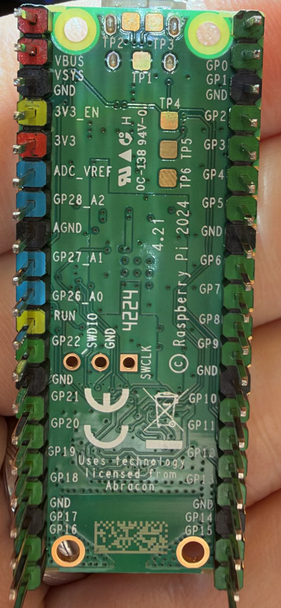

> Public copy for BeaconMind, 2026-10-29; the private course repo holds the unredacted original.

# Raspberry Pi Pico 2 W — pin map of my actual board

Reference for designing the Module 3 wiring diagram (Fritzing) and for every later wiring session.

**Provenance.** All 40 silkscreen labels were read from a photo of the underside of my own board
(`pico2w-underside.jpg`, taken 2026-09-19) and cross-checked against the official Raspberry Pi
Pico 2 W pinout diagram reproduced on Module 3 slide 10. **All 40 match.** Electrical limits below
come from the official *Pico 2 W datasheet* and *RP2350 datasheet*
(datasheets.raspberrypi.com), checked 2026-09-19.

**My board.** Genuine Raspberry Pi Pico 2 W (silkscreen `Pico 2 W`, `FCC:2ABCB-PICO2W`,
underside `© Raspberry Pi 2024`), reseller-soldered colour-coded headers (Amazon B0DP54FWX1),
**micro-USB** connector, chip marked `RP2350A0A2` = **A2 stepping** (see erratum note below).



---

## 1. Two views — they are mirror images

The labels are printed on the **underside only**. On a breadboard you see the **top**, where there
are no pin names (only the numbers `1`, `2` and `39` at the corners). Left and right swap between
the two views, so decide which view you are in before counting.

```
   UNDERSIDE (as in the photo)                 TOP (as seen on a breadboard)
          USB end up                                   USB end up

   40 VBUS      |¯¯USB¯¯|   GP0   1          1  GP0    |¯¯USB¯¯|   VBUS     40
   39 VSYS      |       |   GP1   2          2  GP1    |       |   VSYS     39
   38 GND       |       |   GND   3          3  GND    |       |   GND      38
   37 3V3_EN    |       |   GP2   4          4  GP2    |       |   3V3_EN   37
   36 3V3       |       |   GP3   5          5  GP3    |       |   3V3      36
   35 ADC_VREF  |       |   GP4   6          6  GP4    |       |   ADC_VREF 35
   34 GP28_A2   |       |   GP5   7          7  GP5    |       |   GP28     34
   33 AGND      |       |   GND   8          8  GND    |       |   AGND     33
   32 GP27_A1   |       |   GP6   9          9  GP6    |       |   GP27     32
   31 GP26_A0   |       |   GP7  10         10  GP7    |       |   GP26     31
   30 RUN       |       |   GP8  11         11  GP8    |       |   RUN      30
   29 GP22      |       |   GP9  12         12  GP9    |       |   GP22     29
   28 GND       |       |   GND  13         13  GND    |       |   GND      28
   27 GP21      |       |   GP10 14         14  GP10   |       |   GP21     27
   26 GP20      |       |   GP11 15         15  GP11   |       |   GP20     26
   25 GP19      |       |   GP12 16         16  GP12   |       |   GP19     25
   24 GP18      |       |   GP13 17         17  GP13   |       |   GP18     24
   23 GND       |       |   GND  18         18  GND    |       |   GND      23
   22 GP17      |       |   GP14 19         19  GP14   |       |   GP17     22
   21 GP16      |_______|   GP15 20         20  GP15   |_______|   GP16     21
              antenna end                             antenna end
```

> **Count pins, do not line up labels.** Next to both mounting holes the labels are squeezed
> together and no longer sit beside their pins: the `VBUS` text is level with the *second* pin, and
> `GND / GP14 / GP15` (and `GND / GP17 / GP16`) at the antenna end are shifted up by about one
> pin. Always count from the USB end: **40, 39, 38, 37, 36 …** on the power side.

### "Pin 36" is a Pico number, not a breadboard row

Pin numbers (1–40) are the Pico's own, from its official diagram: top view, USB up, **1–20 down the
left side, 21–40 up the right side**, so pin 40 is beside the USB socket. They are **not printed on
the board** (only a tiny `1`, `2` and `39` on top); the underside prints *names* (`VBUS`, `VSYS`,
`GND`, `3V3_EN`, `3V3` …). The breadboard has only rows 1–30 and columns `a`–`j`.

**Seat the Pico with its USB-end pins in breadboard row 1** (USB socket overhanging the outer edge —
the row-30 end is hard against the battery holder). Then:

| Breadboard row | Low-numbered side | Power side |
| ---: | --- | --- |
| 1 | pin 1 — GP0 | pin 40 — `VBUS` |
| 2 | pin 2 — GP1 | pin 39 — `VSYS` |
| 3 | pin 3 — GND | pin 38 — **`GND`** ← ground jumper |
| 4 | pin 4 — GP2 | pin 37 — `3V3_EN` ← leave alone |
| 5 | pin 5 — GP3 | pin 36 — **`3V3`** ← 3.3 V jumper |
| … | pin = row | pin = 41 − row |
| 20 | pin 20 — GP15 | pin 21 — GP16 |

The **power side** is the one whose coloured header bodies read **red, red, black, yellow, red** from
the USB end — visible from the side once seated. A jumper goes into one of the **free outer holes of
that row, on the same side of the centre gap** as the pin (the inner holes are hidden under the Pico).

---

## 2. Full pin table

Header colours are this reseller's convention (read from the photo): **red** = power,
**black** = ground, **yellow** = control pin (do not use as I/O), **blue** = ADC-related,
**green** = ordinary GPIO.

PWM column: `slice` + `A/B`, from **RP2350 datasheet Table 1130** ("Mapping of PWM channels to GPIO
pins on RP2350"), checked 2026-09-19: GP0–GP15 carry 0A…7B and the pattern repeats from GP16, so
GPn and GP(n+16) are the **same** channel. I2C column: from the official Pico 2 W pinout diagram
(Module 3 slide 10).

| Pin | Label | Colour | Kind | I2C option | PWM | 5 V-tolerant? | Notes |
| ---: | --- | --- | --- | --- | --- | --- | --- |
| 1 | GP0 | green | GPIO | I2C0 SDA | 0A | yes\* | |
| 2 | GP1 | green | GPIO | I2C0 SCL | 0B | yes\* | |
| 3 | GND | black | ground | | | | |
| 4 | GP2 | green | GPIO | I2C1 SDA | 1A | yes\* | |
| 5 | GP3 | green | GPIO | I2C1 SCL | 1B | yes\* | |
| 6 | GP4 | green | GPIO | I2C0 SDA | 2A | yes\* | |
| 7 | GP5 | green | GPIO | I2C0 SCL | 2B | yes\* | |
| 8 | GND | black | ground | | | | |
| 9 | GP6 | green | GPIO | I2C1 SDA | 3A | yes\* | |
| 10 | GP7 | green | GPIO | I2C1 SCL | 3B | yes\* | |
| 11 | GP8 | green | GPIO | I2C0 SDA | 4A | yes\* | |
| 12 | GP9 | green | GPIO | I2C0 SCL | 4B | yes\* | |
| 13 | GND | black | ground | | | | |
| 14 | GP10 | green | GPIO | I2C1 SDA | 5A | yes\* | |
| 15 | GP11 | green | GPIO | I2C1 SCL | 5B | yes\* | |
| 16 | GP12 | green | GPIO | I2C0 SDA | 6A | yes\* | |
| 17 | GP13 | green | GPIO | I2C0 SCL | 6B | yes\* | |
| 18 | GND | black | ground | | | | |
| 19 | GP14 | green | GPIO | I2C1 SDA | 7A | yes\* | |
| 20 | GP15 | green | GPIO | I2C1 SCL | 7B | yes\* | |
| 21 | GP16 | green | GPIO | I2C0 SDA | 0A | yes\* | same PWM channel as GP0 |
| 22 | GP17 | green | GPIO | I2C0 SCL | 0B | yes\* | same PWM channel as GP1 |
| 23 | GND | black | ground | | | | |
| 24 | GP18 | green | GPIO | I2C1 SDA | 1A | yes\* | same PWM channel as GP2 |
| 25 | GP19 | green | GPIO | I2C1 SCL | 1B | yes\* | same PWM channel as GP3 |
| 26 | GP20 | green | GPIO | I2C0 SDA | 2A | yes\* | same PWM channel as GP4 |
| 27 | GP21 | green | GPIO | I2C0 SCL | 2B | yes\* | same PWM channel as GP5 |
| 28 | GND | black | ground | | | | |
| 29 | GP22 | green | GPIO | | 3A | yes\* | same PWM channel as GP6 |
| 30 | RUN | yellow | control | | | | Pull to GND = reset the chip. Leave unconnected. |
| 31 | GP26_A0 | blue | GPIO + ADC0 | I2C1 SDA | 5A | **NO** | max ≈ 3.3 V + 0.3 V |
| 32 | GP27_A1 | blue | GPIO + ADC1 | I2C1 SCL | 5B | **NO** | max ≈ 3.3 V + 0.3 V |
| 33 | AGND | black | ground | | | | Analog ground; same node as GND |
| 34 | GP28_A2 | blue | GPIO + ADC2 | | 6A | **NO** | max ≈ 3.3 V + 0.3 V |
| 35 | ADC_VREF | blue | analog ref | | | | Leave unconnected unless using the ADC precisely |
| 36 | **3V3** | red | power **OUT** | | | | Output of the Pico's own regulator. Keep external load **< 300 mA**. Never feed power into it. |
| 37 | **3V3_EN** | yellow | control | | | | Regulator enable. Pull to GND = whole board off. **Not a power pin.** Leave unconnected. |
| 38 | GND | black | ground | | | | |
| 39 | **VSYS** | red | power **IN** | | | | The documented external power input: **1.8–5.5 V**. Never the raw battery pack. |
| 40 | VBUS | red | power | | | | The USB cable's 5 V. 0 V when USB is unplugged. |

\* "5 V-tolerant" means *not damaged* by a 5 V input **only while the Pico itself is powered**
(3.3 V rail up). With the Pico unpowered the limit on every pin is 3.63 V. Outputs are always
3.3 V. Designing every incoming signal to be 3.3 V avoids the question entirely.

**Totals:** 26 GPIO (GP0–GP22, GP26–GP28) · 8 ground · 5 power/reference · 1 reset = 40.
GP23, GP24, GP25 and GP29 exist on the chip but are wired internally to the WiFi radio, which is
why the numbering skips. The on-board LED hangs off the radio chip, not an RP2350 GPIO.

---

## 3. Facts that constrain pin choices

- **Logic level:** 3.3 V on every GPIO. Default drive 4 mA per pin; **100 mA total** across all
  GPIO. GPIO drive logic inputs only — never a motor or LED strip.
- **Interrupts:** every GPIO can raise an interrupt (rising/falling/level), so any GP0–GP22 pin
  can take an encoder channel.
- **PWM:** 16 independent channels reach the header (slices 0–7, A and B). The two outputs of one
  slice share a **frequency**; GPn and GP(n+16) are the **same channel** and cannot output
  different PWM. `PWMA` and `PWMB` for the motor driver must therefore be on different channels
  (e.g. not GP2 + GP18).
- **I2C pairs** come as fixed SDA/SCL neighbours (see table). SDA and SCL must be from the same
  controller (both I2C0 or both I2C1).
- **ADC pins GP26–GP28** are *not* 5 V-tolerant. Keep anything that could exceed 3.3 V away from
  them.
- **Erratum RP2350-E9 (applies: my chip is A2 stepping).** The internal pull-**down** is too weak:
  a floating input can sit near 2.2 V instead of 0 V. Use internal pull-**ups**, or an external
  pull-down of **8.2 kΩ or less**. Relevant to the TB6612FNG's `STBY`/`IN`/`PWM` lines, whose only
  pull-downs are 200 kΩ inside the driver chip.
- **Antenna keep-out:** the WiFi antenna is at the end opposite USB (pins 20/21 end). Keep metal,
  the battery holder and wire bundles away from it.
- **Power:** feed the board by USB or **VSYS (pin 39)**. Pin 36 is an output, pin 37 is a control
  pin. If an external supply is on VSYS *and* USB is plugged in, Raspberry Pi's documented method
  is a Schottky diode in series with the external supply.

---

## 4. Signals this robot needs (to be assigned when we draw the diagram)

13 GPIO signals + power. **No pin is assigned yet** — the course firmware decides the final GPIO
numbers, so confirm against it before committing the diagram.

| Signal | Count | Needs | Constraint |
| --- | ---: | --- | --- |
| TB6612FNG `PWMA`, `PWMB` | 2 | PWM output | Two *different* PWM channels |
| TB6612FNG `AIN1`, `AIN2`, `BIN1`, `BIN2` | 4 | digital output | any GPIO |
| TB6612FNG `STBY` | 1 | digital output | any GPIO; must be driven HIGH in firmware; mind E9 |
| Encoder left `A`, `B` | 2 | interrupt input | GP0–GP22; encoder powered from 3.3 V |
| Encoder right `A`, `B` | 2 | interrupt input | GP0–GP22; encoder powered from 3.3 V |
| BNO055 `SDA`, `SCL` | 2 | I2C | One SDA/SCL pair from the table; BNO055 `Vin` from 3.3 V |
| 3.3 V out to sensors/driver logic | — | pin 36 | BNO055 + 2 encoders + TB6612 `VCC` ≈ 40 mA, well under 300 mA |
| Ground | — | any GND pin | **Must** be joined to battery −, driver GND, sensor GNDs |

**What the instructor's Fritzing drawing appears to use** (read by counting pads on a raster image —
*medium confidence, not confirmed*): I2C on **GP0/GP1**; encoder A/B on **GP18–GP21**; the two
driver PWM lines from **GP2** and **GP12**; `STBY` from **GP5**. Treat as a starting hypothesis to
check against the course firmware, not as fact.
