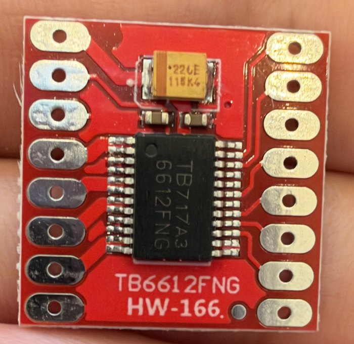
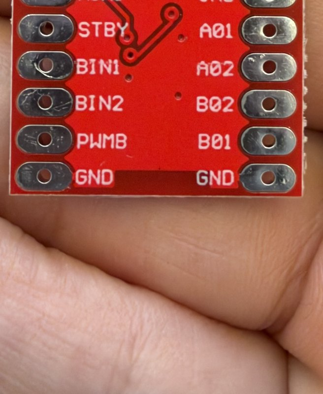

> Public copy for BeaconMind, 2026-10-29; the private course repo holds the unredacted original.

# TB6612FNG dual motor driver — pin map of my actual board

**Provenance.** Labels read from photos of my own board, front and back (`tb6612fng-front.jpg`,
`tb6612fng-back.jpg`, 2026-09-19). Pin functions and limits from the official **Toshiba TB6612FNG
datasheet** and Toshiba's TB6612FNG application note, checked 2026-09-19. Capacitor marking decoded
with the Kyocera-AVX TAJ series datasheet.

**My board.** Red 20 × 20 mm breakout, front silkscreen `TB6612FNG` / **`HW-166`**, chip marked
`TB717A3 6612FNG` (24-pin SSOP). Parts on it: the chip, one tantalum capacitor marked
`226E 115K4`, two small ceramic capacitors — nothing else (no resistors, no diode, no fuse).
Bought as a 4-pack, Amazon B0F43L7LLD; headers ship loose (2 × 8 pins per board).

> My board is **not identical to the Amazon listing photos**: those showed a `476C` capacitor and no
> `HW-166` text. Sellers ship revised boards silently — the labels on the board in hand win.

| Front (chip side) — **no pin labels** | Back — **all 16 labels** |
| --- | --- |
|  |  |

---

## 1. What this part is for

A Pico GPIO pin can supply a few milliamps at 3.3 V. Each motor needs hundreds of milliamps at
battery voltage (vendor figures: 0.1 A free-running, 0.5 A loaded, 0.82 A stalled). The TB6612FNG
sits between them: the Pico sends **small logic signals**, and the driver switches **battery power**
onto the motors accordingly. It contains **two H-bridges**, one per motor.

An *H-bridge* is four electronic switches around a motor, arranged so the battery can be connected
to the motor **either way round** — that is what makes reverse possible. Speed comes from **PWM**:
the power is switched on and off thousands of times per second, and the fraction of time it is on
sets the average power.

Software analogy: the Pico is the application, the TB6612FNG is the device driver for the motors —
the app issues small commands, the driver moves the real current.

---

## 2. The 16 pads

### As labelled on the BACK (the side with text)

```
          BACK VIEW
   PWMA ●            ● VM
   AIN2 ●            ● VCC
   AIN1 ●            ● GND
   STBY ●            ● AO1
   BIN1 ●            ● AO2
   BIN2 ●            ● BO2
   PWMB ●            ● BO1
    GND ●            ● GND
```
(The silkscreen prints the outputs with zeros — `A01 A02 B02 B01`. They are the datasheet's
AO1, AO2, BO2, BO1: **A**/**B** channel **O**utput 1/2.)

### As seen from the FRONT — this is the view on the breadboard ⚠

The board goes into the breadboard **chip side up**, so the labels face down and are hidden, and
left/right are **mirrored** relative to the back view. Orient by the **orange capacitor = top**:

```
          FRONT VIEW (chip up)
        ┌── capacitor end ──┐
     VM ●    [ 226E ]       ● PWMA
    VCC ●    ┌──────┐       ● AIN2
    GND ●    │ chip │       ● AIN1
    AO1 ●    │  ●=  │       ● STBY
    AO2 ●    │ pin1 │       ● BIN1
    BO2 ●    └──────┘       ● BIN2
    BO1 ●   TB6612FNG       ● PWMB
    GND ●    HW-166         ● GND
```

**How I know this mapping is right — two solid checks and one supporting one:**
1. The chip's pin-1 dot is at the capacitor end. Toshiba's pin table puts the outputs on chip pins
   1–12 (one side) in the order AO1, AO2, BO2, BO1, and the controls on pins 13–24 (other side) in
   the order PWMA, AIN2, AIN1, STBY, BIN1, BIN2, PWMB — exactly the two label orders on the back.
2. In my front photo the left-hand chip pins leave in **thick, paired** traces (high-current motor
   outputs) and the right-hand pins in **thin single** traces (logic signals).
3. *(Supporting — photo interpretation.)* The top-left pad's trace runs to the banded (+) end of the
   big capacitor, as a motor-supply pad would. The second pad's trace drops into a via, and the back
   photo shows a trace crossing the board — which `VCC` must do, because the chip's Vcc pin (20) is
   on the opposite side from the `VCC` pad.

**Confirm it yourself in ten seconds (each pad is one hole through the board, so this is purely
visual):** find `VM` on the back, put a fingertip on that corner, flip the board over — your finger
should be at the **capacitor end, on the side of the capacitor's dark band**. Then put a marker dot
on that corner of the front, because after soldering the labels are never visible again.

**Memory aid: capacitor end = `VM` and `PWMA`. Text end = the two `GND`s. Power side on the left.**

### What each pad does

| Pad | Kind | Purpose | Connect to |
| --- | --- | --- | --- |
| **VM** | power in | **Motor supply** — the power that actually drives the motors. Chip range 2.5–13.5 V (15 V absolute max); seller rates this module 4.5–10 V. | **Switched battery +** (raw, not through a regulator) |
| **VCC** | power in | **Logic supply** for the chip's control circuitry, 2.7–5.5 V (6 V absolute max). Draws under 2 mA. | **Pico pin 36 (3.3 V)** |
| **GND** ×3 | ground | Common reference for both supplies and all signals. All three are the same node. | Common ground (one is enough; more is fine) |
| **AO1, AO2** | power out | The two wires to **motor A**. | Motor A's two power wires (the outer two of its 6-wire cable) |
| **BO1, BO2** | power out | The two wires to **motor B**. | Motor B's two power wires |
| **PWMA** | logic in | **Speed** of motor A: PWM signal, up to 100 kHz. | a Pico PWM-capable GPIO |
| **AIN1, AIN2** | logic in | **Direction / mode** of motor A (table below). | two Pico GPIOs |
| **PWMB, BIN1, BIN2** | logic in | The same three, for motor B. | three Pico GPIOs — `PWMB` on a *different PWM channel* from `PWMA` |
| **STBY** | logic in | **Master enable.** LOW = standby, all outputs off. Has an internal 200 kΩ pull-down, so **unconnected = off**. This board has no pull-up. | a Pico GPIO that firmware drives **HIGH** |

Every logic input has an internal 200 kΩ pull-down: an unconnected input reads LOW.

### Control truth table (per motor, with `STBY` = HIGH)

| IN1 | IN2 | PWM | Motor |
| :---: | :---: | :---: | --- |
| H | L | H | turns one way ("CW") |
| L | H | H | turns the other way ("CCW") |
| H or L | the other | L | **short brake** — motor terminals shorted together, stops quickly |
| H | H | any | short brake |
| L | L | H | **stop / coast** — outputs disconnected, motor spins down freely |

During PWM the driver alternates between *drive* and *short brake*, not drive and coast.
"CW/CCW" are just names: which physical direction you get depends on which way round the motor's two
wires are connected — swapping AO1/AO2 reverses that motor.

---

## 3. Why `VCC` must be 3.3 V (not 5 V)

The chip decides what counts as a logic HIGH *relative to its own VCC*: HIGH must be at least
0.7 × VCC.

- VCC = 3.3 V → HIGH ≥ 2.31 V. The Pico guarantees ≥ 2.62 V. ✔ (0.31 V margin)
- VCC = 5 V → HIGH ≥ 3.5 V. A 3.3 V Pico pin can never reach that. ✘ Motors respond erratically or
  not at all.

Inputs must also never exceed VCC + 0.2 V — another reason to power VCC from the same 3.3 V that
powers the Pico's pins.

---

## 4. Limits and protections

| | |
| --- | --- |
| Output current | **1.0 A per channel** recommended (only while VM ≥ 4.5 V; below that 0.4 A and no PWM). 1.2 A absolute maximum average; 3.2 A for a single 10 ms pulse. |
| Motor vs driver | Stall 0.82 A < 1.0 A, so the current fits — but **both motors stalled can overheat the chip**. Do not hold the wheels. |
| Built in | Thermal shutdown (~175 °C), low-voltage detect, and **internal flyback diodes** (no external diodes needed). |
| **NOT** built in | **No over-current / short-circuit protection. No reverse-polarity protection.** A shorted output or a reversed battery destroys the chip. Toshiba: a part that has been reverse-connected even once must not be reused. |
| Power sequencing | Toshiba: bring up **VCC before VM**; remove VM before VCC; hold `STBY` low while powering up or down. In practice: power the Pico (USB) first, battery switch second. The internal pull-down keeps `STBY` low until firmware raises it. |
| ESD | MOS device, static-sensitive. Handle by the edges. |
| Capacitor on my board | `226E` = **22 µF, 25 V** by the AVX marking code (226 = 22 × 10⁶ pF; E = 25 V) — *if* this maker follows that code; the maker is unknown. Its band marks `+`. |

**The dangerous adjacency:** `VM` and `VCC` are neighbours at the capacitor end. Battery voltage on
`VCC` exceeds its limit with fresh cells — and because `VCC` shares the 3.3 V net with the Pico, IMU
and encoders, that one slip puts battery voltage on all of them.

**Erratum interaction (my Pico is A2 stepping):** the RP2350's weak internal pull-down can let an
undriven pin float near 2.2 V, which this chip may read as HIGH. The 200 kΩ pull-downs here are too
weak to overrule it. Firmware should actively drive `STBY`, `IN` and `PWM` lines LOW at start-up
rather than leave them as inputs. (Relevant when writing firmware, not when wiring.)

---

## 5. Physical / breadboard facts

- **Row spacing ≈ 0.6 inch.** Measured on my back photo: the two pad rows are 6.0 pin-pitches apart
  (the 2.54 mm pitch along the row gave the scale). So the board straddles the breadboard's centre
  gap, e.g. columns `d` and `h`. *Photo measurement — test-fit the loose headers before soldering.*
- Solder **chip side up, long pin ends down** into the breadboard, board resting on the header
  plastic. 16 joints. Afterwards check with the multimeter's continuity beep that **no two
  neighbouring pads are bridged** — especially `VM`–`VCC` and the four outputs.
- Only one board is needed; three are spares. Practise soldering on a spare first.
- Place it toward the **motor end** of the breadboard (row 30 on my car): the motor wires arrive
  there, and it keeps the high-current, electrically noisy wiring short and away from the IMU.
